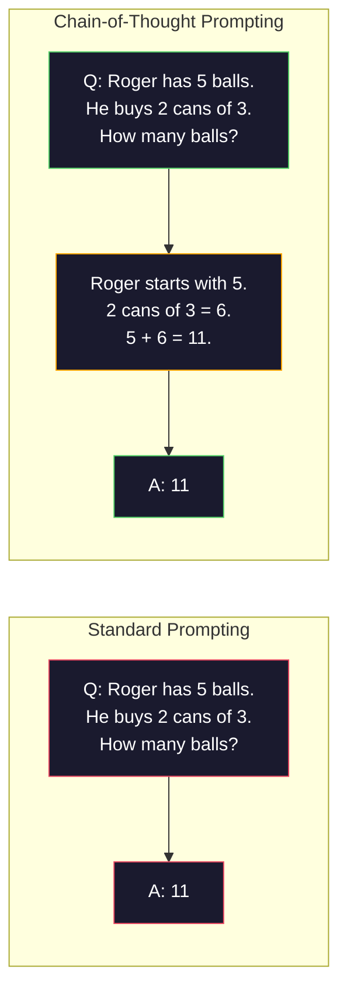
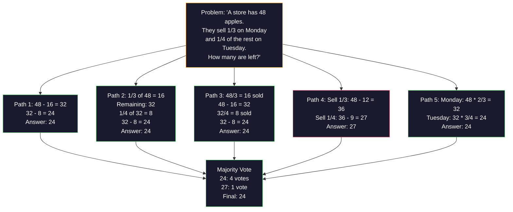
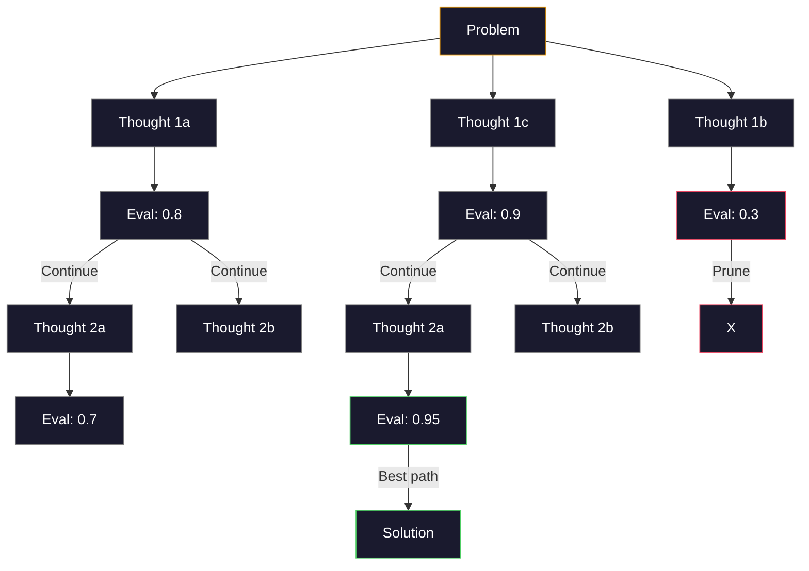

# Few-Shot、Chain-of-Thought、Tree-of-Thought

> 告訴模型該做什麼，叫做 prompting。示範給它看該怎麼思考，才叫 engineering。同一個模型、同一個任務、同樣的資料，準確度可以從 78% 提升到 91%，靠的不是更好的模型，而是更好的推理策略。

**Type:** Build
**Languages:** Python
**Prerequisites:** Lesson 11.01 (Prompt Engineering)
**Time:** ~45 分鐘

## 學習目標 (Learning Objectives)

- 透過挑選並格式化範例示範，實作 few-shot prompting，讓任務準確度最大化
- 運用 chain-of-thought (CoT) 推理，提升數學應用題這類多步驟問題的準確度
- 建立 tree-of-thought prompt，探索多條推理路徑並選出最好的一條
- 在標準 benchmark 上，量測 zero-shot、few-shot 與 CoT 的準確度提升

## 問題 (The Problem)

你做了一個數學家教 app。你的 prompt 寫著：「Solve this word problem.」GPT-5 在 GSM8K（標準的小學數學 benchmark）上答對率是 94%。你覺得已經到頂了。其實沒有，chain-of-thought 還能再加 3 到 4 個百分點。

加上五個字 -- "Let's think step by step" -- 準確度就跳到 91%。再加幾個解題範例，就能到 95%。同一個模型，同樣的 temperature，同樣的 API 成本。唯一的差別，是你給了模型一張草稿紙。

這不是 hack，推理本來就是這樣運作的。人類不會一步跳完多步驟問題，transformer 也不會。當你強迫模型產生中間的 token，這些 token 就會成為下一個 token 的 context 的一部分。每一步推理都餵給下一步。模型真的是一步一步「算」出答案。

但「think step by step」只是起點，不是終點。如果你取樣五條推理路徑，再用多數決決定答案呢？如果你讓模型探索一棵可能性的樹，並評估、修剪分支呢？如果你讓推理和工具使用交錯進行呢？這些都不是假設。它們是已發表、有實測改善的技術，而你會在這堂課把它們全部做出來。

## 核心概念 (The Concept)

### Zero-Shot 與 Few-Shot：範例何時勝過指令

Zero-shot prompting 只給模型一個任務，什麼都不附。Few-shot prompting 則先給它範例。

Wei et al. (2022) 在 8 個 benchmark 上量測過這件事。對於情感分類這類簡單任務，zero-shot 與 few-shot 的表現相差不到 2%。對於多步驟算術與符號推理這類複雜任務，few-shot 讓準確度提升了 10-25%。

直覺是：範例就是壓縮過的指令。與其描述輸出格式，不如直接示範。與其解釋推理過程，不如直接演示。模型對範例做 pattern matching，比解讀抽象的指令更可靠。


**Few-shot 勝出的情況：**對格式敏感的任務、分類、結構化擷取、特定領域的行話，以及任何模型需要對上特定模式的任務。

**Zero-shot 勝出的情況：**簡單的事實問題、範例會限制創意的創作任務，以及找到好範例比寫好指令更難的任務。

### 範例選擇：相似勝過隨機 (Example Selection)

不是所有範例都一樣好。在分類任務上，選擇與目標輸入相似的範例，比隨機選擇高出 5-15%（Liu et al., 2022）。三個原則：

1. **語意相似度**：挑選在 embedding 空間中最接近輸入的範例
2. **標籤多樣性**：讓範例涵蓋所有輸出類別
3. **難度匹配**：配合目標問題的複雜度

多數任務的最佳範例數是 3 到 5 個。少於 3 個，模型沒有足夠的訊號來抽出模式。多於 5 個，效益遞減，還會浪費 context window 的 token。如果分類的標籤很多，就每個標籤放一個範例。

### Chain-of-Thought：給模型一張草稿紙

Chain-of-Thought (CoT) prompting 是 Google Brain 的 Wei et al. (2022) 提出的。概念很簡單：不要只向模型要答案，而是請它先寫出推理步驟。



這為什麼有效？機制上，transformer 產生的每個 token，都會成為下一個 token 的 context。沒有 CoT 時，模型必須把所有推理壓縮進單次 forward pass 的 hidden state。有了 CoT，模型把中間計算外部化成 token。每個推理 token 都延伸了有效的運算深度。

**GSM8K benchmark（小學數學，8.5K 題）：**

| 模型 | Zero-Shot | Zero-Shot CoT | Few-Shot CoT |
|-------|-----------|---------------|--------------|
| GPT-4o | 78% | 91% | 95% |
| GPT-5 | 94% | 97% | 98% |
| o4-mini (reasoning) | 97% | — | — |
| Claude Opus 4.7 | 93% | 97% | 98% |
| Gemini 3 Pro | 92% | 96% | 98% |
| Llama 4 70B | 80% | 89% | 94% |
| DeepSeek-V3.1 | 89% | 94% | 96% |

**關於 reasoning 模型的說明：**OpenAI 的 o 系列（o3、o4-mini）與 DeepSeek-R1 這類模型，會在輸出答案之前，先在內部執行 chain-of-thought。對 reasoning 模型加上「Let's think step by step」是多餘的，有時甚至適得其反，因為它們早就做過了。

CoT 有兩種：

**Zero-shot CoT**：在 prompt 後面加上「Let's think step by step」。不需要範例。Kojima et al. (2022) 證明，這一句話就能提升算術、常識與符號推理任務的準確度。

**Few-shot CoT**：提供包含推理步驟的範例。它比 zero-shot CoT 更有效，因為模型看到的就是你期望的確切推理格式。

**CoT 反而有害的時候**：簡單的事實回憶（「法國的首都是哪裡？」）、單步驟分類，以及速度比準確度更重要的任務。CoT 每次查詢會多出 50-200 個 token 的推理負擔。對高吞吐、低複雜度的任務來說，這是白白浪費的成本。

### Self-Consistency：取樣多次，投票一次

Wang et al. (2023) 提出 self-consistency。洞察是：單一的 CoT 路徑可能含有推理錯誤。但如果你取樣 N 條獨立的推理路徑（使用 temperature > 0），再對最終答案做多數決，錯誤就會互相抵消。



在原本的 PaLM 540B 實驗中，self-consistency 在 N=40 時，把 GSM8K 準確度從 56.5%（單一 CoT）提升到 74.4%。在 GPT-5 上改善很小（97% 到 98%），因為基礎準確度已經飽和。這項技術在基礎 CoT 準確度為 60-85% 的模型上效果最好 -- 這個甜蜜點的單一路徑錯誤很常見，但不是系統性的。對 reasoning 模型（o 系列、R1）來說，self-consistency 已經被內建的內部取樣涵蓋了。

代價是：N 次取樣就代表 N 倍的 API 成本與延遲。實務上，N=5 就能拿到大部分好處。N=3 是讓投票有意義的最小值。對多數任務而言，N > 10 的效益會遞減。

### Tree-of-Thought：分支探索

Yao et al. (2023) 提出 Tree-of-Thought (ToT)。CoT 只走一條線性的推理路徑，ToT 則探索多個分支，並在繼續之前評估哪些最有希望。



ToT 有三個組成部分：

1. **想法生成 (Thought generation)**：產生多個候選的下一步
2. **狀態評估 (State evaluation)**：為每個候選評分（可以用 LLM 本身當評估者）
3. **搜尋演算法 (Search algorithm)**：用 BFS 或 DFS 走訪這棵樹，並修剪低分的分支

在 Game of 24 任務（用算術把 4 個數字組合成 24）上，使用標準 prompting 的 GPT-4 能解開 7.3% 的題目。用 CoT 是 4.0%（CoT 在這裡反而有害，因為搜尋空間很廣）。用 ToT 則是 74%。

ToT 很貴。樹上的每個節點都需要一次 LLM 呼叫。分支因子為 3、深度為 3 的樹，最多需要 39 次 LLM 呼叫。只有在搜尋空間很大、但可以被評估的問題上才用它 -- 例如規劃、解謎，以及有限制條件的創意問題解決。

### ReAct：思考加行動 (Thinking + Doing)

Yao et al. (2022) 把推理軌跡與行動結合起來。模型在思考（產生推理）與行動（呼叫工具、搜尋、運算）之間交替進行。

```mermaid
graph LR
    Q["Question:\nWhat is the\npopulation of the\ncountry where\nthe Eiffel Tower\nis located?"]
    T1["Thought: I need to\nfind which country\nhas the Eiffel Tower"]
    A1["Action: search\n'Eiffel Tower location'"]
    O1["Observation:\nParis, France"]
    T2["Thought: Now I need\nFrance's population"]
    A2["Action: search\n'France population 2024'"]
    O2["Observation:\n68.4 million"]
    T3["Thought: I have\nthe answer"]
    F["Answer:\n68.4 million"]

    Q --> T1 --> A1 --> O1 --> T2 --> A2 --> O2 --> T3 --> F

    style Q fill:#1a1a2e,stroke:#ffa500,color:#fff
    style T1 fill:#1a1a2e,stroke:#51cf66,color:#fff
    style A1 fill:#1a1a2e,stroke:#e94560,color:#fff
    style O1 fill:#1a1a2e,stroke:#808080,color:#fff
    style T2 fill:#1a1a2e,stroke:#51cf66,color:#fff
    style A2 fill:#1a1a2e,stroke:#e94560,color:#fff
    style O2 fill:#1a1a2e,stroke:#808080,color:#fff
    style T3 fill:#1a1a2e,stroke:#51cf66,color:#fff
    style F fill:#1a1a2e,stroke:#51cf66,color:#fff
```



在知識密集型任務上，ReAct 的表現勝過純 CoT，因為它能讓推理建立在真實資料上。在 HotpotQA（多跳問答）上，搭配 GPT-4 的 ReAct 達到 35.1% 的 exact match，單用 CoT 則是 29.4%。真正的威力在於，推理錯誤會被觀察結果修正 -- 模型可以在執行途中更新自己的計畫。

ReAct 是現代 AI agent 的基礎。每個 agent 框架（LangChain、CrewAI、AutoGen）都實作了某種版本的 Thought-Action-Observation 迴圈。你會在 Phase 14 建出完整的 agent。這堂課講的是 prompting 的模式。

### 結構化 Prompting：XML 標籤、分隔符號、標題

當 prompt 變複雜時，結構能避免模型搞混各個段落。有三種做法：

**XML 標籤**（對 Claude 效果最好，各處都穩定可用）：
```
<context>
You are reviewing a pull request.
The codebase uses TypeScript and React.
</context>

<task>
Review the following diff for bugs, security issues, and style violations.
</task>

<diff>
{diff_content}
</diff>

<output_format>
List each issue with: file, line, severity (critical/warning/info), description.
</output_format>
```

**Markdown 標題**（通用）：
```
## Role
Senior security engineer at a fintech company.

## Task
Analyze this API endpoint for vulnerabilities.

## Input
{api_code}

## Rules
- Focus on OWASP Top 10
- Rate each finding: critical, high, medium, low
- Include remediation steps
```

**分隔符號**（極簡但有效）：
```
---INPUT---
{user_text}
---END INPUT---

---INSTRUCTIONS---
Summarize the above in 3 bullet points.
---END INSTRUCTIONS---
```

### Prompt Chaining：依序拆解

有些任務對單一 prompt 來說太複雜。Prompt chaining 把它們拆成多個步驟，前一個 prompt 的輸出成為下一個的輸入。


Chaining 勝過單一 prompt 有三個原因：

1. **每一步更簡單**：模型處理的是單一聚焦的任務，而不是同時兼顧所有事情
2. **中間輸出可檢視**：你可以在步驟之間驗證並修正
3. **不同步驟可以用不同模型**：擷取用便宜的模型，推理用昂貴的模型

### 效能比較 (Performance Comparison)

| 技術 | 最適合 | GSM8K 準確度 (GPT-5) | API 呼叫次數 | Token 額外負擔 | 複雜度 |
|-----------|----------|------------------------|-----------|----------------|------------|
| Zero-Shot | 簡單任務 | 94% | 1 | 無 | 極低 |
| Few-Shot | 格式匹配 | 96% | 1 | 200-500 tokens | 低 |
| Zero-Shot CoT | 快速提升推理 | 97% | 1 | 50-200 tokens | 極低 |
| Few-Shot CoT | 單次呼叫的最高準確度 | 98% | 1 | 300-600 tokens | 低 |
| Self-Consistency (N=5) | 高風險推理 | 98.5% | 5 | 5 倍 token 成本 | 中 |
| Reasoning 模型 (o4-mini) | 直接取代 CoT | 97% | 1 | 隱藏（內部 2-10 倍） | 極低 |
| Tree-of-Thought | 搜尋/規劃問題 | N/A（Game of 24 為 74%） | 10-40+ | 10-40 倍 token 成本 | 高 |
| ReAct | 以知識為基礎的推理 | N/A（HotpotQA 為 35.1%） | 3-10+ | 不固定 | 高 |
| Prompt Chaining | 複雜的多步驟任務 | 96%（pipeline） | 2-5 | 2-5 倍 token 成本 | 中 |

該選哪種技術，取決於三個因素：準確度要求、延遲預算與成本容忍度。對多數 production 系統來說，用 few-shot CoT 搭配 3 次取樣的 self-consistency 作為後備，就能涵蓋 90% 的使用情境。

```figure
few-shot-curve
```

## 動手做 (Build It)

我們要做一個數學題目求解器，把 few-shot prompting、chain-of-thought 推理與 self-consistency 投票結合成單一 pipeline。然後再為困難的題目加上 tree-of-thought。

完整實作在 `code/advanced_prompting.py`。以下是關鍵元件。

### 步驟 1：Few-Shot 範例庫

第一個元件負責管理 few-shot 範例，並為給定的題目挑出最相關的範例。

```python
GSM8K_EXAMPLES = [
    {
        "question": "Janet's ducks lay 16 eggs per day. She eats three for breakfast every morning and bakes muffins for her friends every day with four. She sells every egg at the farmers' market for $2. How much does she make every day at the farmers' market?",
        "reasoning": "Janet's ducks lay 16 eggs per day. She eats 3 and bakes 4, using 3 + 4 = 7 eggs. So she has 16 - 7 = 9 eggs left. She sells each for $2, so she makes 9 * 2 = $18 per day.",
        "answer": "18"
    },
    ...
]
```

每個範例有三個部分：問題、推理鏈與最終答案。推理鏈就是讓一般 few-shot 範例變成 CoT few-shot 範例的關鍵。

### 步驟 2：Chain-of-Thought Prompt Builder

Prompt builder 會把 system message、帶有推理鏈的 few-shot 範例，以及目標問題，組裝成單一 prompt。

```python
def build_cot_prompt(question, examples, num_examples=3):
    system = (
        "You are a math problem solver. "
        "For each problem, show your step-by-step reasoning, "
        "then give the final numerical answer on the last line "
        "in the format: 'The answer is [number]'."
    )

    example_text = ""
    for ex in examples[:num_examples]:
        example_text += f"Q: {ex['question']}\n"
        example_text += f"A: {ex['reasoning']} The answer is {ex['answer']}.\n\n"

    user = f"{example_text}Q: {question}\nA:"
    return system, user
```

格式限制（「The answer is [number]」）非常重要。沒有它，self-consistency 就無法從各個樣本中擷取並比較答案。

### 步驟 3：Self-Consistency 投票

取樣 N 條推理路徑，並採用多數的答案。

```python
def self_consistency_solve(question, examples, client, model, n_samples=5):
    system, user = build_cot_prompt(question, examples)

    answers = []
    reasonings = []
    for _ in range(n_samples):
        response = client.chat.completions.create(
            model=model,
            messages=[
                {"role": "system", "content": system},
                {"role": "user", "content": user}
            ],
            temperature=0.7
        )
        text = response.choices[0].message.content
        reasonings.append(text)
        answer = extract_answer(text)
        if answer is not None:
            answers.append(answer)

    vote_counts = Counter(answers)
    best_answer = vote_counts.most_common(1)[0][0] if vote_counts else None
    confidence = vote_counts[best_answer] / len(answers) if best_answer else 0

    return best_answer, confidence, reasonings, vote_counts
```

Temperature 0.7 很重要。在 temperature 0.0 時，N 個樣本會完全一樣，失去意義。你需要足夠的隨機性來產生多樣的推理路徑，但又不能多到讓模型胡言亂語。

### 步驟 4：Tree-of-Thought 求解器

對於線性推理行不通的問題，ToT 會探索多種做法，並評估哪個方向最有希望。

```python
def tree_of_thought_solve(question, client, model, breadth=3, depth=3):
    thoughts = generate_initial_thoughts(question, client, model, breadth)
    scored = [(t, evaluate_thought(t, question, client, model)) for t in thoughts]
    scored.sort(key=lambda x: x[1], reverse=True)

    for current_depth in range(1, depth):
        next_thoughts = []
        for thought, score in scored[:2]:
            extensions = extend_thought(thought, question, client, model, breadth)
            for ext in extensions:
                ext_score = evaluate_thought(ext, question, client, model)
                next_thoughts.append((ext, ext_score))
        scored = sorted(next_thoughts, key=lambda x: x[1], reverse=True)

    best_thought = scored[0][0] if scored else ""
    return extract_answer(best_thought), best_thought
```

評估器本身就是一次 LLM 呼叫。你問模型：「On a scale of 0.0 to 1.0, how promising is this reasoning path for solving the problem?」這是 ToT 的關鍵洞察 -- 讓模型評估自己的部分解答。

### 步驟 5：完整 Pipeline

這個 pipeline 把所有技術結合起來，並加上升級策略 (escalation strategy)。

```python
def solve_with_escalation(question, examples, client, model):
    single_answer, _ = few_shot_cot_solve(question, examples, client, model)

    sc_answer, confidence, _, _ = self_consistency_solve(
        question, examples, client, model, n_samples=5
    )

    if confidence >= 0.8 and single_answer == sc_answer:
        return sc_answer, "self_consistency", confidence

    tot_answer, _ = tree_of_thought_solve(question, client, model)
    return tot_answer, "tree_of_thought", None
```

升級邏輯是：先試便宜的（單一 CoT）。單一的確定性路徑沒有得票比例，所以它的品質檢查靠的是一致性：temperature 為 0 時的答案，必須與取樣路徑的多數答案相符。如果不相符，或是 self-consistency 的信心低於 0.8（5 個樣本中同意的少於 4 個），就升級到 ToT。這在成本與準確度之間取得平衡 -- 大多數問題用低成本解決，困難的問題才投入更多運算。

## 實際使用 (Use It)

### 以 Template 驅動的 Few-Shot Prompt

LangChain 內建支援 prompt template 與輸出解析，可以簡化 few-shot 與 CoT 模式：

```python
from langchain_core.prompts import FewShotPromptTemplate, PromptTemplate
from langchain_openai import ChatOpenAI

example_prompt = PromptTemplate(
    input_variables=["question", "reasoning", "answer"],
    template="Q: {question}\nA: {reasoning} The answer is {answer}."
)

few_shot_prompt = FewShotPromptTemplate(
    examples=examples,
    example_prompt=example_prompt,
    suffix="Q: {input}\nA: Let's think step by step.",
    input_variables=["input"]
)

llm = ChatOpenAI(model="gpt-4o", temperature=0.7)
chain = few_shot_prompt | llm
result = chain.invoke({"input": "If a train travels 120 km in 2 hours..."})
```

LangChain 也有 `ExampleSelector` 類別，可以做語意相似度的選擇：

```python
from langchain_core.example_selectors import SemanticSimilarityExampleSelector
from langchain_openai import OpenAIEmbeddings

selector = SemanticSimilarityExampleSelector.from_examples(
    examples,
    OpenAIEmbeddings(),
    k=3
)
```

### 編譯式 Prompt (Compiled Prompts)

DSPy 把 prompting 策略視為可優化的模組。你不用手工打造 CoT prompt，只要定義 signature，讓 DSPy 去優化 prompt：

```python
import dspy

dspy.configure(lm=dspy.LM("openai/gpt-4o", temperature=0.7))

class MathSolver(dspy.Module):
    def __init__(self):
        self.solve = dspy.ChainOfThought("question -> answer")

    def forward(self, question):
        return self.solve(question=question)

solver = MathSolver()
result = solver(question="Janet's ducks lay 16 eggs per day...")
```

DSPy 的 `ChainOfThought` 會自動加入推理軌跡。`dspy.majority` 則實作了 self-consistency：

```python
result = dspy.majority(
    [solver(question=q) for _ in range(5)],
    field="answer"
)
```

### 比較：從零實作 vs 框架

| 功能 | 從零實作（本課） | LangChain | DSPy |
|---------|--------------------------|-----------|------|
| 對 prompt 格式的控制 | 完全控制 | 以 template 為主 | 自動 |
| Self-consistency | 手動投票 | 手動 | 內建（`dspy.majority`） |
| 範例選擇 | 自訂邏輯 | `ExampleSelector` | `dspy.BootstrapFewShot` |
| Tree-of-Thought | 自訂樹搜尋 | 社群 chain | 未內建 |
| Prompt 優化 | 手動迭代 | 手動 | 自動編譯 |
| 最適合 | 學習、自訂 pipeline | 標準工作流程 | 研究、優化 |

## 交付 (Ship It)

這堂課會產出兩個成品。

**1. Reasoning Chain Prompt** (`outputs/prompt-reasoning-chain.md`)：一個可用於 production 的 prompt template，適用於搭配 self-consistency 的 few-shot CoT。放進你自己的範例與問題領域即可使用。

**2. CoT Pattern Selection Skill** (`outputs/skill-cot-patterns.md`)：一個決策框架，依據任務類型、準確度要求與成本限制，選出合適的推理技術。

## 練習 (Exercises)

1. **量測差距**：拿 10 題 GSM8K 的題目。分別用 zero-shot、few-shot、zero-shot CoT 與 few-shot CoT 解題。記錄每種方法的準確度。在你的模型上，哪個技術帶來的提升最大？

2. **範例選擇實驗**：對同樣的 10 題，比較隨機選擇範例與手動挑選相似範例的差異。量測準確度差距。範例品質在什麼時候比範例數量更重要？

3. **Self-consistency 成本曲線**：在 20 題 GSM8K 上，分別以 N=1, 3, 5, 7, 10 執行 self-consistency。畫出準確度對成本（總 token 數）的圖。對你的模型來說，曲線的轉折點在哪裡？

4. **建立 ReAct 迴圈**：為 pipeline 加上計算機工具。當模型產生數學運算式時，用 Python 的 `eval()`（在沙盒中）執行，並把結果回饋給模型。量測以工具為基礎的推理是否勝過純 CoT。

5. **把 ToT 用在創意任務**：調整 Tree-of-Thought 求解器，用於創意寫作任務：「Write a 6-word story that is both funny and sad.」用 LLM 當評估者。分支探索產生的創意輸出，是否比單次生成更好？

## 關鍵術語 (Key Terms)

| 術語 | 一般說法 | 實際意義 |
|------|----------------|----------------------|
| Few-shot prompting | 「給它幾個範例」 | 在 prompt 中放入輸入輸出的示範，用來錨定模型的輸出格式與行為 |
| Chain-of-Thought | 「讓它一步一步想」 | 引導模型產生中間的推理 token，在給出最終答案之前延伸模型的有效運算量 |
| Self-Consistency | 「多跑幾次」 | 在 temperature > 0 時取樣 N 條多樣的推理路徑，並以多數決選出最常見的最終答案 |
| Tree-of-Thought | 「讓它探索各種選項」 | 對推理分支做結構化搜尋，評估每個部分解答，只展開有希望的路徑 |
| ReAct | 「思考加工具使用」 | 在 Thought-Action-Observation 迴圈中，讓推理軌跡與外部行動（搜尋、運算、API 呼叫）交錯進行 |
| Prompt chaining | 「拆成步驟」 | 把複雜任務拆成依序執行的 prompt，每個輸出都餵給下一個輸入 |
| Zero-shot CoT | 「加一句『think step by step』就好」 | 不給任何範例，只在 prompt 後面加上觸發推理的句子，仰賴模型潛在的推理能力 |

## 延伸閱讀 (Further Reading)

- [Chain-of-Thought Prompting Elicits Reasoning in Large Language Models](https://arxiv.org/abs/2201.11903) -- Wei et al. 2022。Google Brain 的原始 CoT 論文。核心結果請讀第 2 到 3 節。
- [Self-Consistency Improves Chain of Thought Reasoning in Language Models](https://arxiv.org/abs/2203.11171) -- Wang et al. 2023。Self-consistency 論文。Table 1 有你需要的所有數字。
- [Tree of Thoughts: Deliberate Problem Solving with Large Language Models](https://arxiv.org/abs/2305.10601) -- Yao et al. 2023。ToT 論文。第 4 節的 Game of 24 結果是亮點。
- [ReAct: Synergizing Reasoning and Acting in Language Models](https://arxiv.org/abs/2210.03629) -- Yao et al. 2022。現代 AI agent 的基礎。第 3 節說明 Thought-Action-Observation 迴圈。
- [Large Language Models are Zero-Shot Reasoners](https://arxiv.org/abs/2205.11916) -- Kojima et al. 2022。「Let's think step by step」那篇論文。以它的簡單程度來說，效果好得出人意料。
- [DSPy: Compiling Declarative Language Model Calls into Self-Improving Pipelines](https://arxiv.org/abs/2310.03714) -- Khattab et al. 2023。把 prompting 視為編譯問題。如果你想超越手動 prompt engineering，請讀這篇。
- [OpenAI — Reasoning models guide](https://platform.openai.com/docs/guides/reasoning) -- 供應商的指引，說明 chain-of-thought 何時會變成內部、按 token 計價的「reasoning」模式，而不是 prompt 層級的技巧。
- [Lightman et al., "Let's Verify Step by Step" (2023)](https://arxiv.org/abs/2305.20050) -- process reward models (PRM)，為推理鏈的每一步評分；這種推理監督訊號取代了只看結果的獎勵。
- [Snell et al., "Scaling LLM Test-Time Compute Optimally" (2024)](https://arxiv.org/abs/2408.03314) -- 系統性研究 CoT 長度、self-consistency 取樣與 MCTS；當準確度比延遲更重要時，「think step by step」會走向哪裡。
