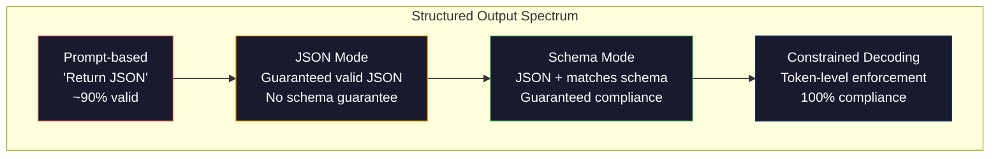
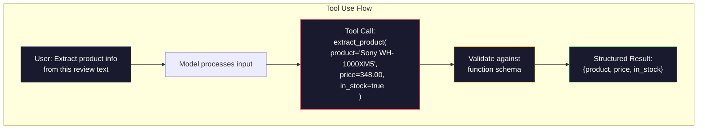

# Structured Outputs：JSON、Schema 驗證、Constrained Decoding

> 你的 LLM 回傳的是字串，你的應用程式需要的是 JSON。這道落差讓 production 系統當機的次數，比任何 hallucination 都多。Structured output 是自然語言與具型別資料之間的橋樑。做對了，你的 LLM 就是可靠的 API；做錯了，你會在凌晨 3 點用 regex 解析自由文字。

**Type:** Build
**Languages:** Python
**Prerequisites:** Phase 10, Lessons 01-05 (LLMs from Scratch)
**Time:** ~90 分鐘
**Related:** Phase 5 · 20 (Structured Outputs & Constrained Decoding) 涵蓋 decoder 層級的理論（FSM/CFG logit processor、Outlines、XGrammar）。這堂課聚焦在 production 的 SDK 介面（OpenAI `response_format`、Anthropic tool use、Instructor）。如果你想了解 API 底層發生了什麼，請先讀 Phase 5 · 20。

## 學習目標 (Learning Objectives)

- 使用 OpenAI 與 Anthropic 的 API 參數，實作 JSON mode 與 schema 限制的輸出
- 建立 Pydantic 驗證層，拒絕格式錯誤的 LLM 輸出，並附上錯誤回饋後重試
- 說明 constrained decoding 如何在 token 層級強制產生有效的 JSON，不需要後處理
- 設計穩健的擷取 prompt，可靠地把非結構化文字轉成具型別的資料結構

## 問題 (The Problem)

你問 LLM：「Extract the product name, price, and availability from this text.」它回答：

```
The product is the Sony WH-1000XM5 headphones, which cost $348.00 and are currently in stock.
```

這個答案完全正確，但對你的應用程式完全沒用。你的庫存系統需要 `{"product": "Sony WH-1000XM5", "price": 348.00, "in_stock": true}`。你需要的是一個 JSON 物件，有特定的 key、特定的型別，以及特定的值限制。你不需要一個句子。

天真的解法是：在 prompt 裡加上「Respond in JSON」。這在 90% 的情況下有效。另外 10% 的情況，模型會把 JSON 包在 markdown code fence 裡、加上「Here's the JSON:」之類的開場白，或是太早關閉括號，產生語法無效的 JSON。你的 JSON parser 當掉，pipeline 壞掉。你加上 try/except 和重試迴圈。重試有時會產生不同的資料。現在你除了解析問題，還多了一致性問題。

這不是 prompt engineering 的問題，而是 decoding 的問題。模型由左到右逐一產生 token。在每個位置，它從 100K 以上的詞彙表中挑出最可能的下一個 token。在任何一個位置，這些選項大多會產生無效的 JSON。如果模型剛輸出 `{"price":`，下一個 token 必須是數字、引號（字串）、`null`、`true`、`false` 或負號。其他任何東西都會產生無效的 JSON。沒有限制時，模型可能挑到一個完全合理的英文單字，但在語法上是災難性的錯誤。

## 核心概念 (The Concept)

### Structured Output 的光譜 (The Structured Output Spectrum)

Structured output 的控制有四個層級，每一級都比前一級更可靠。



**以 prompt 為基礎**（「Respond in valid JSON」）：沒有強制力。模型通常會遵守，但有時不會。可靠度：約 90%。失敗模式：markdown fence、開場白、輸出被截斷、結構錯誤。

**JSON mode**：API 保證輸出是有效的 JSON。OpenAI 的 `response_format: { type: "json_object" }` 可以啟用。輸出能夠無誤地被解析，但可能不符合你預期的 schema -- 多餘的 key、錯誤的型別、缺少的欄位。

**Schema mode**：API 接收 JSON Schema，並保證輸出符合它。2026 年，每個主流供應商都原生支援：OpenAI 的 `response_format: { type: "json_schema", json_schema: {...} }`（也可用 `tool_choice="required"`）、Anthropic 搭配 `input_schema` 的 tool use，以及 Gemini 的 `response_schema` + `response_mime_type: "application/json"`。輸出會有你指定的確切 key、型別與限制。

**Constrained decoding**：在生成過程的每個 token 位置，decoder 會遮掉所有會產生無效輸出的 token。如果 schema 要求數字，而模型正要輸出字母，那個 token 的機率會被設為零。模型只能產生通往有效輸出的 token。OpenAI 的 structured output 模式，以及 Outlines、Guidance 這類函式庫，底層實作的就是這個。

### JSON Schema：契約語言 (The Contract Language)

JSON Schema 是你告訴模型（或驗證層）輸出必須長什麼樣子的方式。每個主流的 structured output 系統都使用它。

```json
{
  "type": "object",
  "properties": {
    "product": { "type": "string" },
    "price": { "type": "number", "minimum": 0 },
    "in_stock": { "type": "boolean" },
    "categories": {
      "type": "array",
      "items": { "type": "string" }
    }
  },
  "required": ["product", "price", "in_stock"]
}
```

這個 schema 的意思是：輸出必須是一個物件，包含字串 `product`、非負數 `price`、布林值 `in_stock`，以及選用的字串陣列 `categories`。任何不符的輸出都會被拒絕。

Schema 能處理困難的情況：巢狀物件、帶型別項目的陣列、enum（把字串限制在特定的值）、模式比對（對字串用 regex），以及組合子（用 oneOf、anyOf、allOf 處理多型輸出）。

### Pydantic 模式 (The Pydantic Pattern)

在 Python 裡，你不會手寫 JSON Schema。你定義一個 Pydantic model，它會幫你產生 schema。

```python
from pydantic import BaseModel

class Product(BaseModel):
    product: str
    price: float
    in_stock: bool
    categories: list[str] = []
```

這會產生和上面相同的 JSON Schema。Instructor 函式庫（以及 OpenAI 的 SDK）可以直接接受 Pydantic model：傳入 model class，拿回一個經過驗證的實例。如果 LLM 輸出不符，Instructor 會自動重試。

### Function Calling / Tool Use

這是同一個問題的另一種介面。你不用請模型直接產生 JSON，而是定義帶有具型別參數的「tool」（函式）。模型輸出一個帶有結構化引數的函式呼叫。OpenAI 稱之為「function calling」，Anthropic 稱之為「tool use」。結果都一樣：結構化資料。



當模型需要選擇要呼叫哪個函式，而不只是填入參數時，建議使用 tool use。如果你有 10 種不同的擷取 schema，模型必須依據輸入選出正確的那一個，tool use 同時幫你完成 schema 的選擇與結構化輸出。

### 常見的失敗模式 (Common Failure Modes)

即使強制套用 schema，structured output 仍可能以微妙的方式失敗。

**Hallucinated values（捏造的值）**：輸出符合 schema，但內容是編出來的資料。文字寫的是 $348，模型卻產生 `{"price": 299.99}`。Schema 驗證抓不到這種錯誤 -- 型別正確，但值是錯的。

**Enum 混淆**：你把欄位限制在 `["in_stock", "out_of_stock", "preorder"]`。模型輸出 `"available"` -- 語意上正確，但不在允許的集合內。好的 constrained decoding 能防止這種情況，以 prompt 為基礎的做法則不行。

**巢狀物件深度**：很深的巢狀 schema（4 層以上）會產生更多錯誤。每多一層巢狀，就多一個讓模型搞丟結構的地方。

**陣列長度**：模型可能在陣列中產生太多或太少的項目。Schema 支援 `minItems` 與 `maxItems`，但並非所有供應商都在 decoding 層級強制執行。

**省略選用欄位**：模型省略了技術上是選用、但對你的使用情境在語意上很重要的欄位。即使資料有時會缺少，也請在 schema 中把它們設為 required -- 強迫模型明確產生 `null`。

```figure
mx-schema-funnel
```

## 動手做 (Build It)

### 步驟 1：JSON Schema 驗證器

從零建立一個驗證器，檢查 Python 物件是否符合 JSON Schema。這就是在輸出端執行、用來確認合規性的東西。

```python
import json

def validate_schema(data, schema):
    errors = []
    _validate(data, schema, "", errors)
    return errors

def _validate(data, schema, path, errors):
    schema_type = schema.get("type")

    if schema_type == "object":
        if not isinstance(data, dict):
            errors.append(f"{path}: expected object, got {type(data).__name__}")
            return
        for key in schema.get("required", []):
            if key not in data:
                errors.append(f"{path}.{key}: required field missing")
        properties = schema.get("properties", {})
        for key, value in data.items():
            if key in properties:
                _validate(value, properties[key], f"{path}.{key}", errors)

    elif schema_type == "array":
        if not isinstance(data, list):
            errors.append(f"{path}: expected array, got {type(data).__name__}")
            return
        min_items = schema.get("minItems", 0)
        max_items = schema.get("maxItems", float("inf"))
        if len(data) < min_items:
            errors.append(f"{path}: array has {len(data)} items, minimum is {min_items}")
        if len(data) > max_items:
            errors.append(f"{path}: array has {len(data)} items, maximum is {max_items}")
        items_schema = schema.get("items", {})
        for i, item in enumerate(data):
            _validate(item, items_schema, f"{path}[{i}]", errors)

    elif schema_type == "string":
        if not isinstance(data, str):
            errors.append(f"{path}: expected string, got {type(data).__name__}")
            return
        enum_values = schema.get("enum")
        if enum_values and data not in enum_values:
            errors.append(f"{path}: '{data}' not in allowed values {enum_values}")

    elif schema_type == "number":
        if not isinstance(data, (int, float)):
            errors.append(f"{path}: expected number, got {type(data).__name__}")
            return
        minimum = schema.get("minimum")
        maximum = schema.get("maximum")
        if minimum is not None and data < minimum:
            errors.append(f"{path}: {data} is less than minimum {minimum}")
        if maximum is not None and data > maximum:
            errors.append(f"{path}: {data} is greater than maximum {maximum}")

    elif schema_type == "boolean":
        if not isinstance(data, bool):
            errors.append(f"{path}: expected boolean, got {type(data).__name__}")

    elif schema_type == "integer":
        if not isinstance(data, int) or isinstance(data, bool):
            errors.append(f"{path}: expected integer, got {type(data).__name__}")
```

### 步驟 2：Pydantic 風格的 Model 轉 Schema

建立一個極簡的 class 轉 schema 轉換器。定義一個 Python class，就能自動產生它的 JSON Schema。

```python
class SchemaField:
    def __init__(self, field_type, required=True, default=None, enum=None, minimum=None, maximum=None):
        self.field_type = field_type
        self.required = required
        self.default = default
        self.enum = enum
        self.minimum = minimum
        self.maximum = maximum

def python_type_to_schema(field):
    type_map = {
        str: "string",
        int: "integer",
        float: "number",
        bool: "boolean",
    }

    schema = {}

    if field.field_type in type_map:
        schema["type"] = type_map[field.field_type]
    elif field.field_type == list:
        schema["type"] = "array"
        schema["items"] = {"type": "string"}
    elif isinstance(field.field_type, dict):
        schema = field.field_type

    if field.enum:
        schema["enum"] = field.enum
    if field.minimum is not None:
        schema["minimum"] = field.minimum
    if field.maximum is not None:
        schema["maximum"] = field.maximum

    return schema

def model_to_schema(name, fields):
    properties = {}
    required = []

    for field_name, field in fields.items():
        properties[field_name] = python_type_to_schema(field)
        if field.required:
            required.append(field_name)

    return {
        "type": "object",
        "properties": properties,
        "required": required,
    }
```

### 步驟 3：Constrained Token 過濾器

模擬 constrained decoding。給定一段不完整的 JSON 字串與一個 schema，判斷在目前位置哪些 token 類別是有效的。

```python
def next_valid_tokens(partial_json, schema):
    stripped = partial_json.strip()

    if not stripped:
        return ["{"]

    try:
        json.loads(stripped)
        return ["<EOS>"]
    except json.JSONDecodeError:
        pass

    last_char = stripped[-1] if stripped else ""

    if last_char == "{":
        return ['"', "}"]
    elif last_char == '"':
        if stripped.endswith('":'):
            return ['"', "0-9", "true", "false", "null", "[", "{"]
        return ["a-z", '"']
    elif last_char == ":":
        return [" ", '"', "0-9", "true", "false", "null", "[", "{"]
    elif last_char == ",":
        return [" ", '"', "{", "["]
    elif last_char in "0123456789":
        return ["0-9", ".", ",", "}", "]"]
    elif last_char == "}":
        return [",", "}", "]", "<EOS>"]
    elif last_char == "]":
        return [",", "}", "<EOS>"]
    elif last_char == "[":
        return ['"', "0-9", "true", "false", "null", "{", "[", "]"]
    else:
        return ["any"]

def demonstrate_constrained_decoding():
    partial_states = [
        '',
        '{',
        '{"product"',
        '{"product":',
        '{"product": "Sony"',
        '{"product": "Sony",',
        '{"product": "Sony", "price":',
        '{"product": "Sony", "price": 348',
        '{"product": "Sony", "price": 348}',
    ]

    print(f"{'Partial JSON':<45} {'Valid Next Tokens'}")
    print("-" * 80)
    for state in partial_states:
        valid = next_valid_tokens(state, {})
        display = state if state else "(empty)"
        print(f"{display:<45} {valid}")
```

### 步驟 4：擷取 Pipeline

把所有東西組合成擷取 pipeline：定義 schema、模擬 LLM 產生結構化輸出、驗證輸出，並處理重試。

```python
def simulate_llm_extraction(text, schema, attempt=0):
    if "headphones" in text.lower() or "sony" in text.lower():
        if attempt == 0:
            return '{"product": "Sony WH-1000XM5", "price": 348.00, "in_stock": true, "categories": ["audio", "headphones"]}'
        return '{"product": "Sony WH-1000XM5", "price": 348.00, "in_stock": true}'

    if "laptop" in text.lower():
        return '{"product": "MacBook Pro 16", "price": 2499.00, "in_stock": false, "categories": ["computers"]}'

    return '{"product": "Unknown", "price": 0, "in_stock": false}'

def extract_with_retry(text, schema, max_retries=3):
    for attempt in range(max_retries):
        raw = simulate_llm_extraction(text, schema, attempt)

        try:
            data = json.loads(raw)
        except json.JSONDecodeError as e:
            print(f"  Attempt {attempt + 1}: JSON parse error -- {e}")
            continue

        errors = validate_schema(data, schema)
        if not errors:
            return data

        print(f"  Attempt {attempt + 1}: Schema validation errors -- {errors}")

    return None

product_schema = {
    "type": "object",
    "properties": {
        "product": {"type": "string"},
        "price": {"type": "number", "minimum": 0},
        "in_stock": {"type": "boolean"},
        "categories": {"type": "array", "items": {"type": "string"}},
    },
    "required": ["product", "price", "in_stock"],
}
```

### 步驟 5：執行完整 Pipeline

```python
def run_demo():
    print("=" * 60)
    print("  Structured Output Pipeline Demo")
    print("=" * 60)

    print("\n--- Schema Definition ---")
    product_fields = {
        "product": SchemaField(str),
        "price": SchemaField(float, minimum=0),
        "in_stock": SchemaField(bool),
        "categories": SchemaField(list, required=False),
    }
    generated_schema = model_to_schema("Product", product_fields)
    print(json.dumps(generated_schema, indent=2))

    print("\n--- Schema Validation ---")
    test_cases = [
        ({"product": "Test", "price": 10.0, "in_stock": True}, "Valid object"),
        ({"product": "Test", "price": -5.0, "in_stock": True}, "Negative price"),
        ({"product": "Test", "in_stock": True}, "Missing price"),
        ({"product": "Test", "price": "ten", "in_stock": True}, "String as price"),
        ("not an object", "String instead of object"),
    ]

    for data, label in test_cases:
        errors = validate_schema(data, product_schema)
        status = "PASS" if not errors else f"FAIL: {errors}"
        print(f"  {label}: {status}")

    print("\n--- Constrained Decoding Simulation ---")
    demonstrate_constrained_decoding()

    print("\n--- Extraction Pipeline ---")
    texts = [
        "The Sony WH-1000XM5 headphones are priced at $348 and currently available.",
        "The new MacBook Pro 16-inch laptop costs $2499 but is sold out.",
        "This is a random sentence with no product info.",
    ]

    for text in texts:
        print(f"\n  Input: {text[:60]}...")
        result = extract_with_retry(text, product_schema)
        if result:
            print(f"  Output: {json.dumps(result)}")
        else:
            print(f"  Output: FAILED after retries")
```

## 實際使用 (Use It)

### OpenAI Structured Outputs

```python
# from openai import OpenAI
# from pydantic import BaseModel
#
# client = OpenAI()
#
# class Product(BaseModel):
#     product: str
#     price: float
#     in_stock: bool
#
# response = client.beta.chat.completions.parse(
#     model="gpt-5-mini",
#     messages=[
#         {"role": "system", "content": "Extract product information."},
#         {"role": "user", "content": "Sony WH-1000XM5, $348, in stock"},
#     ],
#     response_format=Product,
# )
#
# product = response.choices[0].message.parsed
# print(product.product, product.price, product.in_stock)
```

OpenAI 的 structured output 模式在內部使用 constrained decoding。模型產生的每個 token，都保證能產生符合 Pydantic schema 的輸出。不需要重試，也不需要驗證。限制已經內建在 decoding 過程裡。

### Anthropic Tool Use

```python
# import anthropic
#
# client = anthropic.Anthropic()
#
# response = client.messages.create(
#     model="claude-opus-4-7",
#     max_tokens=1024,
#     tools=[{
#         "name": "extract_product",
#         "description": "Extract product information from text",
#         "input_schema": {
#             "type": "object",
#             "properties": {
#                 "product": {"type": "string"},
#                 "price": {"type": "number"},
#                 "in_stock": {"type": "boolean"},
#             },
#             "required": ["product", "price", "in_stock"],
#         },
#     }],
#     messages=[{"role": "user", "content": "Extract: Sony WH-1000XM5, $348, in stock"}],
# )
```

Anthropic 透過 tool use 達成 structured output。模型會送出一個 tool call，帶有符合 input_schema 的結構化引數。結果相同，只是 API 介面不同。

### Instructor 函式庫

```python
# pip install instructor
# import instructor
# from openai import OpenAI
# from pydantic import BaseModel
#
# client = instructor.from_openai(OpenAI())
#
# class Product(BaseModel):
#     product: str
#     price: float
#     in_stock: bool
#
# product = client.chat.completions.create(
#     model="gpt-5-mini",
#     response_model=Product,
#     messages=[{"role": "user", "content": "Sony WH-1000XM5, $348, in stock"}],
# )
```

Instructor 包裝任何 LLM client，並加上自動重試與驗證。如果第一次嘗試沒通過驗證，它會把錯誤當作 context 送回模型，請它修正輸出。這適用於任何供應商，不只 OpenAI。

## 交付 (Ship It)

這堂課會產出 `outputs/prompt-structured-extractor.md` -- 一個可重複使用的 prompt template，能依據 schema 定義，從任何文字擷取結構化資料。給它 JSON Schema 與非結構化文字，它就會回傳經過驗證的 JSON。

它也會產出 `outputs/skill-structured-outputs.md` -- 一個決策框架，依據你的供應商、可靠度需求與 schema 複雜度，選出合適的 structured output 策略。

## 練習 (Exercises)

1. 擴充 schema 驗證器，支援 `oneOf`（資料必須剛好符合其中一個 schema）。這能處理多型輸出 -- 例如某個欄位可以是 `Product` 或 `Service` 物件，兩者形狀不同。

2. 建立「schema diff」工具，比較兩個 schema，找出破壞性變更（移除 required 欄位、改變型別）與非破壞性變更（新增選用欄位、放寬限制）。這對 production 中擷取 schema 的版本管理非常重要。

3. 實作一個更貼近現實的 constrained decoding 模擬器。給定 JSON Schema 與 100 個 token 的詞彙表（字母、數字、標點、關鍵字），逐步走過生成過程，在每個位置遮掉無效的 token。量測每一步中有效詞彙佔多少百分比。

4. 建立擷取 eval 套件。建立 50 筆商品描述，並附上人工標註的 JSON 輸出。在這 50 筆上執行你的擷取 pipeline，量測 exact match、欄位層級準確度與型別合規率。找出哪些欄位最難正確擷取。

5. 為你的擷取 pipeline 加上「confidence score」。對每個擷取出的欄位，估計模型有多少把握（依據 token 機率，或是執行 3 次擷取並量測一致性）。把低信心的欄位標記出來，交給人工審查。

## 關鍵術語 (Key Terms)

| 術語 | 一般說法 | 實際意義 |
|------|----------------|----------------------|
| JSON mode | 「回傳 JSON」 | API 旗標，保證輸出是語法有效的 JSON，但不強制任何特定 schema |
| Structured output | 「有型別的 JSON」 | 符合特定 JSON Schema 的輸出，具備正確的 key、型別與限制 |
| Constrained decoding | 「引導式生成」 | 在每個 token 位置遮掉會產生無效輸出的 token -- 保證 100% 符合 schema |
| JSON Schema | 「JSON 範本」 | 一種宣告式語言，用來描述 JSON 資料的結構、型別與限制（OpenAPI、JSON Forms 等都有使用） |
| Pydantic | 「進階版 Python dataclass」 | 定義資料模型並做型別驗證的 Python 函式庫，FastAPI 與 Instructor 用它來產生 JSON Schema |
| Function calling | 「Tool use」 | LLM 輸出結構化的函式呼叫（名稱加上具型別的引數），而不是自由文字 -- OpenAI 與 Anthropic 都支援 |
| Instructor | 「給 LLM 用的 Pydantic」 | 包裝 LLM client 的 Python 函式庫，回傳經過驗證的 Pydantic 實例，驗證失敗時自動重試 |
| Token masking | 「過濾詞彙表」 | 在生成過程中把特定 token 的機率設為零，讓模型無法產生它們 |
| Schema compliance | 「形狀符合」 | 輸出具備每個 required 欄位、型別正確、值在限制範圍內，且沒有不被允許的額外欄位 |
| Retry loop | 「不斷重試直到成功」 | 把驗證錯誤送回模型，請它修正輸出 -- Instructor 會自動這麼做，最多到可設定的上限 |

## 延伸閱讀 (Further Reading)

- [OpenAI Structured Outputs Guide](https://platform.openai.com/docs/guides/structured-outputs) -- OpenAI API 中以 JSON Schema 為基礎的 constrained decoding 官方文件
- [Willard & Louf, 2023 -- "Efficient Guided Generation for Large Language Models"](https://arxiv.org/abs/2307.09702) -- Outlines 的論文，說明如何把 JSON Schema 編譯成有限狀態機，以做到 token 層級的限制
- [Instructor documentation](https://python.useinstructor.com/) -- 從任何 LLM 取得 structured output 的標準函式庫，附 Pydantic 驗證與重試
- [Anthropic Tool Use Guide](https://docs.anthropic.com/en/docs/tool-use) -- Claude 如何透過帶有 JSON Schema input_schema 的 tool use 實作 structured output
- [JSON Schema specification](https://json-schema.org/) -- 每個主流 structured output 系統所使用的 schema 語言的完整規格
- [Outlines library](https://github.com/outlines-dev/outlines) -- 開源的 constrained generation，使用編譯成有限狀態機的 regex 與 JSON Schema
- [Dong et al., "XGrammar: Flexible and Efficient Structured Generation Engine for Large Language Models" (MLSys 2025)](https://arxiv.org/abs/2411.15100) -- 目前最先進的 grammar 引擎；以 pushdown automaton 編譯，每個 token 約 100 ns 即可遮罩 token。
- [Beurer-Kellner et al., "Prompting Is Programming: A Query Language for Large Language Models" (LMQL)](https://arxiv.org/abs/2212.06094) -- LMQL 論文，把 constrained decoding 視為一種帶有型別與值限制的查詢語言。
- [Microsoft Guidance (framework docs)](https://github.com/guidance-ai/guidance) -- 以 template 驅動的 constrained generation；與供應商無關，可補足 Outlines 與 XGrammar。
