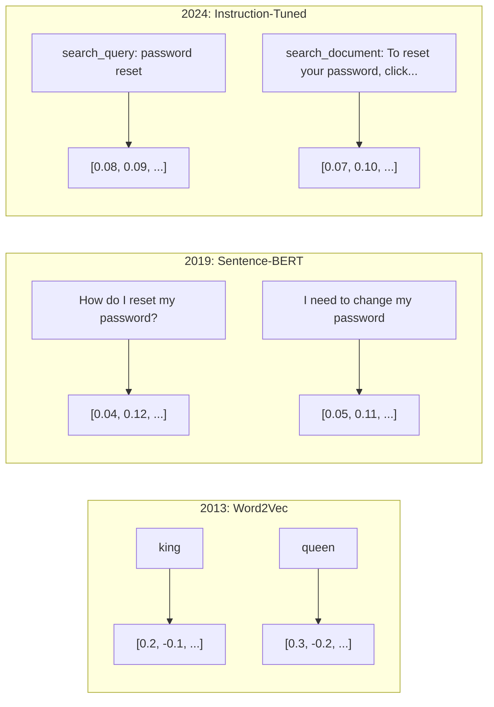
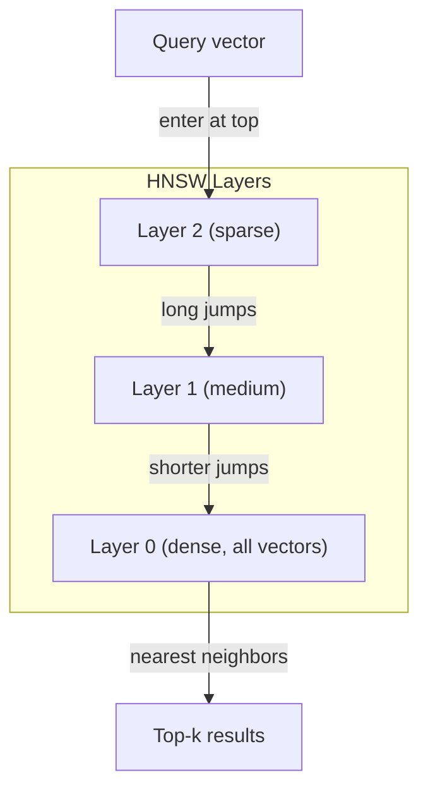
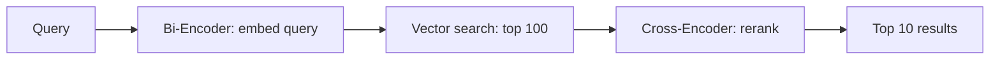

# Embeddings 與向量表示 (Embeddings & Vector Representations)

> 文字是離散的，數學是連續的。每次你請 LLM 找出「相似」的文件、比較語意，或是做關鍵字之外的搜尋，你都在依賴這兩個世界之間的橋樑。這座橋就是 embedding。如果你不了解 embedding，你就不了解現代 AI，你只是在用它而已。

**Type:** Build
**Languages:** Python
**Prerequisites:** Phase 11, Lesson 01 (Prompt Engineering)
**Time:** ~75 分鐘
**Related:** Phase 5 · 22 (Embedding Models Deep Dive) 涵蓋 dense、sparse 與 multi-vector 的差異、Matryoshka 截斷，以及各面向的模型選擇。這堂課聚焦在 production 的 pipeline（vector DB、HNSW、相似度數學）。挑選模型之前，請先讀 Phase 5 · 22。

## 學習目標 (Learning Objectives)

- 使用 API 供應商與開源模型產生文字 embedding，並計算它們之間的 cosine similarity
- 說明為什麼 embedding 能解決關鍵字搜尋處理不了的詞彙不匹配 (vocabulary mismatch) 問題
- 建立語意搜尋索引，依語意而非精確的關鍵字比對來檢索文件
- 用檢索 benchmark（precision@k、recall）評估 embedding 品質，並為你的任務選出合適的 embedding 模型

## 問題 (The Problem)

你有 10,000 張客服工單。一位客戶寫道「my payment didn't go through」。你需要找出過去相似的工單。關鍵字搜尋會找到包含「payment」和「didn't go through」的工單。但它會漏掉「transaction failed」、「charge was declined」和「billing error」。這些工單描述的是完全相同的問題，用的卻是完全不同的字。

這就是詞彙不匹配問題。人類語言有幾十種方式說同一件事。關鍵字搜尋把每個字當成沒有意義的獨立符號。它無從得知「declined」和「didn't go through」指的是同一個概念。

你需要一種文字表示法，讓決定相似度的是語意，而不是拼字。你需要一種方式，把「my payment didn't go through」和「transaction was declined」放在某個數學空間中彼此靠近的位置，同時把「my payment arrived on time」推得很遠，即使它也有「payment」這個字。

這種表示法就是 embedding。

## 核心概念 (The Concept)

### 什麼是 Embedding？

Embedding 是一個由浮點數組成的 dense 向量，用來表示文字的語意。「dense」這個詞很重要 -- 每個維度都帶有資訊，這和 sparse 表示法（bag-of-words、TF-IDF）不同，後者大多數維度都是零。

「The cat sat on the mat」會變成類似 `[0.023, -0.041, 0.087, ..., 0.012]` 的東西 -- 一串 768 到 3072 個數字，數量依模型而定。這些數字編碼了語意。你永遠不會直接檢視它們，你只會拿它們來比較。

### Word2Vec 的突破

2013 年，Tomas Mikolov 與 Google 的同事發表了 Word2Vec。核心洞察是：訓練神經網路用鄰近的字預測某個字（或用某個字預測鄰近的字），隱藏層的權重就會變成有意義的向量表示。

那個著名的結果：

```
king - man + woman = queen
```

對 word embedding 做向量運算，可以捕捉語意關係。從「man」到「woman」的方向，大致與從「king」到「queen」的方向相同。這一刻讓整個領域意識到，幾何可以編碼語意。

Word2Vec 產生 300 維的向量。每個字只有一個向量，不管 context 是什麼。「river bank」裡的「bank」和「bank account」裡的「bank」擁有相同的 embedding。這個限制推動了接下來十年的研究。

### 從單字到句子

Word embedding 表示的是單一 token。Production 系統需要對整個句子、段落或文件做 embedding。出現了四種做法：

**平均 (Averaging)**：取句中所有字向量的平均值。便宜、有損失，但對短文字出乎意料地不錯。完全失去字的順序 -- 「dog bites man」和「man bites dog」會得到相同的 embedding。

**CLS token**：transformer 模型（BERT，2018）會輸出一個特殊的 [CLS] token embedding，代表整段輸入。比平均更好，但 [CLS] token 是為了 next-sentence prediction 而訓練，不是為了相似度。

**對比學習 (Contrastive learning)**：明確地訓練模型，把相似的配對拉近，把不相似的配對推遠。Sentence-BERT（Reimers & Gurevych, 2019）使用這種做法，並成為現代 embedding 模型的基礎。給定「How do I reset my password?」和「I need to change my password」，模型會學到這兩者應該有幾乎相同的向量。

**Instruction-tuned embedding**：最新的做法。E5 和 GTE 這類模型接受任務前綴（「search_query:」、「search_document:」），告訴模型要產生哪一種 embedding。這讓一個模型能服務多種任務。



### 現代 Embedding 模型

市場已經穩定在少數幾個 production 等級的選項（MTEB 分數為 2026 年初的 MTEB v2）：

| 模型 | 供應商 | 維度 | MTEB | Context | 每 1M tokens 費用 |
|-------|----------|-----------|------|---------|------------------|
| Gemini Embedding 2 | Google | 3072 (Matryoshka) | 67.7 (retrieval) | 8192 | $0.15 |
| embed-v4 | Cohere | 1024 (Matryoshka) | 65.2 | 128K | $0.12 |
| voyage-4 | Voyage AI | 1024/2048 (Matryoshka) | 66.8 | 32K | $0.12 |
| text-embedding-3-large | OpenAI | 3072 (Matryoshka) | 64.6 | 8192 | $0.13 |
| text-embedding-3-small | OpenAI | 1536 (Matryoshka) | 62.3 | 8192 | $0.02 |
| BGE-M3 | BAAI | 1024 (dense+sparse+ColBERT) | 63.0 multilingual | 8192 | Open-weight |
| Qwen3-Embedding | Alibaba | 4096 (Matryoshka) | 66.9 | 32K | Open-weight |
| Nomic-embed-v2 | Nomic | 768 (Matryoshka) | 63.1 | 8192 | Open-weight |

MTEB (Massive Text Embedding Benchmark) v2 涵蓋 100 多個任務，包括 retrieval、classification、clustering、reranking 與 summarization。分數越高越好。到了 2026 年，open-weight 模型（Qwen3-Embedding、BGE-M3）在多數面向上已與封閉的託管模型持平甚至超越。Gemini Embedding 2 在純 retrieval 上領先；Voyage/Cohere 則在特定領域（金融、法律、程式碼）領先。在正式採用之前，一定要用你自己的查詢做 benchmark。

### 相似度指標 (Similarity Metrics)

給定兩個 embedding 向量，有三種方式衡量它們有多相似：

**Cosine similarity**：兩個向量夾角的 cosine。範圍從 -1（相反）到 1（方向相同）。忽略大小 -- 如果方向相同，10 個字的句子和 500 個字的文件都可以得到 1.0。這是 90% 使用情境的預設選擇。

```math
\mathop{\mathrm{cosine\_sim}}(a, b) = \frac{\mathop{\mathrm{dot}}(a, b)}{\lVert a \rVert \cdot \lVert b \rVert}
```

**Dot product**：兩個向量的原始內積。當向量已正規化（單位長度）時，與 cosine similarity 相同。計算更快。OpenAI 的 embedding 已經正規化，所以 dot product 與 cosine 會給出相同的排序。

```math
\mathop{\mathrm{dot}}(a, b) = \sum_i a_i b_i
```

**Euclidean (L2) distance**：向量空間中的直線距離。越小代表越相似。對大小的差異很敏感。當空間中的絕對位置很重要、而不只是方向時使用。

```math
\mathop{\mathrm{L2}}(a, b) = \sqrt{\sum_i (a_i - b_i)^2}
```

何時用哪一個：

| 指標 | 適用時機 | 避免使用的時機 |
|--------|----------|------------|
| Cosine similarity | 比較不同長度的文字；大多數檢索任務 | 向量大小帶有資訊時 |
| Dot product | Embedding 已正規化；追求最高速度 | 向量大小各不相同時 |
| Euclidean distance | Clustering；空間上的最近鄰問題 | 比較長度差異極大的文件時 |

### 向量資料庫與 HNSW (Vector Databases and HNSW)

暴力相似度搜尋會把查詢與每一個儲存的向量比較。在 100 萬個向量、1536 維的情況下，每次查詢要做 15 億次乘加運算。太慢了。

向量資料庫用近似最近鄰 (Approximate Nearest Neighbor, ANN) 演算法解決這個問題。主流演算法是 HNSW (Hierarchical Navigable Small World)：

1. 建立向量的多層圖
2. 上層很稀疏 -- 連接相距遙遠的 cluster 之間的長程連結
3. 下層很密集 -- 連接鄰近向量之間的細緻連結
4. 搜尋從最上層開始，貪婪地向下逐層細化
5. 以 $O(\log n)$ 的時間而非 $O(n)$，回傳近似的 top-k 結果

HNSW 用一點點準確度損失（通常是 95-99% 的 recall），換取大幅的速度提升。在 1,000 萬個向量時，暴力搜尋要花數秒，HNSW 只要幾毫秒。



Production 的選項：

| 資料庫 | 類型 | 最適合 | 最大規模 |
|----------|------|----------|-----------|
| Pinecone | 託管 SaaS | 免維運的 production | 數十億 |
| Weaviate | 開源 | 自行託管、hybrid search | 1 億以上 |
| Qdrant | 開源 | 高效能、過濾 | 1 億以上 |
| ChromaDB | 內嵌式 | 原型開發、本機開發 | 100 萬 |
| pgvector | Postgres 擴充套件 | 已經在用 Postgres | 1,000 萬 |
| FAISS | 函式庫 | 行程內 (in-process)、研究 | 10 億以上 |

### Chunking 策略 (Chunking Strategies)

文件太長，沒辦法用單一向量做 embedding。一份 50 頁的 PDF 涵蓋幾十個主題 -- 它的 embedding 會變成所有內容的平均，和任何特定內容都不相似。所以你要把文件切成 chunk，再對每一個做 embedding。

**固定大小 chunking**：每 N 個 token 切一次，並有 M 個 token 的重疊。簡單且可預測。在文件沒有明確結構時效果不錯。512 token 的 chunk 搭配 50 token 的重疊：chunk 1 是 token 0-511，chunk 2 是 token 462-973。

**以句子為單位的 chunking**：在句子邊界切分，把句子歸在一起直到達到 token 上限。每個 chunk 至少包含一個完整的句子。比固定大小更好，因為你不會把一個想法切成兩半。

**遞迴式 chunking**：先嘗試在最大的邊界切分（章節標題）。如果還是太大，就試段落邊界，然後是句子邊界，最後是字元上限。這就是 LangChain 的 `RecursiveCharacterTextSplitter`，對混合格式的語料效果不錯。

**語意式 chunking**：對每個句子做 embedding，再把 embedding 相似的連續句子歸為一組。當 embedding 相似度掉到門檻以下，就開始新的 chunk。成本高（需要對每個句子單獨做 embedding），但能產生最連貫的 chunk。

| 策略 | 複雜度 | 品質 | 最適合 |
|----------|-----------|---------|----------|
| 固定大小 | 低 | 尚可 | 非結構化文字、log |
| 以句子為單位 | 低 | 好 | 文章、email |
| 遞迴式 | 中 | 好 | Markdown、HTML、混合文件 |
| 語意式 | 高 | 最佳 | 檢索品質至關重要時 |

多數系統的甜蜜點是：256-512 token 的 chunk，搭配 50 token 的重疊。

### Bi-Encoder 與 Cross-Encoder

Bi-encoder 會分別對查詢與文件做 embedding，然後比較向量。速度快 -- 你只需對查詢做一次 embedding，再與預先算好的文件 embedding 比較。檢索時用的就是這個。

Cross-encoder 把查詢與文件當成單一輸入，輸出相關性分數。速度慢 -- 它要把每個查詢與文件的配對都跑過完整模型。但準確度高得多，因為它可以同時在查詢與文件的 token 之間做 attention。

Production 的模式是：bi-encoder 檢索出 top-100 候選，cross-encoder 再重新排序成 top-10。這就是 retrieve-then-rerank pipeline。



Reranking 模型：Cohere Rerank 3.5（每 1000 次查詢 $2）、BGE-reranker-v2（免費、開源）、Jina Reranker v2（免費、開源）。

### Matryoshka Embedding

傳統的 embedding 是全有或全無。一個 1536 維的向量就用 1536 個 float。你無法在不重新訓練的情況下截斷成 256 維。

Matryoshka Representation Learning（Kusupati et al., 2022）解決了這個問題。模型的訓練方式讓前 N 個維度捕捉最重要的資訊，就像俄羅斯套娃。把 1536 維的 Matryoshka embedding 截斷成 256 維，會損失一些準確度，但仍然可用。

OpenAI 的 text-embedding-3-small 與 text-embedding-3-large 透過 `dimensions` 參數支援 Matryoshka 截斷。要求 256 維而不是 1536 維，儲存空間少 6 倍，在 MTEB benchmark 上準確度大約只損失 3-5%。

### 二元量化 (Binary Quantization)

一個 1536 維的 embedding 以 float32 儲存要用 6,144 bytes。乘上 1,000 萬份文件：光是向量就要 61 GB。

二元量化把每個 float 轉成單一 bit：正值變成 1，負值變成 0。儲存空間從 6,144 bytes 降到 192 bytes -- 縮小 32 倍。相似度用 Hamming distance（計算不同的 bit 數）來算，CPU 一個指令就能完成。

在 retrieval recall 上的準確度損失大約是 5-10%。常見的模式是：對數百萬個向量的第一輪搜尋用二元量化，然後用全精度向量重新評分 top-1000。這樣能用少 32 倍的記憶體，拿到 95% 以上的全精度準確度。

```figure
cosine-similarity
```

## 動手做 (Build It)

我們從零建立一個語意搜尋引擎。沒有向量資料庫，沒有外部 embedding API，只有純 Python 加上 numpy 做數學運算。

### 步驟 1：文字 Chunking

```python
def chunk_text(text, chunk_size=200, overlap=50):
    words = text.split()
    chunks = []
    start = 0
    while start < len(words):
        end = start + chunk_size
        chunk = " ".join(words[start:end])
        chunks.append(chunk)
        start += chunk_size - overlap
    return chunks


def chunk_by_sentences(text, max_chunk_tokens=200):
    sentences = text.replace("\n", " ").split(".")
    sentences = [s.strip() + "." for s in sentences if s.strip()]
    chunks = []
    current_chunk = []
    current_length = 0
    for sentence in sentences:
        sentence_length = len(sentence.split())
        if current_length + sentence_length > max_chunk_tokens and current_chunk:
            chunks.append(" ".join(current_chunk))
            current_chunk = []
            current_length = 0
        current_chunk.append(sentence)
        current_length += sentence_length
    if current_chunk:
        chunks.append(" ".join(current_chunk))
    return chunks
```

### 步驟 2：從零建立 Embedding

我們用 TF-IDF 搭配 L2 正規化，實作一個簡單的 dense embedding。這不是神經網路的 embedding，但遵循同樣的契約：輸入文字，輸出固定大小的向量，相似的文字產生相似的向量。

```python
import math
import numpy as np
from collections import Counter

class SimpleEmbedder:
    def __init__(self):
        self.vocab = []
        self.idf = []
        self.word_to_idx = {}

    def fit(self, documents):
        vocab_set = set()
        for doc in documents:
            vocab_set.update(doc.lower().split())
        self.vocab = sorted(vocab_set)
        self.word_to_idx = {w: i for i, w in enumerate(self.vocab)}
        n = len(documents)
        self.idf = np.zeros(len(self.vocab))
        for i, word in enumerate(self.vocab):
            doc_count = sum(1 for doc in documents if word in doc.lower().split())
            self.idf[i] = math.log((n + 1) / (doc_count + 1)) + 1

    def embed(self, text):
        words = text.lower().split()
        count = Counter(words)
        total = len(words) if words else 1
        vec = np.zeros(len(self.vocab))
        for word, freq in count.items():
            if word in self.word_to_idx:
                tf = freq / total
                vec[self.word_to_idx[word]] = tf * self.idf[self.word_to_idx[word]]
        norm = np.linalg.norm(vec)
        if norm > 0:
            vec = vec / norm
        return vec
```

### 步驟 3：相似度函式

```python
def cosine_similarity(a, b):
    dot = np.dot(a, b)
    norm_a = np.linalg.norm(a)
    norm_b = np.linalg.norm(b)
    if norm_a == 0 or norm_b == 0:
        return 0.0
    return float(dot / (norm_a * norm_b))


def dot_product(a, b):
    return float(np.dot(a, b))


def euclidean_distance(a, b):
    return float(np.linalg.norm(a - b))
```

### 步驟 4：用暴力搜尋實作向量索引

```python
class VectorIndex:
    def __init__(self):
        self.vectors = []
        self.texts = []
        self.metadata = []

    def add(self, vector, text, meta=None):
        self.vectors.append(vector)
        self.texts.append(text)
        self.metadata.append(meta or {})

    def search(self, query_vector, top_k=5, metric="cosine"):
        scores = []
        for i, vec in enumerate(self.vectors):
            if metric == "cosine":
                score = cosine_similarity(query_vector, vec)
            elif metric == "dot":
                score = dot_product(query_vector, vec)
            elif metric == "euclidean":
                score = -euclidean_distance(query_vector, vec)
            else:
                raise ValueError(f"Unknown metric: {metric}")
            scores.append((i, score))
        scores.sort(key=lambda x: x[1], reverse=True)
        results = []
        for idx, score in scores[:top_k]:
            results.append({
                "text": self.texts[idx],
                "score": score,
                "metadata": self.metadata[idx],
                "index": idx
            })
        return results

    def size(self):
        return len(self.vectors)
```

### 步驟 5：語意搜尋引擎

```python
class SemanticSearchEngine:
    def __init__(self, chunk_size=200, overlap=50):
        self.embedder = SimpleEmbedder()
        self.index = VectorIndex()
        self.chunk_size = chunk_size
        self.overlap = overlap

    def index_documents(self, documents, source_names=None):
        all_chunks = []
        all_sources = []
        for i, doc in enumerate(documents):
            chunks = chunk_text(doc, self.chunk_size, self.overlap)
            all_chunks.extend(chunks)
            name = source_names[i] if source_names else f"doc_{i}"
            all_sources.extend([name] * len(chunks))
        self.embedder.fit(all_chunks)
        for chunk, source in zip(all_chunks, all_sources):
            vec = self.embedder.embed(chunk)
            self.index.add(vec, chunk, {"source": source})
        return len(all_chunks)

    def search(self, query, top_k=5, metric="cosine"):
        query_vec = self.embedder.embed(query)
        return self.index.search(query_vec, top_k, metric)

    def search_with_scores(self, query, top_k=5):
        results = self.search(query, top_k)
        return [
            {
                "text": r["text"][:200],
                "source": r["metadata"].get("source", "unknown"),
                "score": round(r["score"], 4)
            }
            for r in results
        ]
```

### 步驟 6：比較相似度指標

```python
def compare_metrics(engine, query, top_k=3):
    results = {}
    for metric in ["cosine", "dot", "euclidean"]:
        hits = engine.search(query, top_k=top_k, metric=metric)
        results[metric] = [
            {"score": round(h["score"], 4), "preview": h["text"][:80]}
            for h in hits
        ]
    return results
```

## 實際使用 (Use It)

換成 production 的 embedding API 時，架構完全不變。只有 embedder 要換：

```python
from openai import OpenAI

client = OpenAI()

def openai_embed(texts, model="text-embedding-3-small", dimensions=None):
    kwargs = {"model": model, "input": texts}
    if dimensions:
        kwargs["dimensions"] = dimensions
    response = client.embeddings.create(**kwargs)
    return [item.embedding for item in response.data]
```

用 OpenAI 做 Matryoshka 截斷 -- 同一個模型，更少的維度，更低的儲存成本：

```python
full = openai_embed(["semantic search query"], dimensions=1536)
compact = openai_embed(["semantic search query"], dimensions=256)
```

256 維的向量儲存空間少 6 倍。對 1,000 萬份文件來說，是 10 GB 對 61 GB。在標準 benchmark 上，準確度損失大約是 3-5%。

用 Cohere 做 reranking：

```python
import cohere

co = cohere.ClientV2()

results = co.rerank(
    model="rerank-v3.5",
    query="What is the refund policy?",
    documents=["Full refund within 30 days...", "No refunds after 90 days..."],
    top_n=3
)
```

用本機 embedding，不依賴任何 API：

```python
from sentence_transformers import SentenceTransformer

model = SentenceTransformer("BAAI/bge-small-en-v1.5")
embeddings = model.encode(["semantic search query", "another document"])
```

我們做出來的 VectorIndex class 可以搭配上述任何一種。換掉 embedding 函式，保留搜尋邏輯。

## 交付 (Ship It)

這堂課會產出：
- `outputs/prompt-embedding-advisor.md` -- 一個 prompt，用來為特定使用情境挑選 embedding 模型與策略
- `outputs/skill-embedding-patterns.md` -- 一個 skill，教 agent 如何在 production 中有效使用 embedding

## 練習 (Exercises)

1. **指標比較**：用 cosine similarity、dot product 和 euclidean distance，對範例文件執行同樣的 5 個查詢。記錄每種指標的 top-3 結果。哪些查詢的結果在不同指標間不一致？為什麼？

2. **Chunk 大小實驗**：用 50、100、200 和 500 個字的 chunk 大小為範例文件建立索引。每種大小各執行 5 個查詢，記錄 top-1 的相似度分數。畫出 chunk 大小與檢索品質的關係。找出更大的 chunk 開始造成傷害的那個點。

3. **Matryoshka 模擬**：建立一個產生 500 維向量的 SimpleEmbedder。分別截斷成 50、100、200 和 500 維。量測每次截斷後，檢索 recall 如何下降。這在不需要真正訓練技巧的情況下，模擬 Matryoshka 的行為。

4. **二元量化**：取搜尋引擎中的 embedding，轉成二元（正值為 1，負值為 0），並實作 Hamming distance 搜尋。把 top-10 結果與全精度的 cosine similarity 比較。量測重疊的百分比。

5. **以句子為單位的 chunking**：用 `chunk_by_sentences` 取代固定大小 chunking。執行同樣的查詢並比較檢索分數。尊重句子邊界有改善結果嗎？

## 關鍵術語 (Key Terms)

| 術語 | 一般說法 | 實際意義 |
|------|----------------|----------------------|
| Embedding | 「把文字變成數字」 | 一個 dense 向量，其幾何上的接近程度編碼了語意相似度 |
| Word2Vec | 「元祖 embedding」 | 2013 年的模型，透過預測上下文字詞來學習字向量；證明了向量運算可以編碼語意 |
| Cosine similarity | 「兩個向量有多相似」 | 向量夾角的 cosine；1 = 方向相同，0 = 正交，-1 = 相反 |
| HNSW | 「快速向量搜尋」 | Hierarchical Navigable Small World 圖 -- 多層結構，能以 $O(\log n)$ 進行近似最近鄰搜尋 |
| Bi-encoder | 「分開 embed，快速比較」 | 把查詢與文件各自獨立編碼成向量；可預先計算，檢索快速 |
| Cross-encoder | 「慢但準的 reranker」 | 把查詢與文件配對一起跑過完整模型；準確度較高，但無法預先計算 |
| Matryoshka embeddings | 「可截斷的向量」 | 訓練成讓前 N 個維度捕捉最重要資訊的 embedding，可彈性調整儲存大小 |
| Binary quantization | 「1 bit 的 embedding」 | 把 float 向量轉成二元（只保留符號位元），搭配 Hamming distance 搜尋，儲存空間縮小 32 倍 |
| Chunking | 「為了 embedding 而切文件」 | 把文件切成 256-512 token 的片段，讓每一段都能獨立 embed 與檢索 |
| Vector database | 「embedding 的搜尋引擎」 | 針對儲存向量並大規模執行近似最近鄰搜尋而最佳化的資料儲存系統 |
| Contrastive learning | 「透過比較來訓練」 | 一種訓練方式，把相似配對的 embedding 拉近，把不相似配對的 embedding 推遠 |
| MTEB | 「embedding 的 benchmark」 | Massive Text Embedding Benchmark -- 橫跨 8 種任務、56 個資料集；比較 embedding 模型的標準 |

## 延伸閱讀 (Further Reading)

- Mikolov et al., "Efficient Estimation of Word Representations in Vector Space" (2013) -- Word2Vec 論文，以 king-queen 類比開啟了 embedding 革命
- Reimers & Gurevych, "Sentence-BERT: Sentence Embeddings using Siamese BERT-Networks" (2019) -- 如何訓練 bi-encoder 做句子層級的相似度，是現代 embedding 模型的基礎
- Kusupati et al., "Matryoshka Representation Learning" (2022) -- 可變維度 embedding 背後的技術，OpenAI 在 text-embedding-3 採用了它
- Malkov & Yashunin, "Efficient and Robust Approximate Nearest Neighbor using Hierarchical Navigable Small World Graphs" (2018) -- HNSW 論文，多數 production 向量搜尋背後的演算法
- OpenAI Embeddings Guide (platform.openai.com/docs/guides/embeddings) -- text-embedding-3 模型的實用參考，包括 Matryoshka 降維
- MTEB Leaderboard (huggingface.co/spaces/mteb/leaderboard) -- 即時 benchmark，比較所有 embedding 模型在各種任務與語言上的表現
- [Muennighoff et al., "MTEB: Massive Text Embedding Benchmark" (EACL 2023)](https://arxiv.org/abs/2210.07316) -- 定義 8 種任務類別（classification、clustering、pair classification、reranking、retrieval、STS、summarization、bitext mining）的 benchmark，排行榜就是依此回報；在相信任何單一 MTEB 分數之前請先讀它。
- [Sentence Transformers documentation](https://www.sbert.net/) -- bi-encoder 與 cross-encoder、pooling 策略，以及本課實作的 ingest-split-embed-store RAG pipeline 的標準參考。
