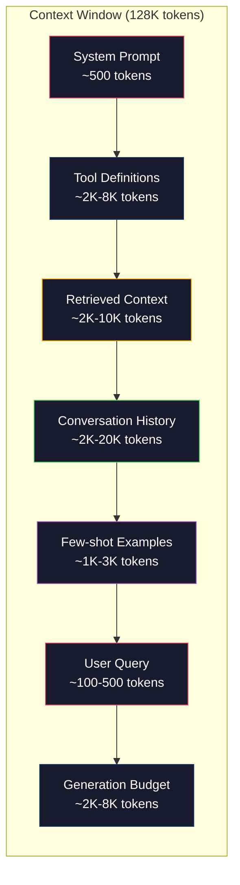
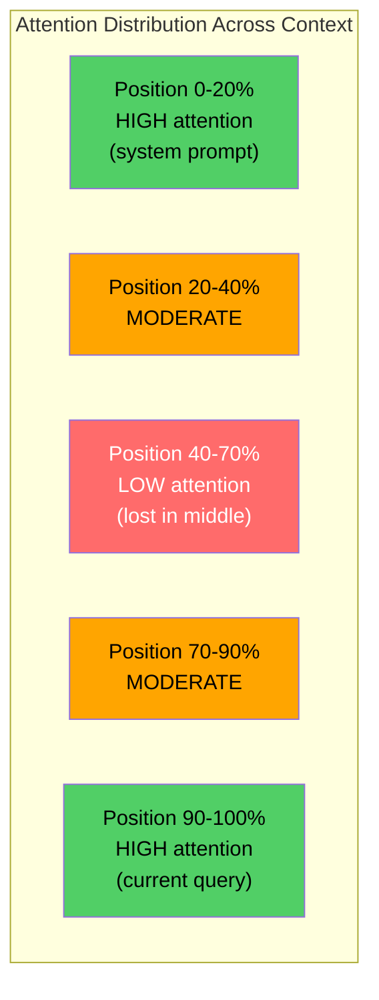
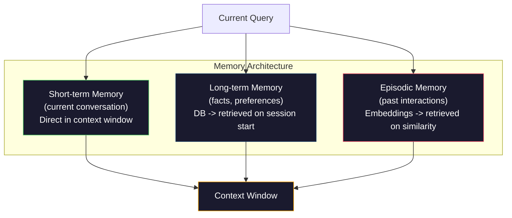

# Context Engineering：Window、預算、記憶與檢索

> Prompt engineering 只是其中一部分，context engineering 才是整場遊戲。Prompt 是你輸入的一段字串，context 則是進入模型 window 的所有東西：system 指令、檢索到的文件、tool 定義、對話歷史、few-shot 範例，以及 prompt 本身。2026 年最優秀的 AI 工程師都是 context engineer。他們決定什麼要放進去、什麼要擋在外面，以及用什麼順序。

**Type:** Build
**Languages:** Python
**Prerequisites:** Phase 10 (LLMs from Scratch), Phase 11 Lesson 01-02
**Time:** ~90 分鐘
**Related:** Phase 11 · 15 (Prompt Caching) — 對 cache 友善的版面配置是 context engineering 的延伸。Phase 5 · 28 (Long-Context Evaluation)，了解如何用 NIAH/RULER 量測 lost-in-the-middle。

## 學習目標 (Learning Objectives)

- 計算 context window 各組成部分（system prompt、tool、歷史、檢索文件、生成餘裕）的 token 預算
- 實作 context window 的管理策略：對對話歷史做截斷、摘要與滑動視窗
- 為 context 的各個組成排定優先順序並安排位置，讓模型的注意力集中在最相關的資訊上
- 建立 context assembler，依據查詢類型與可用的 window 空間動態分配 token

## 問題 (The Problem)

Claude Opus 4.7 有 200K token 的 window（beta 為 1M）。GPT-5 有 400K。Gemini 3 Pro 有 2M。Llama 4 宣稱有 10M。這些數字聽起來很龐大，直到你把它們填滿。

以下是一個 coding assistant 的真實分解。System prompt：500 tokens。50 個 tool 的定義：8,000 tokens。檢索到的文件：4,000 tokens。對話歷史（10 輪）：6,000 tokens。目前使用者的查詢：200 tokens。生成預算（最大輸出）：4,000 tokens。總計：22,700 tokens。這只佔 128K window 的 18%。

但 attention 不會隨 context 長度線性擴張。擁有 128K token context 的模型要付出二次方的 attention 成本（在標準 transformer 中是 $O(n^2)$，不過多數 production 模型使用高效率的 attention 變體）。更重要的是，檢索準確度會下降。「Needle in a Haystack」測試顯示，模型很難找到放在長 context 中間的資訊。Liu et al. (2023) 的研究顯示，LLM 對於長 context 開頭和結尾的資訊，檢索準確度近乎完美，但對於放在中間的資訊（context 的 40-70% 位置），準確度會下降 10-20%。這種「lost-in-the-middle」效應因模型而異，但會影響目前所有的架構。

實務上的教訓是：擁有 200K token 可用，不代表用滿 200K token 就有效。精心策劃的 10K token context，表現往往勝過亂倒進去的 100K token context。Context engineering 這門學問，就是在 context window 內最大化訊噪比。

你放進 window 的每個 token，都會擠掉一個可能攜帶更多相關資訊的 token。每一個不相關的 tool 定義、每一輪過時的對話、每一段沒有回答問題的檢索文字，都會讓模型在任務上稍微變差一點。

## 核心概念 (The Concept)

### Context Window 是稀缺資源

把 context window 想成 RAM，而不是磁碟。它速度快、可以直接存取，但容量有限。你沒辦法把所有東西都塞進去，必須做選擇。



每個組成部分都在爭奪空間。加入更多 tool 定義，對話歷史的空間就變少。加入更多檢索 context，few-shot 範例的空間就變少。Context engineering 就是分配這份預算、讓任務表現最大化的藝術。

### Lost-in-the-Middle

這是 context engineering 中最重要的實證發現。模型對 context 開頭和結尾的資訊注意力較好。中間的資訊拿到的 attention 分數較低，也更容易被忽略。

Liu et al. (2023) 系統性地測試了這點。他們把一份相關文件放在 20 份不相關文件之中的不同位置，並量測答案的準確度。當相關文件在第一個或最後一個位置時，準確度是 85-90%。當它在中間（20 份中的第 10 個位置）時，準確度掉到 60-70%。

這對工程有直接的影響：

- 把最重要的資訊放在最前面（system prompt、關鍵指令）
- 把目前的查詢與最相關的 context 放在最後面（近因偏誤 recency bias 有幫助）
- 把 context 的中間視為優先順序最低的區域
- 如果一定要把資訊放在中間，請把重點在結尾重複一次



### Context 的組成 (Context Components)

**System prompt**：設定 persona、限制與行為規則。它放在最前面，並且在各輪之間保持不變。Claude Code 的 system prompt（包含 tool 定義與行為指令）大約使用 6,000 tokens。請保持精簡。System prompt 裡的每個字，在每次 API 呼叫時都會重複一次。

**Tool 定義**：每個 tool 增加 50-200 tokens（名稱、描述、參數 schema）。50 個 tool、每個 150 tokens，在任何對話發生之前就已經是 7,500 tokens。動態選擇 tool -- 只納入與目前查詢相關的 tool -- 可以減少 60-80%。

**檢索到的 context**：來自向量資料庫的文件、搜尋結果、檔案內容。檢索的品質直接決定回應的品質。糟糕的檢索比不檢索還糟 -- 它用雜訊填滿 window，還會積極誤導模型。

**對話歷史**：之前每一則使用者訊息與 assistant 回應。隨對話長度線性增長。50 輪對話、每輪 200 tokens，就是 10,000 tokens 的歷史。其中大部分與目前的查詢無關。

**Few-shot 範例**：示範期望行為的輸入/輸出配對。兩到三個精心挑選的範例，往往比數千 token 的指令更能提升輸出品質。但它們會佔用空間。

**生成預算**：保留給模型回應的 token。如果你把 window 填到滿，模型就沒有空間回答。請至少保留 2,000-4,000 tokens 給生成。

### Context 壓縮策略 (Context Compression Strategies)

**歷史摘要 (History summarization)**：與其逐字保留所有之前的對話輪次，不如定期摘要對話。用 100 tokens 寫「我們討論了 X，決定了 Y，使用者想要 Z」，就能取代花了 2,000 tokens 的 10 輪對話。當歷史超過門檻（例如 5,000 tokens）時執行摘要。

**相關性過濾 (Relevance filtering)**：把每份檢索到的文件對目前查詢評分，丟掉低於門檻的文件。如果你檢索了 10 個 chunk，但只有 3 個相關，就丟掉另外 7 個。3 個高度相關的 chunk，比 10 個普通的 chunk 更好。

**Tool 修剪 (Tool pruning)**：分類使用者查詢的意圖，只納入與該意圖相關的 tool。程式碼問題不需要行事曆 tool。排程問題不需要檔案系統 tool。這可以把 tool 定義從 8,000 tokens 減到 1,000。

**遞迴式摘要 (Recursive summarization)**：對很長的文件分階段摘要。先摘要每個章節，再摘要這些摘要。一份 50 頁的文件會變成 500 token 的精華，涵蓋關鍵重點。

### 記憶系統 (Memory Systems)

Context engineering 涵蓋三種時間範圍。

**短期記憶 (Short-term memory)**：目前的對話。直接存放在 context window 中。每一輪都會增長。透過摘要與截斷來管理。

**長期記憶 (Long-term memory)**：跨對話持續存在的事實與偏好。「使用者偏好 TypeScript。」「專案使用 PostgreSQL。」儲存在資料庫中，在 session 開始時檢索。Claude Code 把這些存在 CLAUDE.md 檔案裡。ChatGPT 則存在它的記憶功能中。

**情節記憶 (Episodic memory)**：可能相關的特定過往互動。「上週二，我們在 auth 模組除錯過類似的問題。」以 embedding 儲存，當目前的對話符合某個過往情節時被檢索出來。



### 動態 Context 組裝 (Dynamic Context Assembly)

關鍵洞察是：不同的查詢需要不同的 context。靜態的 system prompt、靜態的 tool 加上靜態的歷史是浪費的。最好的系統會針對每個查詢動態組裝 context。

1. 分類查詢意圖
2. 選擇相關的 tool（而不是全部的 tool）
3. 檢索相關的文件（而不是固定的一組）
4. 納入相關的歷史輪次（而不是全部歷史）
5. 加入符合任務類型的 few-shot 範例
6. 依重要性排序：關鍵的放最前、重要的放最後、可有可無的放中間

這就是好的 AI 應用程式與卓越的 AI 應用程式之間的差別。模型是同一個，context 才是差異所在。

```figure
lost-in-the-middle
```

## 動手做 (Build It)

### 步驟 1：Token 計數器

無法衡量的東西就無法做預算。建立一個簡單的 token 計數器（用空白分割來近似，因為精確的數量取決於 tokenizer）。

```python
import json
import numpy as np
from collections import OrderedDict

def count_tokens(text):
    if not text:
        return 0
    return int(len(text.split()) * 1.3)

def count_tokens_json(obj):
    return count_tokens(json.dumps(obj))
```

### 步驟 2：Context 預算管理器

核心抽象。預算管理器會追蹤各個組成部分使用多少 token，並強制執行上限。

```python
class ContextBudget:
    def __init__(self, max_tokens=128000, generation_reserve=4000):
        self.max_tokens = max_tokens
        self.generation_reserve = generation_reserve
        self.available = max_tokens - generation_reserve
        self.allocations = OrderedDict()

    def allocate(self, component, content, max_tokens=None):
        tokens = count_tokens(content)
        if max_tokens and tokens > max_tokens:
            words = content.split()
            target_words = int(max_tokens / 1.3)
            content = " ".join(words[:target_words])
            tokens = count_tokens(content)

        used = sum(self.allocations.values())
        if used + tokens > self.available:
            allowed = self.available - used
            if allowed <= 0:
                return None, 0
            words = content.split()
            target_words = int(allowed / 1.3)
            content = " ".join(words[:target_words])
            tokens = count_tokens(content)

        self.allocations[component] = tokens
        return content, tokens

    def remaining(self):
        used = sum(self.allocations.values())
        return self.available - used

    def utilization(self):
        used = sum(self.allocations.values())
        return used / self.max_tokens

    def report(self):
        total_used = sum(self.allocations.values())
        lines = []
        lines.append(f"Context Budget Report ({self.max_tokens:,} token window)")
        lines.append("-" * 50)
        for component, tokens in self.allocations.items():
            pct = tokens / self.max_tokens * 100
            bar = "#" * int(pct / 2)
            lines.append(f"  {component:<25} {tokens:>6} tokens ({pct:>5.1f}%) {bar}")
        lines.append("-" * 50)
        lines.append(f"  {'Used':<25} {total_used:>6} tokens ({total_used/self.max_tokens*100:.1f}%)")
        lines.append(f"  {'Generation reserve':<25} {self.generation_reserve:>6} tokens")
        lines.append(f"  {'Remaining':<25} {self.remaining():>6} tokens")
        return "\n".join(lines)
```

### 步驟 3：Lost-in-the-Middle 重新排序

實作重新排序策略：最重要的項目放最前面和最後面，最不重要的放中間。

```python
def reorder_lost_in_middle(items, scores):
    paired = sorted(zip(scores, items), reverse=True)
    sorted_items = [item for _, item in paired]

    if len(sorted_items) <= 2:
        return sorted_items

    first_half = sorted_items[::2]
    second_half = sorted_items[1::2]
    second_half.reverse()

    return first_half + second_half

def score_relevance(query, documents):
    query_words = set(query.lower().split())
    scores = []
    for doc in documents:
        doc_words = set(doc.lower().split())
        if not query_words:
            scores.append(0.0)
            continue
        overlap = len(query_words & doc_words) / len(query_words)
        scores.append(round(overlap, 3))
    return scores
```

### 步驟 4：對話歷史壓縮器

摘要舊的對話輪次，以回收 token 預算。

```python
class ConversationManager:
    def __init__(self, max_history_tokens=5000):
        self.turns = []
        self.summaries = []
        self.max_history_tokens = max_history_tokens

    def add_turn(self, role, content):
        self.turns.append({"role": role, "content": content})
        self._compress_if_needed()

    def _compress_if_needed(self):
        total = sum(count_tokens(t["content"]) for t in self.turns)
        if total <= self.max_history_tokens:
            return

        while total > self.max_history_tokens and len(self.turns) > 4:
            old_turns = self.turns[:2]
            summary = self._summarize_turns(old_turns)
            self.summaries.append(summary)
            self.turns = self.turns[2:]
            total = sum(count_tokens(t["content"]) for t in self.turns)

    def _summarize_turns(self, turns):
        parts = []
        for t in turns:
            content = t["content"]
            if len(content) > 100:
                content = content[:100] + "..."
            parts.append(f"{t['role']}: {content}")
        return "Previous: " + " | ".join(parts)

    def get_context(self):
        parts = []
        if self.summaries:
            parts.append("[Conversation Summary]")
            for s in self.summaries:
                parts.append(s)
        parts.append("[Recent Conversation]")
        for t in self.turns:
            parts.append(f"{t['role']}: {t['content']}")
        return "\n".join(parts)

    def token_count(self):
        return count_tokens(self.get_context())
```

### 步驟 5：動態 Tool 選擇器

只納入與目前查詢相關的 tool。先分類意圖，再做過濾。

```python
TOOL_REGISTRY = {
    "read_file": {
        "description": "Read contents of a file",
        "tokens": 120,
        "categories": ["code", "files"],
    },
    "write_file": {
        "description": "Write content to a file",
        "tokens": 150,
        "categories": ["code", "files"],
    },
    "search_code": {
        "description": "Search for patterns in codebase",
        "tokens": 130,
        "categories": ["code"],
    },
    "run_command": {
        "description": "Execute a shell command",
        "tokens": 140,
        "categories": ["code", "system"],
    },
    "create_calendar_event": {
        "description": "Create a new calendar event",
        "tokens": 180,
        "categories": ["calendar"],
    },
    "list_emails": {
        "description": "List recent emails",
        "tokens": 160,
        "categories": ["email"],
    },
    "send_email": {
        "description": "Send an email message",
        "tokens": 200,
        "categories": ["email"],
    },
    "web_search": {
        "description": "Search the web for information",
        "tokens": 140,
        "categories": ["research"],
    },
    "query_database": {
        "description": "Run a SQL query on the database",
        "tokens": 170,
        "categories": ["code", "data"],
    },
    "generate_chart": {
        "description": "Generate a chart from data",
        "tokens": 190,
        "categories": ["data", "visualization"],
    },
}

def classify_intent(query):
    query_lower = query.lower()

    intent_keywords = {
        "code": ["code", "function", "bug", "error", "file", "implement", "refactor", "debug", "test"],
        "calendar": ["meeting", "schedule", "calendar", "appointment", "event"],
        "email": ["email", "mail", "send", "inbox", "message"],
        "research": ["search", "find", "what is", "how does", "explain", "look up"],
        "data": ["data", "query", "database", "chart", "graph", "analytics", "sql"],
    }

    scores = {}
    for intent, keywords in intent_keywords.items():
        score = sum(1 for kw in keywords if kw in query_lower)
        if score > 0:
            scores[intent] = score

    if not scores:
        return ["code"]

    max_score = max(scores.values())
    return [intent for intent, score in scores.items() if score >= max_score * 0.5]

def select_tools(query, token_budget=2000):
    intents = classify_intent(query)
    relevant = {}
    total_tokens = 0

    for name, tool in TOOL_REGISTRY.items():
        if any(cat in intents for cat in tool["categories"]):
            if total_tokens + tool["tokens"] <= token_budget:
                relevant[name] = tool
                total_tokens += tool["tokens"]

    return relevant, total_tokens
```

### 步驟 6：完整的 Context 組裝 Pipeline

把所有東西串在一起。給定一個查詢，動態組裝出最佳的 context。

```python
class ContextEngine:
    def __init__(self, max_tokens=128000, generation_reserve=4000):
        self.budget = ContextBudget(max_tokens, generation_reserve)
        self.conversation = ConversationManager(max_history_tokens=5000)
        self.system_prompt = (
            "You are a helpful AI assistant. You have access to tools for "
            "code editing, file management, web search, and data analysis. "
            "Use the appropriate tools for each task. Be concise and accurate."
        )
        self.knowledge_base = [
            "Python 3.12 introduced type parameter syntax for generic classes using bracket notation.",
            "The project uses PostgreSQL 16 with pgvector for embedding storage.",
            "Authentication is handled by Supabase Auth with JWT tokens.",
            "The frontend is built with Next.js 15 using the App Router.",
            "API rate limits are set to 100 requests per minute per user.",
            "The deployment pipeline uses GitHub Actions with Docker multi-stage builds.",
            "Test coverage must be above 80% for all new modules.",
            "The codebase follows the repository pattern for data access.",
        ]

    def assemble(self, query):
        self.budget = ContextBudget(self.budget.max_tokens, self.budget.generation_reserve)

        system_content, _ = self.budget.allocate("system_prompt", self.system_prompt, max_tokens=1000)

        tools, tool_tokens = select_tools(query, token_budget=2000)
        tool_text = json.dumps(list(tools.keys()))
        tool_content, _ = self.budget.allocate("tools", tool_text, max_tokens=2000)

        relevance = score_relevance(query, self.knowledge_base)
        threshold = 0.1
        relevant_docs = [
            doc for doc, score in zip(self.knowledge_base, relevance)
            if score >= threshold
        ]

        if relevant_docs:
            doc_scores = [s for s in relevance if s >= threshold]
            reordered = reorder_lost_in_middle(relevant_docs, doc_scores)
            doc_text = "\n".join(reordered)
            doc_content, _ = self.budget.allocate("retrieved_context", doc_text, max_tokens=3000)

        history_text = self.conversation.get_context()
        if history_text.strip():
            history_content, _ = self.budget.allocate("conversation_history", history_text, max_tokens=5000)

        query_content, _ = self.budget.allocate("user_query", query, max_tokens=500)

        return self.budget

    def chat(self, query):
        self.conversation.add_turn("user", query)
        budget = self.assemble(query)
        response = f"[Response to: {query[:50]}...]"
        self.conversation.add_turn("assistant", response)
        return budget


def run_demo():
    print("=" * 60)
    print("  Context Engineering Pipeline Demo")
    print("=" * 60)

    engine = ContextEngine(max_tokens=128000, generation_reserve=4000)

    print("\n--- Query 1: Code task ---")
    budget = engine.chat("Fix the bug in the authentication module where JWT tokens expire too early")
    print(budget.report())

    print("\n--- Query 2: Research task ---")
    budget = engine.chat("What is the best approach for implementing vector search in PostgreSQL?")
    print(budget.report())

    print("\n--- Query 3: After conversation history builds up ---")
    for i in range(8):
        engine.conversation.add_turn("user", f"Follow-up question number {i+1} about the implementation details of the system")
        engine.conversation.add_turn("assistant", f"Here is the response to follow-up {i+1} with technical details about the architecture")

    budget = engine.chat("Now implement the changes we discussed")
    print(budget.report())

    print("\n--- Tool Selection Examples ---")
    test_queries = [
        "Fix the bug in auth.py",
        "Schedule a meeting with the team for Tuesday",
        "Show me the database query performance stats",
        "Search for best practices on error handling",
    ]

    for q in test_queries:
        tools, tokens = select_tools(q)
        intents = classify_intent(q)
        print(f"\n  Query: {q}")
        print(f"  Intents: {intents}")
        print(f"  Tools: {list(tools.keys())} ({tokens} tokens)")

    print("\n--- Lost-in-the-Middle Reordering ---")
    docs = ["Doc A (most relevant)", "Doc B (somewhat relevant)", "Doc C (least relevant)",
            "Doc D (relevant)", "Doc E (moderately relevant)"]
    scores = [0.95, 0.60, 0.20, 0.80, 0.50]
    reordered = reorder_lost_in_middle(docs, scores)
    print(f"  Original order: {docs}")
    print(f"  Scores:         {scores}")
    print(f"  Reordered:      {reordered}")
    print(f"  (Most relevant at start and end, least relevant in middle)")
```

## 實際使用 (Use It)

### 由 Harness 管理的 Context

Claude Code 用分層的方式管理 context。System prompt 包含行為規則與 tool 定義（約 6K tokens）。當你開啟檔案時，它的內容會被注入成 context。當你搜尋時，結果會被加進去。舊的對話輪次會被摘要。CLAUDE.md 提供跨 session 持續存在的長期記憶。

關鍵的工程決策是：Claude Code 不會把你整個程式碼庫倒進 context。它會依需求檢索相關的檔案。這就是實務上的 context engineering。

### 動態載入 Context

Cursor 會把你整個程式碼庫建成 embedding 索引。當你輸入查詢時，它用向量相似度檢索最相關的檔案與程式碼區塊。只有這些片段會進入 context window。一個 50 萬行的程式碼庫，被壓縮成最相關的 5 到 10 個程式碼區塊。

這就是這個模式：全部做 embedding、依需求檢索、只納入重要的東西。

### Assistant 的長期記憶

ChatGPT 把使用者偏好與事實存成長期記憶。每次對話開始時，相關的記憶會被檢索出來並放進 system prompt。「使用者偏好 Python」只花 5 個 token，卻能省下跨對話重複說明所需的數百個 token。

### 把 RAG 視為 Context Engineering

Retrieval-Augmented Generation 就是正式化的 context engineering。與其把知識塞進模型的權重（訓練）或 system prompt（靜態 context），你是在查詢時檢索相關文件，再注入 context window。整條 RAG pipeline -- chunking、embedding、retrieval、reranking -- 都是為了解決一個問題而存在：把正確的資訊放進 context window。

## 交付 (Ship It)

這堂課會產出 `outputs/prompt-context-optimizer.md` -- 一個可重複使用的 prompt，用來稽核 context 組裝策略並建議優化。把你的 system prompt、tool 數量、平均歷史長度與檢索策略餵給它，它會找出 token 浪費，並建議改進方式。

它也會產出 `outputs/skill-context-engineering.md` -- 一個決策框架，依據任務類型、context window 大小與延遲預算，設計 context 組裝 pipeline。

## 練習 (Exercises)

1. 為 ContextBudget class 加上「token 浪費偵測器」。它應該標記使用超過 30% 預算的組成部分，並針對每種組成類型建議特定的壓縮策略（摘要歷史、修剪 tool、重新排序文件）。

2. 為檢索到的 context 實作語意去重。如果兩份檢索到的文件相似度超過 80%（用字詞重疊或 embedding 的 cosine similarity 計算），只保留分數較高的那份。量測這能回收多少 token 預算。

3. 建立「context replay」工具。給定一份對話逐字稿，把它重新跑過 ContextEngine，並視覺化預算分配如何逐輪變化。畫出各組成部分的 token 使用量隨時間的變化。找出 context 開始被壓縮的那一輪。

4. 實作以優先順序為基礎的 tool 選擇器。不要做二元的納入/排除，而是為每個 tool 對目前查詢指派一個相關性分數。依相關性由高到低納入 tool，直到 tool 預算用完。比較納入 5、10、20 和 50 個 tool 時的任務表現。

5. 建立多策略的 context 壓縮器。實作三種壓縮策略（截斷、摘要、擷取關鍵句），並在一組 20 份文件上做 benchmark。量測壓縮比與資訊保留之間的取捨（壓縮後的版本是否仍然包含查詢的答案？）。

## 關鍵術語 (Key Terms)

| 術語 | 一般說法 | 實際意義 |
|------|----------------|----------------------|
| Context window | 「模型能讀多少」 | 模型在單次 forward pass 中處理的最大 token 數（輸入 + 輸出）-- GPT-5 為 400K，Claude Opus 4.7 為 200K（beta 為 1M），Gemini 3 Pro 為 2M |
| Context engineering | 「進階的 prompt engineering」 | 決定什麼進入 context window、以什麼順序、以什麼優先順序的學問 -- 涵蓋檢索、壓縮、tool 選擇與記憶管理 |
| Lost-in-the-middle | 「模型會忘掉中間的東西」 | 實證發現：LLM 對 context 開頭與結尾的注意力較好，放在中間的資訊準確度會下降 10-20% |
| Token budget | 「你還剩多少 token」 | 把 context window 的容量明確地分配給各個組成部分（system prompt、tool、歷史、檢索、生成），並為每個部分設上限 |
| Dynamic context | 「即時載入東西」 | 依據意圖分類、相關 tool 的選擇與檢索結果，為每個查詢以不同方式組裝 context window |
| History summarization | 「壓縮對話」 | 用簡潔的摘要取代逐字保留的舊對話輪次，在保留關鍵資訊的同時降低 token 成本 |
| Tool pruning | 「只納入相關的 tool」 | 分類查詢意圖，只納入符合的 tool 定義，讓 tool 的 token 成本減少 60-80% |
| Long-term memory | 「跨 session 記憶」 | 儲存在資料庫中、於 session 開始時檢索的事實與偏好 -- CLAUDE.md、ChatGPT Memory 與類似系統 |
| Episodic memory | 「記住特定的過往事件」 | 以 embedding 儲存的過往互動，在目前查詢與過去對話相似時被檢索出來 |
| Generation budget | 「留給答案的空間」 | 保留給模型輸出的 token -- 如果 context 把 window 完全填滿，模型就沒有空間回應 |

## 延伸閱讀 (Further Reading)

- [Liu et al., 2023 -- "Lost in the Middle: How Language Models Use Long Contexts"](https://arxiv.org/abs/2307.03172) -- 關於位置相關 attention 的權威研究，顯示模型很難處理長 context 中間的資訊
- [Anthropic's Contextual Retrieval blog post](https://www.anthropic.com/news/contextual-retrieval) -- Anthropic 如何處理具 context 感知的 chunk 檢索，讓檢索失敗減少 49%
- [Simon Willison's "Context Engineering"](https://simonwillison.net/2025/Jun/27/context-engineering/) -- 為這門學問命名，並將它與 prompt engineering 區分開來的部落格文章
- [LangChain documentation on RAG](https://python.langchain.com/docs/tutorials/rag/) -- 把 retrieval-augmented generation 當作 context engineering 模式的實際實作
- [Greg Kamradt's Needle in a Haystack test](https://github.com/gkamradt/LLMTest_NeedleInAHaystack) -- 揭露所有主流模型都有位置相關的檢索失敗的 benchmark
- [Pope et al., "Efficiently Scaling Transformer Inference" (2022)](https://arxiv.org/abs/2211.05102) -- 為什麼 context 長度會驅動記憶體與延遲，以及 KV cache、MQA 與 GQA 如何改變預算計算。
- [Agrawal et al., "SARATHI: Efficient LLM Inference by Piggybacking Decodes with Chunked Prefills" (2023)](https://arxiv.org/abs/2308.16369) -- 推論的兩個階段，使長 prompt 在 TTFT 上昂貴、在 TPOT 上便宜；context 打包取捨背後的基本事實。
- [Ainslie et al., "GQA: Training Generalized Multi-Query Transformer Models from Multi-Head Checkpoints" (EMNLP 2023)](https://arxiv.org/abs/2305.13245) -- grouped-query attention 論文，在 production decoder 中將 KV 記憶體減少 8 倍且不損失品質。
