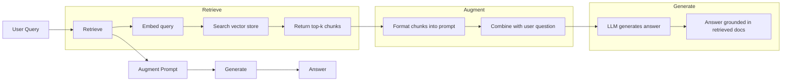
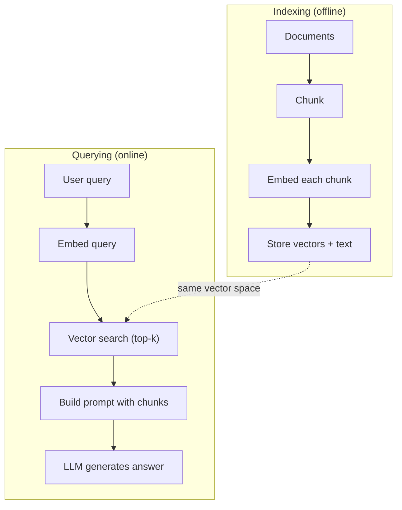

# RAG (Retrieval-Augmented Generation)

> 你的 LLM 知道的一切，都截止在它的訓練時間點。它對你公司的文件、你的程式碼庫，或上週的會議記錄一無所知。RAG 的解法，是檢索相關的文件，再把它們塞進 prompt。這是 production AI 中部署最廣泛的模式。如果你要從這門課挑一樣東西來實作，就做一條 RAG pipeline。

**Type:** Build
**Languages:** Python
**Prerequisites:** Phase 10 (LLMs from Scratch), Phase 11 Lessons 01-05
**Time:** ~90 分鐘
**Related:** Phase 5 · 23 (Chunking Strategies for RAG)，了解六種 chunking 演算法以及各自何時勝出。Phase 5 · 22 (Embedding Models Deep Dive)，了解如何挑選 embedder。Phase 11 · 07 (Advanced RAG)，了解 hybrid search、reranking 與查詢轉換。

## 學習目標 (Learning Objectives)

- 建立完整的 RAG pipeline：文件載入、chunking、embedding、向量儲存、檢索與生成
- 使用向量資料庫（ChromaDB、FAISS 或 Pinecone）搭配正確的索引，實作語意搜尋
- 說明為什麼在以知識為基礎的應用中，RAG 比 fine-tuning 更受青睞（成本、時效性、可追溯來源）
- 用檢索指標（precision、recall）與生成指標（faithfulness、relevance）評估 RAG 的品質

## 問題 (The Problem)

你為公司做了一個聊天機器人。一位客戶問：「What's the refund policy for enterprise plans?」LLM 回了一個關於一般 SaaS 退款政策的籠統答案。真正的政策埋在一份 200 頁的內部 wiki 裡，寫著企業客戶有 60 天的期限，並按比例退款。LLM 從未看過這份文件。它不可能知道自己沒學過的東西。

Fine-tuning 是一種解法。拿 LLM 來，用你的內部文件訓練，再部署更新後的模型。這可行，但有嚴重的問題。Fine-tuning 的運算成本動輒數千美元。文件一改，模型就過時了。你無法得知模型的答案是取自哪個來源。而且如果公司下個月併購了另一條產品線，你又得再 fine-tune 一次。

RAG 是另一種解法。保持模型不變。當問題進來時，在你的文件庫中搜尋相關段落，在問題之前把它們貼進 prompt，讓模型以這些段落作為 context 來回答。文件庫可以在幾分鐘內更新。你能清楚看到檢索了哪些文件。模型本身完全不變。這就是 RAG 成為 production 主流模式的原因：它更便宜、更新鮮、更容易稽核，而且適用於任何 LLM。

## 核心概念 (The Concept)

### RAG 模式 (The RAG Pattern)

整個模式可以濃縮成四個步驟：



Query -> Retrieve -> Augment prompt -> Generate。每個 RAG 系統都遵循這個模式。Production RAG 系統之間的差異，在於每個步驟的細節：如何 chunking、如何 embedding、如何搜尋，以及如何組建 prompt。

### 為什麼 RAG 勝過 Fine-Tuning

| 考量 | Fine-tuning | RAG |
|---------|------------|-----|
| 成本 | 每次訓練 $1,000-$100,000+ | 每次查詢 $0.01-$0.10（embedding + LLM） |
| 時效性 | 在重新訓練前都是過時的 | 重新索引文件後幾分鐘內即可更新 |
| 可稽核性 | 無法將答案追溯到來源 | 可以顯示檢索到的確切段落 |
| Hallucination | 仍然會自由地 hallucinate | 以檢索到的文件為基礎 |
| 資料隱私 | 訓練資料被烘焙進權重裡 | 文件留在你的向量儲存中 |

Fine-tuning 會永久改變模型的權重。RAG 則是暫時改變模型的 context。對大多數應用來說，暫時的 context 才是你要的。

Fine-tuning 勝出的唯一情況是：你需要模型採用特定的風格、語氣或推理模式，而這無法單靠 prompting 達成。對於事實知識的檢索，RAG 每次都贏。

### Embedding 模型

Embedding 模型把文字轉成 dense 向量。相似的文字會在這個高維空間中產生彼此接近的向量。「How do I reset my password?」和「I need to change my password」雖然共用的字很少，卻會產生幾乎相同的向量。「The cat sat on the mat」則會產生非常不同的向量。

常見的 embedding 模型（2026 年陣容 — 完整分析請見 Phase 5 · 22）：

| 模型 | 維度 | 供應商 | 備註 |
|-------|-----------|----------|-------|
| text-embedding-3-small | 1536 (Matryoshka) | OpenAI | 對多數使用情境來說性價比最佳 |
| text-embedding-3-large | 3072 (Matryoshka) | OpenAI | 準確度較高，可截斷成 256/512/1024 |
| Gemini Embedding 2 | 3072 (Matryoshka) | Google | MTEB retrieval 最高；8K context |
| voyage-4 | 1024/2048 (Matryoshka) | Voyage AI | 有領域變體（程式碼、金融、法律） |
| Cohere embed-v4 | 1024 (Matryoshka) | Cohere | 多語言表現強，128K context |
| BGE-M3 | 1024 (dense + sparse + ColBERT) | BAAI (open-weight) | 一個模型提供三種視角 |
| Qwen3-Embedding | 4096 (Matryoshka) | Alibaba (open-weight) | open-weight 中 retrieval 分數最高 |
| all-MiniLM-L6-v2 | 384 | Open-weight (Sentence Transformers) | 原型開發的基準線 |

這堂課我們用 TF-IDF 自己做一個簡單的 embedding。不是因為 production 系統用 TF-IDF，而是因為它能讓概念變得具體：輸入文字，輸出向量，相似的文字產生相似的向量。

### 向量相似度 (Vector Similarity)

給定兩個向量，要如何衡量相似度？有三種選擇：

**Cosine similarity**：兩個向量夾角的 cosine。範圍從 -1（相反）到 1（相同）。忽略大小，只在乎方向。這是 RAG 的預設選擇。

```math
\mathop{\mathrm{cosine\_sim}}(a, b) = \frac{\mathop{\mathrm{dot}}(a, b)}{\lVert a \rVert \cdot \lVert b \rVert}
```

**Dot product**：原始內積。向量越大，分數越高。當向量大小帶有資訊時很有用（較長的文件可能更相關）。

```math
\mathop{\mathrm{dot}}(a, b) = \sum_i a_i b_i
```

**L2 (Euclidean) distance**：向量空間中的直線距離。距離越小代表越相似。對大小的差異很敏感。

```math
\mathop{\mathrm{L2}}(a, b) = \sqrt{\sum_i (a_i - b_i)^2}
```

Cosine similarity 是標準做法。它能優雅地處理不同長度的文件，因為會依大小做正規化。當有人說「vector search」，他們幾乎都是指 cosine similarity。

### Chunking 策略 (Chunking Strategies)

文件太長，沒辦法用單一向量做 embedding。一份 50 頁的 PDF 可能因為包含幾十個主題，而產生很糟的 embedding。所以你要把文件切成 chunk，再分別對每個 chunk 做 embedding。

**固定大小 chunking**：每 N 個 token 切一次。簡單且可預測。512 token 的 chunk 搭配 50 token 的重疊，代表 chunk 1 是 token 0-511，chunk 2 是 token 462-973，依此類推。重疊能確保你不會在倒楣的邊界把句子切斷。

**語意式 chunking**：在自然的邊界切分。段落、章節或 markdown 標題。每個 chunk 都是一個連貫的語意單位。實作起來比較複雜，但檢索效果更好。

**遞迴式 chunking**：先嘗試在最大的邊界切分（章節標題）。如果某一節仍然太大，就在段落邊界切分。如果某個段落仍然太大，就在句子邊界切分。這就是 LangChain 的 RecursiveCharacterTextSplitter 做法，實務上效果不錯。

Chunk 大小比大家想的更重要：

- 太小（64-128 tokens）：每個 chunk 缺乏 context。「It increased 15% last quarter」如果不知道「it」指的是什麼，就沒有意義。
- 太大（2048+ tokens）：每個 chunk 涵蓋多個主題，稀釋了相關性。當你搜尋營收資料時，你拿到的 chunk 有 10% 是營收、90% 是人力編制。
- 甜蜜點（256-512 tokens）：有足夠的 context 能自成一體，又夠聚焦而相關。

多數 production RAG 系統使用 256-512 token 的 chunk，搭配 50 token 的重疊。Anthropic 的 RAG 指引也建議這個範圍。

### 向量資料庫 (Vector Databases)

有了 embedding 之後，你需要一個地方來儲存並搜尋它們。選項如下：

| 資料庫 | 類型 | 最適合 |
|----------|------|----------|
| FAISS | 函式庫（行程內 in-process） | 原型開發、中小型資料集 |
| Chroma | 輕量級資料庫 | 本機開發、小型部署 |
| Pinecone | 託管服務 | 免維運負擔的 production |
| Weaviate | 開源資料庫 | 自行託管的 production |
| pgvector | Postgres 擴充套件 | 已經在用 Postgres |
| Qdrant | 開源資料庫 | 高效能的自行託管 |

這堂課我們建一個簡單的記憶體內向量儲存。它把向量存在 list 裡，並做暴力 cosine similarity 搜尋。這等同於使用 flat index 的 FAISS。它大約可以擴展到 100,000 個向量，之後就會變慢。Production 系統使用近似最近鄰 (ANN) 演算法，例如 HNSW，能在幾毫秒內搜尋數百萬個向量。

### 完整的 Pipeline (The Full Pipeline)



索引階段對每份文件（或文件更新時）執行一次。查詢階段則在每次使用者請求時執行。在 production 中，索引可能要花數小時處理數百萬份文件。查詢則必須在一秒內回應。

### 真實數字 (Real Numbers)

多數 production RAG 系統使用這些參數：

- **k = 5 到 10**：每次查詢檢索的 chunk 數
- **Chunk 大小 = 256 到 512 tokens**，搭配 50 token 的重疊
- **Context 預算**：每次查詢 2,500-5,000 tokens 的檢索內容
- **整個 prompt**：約 8,000-16,000 tokens（system prompt + 檢索到的 chunk + 對話歷史 + 使用者查詢）
- **Embedding 維度**：依模型而定，384-3072
- **索引吞吐量**：使用 API embedding 時，每秒 100-1,000 份文件
- **查詢延遲**：檢索 50-200ms，生成 500-3000ms

```figure
rag-chunking
```

## 動手做 (Build It)

### 步驟 1：文件 Chunking

```python
def chunk_text(text, chunk_size=200, overlap=50):
    words = text.split()
    chunks = []
    start = 0
    while start < len(words):
        end = start + chunk_size
        chunk = " ".join(words[start:end])
        chunks.append(chunk)
        start += chunk_size - overlap
    return chunks
```

### 步驟 2：TF-IDF Embedding

我們建一個簡單的 embedding 函式。TF-IDF (Term Frequency-Inverse Document Frequency) 不是神經網路的 embedding，但它能以捕捉字詞重要性的方式把文字轉成向量。在文件中頻繁出現的字，TF 較高。在整個語料中罕見的字，IDF 較高。兩者相乘，得到一個向量，其中重要且有區別力的字會有較高的值。

```python
import math
from collections import Counter

def build_vocabulary(documents):
    vocab = set()
    for doc in documents:
        vocab.update(doc.lower().split())
    return sorted(vocab)

def compute_tf(text, vocab):
    words = text.lower().split()
    count = Counter(words)
    total = len(words)
    return [count.get(word, 0) / total for word in vocab]

def compute_idf(documents, vocab):
    n = len(documents)
    idf = []
    for word in vocab:
        doc_count = sum(1 for doc in documents if word in doc.lower().split())
        idf.append(math.log((n + 1) / (doc_count + 1)) + 1)
    return idf

def tfidf_embed(text, vocab, idf):
    tf = compute_tf(text, vocab)
    return [t * i for t, i in zip(tf, idf)]
```

### 步驟 3：Cosine Similarity 搜尋

```python
def cosine_similarity(a, b):
    dot = sum(x * y for x, y in zip(a, b))
    norm_a = math.sqrt(sum(x * x for x in a))
    norm_b = math.sqrt(sum(x * x for x in b))
    if norm_a == 0 or norm_b == 0:
        return 0.0
    return dot / (norm_a * norm_b)

def search(query_embedding, stored_embeddings, top_k=5):
    scores = []
    for i, emb in enumerate(stored_embeddings):
        sim = cosine_similarity(query_embedding, emb)
        scores.append((i, sim))
    scores.sort(key=lambda x: x[1], reverse=True)
    return scores[:top_k]
```

### 步驟 4：Prompt 組建

RAG 裡的「augmented」就發生在這裡。取出檢索到的 chunk，格式化成 prompt，並請 LLM 根據提供的 context 回答。

```python
def build_rag_prompt(query, retrieved_chunks):
    context = "\n\n---\n\n".join(
        f"[Source {i+1}]\n{chunk}"
        for i, chunk in enumerate(retrieved_chunks)
    )
    return f"""Answer the question based ONLY on the following context.
If the context doesn't contain enough information, say "I don't have enough information to answer that."

Context:
{context}

Question: {query}

Answer:"""
```

### 步驟 5：完整的 RAG Pipeline

```python
class RAGPipeline:
    def __init__(self):
        self.chunks = []
        self.embeddings = []
        self.vocab = []
        self.idf = []

    def index(self, documents):
        all_chunks = []
        for doc in documents:
            all_chunks.extend(chunk_text(doc))
        self.chunks = all_chunks
        self.vocab = build_vocabulary(all_chunks)
        self.idf = compute_idf(all_chunks, self.vocab)
        self.embeddings = [
            tfidf_embed(chunk, self.vocab, self.idf)
            for chunk in all_chunks
        ]

    def query(self, question, top_k=5):
        query_emb = tfidf_embed(question, self.vocab, self.idf)
        results = search(query_emb, self.embeddings, top_k)
        retrieved = [(self.chunks[i], score) for i, score in results]
        prompt = build_rag_prompt(
            question, [chunk for chunk, _ in retrieved]
        )
        return prompt, retrieved
```

### 步驟 6：生成（模擬）

在 production 中，這裡會呼叫 LLM API。這堂課我們從檢索到的 context 中擷取最相關的句子，來模擬生成。

```python
def simple_generate(prompt, retrieved_chunks):
    query_words = set(prompt.lower().split("question:")[-1].split())
    best_sentence = ""
    best_score = 0
    for chunk in retrieved_chunks:
        for sentence in chunk.split("."):
            sentence = sentence.strip()
            if not sentence:
                continue
            words = set(sentence.lower().split())
            overlap = len(query_words & words)
            if overlap > best_score:
                best_score = overlap
                best_sentence = sentence
    return best_sentence if best_sentence else "I don't have enough information."
```

## 實際使用 (Use It)

換成真正的 embedding 模型與 LLM 時，程式碼幾乎不用改：

```python
from openai import OpenAI

client = OpenAI()

def embed(text):
    response = client.embeddings.create(
        model="text-embedding-3-small",
        input=text
    )
    return response.data[0].embedding

def generate(prompt):
    response = client.chat.completions.create(
        model="gpt-4o-mini",
        messages=[{"role": "user", "content": prompt}],
        temperature=0
    )
    return response.choices[0].message.content
```

或是改用 Anthropic：

```python
import anthropic

client = anthropic.Anthropic()

def generate(prompt):
    response = client.messages.create(
        model="claude-sonnet-5",
        max_tokens=1024,
        messages=[{"role": "user", "content": prompt}]
    )
    return response.content[0].text
```

Pipeline 是相同的。換掉 embedding 函式，換掉生成函式。檢索邏輯、chunking、prompt 組建 -- 不管你用哪種模型，全部都一樣。

要大規模儲存向量時，用真正的向量資料庫取代暴力搜尋：

```python
import chromadb

client = chromadb.Client()
collection = client.create_collection("my_docs")

collection.add(
    documents=chunks,
    ids=[f"chunk_{i}" for i in range(len(chunks))]
)

results = collection.query(
    query_texts=["What is the refund policy?"],
    n_results=5
)
```

Chroma 在內部處理 embedding（預設使用 all-MiniLM-L6-v2），並把向量存在本機資料庫。同樣的模式，不同的管線。

## 交付 (Ship It)

這堂課會產出：
- `outputs/prompt-rag-architect.md` -- 一個 prompt，用來為特定使用情境設計 RAG 系統
- `outputs/skill-rag-pipeline.md` -- 一個 skill，教 agent 如何建立並除錯 RAG pipeline

## 練習 (Exercises)

1. 把 TF-IDF embedding 換成簡單的 bag-of-words 做法（二元：字出現就是 1，沒出現就是 0）。在範例文件上比較檢索品質。TF-IDF 應該表現更好，因為它會給罕見的字更高的權重。

2. 實驗不同的 chunk 大小：在同一組文件上試 50、100、200 和 500 個字。每種大小都執行同樣的 5 個查詢，計算有多少查詢在 top-3 中回傳相關的 chunk。找出檢索品質達到高峰的甜蜜點。

3. 為每個 chunk 加上 metadata（來源文件名稱、chunk 位置）。修改 prompt template，加入來源標註，讓 LLM 引用它的來源。

4. 實作簡單的評估：給定 10 組問答配對，把每個問題跑過 RAG pipeline，並量測有多少百分比的檢索 chunk 包含答案。這就是 k 個結果的檢索 recall。

5. 建立能感知對話的 RAG pipeline：維護最近 3 輪交流的歷史，並與檢索到的 chunk 一起放進 prompt。用後續追問來測試，例如問完定價之後再問「What about enterprise?」。

## 關鍵術語 (Key Terms)

| 術語 | 一般說法 | 實際意義 |
|------|----------------|----------------------|
| RAG | 「會讀你文件的 AI」 | 檢索相關文件，把它們貼進 prompt，並產生以這些文件為依據的答案 |
| Embedding | 「把文字轉成數字」 | 文字的 dense 向量表示，意思相近的文字會產生相近的向量 |
| Vector database | 「AI 的搜尋引擎」 | 針對儲存向量並依相似度找出最近鄰而最佳化的資料儲存系統 |
| Chunking | 「把文件切成小塊」 | 把文件切成較小的片段（通常是 256-512 tokens），讓每一塊都能獨立 embed 與檢索 |
| Cosine similarity | 「兩個向量有多相似」 | 兩個向量夾角的 cosine；1 = 方向相同，0 = 正交，-1 = 相反 |
| Top-k retrieval | 「取前 k 個最佳匹配」 | 從向量儲存中回傳與查詢最相似的 k 個 chunk |
| Context window | 「LLM 能看到多少文字」 | LLM 單次請求能處理的最大 token 數；檢索到的 chunk 必須放得進這個範圍 |
| Augmented generation | 「用給定的 context 回答」 | 以檢索到的文件作為 context 來產生回應，而不是只靠訓練得到的知識 |
| TF-IDF | 「字詞重要性評分」 | Term Frequency 乘以 Inverse Document Frequency；依字詞在語料中的區別力來加權 |
| Indexing | 「為搜尋準備文件」 | 離線進行 chunking、embedding 並儲存文件的流程，讓文件能在查詢時被搜尋 |

## 延伸閱讀 (Further Reading)

- Lewis et al., "Retrieval-Augmented Generation for Knowledge-Intensive NLP Tasks" (2020) -- Facebook AI Research 的原始 RAG 論文，將 retrieve-then-generate 模式正式化
- Anthropic's RAG documentation (docs.anthropic.com) -- 關於 chunk 大小、prompt 組建與評估的實用指引
- Pinecone Learning Center, "What is RAG?" -- 以清楚的視覺化解釋 RAG pipeline，並附上 production 的考量
- Sentence-BERT: Reimers & Gurevych (2019) -- all-MiniLM embedding 模型背後的論文，說明如何訓練 bi-encoder 做語意相似度
- [Karpukhin et al., "Dense Passage Retrieval for Open-Domain Question Answering" (EMNLP 2020)](https://arxiv.org/abs/2004.04906) -- DPR 論文，證明 dense bi-encoder 檢索在開放領域問答上勝過 BM25，並為現代 RAG retriever 樹立了模式。
- [LlamaIndex High-Level Concepts](https://docs.llamaindex.ai/en/stable/getting_started/concepts.html) -- 建立 RAG pipeline 時需要了解的主要概念：data loader、node parser、index、retriever、response synthesizer。
- [LangChain RAG tutorial](https://python.langchain.com/docs/tutorials/rag/) -- 風格相反的 orchestrator；用 chain-of-runnables 的視角看同樣的 retrieve-then-generate 模式。
