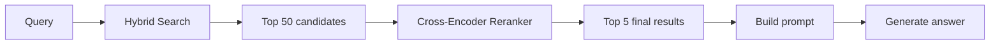
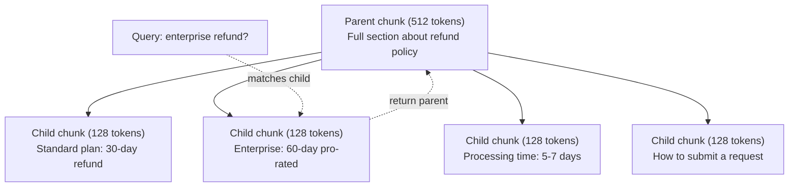
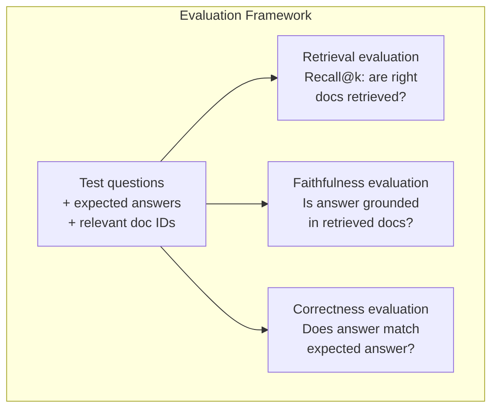

# 進階 RAG (Chunking、Reranking、Hybrid Search)

> 基本的 RAG 會檢索 top-k 最相似的 chunk。這對簡單的問題行得通，但在多跳推理、模糊的查詢和大型語料上就會失靈。進階 RAG 的差別，就在於一個只能處理 10 份文件的 demo，和一個能處理 1,000 萬份文件的系統。

**Type:** Build
**Languages:** Python
**Prerequisites:** Phase 11, Lesson 06 (RAG)
**Time:** ~90 分鐘
**Related:** Phase 5 · 23 (Chunking Strategies for RAG) 涵蓋全部六種 chunking 演算法 — recursive、semantic、sentence、parent-document、late chunking、contextual retrieval — 並附有 Vectara/Anthropic 的 benchmark。這堂課在它之上繼續往下建：hybrid search、reranking、查詢轉換。

## 學習目標 (Learning Objectives)

- 實作進階的 chunking 策略（semantic、recursive、parent-child），保留文件的結構與 context
- 建立 hybrid search pipeline，結合 BM25 關鍵字比對、語意向量搜尋與 cross-encoder reranker
- 運用查詢轉換技巧（HyDE、multi-query、step-back），改善模糊或複雜問題的檢索
- 診斷並修正常見的 RAG 失敗：檢索到錯的 chunk、答案不在 context 裡、多跳推理失敗

## 問題 (The Problem)

你在第 06 課建了一條基本的 RAG pipeline。它在小型語料上對直白的問題有效。現在試試這些：

**模糊的查詢**：「What was revenue last quarter?」語意搜尋回傳的 chunk 談的是營收策略、營收預測，以及 CFO 對營收成長的想法。它們在語意上都和「revenue」這個字很相似，但沒有一個包含實際的數字。正確的 chunk 寫著「$47.2M in Q3 2025」，卻用的是「earnings」而不是「revenue」。Embedding 模型認為「revenue strategy」比「Q3 earnings were $47.2M」更接近這個查詢。

**多跳問題**：「Which team had the highest customer satisfaction score improvement?」這需要找出每個團隊的滿意度分數、比較它們，再找出最大值。沒有任何單一 chunk 包含答案。資訊散落在各個團隊的報告裡。

**大型語料問題**：你有 200 萬個 chunk。正確答案在 chunk #1,847,293。你的 top-5 檢索拉出的是 chunk #14、#89,201、#1,200,000、#44 和 #901,333。它們在 embedding 空間中很接近，但沒有一個包含答案。在這個規模下，近似最近鄰搜尋引入了足夠的誤差，讓相關的結果被擠出 top-k。

基本 RAG 會失敗，是因為向量相似度不等於相關性。一個 chunk 可以在語意上與查詢很相似，卻對回答問題沒有幫助。進階 RAG 用四種技術來解決這個問題：hybrid search（加入關鍵字比對）、reranking（更仔細地為候選項評分）、查詢轉換（搜尋之前先修正查詢）以及更好的 chunking（用正確的粒度檢索）。

## 核心概念 (The Concept)

### Hybrid Search：語意加關鍵字

語意搜尋（向量相似度）擅長理解語意。「How do I cancel my subscription?」可以匹配「Steps to terminate your plan」，即使兩者沒有共用的字。但它會漏掉精確比對。「Error code E-4021」可能無法匹配到包含「E-4021」的 chunk，如果 embedding 模型把它當成雜訊的話。

關鍵字搜尋 (BM25) 正好相反。它擅長精確比對。「E-4021」能完美匹配。但如果文件寫的是「terminate your plan」，「cancel my subscription」就會回傳零筆結果。

Hybrid search 會兩種都跑，再合併結果。

**BM25** (Best Matching 25) 是標準的關鍵字搜尋演算法。從 1990 年代起，它一直是搜尋引擎的骨幹。公式如下：

```
BM25(q, d) = sum over terms t in q:
    IDF(t) * (tf(t,d) * (k1 + 1)) / (tf(t,d) + k1 * (1 - b + b * |d| / avgdl))
```

其中 tf(t,d) 是 t 在文件 d 中的詞頻，IDF(t) 是逆文件頻率，|d| 是文件長度，avgdl 是平均文件長度，k1 控制詞頻的飽和程度（預設 1.2），b 控制長度正規化（預設 0.75）。

簡單來說：BM25 會給包含查詢詞（尤其是罕見詞）的文件較高的分數，但重複出現的詞有邊際遞減的效果。一份出現「revenue」50 次的文件，並不會比出現 1 次的文件相關 50 倍。

### Reciprocal Rank Fusion (RRF)

你有兩份排序清單：一份來自向量搜尋，一份來自 BM25。要怎麼合併？Reciprocal Rank Fusion 是標準做法。

```
RRF_score(d) = sum over rankings R:
    1 / (k + rank_R(d))
```

其中 k 是常數（通常是 60），用來避免排名第一的結果獨占優勢。

在向量搜尋排名 #1、在 BM25 排名 #5 的文件，得分是：1/(60+1) + 1/(60+5) = 0.0164 + 0.0154 = 0.0318

在向量搜尋排名 #3、在 BM25 排名 #2 的文件，得分是：1/(60+3) + 1/(60+2) = 0.0159 + 0.0161 = 0.0320

RRF 自然地平衡了兩種訊號。在兩份清單中都排名很前面的文件，得到最佳分數。在一份清單中排名 #1、但在另一份中缺席的文件，得到中等分數。這很穩健，因為它使用的是排名而不是原始分數，所以兩個系統之間分數分布的差異不會造成影響。

### Reranking

檢索（不論是向量、關鍵字或 hybrid）速度快但不夠精確。它使用 bi-encoder：查詢與每份文件各自獨立做 embedding，然後比較。Embedding 只算一次並快取起來。這可以擴展到數百萬份文件。

Reranking 使用 cross-encoder：把查詢與候選文件一起餵進模型，輸出相關性分數。模型同時看到兩段文字，能捕捉它們之間細緻的互動。Cross-encoder 能理解「What were Q3 earnings?」與包含「$47.2M in Q3」的 chunk 高度相關，即使 bi-encoder 漏掉了這層關聯。

取捨是：cross-encoder 比 bi-encoder 慢 100-1000 倍，因為它要同時處理查詢與文件的配對。你沒辦法為一百萬份文件預先計算 cross-encoder 的分數。解法是：先檢索較大的候選集（hybrid search 的 top-50），再用 cross-encoder 重新排序，得到最後的 top-5。



常見的 reranking 模型（2026 年陣容）：
- Cohere Rerank 3.5：託管 API，支援多語言，在混合語料上 recall 提升最多
- Voyage rerank-2.5：託管 API，託管選項中延遲最低
- Jina-Reranker-v2 Multilingual：open-weight，支援 100 多種語言
- bge-reranker-v2-m3：open-weight，強大的基準線
- cross-encoder/ms-marco-MiniLM-L-6-v2：open-weight，可在 CPU 上執行，適合原型開發
- ColBERTv2 / Jina-ColBERT-v2：late-interaction 的 multi-vector reranker — 評分時的複雜度是 $O(\text{tokens})$ 而非 $O(\text{docs})$

### 查詢轉換 (Query Transformation)

有時問題不在檢索，而在查詢本身。「What was that thing about the new policy change?」是個很糟的搜尋查詢。它沒有任何具體的詞。Embedding 很模糊。沒有任何檢索系統能靠這個找到正確的文件。

**查詢改寫 (Query rewriting)**：把使用者的查詢改寫成更好的搜尋查詢。LLM 可以做到：

```
User: "What was that thing about the new policy change?"
Rewritten: "Recent policy changes and updates"
```

**HyDE (Hypothetical Document Embeddings)**：不用查詢去搜尋，而是先產生一個假設的答案，對它做 embedding，再搜尋相似的真實文件。

```
Query: "What is the refund policy for enterprise?"
Hypothetical answer: "Enterprise customers are eligible for a full refund
within 60 days of purchase. Refunds are pro-rated based on the remaining
subscription period and processed within 5-7 business days."
```

對假設的答案做 embedding，再搜尋與它相似的真實文件。直覺是：假設的答案在 embedding 空間中，比原本的問題更接近真正的答案。問題與答案的語言結構不同。藉由產生假設的答案，你在 embedding 中橋接了「問題空間」與「答案空間」之間的落差。

HyDE 在檢索之前多一次 LLM 呼叫，會增加 500-2000ms 的延遲。當原始查詢的檢索品質不佳時，這很值得。

### Parent-Child Chunking

標準的 chunking 迫使你做取捨：小 chunk 利於精準檢索，大 chunk 提供足夠的 context。Parent-child chunking 消除了這個取捨。

用小 chunk（128 tokens）建立索引來檢索。當小 chunk 被檢索到時，回傳它的 parent chunk（512 tokens）放進 prompt。小 chunk 精準地匹配查詢。Parent chunk 則提供足夠的 context，讓 LLM 產生好的答案。



查詢「enterprise refund?」精準地匹配到 child chunk C2。但 prompt 收到的是完整的 parent chunk P，其中包含關於處理時間與提交流程的周邊 context。

### Metadata 過濾 (Metadata Filtering)

在執行向量搜尋之前，先依 metadata 過濾語料：日期、來源、類別、作者、語言。這能縮小搜尋空間，避免不相關的結果。

「What changed in the security policy last month?」應該只搜尋 security 類別中過去 30 天的文件。如果沒有 metadata 過濾，你會搜尋整個語料，可能檢索到一份兩年前、剛好語意相似的安全文件。

Production RAG 系統會把 metadata 與每個 chunk 一起儲存：來源文件、建立日期、類別、作者、版本。向量資料庫支援在相似度搜尋之前，先依 metadata 做預先過濾，這對大規模下的效能至關重要。

### 評估 (Evaluation)

你建了一個 RAG 系統。要怎麼知道它有沒有用？有三個指標：

**檢索相關性 (Recall@k)**：對於一組已知相關文件的測試問題，有多少百分比的相關文件出現在 top-k 結果中？如果某個問題的答案在 chunk #47，那 chunk #47 有出現在 top-5 嗎？

**Faithfulness**：生成的答案是否以檢索到的文件為依據？如果檢索到的 chunk 寫「60-day refund window」，而模型說「90-day refund window」，那就是 faithfulness 失敗。模型即使有正確的 context，仍然 hallucinate 了。

**答案正確性 (Answer correctness)**：生成的答案是否符合預期答案？這是端到端的指標。它結合了檢索品質與生成品質。

一個簡單的 faithfulness 檢查：取生成答案中的每個主張，驗證它（實質上）出現在檢索到的 chunk 中。如果答案包含任何 chunk 都沒有的事實，它很可能是 hallucinate 出來的。



```figure
agentic-rag-loop
```

## 動手做 (Build It)

### 步驟 1：BM25 實作

```python
import math
from collections import Counter

class BM25:
    def __init__(self, k1=1.2, b=0.75):
        self.k1 = k1
        self.b = b
        self.docs = []
        self.doc_lengths = []
        self.avg_dl = 0
        self.doc_freqs = {}
        self.n_docs = 0

    def index(self, documents):
        self.docs = documents
        self.n_docs = len(documents)
        self.doc_lengths = []
        self.doc_freqs = {}

        for doc in documents:
            words = doc.lower().split()
            self.doc_lengths.append(len(words))
            unique_words = set(words)
            for word in unique_words:
                self.doc_freqs[word] = self.doc_freqs.get(word, 0) + 1

        self.avg_dl = sum(self.doc_lengths) / self.n_docs if self.n_docs else 1

    def score(self, query, doc_idx):
        query_words = query.lower().split()
        doc_words = self.docs[doc_idx].lower().split()
        doc_len = self.doc_lengths[doc_idx]
        word_counts = Counter(doc_words)
        score = 0.0

        for term in query_words:
            if term not in word_counts:
                continue
            tf = word_counts[term]
            df = self.doc_freqs.get(term, 0)
            idf = math.log((self.n_docs - df + 0.5) / (df + 0.5) + 1)
            numerator = tf * (self.k1 + 1)
            denominator = tf + self.k1 * (1 - self.b + self.b * doc_len / self.avg_dl)
            score += idf * numerator / denominator

        return score

    def search(self, query, top_k=10):
        scores = [(i, self.score(query, i)) for i in range(self.n_docs)]
        scores.sort(key=lambda x: x[1], reverse=True)
        return scores[:top_k]
```

### 步驟 2：Reciprocal Rank Fusion

```python
def reciprocal_rank_fusion(ranked_lists, k=60):
    scores = {}
    for ranked_list in ranked_lists:
        for rank, (doc_id, _) in enumerate(ranked_list):
            if doc_id not in scores:
                scores[doc_id] = 0.0
            scores[doc_id] += 1.0 / (k + rank + 1)
    fused = sorted(scores.items(), key=lambda x: x[1], reverse=True)
    return fused
```

### 步驟 3：Hybrid Search Pipeline

```python
def hybrid_search(query, chunks, vector_embeddings, vocab, idf, bm25_index, top_k=5, fusion_k=60):
    query_emb = tfidf_embed(query, vocab, idf)
    vector_results = search(query_emb, vector_embeddings, top_k=top_k * 3)
    bm25_results = bm25_index.search(query, top_k=top_k * 3)
    fused = reciprocal_rank_fusion([vector_results, bm25_results], k=fusion_k)
    return fused[:top_k]
```

### 步驟 4：簡單的 Reranker

在 production 中，你會使用 cross-encoder 模型。這裡我們建一個 reranker，用字詞重疊、詞的重要性與片語比對，來為查詢與文件的相關性評分。

```python
def rerank(query, candidates, chunks):
    query_words = set(query.lower().split())
    stop_words = {"the", "a", "an", "is", "are", "was", "were", "what", "how",
                  "why", "when", "where", "do", "does", "for", "of", "in", "to",
                  "and", "or", "on", "at", "by", "it", "its", "this", "that",
                  "with", "from", "be", "has", "have", "had", "not", "but"}
    query_terms = query_words - stop_words

    scored = []
    for doc_id, initial_score in candidates:
        chunk = chunks[doc_id].lower()
        chunk_words = set(chunk.split())

        term_overlap = len(query_terms & chunk_words)

        query_bigrams = set()
        q_list = [w for w in query.lower().split() if w not in stop_words]
        for i in range(len(q_list) - 1):
            query_bigrams.add(q_list[i] + " " + q_list[i + 1])
        bigram_matches = sum(1 for bg in query_bigrams if bg in chunk)

        position_boost = 0
        for term in query_terms:
            pos = chunk.find(term)
            if pos != -1 and pos < len(chunk) // 3:
                position_boost += 0.5

        rerank_score = (
            term_overlap * 1.0
            + bigram_matches * 2.0
            + position_boost
            + initial_score * 5.0
        )
        scored.append((doc_id, rerank_score))

    scored.sort(key=lambda x: x[1], reverse=True)
    return scored
```

### 步驟 5：HyDE (Hypothetical Document Embeddings)

```python
def hyde_generate_hypothesis(query):
    templates = {
        "what": "The answer to '{query}' is as follows: Based on our documentation, {topic} involves specific policies and procedures that define how the process works.",
        "how": "To address '{query}': The process involves several steps. First, you need to initiate the request. Then, the system processes it according to the defined rules.",
        "default": "Regarding '{query}': Our records indicate specific details and policies related to this topic that provide a comprehensive answer."
    }
    query_lower = query.lower()
    if query_lower.startswith("what"):
        template = templates["what"]
    elif query_lower.startswith("how"):
        template = templates["how"]
    else:
        template = templates["default"]

    topic_words = [w for w in query.lower().split()
                   if w not in {"what", "is", "the", "how", "do", "does", "a", "an",
                                "for", "of", "to", "in", "on", "at", "by", "and", "or"}]
    topic = " ".join(topic_words) if topic_words else "this topic"

    return template.format(query=query, topic=topic)


def hyde_search(query, chunks, vector_embeddings, vocab, idf, top_k=5):
    hypothesis = hyde_generate_hypothesis(query)
    hypothesis_emb = tfidf_embed(hypothesis, vocab, idf)
    results = search(hypothesis_emb, vector_embeddings, top_k)
    return results, hypothesis
```

### 步驟 6：Parent-Child Chunking

```python
def create_parent_child_chunks(text, parent_size=200, child_size=50):
    words = text.split()
    parents = []
    children = []
    child_to_parent = {}

    parent_idx = 0
    start = 0
    while start < len(words):
        parent_end = min(start + parent_size, len(words))
        parent_text = " ".join(words[start:parent_end])
        parents.append(parent_text)

        child_start = start
        while child_start < parent_end:
            child_end = min(child_start + child_size, parent_end)
            child_text = " ".join(words[child_start:child_end])
            child_idx = len(children)
            children.append(child_text)
            child_to_parent[child_idx] = parent_idx
            child_start += child_size

        parent_idx += 1
        start += parent_size

    return parents, children, child_to_parent
```

### 步驟 7：Faithfulness 評估

```python
def evaluate_faithfulness(answer, retrieved_chunks):
    answer_sentences = [s.strip() for s in answer.split(".") if len(s.strip()) > 10]
    if not answer_sentences:
        return 1.0, []

    grounded = 0
    ungrounded = []
    context = " ".join(retrieved_chunks).lower()

    for sentence in answer_sentences:
        words = set(sentence.lower().split())
        stop_words = {"the", "a", "an", "is", "are", "was", "were", "and", "or",
                      "to", "of", "in", "for", "on", "at", "by", "it", "this", "that"}
        content_words = words - stop_words
        if not content_words:
            grounded += 1
            continue

        matched = sum(1 for w in content_words if w in context)
        ratio = matched / len(content_words) if content_words else 0

        if ratio >= 0.5:
            grounded += 1
        else:
            ungrounded.append(sentence)

    score = grounded / len(answer_sentences) if answer_sentences else 1.0
    return score, ungrounded


def evaluate_retrieval_recall(queries_with_relevant, retrieval_fn, k=5):
    total_recall = 0.0
    results = []

    for query, relevant_indices in queries_with_relevant:
        retrieved = retrieval_fn(query, k)
        retrieved_indices = set(idx for idx, _ in retrieved)
        relevant_set = set(relevant_indices)
        hits = len(retrieved_indices & relevant_set)
        recall = hits / len(relevant_set) if relevant_set else 1.0
        total_recall += recall
        results.append({
            "query": query,
            "recall": recall,
            "hits": hits,
            "total_relevant": len(relevant_set)
        })

    avg_recall = total_recall / len(queries_with_relevant) if queries_with_relevant else 0
    return avg_recall, results
```

## 實際使用 (Use It)

用真正的 cross-encoder 做 reranking：

```python
from sentence_transformers import CrossEncoder

reranker = CrossEncoder("cross-encoder/ms-marco-MiniLM-L-6-v2")

def rerank_with_cross_encoder(query, candidates, chunks, top_k=5):
    pairs = [(query, chunks[doc_id]) for doc_id, _ in candidates]
    scores = reranker.predict(pairs)
    scored = list(zip([doc_id for doc_id, _ in candidates], scores))
    scored.sort(key=lambda x: x[1], reverse=True)
    return scored[:top_k]
```

用 Cohere 的託管 reranker：

```python
import cohere

co = cohere.Client()

def rerank_with_cohere(query, candidates, chunks, top_k=5):
    docs = [chunks[doc_id] for doc_id, _ in candidates]
    response = co.rerank(
        model="rerank-english-v3.0",
        query=query,
        documents=docs,
        top_n=top_k
    )
    return [(candidates[r.index][0], r.relevance_score) for r in response.results]
```

用真正的 LLM 做 HyDE：

```python
import anthropic

client = anthropic.Anthropic()

def hyde_with_llm(query):
    response = client.messages.create(
        model="claude-sonnet-5",
        max_tokens=256,
        messages=[{
            "role": "user",
            "content": f"Write a short paragraph that would be a good answer to this question. Do not say you don't know. Just write what the answer would look like.\n\nQuestion: {query}"
        }]
    )
    return response.content[0].text
```

用 Weaviate 做 production 的 hybrid search：

```python
import weaviate

client = weaviate.connect_to_local()

collection = client.collections.get("Documents")
response = collection.query.hybrid(
    query="enterprise refund policy",
    alpha=0.5,
    limit=10
)
```

alpha 參數控制平衡：0.0 = 純關鍵字 (BM25)，1.0 = 純向量，0.5 = 兩者等權重。多數 production 系統使用介於 0.3 到 0.7 之間的 alpha。

## 交付 (Ship It)

這堂課會產出：
- `outputs/prompt-advanced-rag-debugger.md` -- 一個 prompt，用來診斷並修正 RAG 的品質問題
- `outputs/skill-advanced-rag.md` -- 一個 skill，用來建立具備 hybrid search 與 reranking 的 production 等級 RAG

## 練習 (Exercises)

1. 在範例文件上比較 BM25、向量搜尋與 hybrid search。對 5 個測試查詢，各自記錄哪種方法在第 #1 位回傳最相關的 chunk。Hybrid search 應該在 5 個中至少贏 3 個。

2. 實作 metadata 過濾。為每份文件加上「category」欄位（security、billing、api、product）。在執行向量搜尋之前，先把 chunk 過濾成只剩相關的類別。用「What encryption is used?」測試，並驗證它只搜尋 security 類別的 chunk。

3. 用第 06 課的簡單 generate 函式，建立完整的 HyDE pipeline。在全部 5 個測試查詢上，比較直接查詢搜尋與 HyDE 搜尋的檢索品質（top-3 的相關性）。HyDE 應該能改善模糊查詢的結果。

4. 在範例文件上實作 parent-child chunking 策略。使用 child_size=30 與 parent_size=100。用 child chunk 搜尋，但在 prompt 中回傳 parent chunk。把生成的答案與 chunk_size=50 的標準 chunking 做比較。

5. 建立評估資料集：10 個問題，並附上已知的答案 chunk。針對 (a) 僅向量搜尋、(b) 僅 BM25、(c) hybrid search、(d) hybrid + reranking，量測 Recall@3、Recall@5 和 Recall@10。畫出結果，並找出 reranking 在哪裡幫助最大。

## 關鍵術語 (Key Terms)

| 術語 | 一般說法 | 實際意義 |
|------|----------------|----------------------|
| BM25 | 「關鍵字搜尋」 | 一種機率式排序演算法，依詞頻、逆文件頻率與文件長度正規化來為文件評分 |
| Hybrid search | 「兩全其美」 | 平行執行語意（向量）搜尋與關鍵字 (BM25) 搜尋，再用 rank fusion 合併結果 |
| Reciprocal Rank Fusion | 「合併排序清單」 | 把每份文件在所有清單中的 1/(k + rank) 加總，藉此合併多份排序清單 |
| Reranking | 「第二輪評分」 | 用更昂貴的 cross-encoder 模型，對初步檢索得到的候選集重新評分 |
| Cross-encoder | 「查詢與文件的聯合模型」 | 把查詢與文件當成單一輸入、輸出相關性分數的模型；比 bi-encoder 更準確，但對整個語料搜尋來說太慢 |
| Bi-encoder | 「獨立的 embedding 模型」 | 獨立地對查詢與文件做 embedding 的模型；因為 embedding 可預先算好所以很快，但準確度不如 cross-encoder |
| HyDE | 「用假答案去搜尋」 | 為查詢產生一個假設的答案，對它做 embedding，再搜尋與它相似的真實文件 |
| Parent-child chunking | 「小塊搜尋，大塊 context」 | 為小 chunk 建立索引以精準檢索，但回傳較大的 parent chunk 以提供足夠的 context |
| Metadata filtering | 「搜尋前先縮小範圍」 | 在執行向量搜尋之前，先依屬性（日期、來源、類別）過濾文件，以縮小搜尋空間 |
| Faithfulness | 「有沒有守住依據」 | 生成的答案是否被檢索到的文件所支持，而不是從模型訓練資料中 hallucinate 出來的 |

## 延伸閱讀 (Further Reading)

- Robertson & Zaragoza, "The Probabilistic Relevance Framework: BM25 and Beyond" (2009) -- BM25 的權威參考資料，說明公式背後的機率基礎
- Cormack et al., "Reciprocal Rank Fusion Outperforms Condorcet and Individual Rank Learning Methods" (2009) -- 原始的 RRF 論文，證明它勝過更複雜的融合方法
- Gao et al., "Precise Zero-Shot Dense Retrieval without Relevance Labels" (2022) -- HyDE 論文，證明 hypothetical document embeddings 不需要任何訓練資料就能改善檢索
- Nogueira & Cho, "Passage Re-ranking with BERT" (2019) -- 顯示在 BM25 之上加上 cross-encoder reranking，能大幅改善檢索品質
- [Khattab et al., "DSPy: Compiling Declarative Language Model Calls into Self-Improving Pipelines" (2023)](https://arxiv.org/abs/2310.03714) -- 把 prompt 的建構與權重的選擇視為對檢索 pipeline 的最佳化問題；想「為 LLM 寫程式」而非「對 LLM 下 prompt」時請讀這篇。
- [Edge et al., "From Local to Global: A Graph RAG Approach to Query-Focused Summarization" (Microsoft Research 2024)](https://arxiv.org/abs/2404.16130) -- GraphRAG 論文：實體-關係擷取加上 Leiden 社群偵測，用於以查詢為焦點的摘要；global 與 local 檢索的區別。
- [Asai et al., "Self-RAG: Learning to Retrieve, Generate, and Critique through Self-Reflection" (ICLR 2024)](https://arxiv.org/abs/2310.11511) -- 帶有 reflection token 的自我評估 RAG；超越靜態 retrieve-then-generate 的 agentic 前沿。
- [LangChain Query Construction blog](https://blog.langchain.dev/query-construction/) -- 如何把自然語言查詢轉換成結構化的資料庫查詢（Text-to-SQL、Cypher），作為檢索前的步驟。
