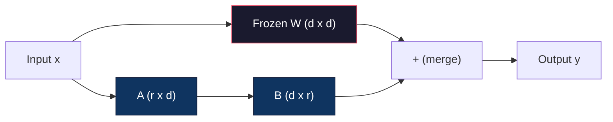
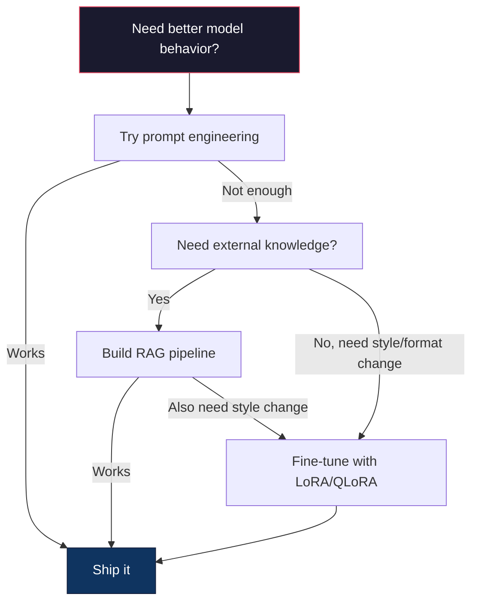

# 用 LoRA 與 QLoRA 做 Fine-Tuning

> 對 7B 模型做完整的 fine-tuning 需要 56GB 的 VRAM。你沒有，大多數公司也沒有。LoRA 讓你只訓練不到 1% 的參數，就能用 6GB 對同一個模型做 fine-tuning。這不是妥協 -- 在大多數任務上，它的品質與完整 fine-tuning 相當。整個開源 fine-tuning 生態系，都靠這一招運轉。

**Type:** Build
**Languages:** Python
**Prerequisites:** Phase 10, Lesson 06 (Instruction Tuning / SFT)
**Time:** ~75 分鐘
**Related:** Phase 10 從零實作了 SFT/DPO 迴圈。這堂課把它們接上 2026 年的 PEFT 工具組（PEFT、TRL、Unsloth、Axolotl、LLaMA-Factory）。

## 學習目標 (Learning Objectives)

- 把低秩 adapter 矩陣（A 與 B）注入預訓練模型的 attention 層，實作 LoRA
- 計算 LoRA 相較於完整 fine-tuning 節省的參數量：秩 $r$ 搭配 $d_{\text{model}}$ 維度，訓練的是 $2 \cdot r \cdot d$ 個參數，而不是 $d^2$
- 用 QLoRA（4-bit 量化的 base + LoRA adapter）進行 fine-tuning，讓它能放進一般消費級 GPU 的記憶體
- 把 LoRA 權重合併回 base 模型以便部署，並比較有無 adapter 時的推論速度

## 問題 (The Problem)

你有一個 base 模型：Llama 3 8B。你想讓它用你公司的口吻回答客服工單。答案是 SFT。但 SFT 有成本問題。

完整 fine-tuning 會更新模型中的每個參數。Llama 3 8B 有 80 億個參數。在 fp16 下，每個參數佔 2 bytes。光是載入權重就要 16GB。訓練時，你還需要 gradient（16GB）、Adam 的 optimizer state（momentum + variance 共 32GB），以及 activation。總計：單一個 8B 模型大約要 56GB 的 VRAM。

一張 A100 80GB 勉強放得下。兩張 A100 在雲端供應商上每小時要 $3-4。在 50,000 筆範例上訓練 3 個 epoch，要花 6 到 10 小時。每次實驗 $30-40。跑 10 次實驗才調對 hyperparameter，在部署任何東西之前你就已經花了 $400。

把規模放大到 Llama 3 70B，數字就誇張了。光是權重就要 140GB。你需要一個叢集。每次實驗 $100 以上。

還有更深層的問題。完整 fine-tuning 會修改模型中的每個權重。如果你用客服資料做 fine-tuning，可能會削弱模型的通用能力。這叫做 catastrophic forgetting。模型在你的任務上變好了，在其他所有事情上卻變差了。

你需要一個方法：訓練更少的參數、使用更少的記憶體，而且不會摧毀模型既有的知識。

## 核心概念 (The Concept)

### LoRA：Low-Rank Adaptation

Microsoft 的 Edward Hu 與同事在 2021 年 6 月發表了 LoRA。論文的洞察是：fine-tuning 期間的權重更新具有低的內在秩 (intrinsic rank)。你不需要更新 4096x4096 權重矩陣中全部 1,670 萬個參數。更新中真正有用的資訊，可以用秩為 16 或 32 的矩陣來捕捉。

數學如下。標準的線性層計算：

```math
y = Wx
```

其中 $W$ 是 $d_{\text{out}} \times d_{\text{in}}$ 的矩陣。以 4096x4096 的 attention projection 來說，就是 16,777,216 個參數。

LoRA 凍結 $W$，並加上一個低秩分解：

```math
y = Wx + BAx
```

其中 $B$ 是 $(d_{\text{out}} \times r)$，$A$ 是 $(r \times d_{\text{in}})$。秩 $r$ 比 $d$ 小很多 -- 通常是 8、16 或 32。

對 4096x4096 的層取 $r=16$：
- 原始參數：4096 x 4096 = 16,777,216
- LoRA 參數：(4096 x 16) + (16 x 4096) = 65,536 + 65,536 = 131,072
- 縮減比例：131,072 / 16,777,216 = 0.78%

你只訓練 0.78% 的參數，卻能得到 95-100% 的品質。



A 以隨機 Gaussian 初始化。B 初始化為零。這代表 LoRA 的貢獻一開始是零 -- 模型從原本的行為開始訓練，再逐漸學會適應。

### 縮放係數：Alpha

LoRA 引入縮放係數 $\alpha$，控制低秩更新對輸出的影響有多大：

```math
y = Wx + \frac{\alpha}{r} \cdot BAx
```

當 $\alpha = r$ 時，縮放為 1 倍。當 $\alpha = 2r$（常見的預設值）時，縮放為 2 倍。這個 hyperparameter 獨立於 base learning rate，控制 LoRA 路徑的學習率。

實務上的指引：
- $\alpha = 2 \cdot \text{rank}$ 是社群常見的慣例（原始論文在多數實驗中使用 $\alpha = \text{rank}$）
- $\alpha = \text{rank}$ 提供 1 倍縮放，保守但穩定
- 較高的 $\alpha$ 代表每一步的更新較大，可能加快收斂，也可能造成不穩定

### 該把 LoRA 用在哪裡 (Where to Apply LoRA)

Transformer 有許多線性層。你不需要在所有層都加上 LoRA。原始論文測試了不同的組合：

| 目標層 | 可訓練參數 (7B) | 品質 |
|--------------|----------------------|---------|
| 僅 q_proj | 4.7M | 好 |
| q_proj + v_proj | 9.4M | 更好 |
| q_proj + k_proj + v_proj + o_proj | 18.9M | attention 中最佳 |
| 全部線性層 (attention + MLP) | 37.7M | 增益有限，參數量 2 倍 |

多數任務的甜蜜點是：q_proj + v_proj。這針對 self-attention 中的 query 與 value projection，它們控制模型關注什麼，以及萃取什麼資訊。加入 MLP 層對程式碼生成這類複雜任務有幫助，但參數量會加倍，對較簡單的任務則報酬遞減。

### 秩的選擇 (Rank Selection)

秩 $r$ 控制適應 (adaptation) 的表達能力：

| 秩 | 可訓練參數（每層） | 最適合 |
|------|---------------------------|----------|
| 4 | 32,768 | 簡單的分類、情感分析 |
| 8 | 65,536 | 單一領域的問答、摘要 |
| 16 | 131,072 | 多領域任務、指令遵循 |
| 32 | 262,144 | 複雜推理、程式碼生成 |
| 64 | 524,288 | 對多數任務來說報酬遞減 |
| 128 | 1,048,576 | 很少有理由使用 |

Hu et al. 顯示，對簡單任務來說，$r=4$ 就已經捕捉了大部分的適應。實務上最常見的選擇是 $r=8$ 與 $r=16$。超過 $r=64$ 很少能改善品質，還會開始失去 LoRA 在記憶體上的優勢。

### QLoRA：4-Bit 量化加 LoRA

華盛頓大學的 Tim Dettmers 與同事在 2023 年 5 月發表了 QLoRA。想法是：把凍結的 base 模型量化成 4-bit 精度，再在上面接上 fp16 的 LoRA adapter。

這大幅改變了記憶體的算式：

| 方法 | 權重記憶體 (7B) | 訓練記憶體 (7B) | 需要的 GPU |
|--------|-------------------|---------------------|-------------|
| 完整 fine-tune (fp16) | 14GB | ~56GB | 1x A100 80GB |
| LoRA (fp16 base) | 14GB | ~18GB | 1x A100 40GB |
| QLoRA (4-bit base) | 3.5GB | ~6GB | 1x RTX 3090 24GB |

QLoRA 有三項技術貢獻：

**NF4 (Normal Float 4-bit)**：一種專為神經網路權重設計的新資料型別。神經網路權重大致服從常態分布。NF4 把它的 16 個量化層級，放在標準常態分布的分位數上。對於常態分布的資料，這在資訊理論上是最佳的。它損失的資訊比均勻的 4-bit 量化 (INT4) 或標準 Float4 更少。

**Double quantization**：量化常數本身也佔記憶體。每 64 個權重的區塊需要一個 fp32 的縮放係數（4 bytes）。對 7B 模型來說，額外多出 0.4GB。Double quantization 把這些常數量化成 fp8，將額外負擔降到 0.1GB。很小，但累積起來有差。

**Paged optimizer**：訓練時，optimizer state（Adam 的 momentum 與 variance）在長序列上可能超過 GPU 記憶體。Paged optimizer 利用 NVIDIA 的 unified memory，在 GPU 記憶體用完時自動把 optimizer state 換頁到 CPU RAM，需要時再換回來。這能避免 OOM 當機，代價是一些吞吐量。

### 品質的問題 (The Quality Question)

減少參數或量化 base 會損害品質嗎？來自多篇論文的結果：

| 方法 | MMLU (5-shot) | MT-Bench | HumanEval |
|--------|--------------|----------|-----------|
| 完整 fine-tune (Llama 2 7B) | 48.3 | 6.72 | 14.6 |
| LoRA r=16 | 47.9 | 6.68 | 14.0 |
| QLoRA r=16 (NF4) | 47.5 | 6.61 | 13.4 |
| QLoRA r=64 (NF4) | 48.1 | 6.70 | 14.2 |

在多數 benchmark 上，$r=16$ 的 LoRA 與完整 fine-tuning 相差不到 1%。$r=16$ 的 QLoRA 又再損失零點幾個百分點。$r=64$ 的 QLoRA 基本上與完整 fine-tuning 相當，同時少用 90% 的記憶體。

### 真實世界的成本 (Real-World Costs)

在 50,000 筆範例上對 Llama 3 8B 做 fine-tuning（3 個 epoch）：

| 方法 | GPU | 時間 | 成本 |
|--------|-----|------|------|
| 完整 fine-tune | 2x A100 80GB | 8 小時 | ~$32 |
| LoRA r=16 | 1x A100 40GB | 4 小時 | ~$8 |
| QLoRA r=16 | 1x RTX 4090 24GB | 6 小時 | ~$5 |
| QLoRA r=16 (Unsloth) | 1x RTX 4090 24GB | 2.5 小時 | ~$2 |
| QLoRA r=16 | 1x T4 16GB | 12 小時 | ~$4 |

在單張消費級 GPU 上跑 QLoRA，花費比一頓午餐還少。這就是 open-weight fine-tuning 社群在 2023 年爆發的原因，也是為什麼下面的每個訓練框架在 2026 年都預設內建 QLoRA。

### 2026 年的 PEFT 技術堆疊 (The 2026 PEFT stack)

| 框架 | 它是什麼 | 何時選用 |
|-----------|-----------|-----------|
| **Hugging Face PEFT** | 標準的 LoRA/QLoRA/DoRA/IA3 函式庫 | 你想要完全掌控，而且你的訓練迴圈已經建立在 `transformers.Trainer` 上 |
| **TRL** | HF 的 reinforcement-from-feedback 訓練器（SFT、DPO、GRPO、PPO、ORPO） | SFT 之後你需要 DPO/GRPO；建立在 PEFT 之上 |
| **Unsloth** | 以 Triton kernel 重寫的 forward/backward pass | 你想要 2-5 倍加速、一半的 VRAM，且不損失準確度；適用 Llama/Mistral/Qwen 系列 |
| **Axolotl** | 包裝 PEFT + TRL + DeepSpeed + Unsloth 的 YAML 設定檔 wrapper | 你想要可重現、受版本控制的訓練流程 |
| **LLaMA-Factory** | 包裝 PEFT + TRL 的 GUI/CLI/API | 你想要零程式碼的 fine-tuning；支援 100 多個模型系列 |
| **torchtune** | 原生 PyTorch 配方，不依賴 `transformers` | 你想要最少的相依套件，而且你的組織已經以 PyTorch 為標準 |

經驗法則：研究用途或一次性實驗 → PEFT。可重複的 production pipeline → 啟用 Unsloth kernel 的 Axolotl。拋棄式的原型開發 → LLaMA-Factory。

### 合併 Adapter (Merging Adapters)

訓練完成後，你有兩樣東西：凍結的 base 模型，以及一個小型的 LoRA adapter（通常 10-100MB）。你可以選擇：

1. **分開保存**：載入 base 模型，再在上面載入 adapter。針對不同任務更換 adapter。這就是你用同一個 base 模型提供多個 fine-tune 變體的方式。

2. **永久合併**：計算 $W' = W + (\alpha/r) \cdot BA$，並把結果存成新的完整模型。合併後的模型與原始模型大小相同。沒有推論額外負擔，也不用管理 adapter。

要服務多個任務（客服 adapter、程式碼 adapter、翻譯 adapter）時，請分開保存。要部署單一專用模型時，請合併。

合併多個 adapter 的進階技巧：

- **TIES-Merging** (Yadav et al. 2023)：修剪數值很小的參數、解決符號衝突，然後再合併。減少 adapter 之間的干擾。
- **DARE** (Yu et al. 2023)：合併前隨機丟掉 adapter 的參數，並重新縮放其餘部分。在結合能力上出乎意料地有效。
- **Task arithmetic**：直接對 adapter 權重做加減。把「程式碼」adapter 與「數學」adapter 相加，往往能得到兩者都擅長的模型。

### 何時不該 Fine-Tune (When NOT to Fine-Tune)

Fine-tuning 是第三個選項，不是第一個。

**第一：prompt engineering。**寫更好的 system prompt。加入 few-shot 範例。使用 chain-of-thought。這不花錢，幾分鐘就能做完。如果 prompting 已經能讓你完成 80%，你大概不需要 fine-tune。

**第二：RAG。**如果模型需要知道你的特定資料（文件、知識庫、產品目錄），檢索比把它烘焙進權重更便宜、也更容易維護。請見第 06 課。

**第三：fine-tuning。**當你需要模型採用特定的風格、格式或推理模式，而這無法透過 prompting 達成時才用。當你需要一致的結構化輸出時。當你需要把較大的模型蒸餾成較小的模型時。當延遲很重要，而你負擔不起 few-shot prompting 多出來的 token 時。



```figure
lora-params
```

## 動手做 (Build It)

我們用純 PyTorch 從零實作 LoRA。不用函式庫，沒有魔法。你會建出 LoRA 層、把它注入模型、訓練它，然後把權重合併回去。

### 步驟 1：LoRA 層

```python
import torch
import torch.nn as nn
import math

class LoRALayer(nn.Module):
    def __init__(self, in_features, out_features, rank=8, alpha=16):
        super().__init__()
        self.rank = rank
        self.alpha = alpha
        self.scaling = alpha / rank

        self.A = nn.Parameter(torch.randn(in_features, rank) * (1 / math.sqrt(rank)))
        self.B = nn.Parameter(torch.zeros(rank, out_features))

    def forward(self, x):
        return (x @ self.A @ self.B) * self.scaling
```

A 以縮放過的隨機值初始化。B 初始化為零。乘積 BA 一開始是零，所以模型從原本的行為開始。

### 步驟 2：包上 LoRA 的線性層

```python
class LinearWithLoRA(nn.Module):
    def __init__(self, linear, rank=8, alpha=16):
        super().__init__()
        self.linear = linear
        self.lora = LoRALayer(
            linear.in_features, linear.out_features, rank, alpha
        )

        for param in self.linear.parameters():
            param.requires_grad = False

    def forward(self, x):
        return self.linear(x) + self.lora(x)
```

原本的線性層被凍結。只有 LoRA 參數（A 與 B）是可訓練的。

### 步驟 3：把 LoRA 注入模型

```python
def inject_lora(model, target_modules, rank=8, alpha=16):
    for param in model.parameters():
        param.requires_grad = False

    lora_layers = {}
    for name, module in model.named_modules():
        if isinstance(module, nn.Linear):
            if any(t in name for t in target_modules):
                parent_name = ".".join(name.split(".")[:-1])
                child_name = name.split(".")[-1]
                parent = dict(model.named_modules())[parent_name]
                lora_linear = LinearWithLoRA(module, rank, alpha)
                setattr(parent, child_name, lora_linear)
                lora_layers[name] = lora_linear
    return lora_layers
```

首先，凍結模型中的每個參數。然後走訪模型樹，找出名稱符合目標的線性層，並用包上 LoRA 的版本取代它們。LoRA 的 A 與 B 矩陣是整個模型中唯一可訓練的參數。

### 步驟 4：計算參數量

```python
def count_parameters(model):
    total = sum(p.numel() for p in model.parameters())
    trainable = sum(p.numel() for p in model.parameters() if p.requires_grad)
    frozen = total - trainable
    return {
        "total": total,
        "trainable": trainable,
        "frozen": frozen,
        "trainable_pct": 100 * trainable / total if total > 0 else 0
    }
```

### 步驟 5：把權重合併回去

```python
def merge_lora_weights(model):
    for name, module in model.named_modules():
        if isinstance(module, LinearWithLoRA):
            with torch.no_grad():
                merged = (
                    module.lora.A @ module.lora.B
                ) * module.lora.scaling
                module.linear.weight.data += merged.T
            parent_name = ".".join(name.split(".")[:-1])
            child_name = name.split(".")[-1]
            if parent_name:
                parent = dict(model.named_modules())[parent_name]
            else:
                parent = model
            setattr(parent, child_name, module.linear)
```

合併之後，LoRA 層就消失了。模型與原始大小相同，而適應的結果已經烘焙進權重裡。沒有推論額外負擔。

### 步驟 6：模擬 QLoRA 量化

```python
def quantize_to_nf4(tensor, block_size=64):
    blocks = tensor.reshape(-1, block_size)
    scales = blocks.abs().max(dim=1, keepdim=True).values / 7.0
    scales = torch.clamp(scales, min=1e-8)
    quantized = torch.round(blocks / scales).clamp(-8, 7).to(torch.int8)
    return quantized, scales

def dequantize_from_nf4(quantized, scales, original_shape):
    dequantized = quantized.float() * scales
    return dequantized.reshape(original_shape)
```

這段程式碼把權重在 64 個一組的區塊內，對應到 16 個離散層級，藉此模擬 4-bit 量化。Production 的 QLoRA 使用 bitsandbytes 函式庫，在 GPU 上做真正的 NF4。

### 步驟 7：訓練迴圈

```python
def train_lora(model, data, epochs=5, lr=1e-3, batch_size=4):
    optimizer = torch.optim.AdamW(
        [p for p in model.parameters() if p.requires_grad], lr=lr
    )
    criterion = nn.MSELoss()

    losses = []
    for epoch in range(epochs):
        epoch_loss = 0.0
        n_batches = 0
        indices = torch.randperm(len(data["inputs"]))

        for i in range(0, len(indices), batch_size):
            batch_idx = indices[i:i + batch_size]
            x = data["inputs"][batch_idx]
            y = data["targets"][batch_idx]

            output = model(x)
            loss = criterion(output, y)

            optimizer.zero_grad()
            loss.backward()
            optimizer.step()

            epoch_loss += loss.item()
            n_batches += 1

        avg_loss = epoch_loss / n_batches
        losses.append(avg_loss)

    return losses
```

### 步驟 8：完整 Demo

```python
def demo():
    torch.manual_seed(42)
    d_model = 256
    n_classes = 10

    model = nn.Sequential(
        nn.Linear(d_model, 512),
        nn.ReLU(),
        nn.Linear(512, 512),
        nn.ReLU(),
        nn.Linear(512, n_classes),
    )

    n_samples = 500
    x = torch.randn(n_samples, d_model)
    y = torch.randint(0, n_classes, (n_samples,))
    y_onehot = torch.zeros(n_samples, n_classes).scatter_(1, y.unsqueeze(1), 1.0)

    data = {"inputs": x, "targets": y_onehot}

    params_before = count_parameters(model)

    lora_layers = inject_lora(
        model, target_modules=["0", "2"], rank=8, alpha=16
    )

    params_after = count_parameters(model)

    losses = train_lora(model, data, epochs=20, lr=1e-3)

    merge_lora_weights(model)
    params_merged = count_parameters(model)

    return {
        "params_before": params_before,
        "params_after": params_after,
        "params_merged": params_merged,
        "losses": losses,
    }
```

這個 demo 建立一個小型模型，在兩個層注入 LoRA、訓練它，然後把權重合併回去。參數量從全部可訓練，降到 LoRA 訓練期間約 1% 可訓練，合併後再回到原本的架構。

## 實際使用 (Use It)

透過 Hugging Face 生態系，在真實模型上做 LoRA 大約只要 20 行：

```python
from transformers import AutoModelForCausalLM, AutoTokenizer
from peft import LoraConfig, get_peft_model, TaskType

model = AutoModelForCausalLM.from_pretrained("meta-llama/Llama-3.1-8B")
tokenizer = AutoTokenizer.from_pretrained("meta-llama/Llama-3.1-8B")

lora_config = LoraConfig(
    task_type=TaskType.CAUSAL_LM,
    r=16,
    lora_alpha=32,
    lora_dropout=0.05,
    target_modules=["q_proj", "v_proj"],
)

model = get_peft_model(model, lora_config)
model.print_trainable_parameters()
```

要用 QLoRA 的話，加上 bitsandbytes 量化：

```python
from transformers import BitsAndBytesConfig

bnb_config = BitsAndBytesConfig(
    load_in_4bit=True,
    bnb_4bit_quant_type="nf4",
    bnb_4bit_compute_dtype=torch.bfloat16,
    bnb_4bit_use_double_quant=True,
)

model = AutoModelForCausalLM.from_pretrained(
    "meta-llama/Llama-3.1-8B",
    quantization_config=bnb_config,
    device_map="auto",
)

model = get_peft_model(model, lora_config)
```

就這樣。同樣的訓練迴圈，同樣的資料 pipeline。Base 模型現在存放在 4-bit，LoRA adapter 以 fp16 訓練，整個東西可以放進 6GB。

用 Hugging Face Trainer 訓練：

```python
from transformers import TrainingArguments, Trainer
from datasets import load_dataset

dataset = load_dataset("tatsu-lab/alpaca", split="train[:5000]")

training_args = TrainingArguments(
    output_dir="./lora-llama",
    num_train_epochs=3,
    per_device_train_batch_size=4,
    gradient_accumulation_steps=4,
    learning_rate=2e-4,
    fp16=True,
    logging_steps=10,
    save_strategy="epoch",
    optim="paged_adamw_8bit",
)

trainer = Trainer(
    model=model,
    args=training_args,
    train_dataset=dataset,
)

trainer.train()

model.save_pretrained("./lora-adapter")
```

儲存下來的 adapter 是 10-100MB。Base 模型維持不變。你可以在 Hugging Face Hub 上分享 adapter，而不用重新散布完整模型。

## 交付 (Ship It)

這堂課會產出：
- `outputs/prompt-lora-advisor.md` -- 一個 prompt，幫助你為特定任務決定 LoRA 的秩、目標模組與 hyperparameter
- `outputs/skill-fine-tuning-guide.md` -- 一個 skill，教 agent 判斷何時以及如何 fine-tune 的決策樹

## 練習 (Exercises)

1. **秩的消融研究。**用秩 2、4、8、16、32 和 64 執行 demo。畫出最終 loss 對秩的圖。找出報酬遞減的點，也就是秩加倍之後 loss 不再減半的地方。對於 256 維特徵上的簡單分類任務，這大約會在 r=8-16 之間。

2. **目標模組比較。**修改 inject_lora，讓它分別只針對層 "0"、只針對層 "2"、只針對層 "4"，以及全部三層。每種變體都訓練 20 個 epoch。比較收斂速度與最終 loss。這對應到真實世界中，針對 q_proj、v_proj 還是全部線性層的決策。

3. **量化誤差分析。**取訓練後模型的權重矩陣，比較經過 quantize_to_nf4 / dequantize_from_nf4 前後的差異。計算均方誤差、最大絕對誤差，以及原始與重建權重之間的相關性。試驗 block_size 為 32、64、128 和 256。

4. **多 adapter 服務。**用資料的不同子集（偶數索引對奇數索引）訓練兩個 LoRA adapter。儲存兩個 adapter。只載入一次 base 模型，然後切換 adapter，並驗證每個 adapter 在同一個輸入上產生不同的輸出。這就是 production 系統用同一個 base 提供多個 fine-tune 模型的方式。

5. **合併與未合併的推論。**在相同的 100 筆輸入上，比較 merge_lora_weights 前後 LoRA 模型的輸出。驗證輸出相同（在 1e-5 的浮點容忍範圍內）。然後量測兩者的推論速度 -- 合併後應該稍微快一些，因為只需一次矩陣乘法，而不是兩次。

## 關鍵術語 (Key Terms)

| 術語 | 一般說法 | 實際意義 |
|------|----------------|----------------------|
| LoRA | 「高效率的 fine-tuning」 | Low-Rank Adaptation：凍結 base 權重，訓練兩個小矩陣 A 與 B，它們的乘積近似完整的權重更新 |
| QLoRA | 「在筆電上做 fine-tune」 | Quantized LoRA：以 4-bit NF4 載入 base 模型，在上面以 fp16 訓練 LoRA adapter，讓 7B 模型能在 6GB VRAM 內 fine-tune |
| Rank (r) | 「模型能學多少」 | A 與 B 矩陣的內部維度；控制表達能力與參數量之間的取捨 |
| Alpha | 「LoRA 的學習率」 | 套用在 LoRA 輸出上的縮放係數；$\alpha/r$ 決定適應對最終輸出的貢獻程度 |
| NF4 | 「4-bit 量化」 | Normal Float 4：一種 4-bit 資料型別，量化層級位於常態分布的分位數上，對神經網路權重而言是最佳的 |
| Adapter | 「訓練出來的那一小部分」 | 另存成獨立檔案（10-100MB）的 LoRA A 與 B 矩陣，可以載入到任何一份 base 模型之上 |
| Target modules | 「要對哪些層加 LoRA」 | 注入 LoRA adapter 的特定線性層（q_proj、v_proj 等） |
| Merging | 「烘焙進去」 | 計算 $W + (\alpha/r) \cdot BA$ 並取代原本的權重，消除推論時的 adapter 額外負擔 |
| Paged optimizers | 「訓練時不要 OOM」 | 在 GPU 記憶體用完時，把 optimizer state（Adam 的 momentum、variance）卸載到 CPU |
| Catastrophic forgetting | 「Fine-tuning 把其他東西都搞壞了」 | 更新所有權重導致模型失去先前學會的能力 |

## 延伸閱讀 (Further Reading)

- Hu et al., "LoRA: Low-Rank Adaptation of Large Language Models" (2021) -- 提出低秩分解方法的原始論文，在 GPT-3 175B 上測試，秩低至 4
- Dettmers et al., "QLoRA: Efficient Finetuning of Quantized Language Models" (2023) -- 提出 NF4、double quantization 與 paged optimizer，讓 65B 模型能在單張 48GB GPU 上 fine-tune
- PEFT library documentation (huggingface.co/docs/peft) -- Hugging Face 生態系中，LoRA、QLoRA 與其他 parameter-efficient 方法的標準函式庫
- Yadav et al., "TIES-Merging: Resolving Interference When Merging Models" (2023) -- 在不降低品質的前提下結合多個 LoRA adapter 的技巧
- [Rafailov et al., "Direct Preference Optimization: Your Language Model is Secretly a Reward Model" (NeurIPS 2023)](https://arxiv.org/abs/2305.18290) -- DPO 的推導；接在 SFT 之後的偏好調校階段，不需要 reward model。
- [TRL documentation](https://huggingface.co/docs/trl/) -- `SFTTrainer`、`DPOTrainer`、`KTOTrainer` 的官方參考，以及與 PEFT/bitsandbytes/Unsloth 的整合介面。
- [Unsloth documentation](https://docs.unsloth.ai/) -- 融合 kernel，讓 fine-tuning 吞吐量加倍、記憶體減半；TRL 底下的效能層。
- [Axolotl documentation](https://axolotl-ai-cloud.github.io/axolotl/) -- 以 YAML 設定的多 GPU SFT/DPO/QLoRA 訓練器；取代手寫腳本的 config-as-code 方案。
