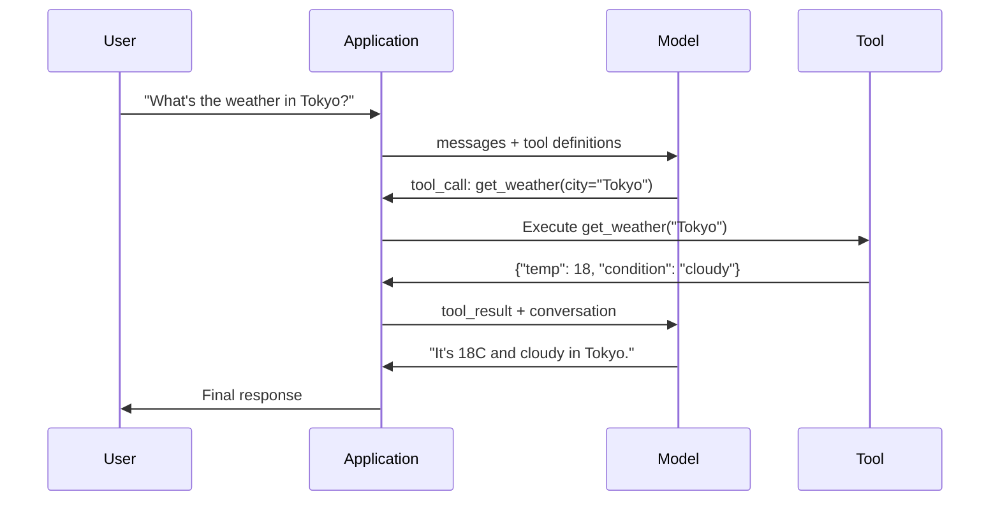

# Function Calling 與 Tool Use

> LLM 什麼事都做不了，它只會生成文字，這就是它全部的能力。它不能查天氣、查資料庫、寄 email、執行程式，也不能讀檔案。你見過的每一個「AI agent」，其實都是 LLM 生成一段 JSON 說該呼叫哪個函式 -- 然後由你的程式碼真正去呼叫它。模型是大腦，tool 是雙手，function calling 則是連接兩者的神經系統。

**Type:** Build
**Languages:** Python
**Prerequisites:** Phase 11 Lesson 03 (Structured Outputs)
**Time:** ~75 分鐘
**Related:** Phase 11 · 14 (Model Context Protocol) — 當 tool 需要在多個 host 之間共用時，就從內嵌的 function calling 升級成 MCP server。這堂課涵蓋內嵌的情況；MCP 則涵蓋協定的情況。

## 學習目標 (Learning Objectives)

- 實作 function calling 迴圈：定義 tool schema、解析模型的 tool-call JSON、執行函式並回傳結果
- 設計 tool schema，搭配清楚的描述與具型別的參數，讓模型能可靠地呼叫
- 建立多輪的 agent 迴圈，串接多個 function call 來回答複雜的查詢
- 處理 function calling 的邊緣情況：平行的 tool call、錯誤傳遞，以及避免無限的 tool 迴圈

## 問題 (The Problem)

你做了一個聊天機器人。使用者問：「What's the weather in Tokyo right now?」

模型回答：「I don't have access to real-time weather data, but based on the season, Tokyo is likely around 15 degrees Celsius...」

這是披著免責聲明外衣的 hallucination。模型不知道天氣，也永遠不會知道。天氣每小時都在變，而模型的訓練資料已經是幾個月前的了。

正確的答案需要呼叫 OpenWeatherMap API、取得目前的溫度，並回傳真實的數字。模型不能呼叫 API，你的程式碼可以。缺少的那一塊是：一個結構化的協定，讓模型能說「我需要用這些引數呼叫天氣 API」，並讓你的程式碼去執行它，再把結果餵回去。

這就是 function calling。模型輸出結構化的 JSON，描述要用什麼引數呼叫哪個函式。你的應用程式執行該函式。結果回到對話中。模型用這個結果產生最終答案。

沒有 function calling，LLM 只是百科全書。有了它，它們就變成 agent。

## 核心概念 (The Concept)

### Function Calling 迴圈 (The Function Calling Loop)

每一次 tool-use 的互動都遵循同樣的 5 步驟迴圈。



步驟 1：使用者送出訊息。步驟 2：模型收到訊息，以及 tool 定義（描述可用函式的 JSON Schema）。步驟 3：模型不回應文字，而是輸出一個 tool call -- 一個包含函式名稱與引數的結構化 JSON 物件。步驟 4：你的程式碼執行函式並取得結果。步驟 5：結果回到模型，現在它有了真實的資料，可以產生最終答案。

模型從不執行任何東西。它只決定要呼叫什麼、用什麼引數。你的程式碼才是執行者。

### Tool 定義：JSON Schema 契約 (Tool Definitions)

每個 tool 都由一個 JSON Schema 定義，告訴模型這個函式做什麼、接受哪些引數，以及這些引數必須是什麼型別。

```json
{
  "type": "function",
  "function": {
    "name": "get_weather",
    "description": "Get current weather for a city. Returns temperature in Celsius and conditions.",
    "parameters": {
      "type": "object",
      "properties": {
        "city": {
          "type": "string",
          "description": "City name, e.g. 'Tokyo' or 'San Francisco'"
        },
        "units": {
          "type": "string",
          "enum": ["celsius", "fahrenheit"],
          "description": "Temperature units"
        }
      },
      "required": ["city"]
    }
  }
}
```

`description` 欄位至關重要。模型會讀它們來決定何時以及如何使用這個 tool。像「gets weather」這種含糊的描述，tool 選擇的效果會比「Get current weather for a city. Returns temperature in Celsius and conditions.」差。這段描述就是用來選擇 tool 的 prompt。

### 供應商比較 (Provider Comparison)

每個主流供應商都支援 function calling，但 API 介面不同。

| 供應商 | API 參數 | Tool Call 格式 | 平行呼叫 | 強制呼叫 |
|----------|--------------|-----------------|---------------|----------------|
| OpenAI (GPT-5, o4) | `tools` | `tool_calls[].function` | 是（每輪多個） | `tool_choice="required"` |
| Anthropic (Claude 4.6/4.7) | `tools` | `content[].type="tool_use"` | 是（多個 block） | `tool_choice={"type":"any"}` |
| Google (Gemini 3) | `function_declarations` | `functionCall` | 是 | `function_calling_config` |
| Open-weight (Llama 4, Qwen3, DeepSeek-V3) | Llama 4 原生支援 `tools`；其他使用 Hermes 或 ChatML | 不一 | 依模型而定 | 以 prompt 為基礎，或在支援時使用 `tool_choice` |

到了 2026 年，三家封閉的供應商已經收斂到幾乎相同的、以 JSON Schema 為基礎的格式。Llama 4 內建原生的 `tools` 欄位，形狀與 OpenAI 的一致。Open-weight 的 fine-tune 仍然各不相同 — Hermes 格式 (NousResearch) 是第三方 fine-tune 中最常見的。要在多個 host 之間共用 tool，請優先選擇 MCP（Phase 11 · 14），而不是內嵌的 function calling — 同一個 server 對所有 host 都適用。

### Tool Choice：Auto、Required、Specific

你可以控制模型何時使用 tool。

**Auto**（預設）：由模型決定要呼叫 tool 還是直接回應。「What's 2+2?」 -- 直接回應。「What's the weather?」 -- 呼叫 tool。

**Required**：模型必須至少呼叫一個 tool。當你知道使用者的意圖需要用到 tool 時使用。避免模型用猜的，而不是去查真實資料。

**Specific function**：強制模型呼叫特定的函式。`tool_choice={"type":"function", "function": {"name": "get_weather"}}` 保證天氣 tool 會被呼叫，不論查詢內容為何。用於路由 -- 當上游邏輯已經判斷出需要哪個 tool 的時候。

### 平行 Function Calling (Parallel Function Calling)

GPT-4o 和 Claude 可以在單一輪中呼叫多個函式。使用者問：「What's the weather in Tokyo and New York?」模型同時輸出兩個 tool call：

```json
[
  {"name": "get_weather", "arguments": {"city": "Tokyo"}},
  {"name": "get_weather", "arguments": {"city": "New York"}}
]
```

你的程式碼執行兩者（最好是並行），回傳兩個結果，模型再綜合成單一回應。這把來回的次數從 2 次降到 1 次。對於每次查詢有 5-10 個 tool call 的 agent，平行呼叫能降低 60-80% 的延遲。

### Structured Outputs 與 Function Calling 的比較

第 03 課談過 structured outputs。Function calling 使用同樣的 JSON Schema 機制，但目的不同。

**Structured outputs**：強制模型產生特定形狀的資料。輸出就是最終產品。範例：把文字中的商品資訊擷取成 `{name, price, in_stock}`。

**Function calling**：模型宣告要執行某個動作的意圖。輸出是中間步驟。範例：`get_weather(city="Tokyo")` -- 模型是在請求一個動作，而不是產生最終答案。

想擷取資料時用 structured outputs。想讓模型與外部系統互動時用 function calling。

### 安全性：不可妥協的規則 (Security: The Non-Negotiable Rules)

Function calling 是你能賦予 LLM 的最危險的能力。由模型選擇要執行什麼。如果你的 tool 集合包含資料庫查詢，查詢是由模型建構的。如果包含 shell 指令，指令是由模型寫的。

**規則 1：絕對不要把模型生成的 SQL 直接傳給資料庫。**模型可以、也一定會生成 DROP TABLE、UNION injection，或是回傳每一列資料的查詢。一律使用參數化。一律做驗證。一律使用允許的操作白名單。

**規則 2：函式使用白名單。**模型只能呼叫你明確定義的函式。絕對不要建立通用的「依名稱執行任何函式」tool。如果你有 50 個內部函式，只暴露使用者需要的那 5 個。

**規則 3：驗證引數。**模型可能傳入 `"; DROP TABLE users; --"` 作為城市名稱。執行之前，要依預期的型別、範圍與格式驗證每個引數。

**規則 4：清理 tool 的結果。**如果 tool 回傳敏感資料（API key、PII、內部錯誤），在送回給模型之前先過濾掉。模型會把 tool 結果原封不動地放進它的回應裡。

**規則 5：對 tool call 做 rate limit。**陷入迴圈的模型可能呼叫 tool 數百次。設定一個上限（每段對話 10-20 次呼叫是合理的）。中斷無限迴圈。

### 錯誤處理 (Error Handling)

Tool 會失敗。API 會逾時。資料庫會掛掉。檔案可能不存在。模型需要知道 tool 何時失敗，以及為什麼。

把錯誤當作結構化的 tool 結果回傳，而不是拋出例外：

```json
{
  "error": true,
  "message": "City 'Toky' not found. Did you mean 'Tokyo'?",
  "code": "CITY_NOT_FOUND"
}
```

模型讀到這個，會調整它的引數並重試。模型很擅長從結構化的錯誤訊息中自我修正。但它們不擅長從空的回應，或是籠統的「something went wrong」錯誤中恢復。

### MCP：Model Context Protocol

MCP 是 Anthropic 提出的 tool 互通性開放標準。與其讓每個應用程式各自定義自己的 tool，MCP 提供一個通用的協定：tool 由 MCP server 提供，由 MCP client（例如 Claude Code、Cursor 或你的應用程式）使用。

一個 MCP server 可以向任何相容的 client 暴露 tool。Postgres MCP server 讓任何相容 MCP 的 agent 都能存取資料庫。GitHub MCP server 讓任何 agent 都能存取 repository。Tool 只需定義一次，到處都能用。

MCP 之於 function calling，就像 HTTP 之於網路。它標準化了傳輸層，讓 tool 變得可攜。

```figure
mx-tool-call-loop
```

## 動手做 (Build It)

### 步驟 1：定義 Tool Registry

建立一個 registry，儲存 tool 定義與它們的實作。每個 tool 都有一個 JSON Schema 定義（模型看到的）和一個 Python 函式（你的程式碼執行的）。

```python
import ast
import json
import math
import time
import hashlib


TOOL_REGISTRY = {}


def register_tool(name, description, parameters, function):
    TOOL_REGISTRY[name] = {
        "definition": {
            "type": "function",
            "function": {
                "name": name,
                "description": description,
                "parameters": parameters,
            },
        },
        "function": function,
    }
```

### 步驟 2：實作 5 個 Tool

建立計算機、天氣查詢、網頁搜尋模擬器、檔案讀取器與程式碼執行器。

```python
def calculator(expression, precision=2):
    allowed = set("0123456789+-*/.() ")
    if not all(c in allowed for c in expression):
        return {"error": True, "message": f"Invalid characters in expression: {expression}"}
    try:
        result = eval(expression, {"__builtins__": {}}, {"math": math})
        return {"result": round(float(result), precision), "expression": expression}
    except Exception as e:
        return {"error": True, "message": str(e)}


WEATHER_DB = {
    "tokyo": {"temp_c": 18, "condition": "cloudy", "humidity": 72, "wind_kph": 14},
    "new york": {"temp_c": 22, "condition": "sunny", "humidity": 45, "wind_kph": 8},
    "london": {"temp_c": 12, "condition": "rainy", "humidity": 88, "wind_kph": 22},
    "san francisco": {"temp_c": 16, "condition": "foggy", "humidity": 80, "wind_kph": 18},
    "sydney": {"temp_c": 25, "condition": "sunny", "humidity": 55, "wind_kph": 10},
}


def get_weather(city, units="celsius"):
    key = city.lower().strip()
    if key not in WEATHER_DB:
        suggestions = [c for c in WEATHER_DB if c.startswith(key[:3])]
        return {
            "error": True,
            "message": f"City '{city}' not found.",
            "suggestions": suggestions,
            "code": "CITY_NOT_FOUND",
        }
    data = WEATHER_DB[key].copy()
    if units == "fahrenheit":
        data["temp_f"] = round(data["temp_c"] * 9 / 5 + 32, 1)
        del data["temp_c"]
    data["city"] = city
    return data


SEARCH_DB = {
    "python function calling": [
        {"title": "OpenAI Function Calling Guide", "url": "https://platform.openai.com/docs/guides/function-calling", "snippet": "Learn how to connect LLMs to external tools."},
        {"title": "Anthropic Tool Use", "url": "https://docs.anthropic.com/en/docs/tool-use", "snippet": "Claude can interact with external tools and APIs."},
    ],
    "MCP protocol": [
        {"title": "Model Context Protocol", "url": "https://modelcontextprotocol.io", "snippet": "An open standard for connecting AI models to data sources."},
    ],
    "weather API": [
        {"title": "OpenWeatherMap API", "url": "https://openweathermap.org/api", "snippet": "Free weather API with current, forecast, and historical data."},
    ],
}


def web_search(query, max_results=3):
    key = query.lower().strip()
    for db_key, results in SEARCH_DB.items():
        if db_key in key or key in db_key:
            return {"query": query, "results": results[:max_results], "total": len(results)}
    return {"query": query, "results": [], "total": 0}


FILE_SYSTEM = {
    "data/config.json": '{"model": "gpt-4o", "temperature": 0.7, "max_tokens": 4096}',
    "data/users.csv": "name,email,role\nAlice,alice@example.com,admin\nBob,bob@example.com,user",
    "README.md": "# My Project\nA tool-use agent built from scratch.",
}


def read_file(path):
    if ".." in path or path.startswith("/"):
        return {"error": True, "message": "Path traversal not allowed.", "code": "FORBIDDEN"}
    if path not in FILE_SYSTEM:
        available = list(FILE_SYSTEM.keys())
        return {"error": True, "message": f"File '{path}' not found.", "available_files": available, "code": "NOT_FOUND"}
    content = FILE_SYSTEM[path]
    return {"path": path, "content": content, "size_bytes": len(content), "lines": content.count("\n") + 1}


def run_code(code, language="python"):
    if language != "python":
        return {"error": True, "message": f"Language '{language}' not supported. Only 'python' is available."}
    try:
        tree = ast.parse(code)
    except SyntaxError as e:
        return {"error": True, "message": f"SyntaxError: {e}", "code": "SYNTAX_ERROR"}
    unsafe_names = {"exec", "eval", "compile", "__import__", "open", "globals", "locals", "vars", "getattr", "setattr", "delattr"}
    for node in ast.walk(tree):
        if isinstance(node, (ast.Import, ast.ImportFrom)):
            return {"error": True, "message": "Forbidden operation: import is not allowed", "code": "SECURITY_VIOLATION"}
        if isinstance(node, ast.Attribute) and node.attr.startswith("__") and node.attr.endswith("__"):
            return {"error": True, "message": "Forbidden operation: dunder attribute access is not allowed", "code": "SECURITY_VIOLATION"}
        if isinstance(node, ast.Name) and node.id in unsafe_names:
            return {"error": True, "message": f"Forbidden operation: {node.id} is not allowed", "code": "SECURITY_VIOLATION"}
    try:
        local_vars = {}
        exec(code, {"__builtins__": {"print": print, "range": range, "len": len, "str": str, "int": int, "float": float, "list": list, "dict": dict, "sum": sum, "min": min, "max": max, "abs": abs, "round": round, "sorted": sorted, "enumerate": enumerate, "zip": zip, "map": map, "filter": filter, "math": math}}, local_vars)
        result = local_vars.get("result", None)
        return {"success": True, "result": result, "variables": {k: str(v) for k, v in local_vars.items() if not k.startswith("_")}}
    except Exception as e:
        return {"error": True, "message": f"{type(e).__name__}: {e}"}
```

子字串黑名單是把程式碼當成文字來讀，所以字串比對沒有逐字寫出的東西，它都會漏掉。把程式碼解析成語法樹並走訪它，能讓防護機制依結構而不是拼字，拒絕 `import` 陳述式、dunder 屬性存取（那些能回溯到真正直譯器的 `__class__` 與 `__globals__` 鏈），以及不安全的內建名稱。即便如此，請把它當作教學用的過濾器，而不是真正的邊界。任何行程內 (in-process) 的防護，都與它所執行的程式碼共用同一個直譯器，意志堅決的呼叫者仍然能找到可以觸及的物件。Production 系統會在獨立的行程或容器中執行不受信任的程式碼（權限被降低的 subprocess、gVisor、Firecracker，或託管的程式碼執行器），這樣即使被逃脫，攻擊者落入的也是一個用完即丟的盒子，而不是你的服務。

### 步驟 3：註冊所有 Tool

```python
def register_all_tools():
    register_tool(
        "calculator", "Evaluate a mathematical expression. Supports +, -, *, /, parentheses, and decimals. Returns the numeric result.",
        {"type": "object", "properties": {"expression": {"type": "string", "description": "Math expression, e.g. '(10 + 5) * 3'"}, "precision": {"type": "integer", "description": "Decimal places in result", "default": 2}}, "required": ["expression"]},
        calculator,
    )
    register_tool(
        "get_weather", "Get current weather for a city. Returns temperature, condition, humidity, and wind speed.",
        {"type": "object", "properties": {"city": {"type": "string", "description": "City name, e.g. 'Tokyo' or 'San Francisco'"}, "units": {"type": "string", "enum": ["celsius", "fahrenheit"], "description": "Temperature units, defaults to celsius"}}, "required": ["city"]},
        get_weather,
    )
    register_tool(
        "web_search", "Search the web for information. Returns a list of results with title, URL, and snippet.",
        {"type": "object", "properties": {"query": {"type": "string", "description": "Search query"}, "max_results": {"type": "integer", "description": "Maximum results to return", "default": 3}}, "required": ["query"]},
        web_search,
    )
    register_tool(
        "read_file", "Read the contents of a file. Returns the file content, size, and line count.",
        {"type": "object", "properties": {"path": {"type": "string", "description": "Relative file path, e.g. 'data/config.json'"}}, "required": ["path"]},
        read_file,
    )
    register_tool(
        "run_code", "Run a small Python snippet behind a static-analysis guard and a restricted interpreter. This is a teaching filter, not real isolation. Set a 'result' variable to return output.",
        {"type": "object", "properties": {"code": {"type": "string", "description": "Python code to execute"}, "language": {"type": "string", "enum": ["python"], "description": "Programming language"}}, "required": ["code"]},
        run_code,
    )
```

### 步驟 4：建立 Function Calling 迴圈

這是核心引擎。它模擬模型決定要呼叫哪個 tool、執行 tool，並把結果餵回去。

```python
def simulate_model_decision(user_message, tools, conversation_history):
    msg = user_message.lower()

    if any(word in msg for word in ["weather", "temperature", "forecast"]):
        cities = []
        for city in WEATHER_DB:
            if city in msg:
                cities.append(city)
        if not cities:
            for word in msg.split():
                if word.capitalize() in [c.title() for c in WEATHER_DB]:
                    cities.append(word)
        if not cities:
            cities = ["tokyo"]
        calls = []
        for city in cities:
            calls.append({"name": "get_weather", "arguments": {"city": city.title()}})
        return calls

    if any(word in msg for word in ["calculate", "compute", "math", "what is", "how much"]):
        for token in msg.split():
            if any(c in token for c in "+-*/"):
                return [{"name": "calculator", "arguments": {"expression": token}}]
        if "+" in msg or "-" in msg or "*" in msg or "/" in msg:
            expr = "".join(c for c in msg if c in "0123456789+-*/.() ")
            if expr.strip():
                return [{"name": "calculator", "arguments": {"expression": expr.strip()}}]
        return [{"name": "calculator", "arguments": {"expression": "0"}}]

    if any(word in msg for word in ["search", "find", "look up", "google"]):
        query = msg.replace("search for", "").replace("look up", "").replace("find", "").strip()
        return [{"name": "web_search", "arguments": {"query": query}}]

    if any(word in msg for word in ["read", "file", "open", "cat", "show"]):
        for path in FILE_SYSTEM:
            if path.split("/")[-1].split(".")[0] in msg:
                return [{"name": "read_file", "arguments": {"path": path}}]
        return [{"name": "read_file", "arguments": {"path": "README.md"}}]

    if any(word in msg for word in ["run", "execute", "code", "python"]):
        return [{"name": "run_code", "arguments": {"code": "result = 'Hello from the sandbox!'", "language": "python"}}]

    return []


def execute_tool_call(tool_call):
    name = tool_call["name"]
    args = tool_call["arguments"]

    if name not in TOOL_REGISTRY:
        return {"error": True, "message": f"Unknown tool: {name}", "code": "UNKNOWN_TOOL"}

    tool = TOOL_REGISTRY[name]
    func = tool["function"]
    start = time.time()

    try:
        result = func(**args)
    except TypeError as e:
        result = {"error": True, "message": f"Invalid arguments: {e}"}

    elapsed_ms = round((time.time() - start) * 1000, 2)
    return {"tool": name, "result": result, "execution_time_ms": elapsed_ms}


def run_function_calling_loop(user_message, max_iterations=5):
    conversation = [{"role": "user", "content": user_message}]
    tool_definitions = [t["definition"] for t in TOOL_REGISTRY.values()]
    all_tool_results = []

    for iteration in range(max_iterations):
        tool_calls = simulate_model_decision(user_message, tool_definitions, conversation)

        if not tool_calls:
            break

        results = []
        for call in tool_calls:
            result = execute_tool_call(call)
            results.append(result)

        conversation.append({"role": "assistant", "content": None, "tool_calls": tool_calls})

        for result in results:
            conversation.append({"role": "tool", "content": json.dumps(result["result"]), "tool_name": result["tool"]})

        all_tool_results.extend(results)
        break

    return {"conversation": conversation, "tool_results": all_tool_results, "iterations": iteration + 1 if tool_calls else 0}
```

### 步驟 5：引數驗證

建立驗證器，在執行之前，依 JSON Schema 檢查 tool call 的引數。

```python
def validate_tool_arguments(tool_name, arguments):
    if tool_name not in TOOL_REGISTRY:
        return [f"Unknown tool: {tool_name}"]

    schema = TOOL_REGISTRY[tool_name]["definition"]["function"]["parameters"]
    errors = []

    if not isinstance(arguments, dict):
        return [f"Arguments must be an object, got {type(arguments).__name__}"]

    for required_field in schema.get("required", []):
        if required_field not in arguments:
            errors.append(f"Missing required argument: {required_field}")

    properties = schema.get("properties", {})
    for arg_name, arg_value in arguments.items():
        if arg_name not in properties:
            errors.append(f"Unknown argument: {arg_name}")
            continue

        prop_schema = properties[arg_name]
        expected_type = prop_schema.get("type")

        type_checks = {"string": str, "integer": int, "number": (int, float), "boolean": bool, "array": list, "object": dict}
        if expected_type in type_checks:
            if not isinstance(arg_value, type_checks[expected_type]):
                errors.append(f"Argument '{arg_name}': expected {expected_type}, got {type(arg_value).__name__}")

        if "enum" in prop_schema and arg_value not in prop_schema["enum"]:
            errors.append(f"Argument '{arg_name}': '{arg_value}' not in {prop_schema['enum']}")

    return errors
```

### 步驟 6：執行 Demo

```python
def run_demo():
    register_all_tools()

    print("=" * 60)
    print("  Function Calling & Tool Use Demo")
    print("=" * 60)

    print("\n--- Registered Tools ---")
    for name, tool in TOOL_REGISTRY.items():
        desc = tool["definition"]["function"]["description"][:60]
        params = list(tool["definition"]["function"]["parameters"].get("properties", {}).keys())
        print(f"  {name}: {desc}...")
        print(f"    params: {params}")

    print(f"\n--- Argument Validation ---")
    validation_tests = [
        ("get_weather", {"city": "Tokyo"}, "Valid call"),
        ("get_weather", {}, "Missing required arg"),
        ("get_weather", {"city": "Tokyo", "units": "kelvin"}, "Invalid enum value"),
        ("calculator", {"expression": 123}, "Wrong type (int for string)"),
        ("unknown_tool", {"x": 1}, "Unknown tool"),
    ]
    for tool_name, args, label in validation_tests:
        errors = validate_tool_arguments(tool_name, args)
        status = "VALID" if not errors else f"ERRORS: {errors}"
        print(f"  {label}: {status}")

    print(f"\n--- Tool Execution ---")
    direct_tests = [
        {"name": "calculator", "arguments": {"expression": "(10 + 5) * 3 / 2"}},
        {"name": "get_weather", "arguments": {"city": "Tokyo"}},
        {"name": "get_weather", "arguments": {"city": "Mars"}},
        {"name": "web_search", "arguments": {"query": "python function calling"}},
        {"name": "read_file", "arguments": {"path": "data/config.json"}},
        {"name": "read_file", "arguments": {"path": "../etc/passwd"}},
        {"name": "run_code", "arguments": {"code": "result = sum(range(1, 101))"}},
        {"name": "run_code", "arguments": {"code": "import os; os.system('rm -rf /')"}},
    ]
    for call in direct_tests:
        result = execute_tool_call(call)
        print(f"\n  {call['name']}({json.dumps(call['arguments'])})")
        print(f"    -> {json.dumps(result['result'], indent=None)[:100]}")
        print(f"    time: {result['execution_time_ms']}ms")

    print(f"\n--- Full Function Calling Loop ---")
    test_queries = [
        "What's the weather in Tokyo?",
        "Calculate (100 + 250) * 0.15",
        "Search for MCP protocol",
        "Read the config file",
        "Run some Python code",
        "Tell me a joke",
    ]
    for query in test_queries:
        print(f"\n  User: {query}")
        result = run_function_calling_loop(query)
        if result["tool_results"]:
            for tr in result["tool_results"]:
                print(f"    Tool: {tr['tool']} ({tr['execution_time_ms']}ms)")
                print(f"    Result: {json.dumps(tr['result'], indent=None)[:90]}")
        else:
            print(f"    [No tool called -- direct response]")
        print(f"    Iterations: {result['iterations']}")

    print(f"\n--- Parallel Tool Calls ---")
    multi_city_query = "What's the weather in tokyo and london?"
    print(f"  User: {multi_city_query}")
    result = run_function_calling_loop(multi_city_query)
    print(f"  Tool calls made: {len(result['tool_results'])}")
    for tr in result["tool_results"]:
        city = tr["result"].get("city", "unknown")
        temp = tr["result"].get("temp_c", "N/A")
        print(f"    {city}: {temp}C, {tr['result'].get('condition', 'N/A')}")

    print(f"\n--- Security Checks ---")
    security_tests = [
        ("read_file", {"path": "../../etc/passwd"}),
        ("run_code", {"code": "import subprocess; subprocess.run(['ls'])"}),
        ("calculator", {"expression": "__import__('os').system('ls')"}),
    ]
    for tool_name, args in security_tests:
        result = execute_tool_call({"name": tool_name, "arguments": args})
        blocked = result["result"].get("error", False)
        print(f"  {tool_name}({list(args.values())[0][:40]}): {'BLOCKED' if blocked else 'ALLOWED'}")
```

## 實際使用 (Use It)

### OpenAI Function Calling

```python
# from openai import OpenAI
#
# client = OpenAI()
#
# tools = [{
#     "type": "function",
#     "function": {
#         "name": "get_weather",
#         "description": "Get current weather for a city",
#         "parameters": {
#             "type": "object",
#             "properties": {
#                 "city": {"type": "string"},
#                 "units": {"type": "string", "enum": ["celsius", "fahrenheit"]}
#             },
#             "required": ["city"]
#         }
#     }
# }]
#
# response = client.chat.completions.create(
#     model="gpt-4o",
#     messages=[{"role": "user", "content": "Weather in Tokyo?"}],
#     tools=tools,
#     tool_choice="auto",
# )
#
# tool_call = response.choices[0].message.tool_calls[0]
# args = json.loads(tool_call.function.arguments)
# result = get_weather(**args)
#
# final = client.chat.completions.create(
#     model="gpt-4o",
#     messages=[
#         {"role": "user", "content": "Weather in Tokyo?"},
#         response.choices[0].message,
#         {"role": "tool", "tool_call_id": tool_call.id, "content": json.dumps(result)},
#     ],
# )
# print(final.choices[0].message.content)
```

OpenAI 以 `response.choices[0].message.tool_calls` 回傳 tool call。每個 call 都有一個 `id`，回傳結果時你必須帶上它。模型用這個 ID 把結果對應回 call。GPT-4o 可以在單一回應中回傳多個 tool call -- 請逐一迭代並全部執行。

### Anthropic Tool Use

```python
# import anthropic
#
# client = anthropic.Anthropic()
#
# response = client.messages.create(
#     model="claude-sonnet-5",
#     max_tokens=1024,
#     tools=[{
#         "name": "get_weather",
#         "description": "Get current weather for a city",
#         "input_schema": {
#             "type": "object",
#             "properties": {
#                 "city": {"type": "string"},
#                 "units": {"type": "string", "enum": ["celsius", "fahrenheit"]}
#             },
#             "required": ["city"]
#         }
#     }],
#     messages=[{"role": "user", "content": "Weather in Tokyo?"}],
# )
#
# tool_block = next(b for b in response.content if b.type == "tool_use")
# result = get_weather(**tool_block.input)
#
# final = client.messages.create(
#     model="claude-sonnet-5",
#     max_tokens=1024,
#     tools=[...],
#     messages=[
#         {"role": "user", "content": "Weather in Tokyo?"},
#         {"role": "assistant", "content": response.content},
#         {"role": "user", "content": [{"type": "tool_result", "tool_use_id": tool_block.id, "content": json.dumps(result)}]},
#     ],
# )
```

Anthropic 以 `type: "tool_use"` 的 content block 回傳 tool call。Tool 的結果則放在 user 訊息中，type 為 `"tool_result"`。注意關鍵差異：Anthropic 的 tool 參數定義使用 `input_schema`，而 OpenAI 使用 `parameters`。

### MCP 整合

```python
# MCP servers expose tools over a standardized protocol.
# Any MCP-compatible client can discover and call these tools.
#
# Example: connecting to a Postgres MCP server
#
# from mcp import ClientSession, StdioServerParameters
# from mcp.client.stdio import stdio_client
#
# server_params = StdioServerParameters(
#     command="npx",
#     args=["-y", "@modelcontextprotocol/server-postgres", "postgresql://localhost/mydb"],
# )
#
# async with stdio_client(server_params) as (read, write):
#     async with ClientSession(read, write) as session:
#         await session.initialize()
#         tools = await session.list_tools()
#         result = await session.call_tool("query", {"sql": "SELECT count(*) FROM users"})
```

MCP 把 tool 的實作與 tool 的使用解耦。Postgres server 懂 SQL。GitHub server 懂它的 API。你的 agent 只需要發現並呼叫 tool -- 不需要為每個整合撰寫供應商專屬的程式碼。

## 交付 (Ship It)

這堂課會產出 `outputs/prompt-tool-designer.md` -- 一個可重複使用的 prompt template，用來設計 tool 定義。給它一段你想讓 tool 做什麼的描述，它就會產出完整的 JSON Schema 定義，包含描述、型別與限制。

它也會產出 `outputs/skill-function-calling-patterns.md` -- 一個在 production 實作 function calling 的決策框架，涵蓋 tool 設計、錯誤處理、安全性，以及各供應商專屬的模式。

## 練習 (Exercises)

1. **新增第 6 個 tool：資料庫查詢。**用記憶體內的資料表實作一個模擬的 SQL tool。這個 tool 接受資料表名稱與過濾條件（不是原始 SQL）。驗證資料表名稱在白名單內，且過濾運算子限制在 `=`、`>`、`<`、`>=`、`<=`。以 JSON 回傳符合的列。

2. **實作帶有錯誤回饋的重試。**當 tool call 失敗時（例如找不到城市），把錯誤訊息餵回模型的決策函式，讓它修正自己的引數。追蹤每個 call 重試了幾次。每個 tool call 最多重試 3 次。

3. **建立多步驟的 agent。**有些查詢需要串接 tool call：「Read the config file and tell me what model is configured, then search the web for that model's pricing.」實作一個迴圈，一直執行到模型判斷不再需要更多 tool 為止，並把累積的結果傳入每個決策步驟。限制在 10 次迭代以內，以避免無限迴圈。

4. **量測 tool 選擇的準確度。**建立 30 個測試查詢，並附上預期的 tool 名稱。在這 30 個上執行你的決策函式，量測它選到正確 tool 的比例。找出哪些查詢最容易造成 tool 之間的混淆。

5. **實作 tool call 快取。**如果同一個 tool 在 60 秒內以相同的引數被呼叫，就回傳快取的結果，而不是重新執行。使用以 `(tool_name, frozenset(args.items()))` 為 key 的字典。在包含 20 個查詢的對話中量測快取命中率。

## 關鍵術語 (Key Terms)

| 術語 | 一般說法 | 實際意義 |
|------|----------------|----------------------|
| Function calling | 「Tool use」 | 模型輸出結構化的 JSON，描述要用特定引數呼叫的函式 -- 執行它的是你的程式碼，不是模型 |
| Tool definition | 「函式 schema」 | 描述 tool 的名稱、用途、參數與型別的 JSON Schema 物件 -- 模型讀它來決定何時以及如何使用這個 tool |
| Tool choice | 「呼叫模式」 | 控制模型必須呼叫 tool（required）、可以呼叫 tool（auto），或必須呼叫特定 tool（指名） |
| Parallel calling | 「多 tool」 | 模型在單一輪中輸出多個 tool call，減少來回次數 -- GPT-4o 與 Claude 都支援 |
| Tool result | 「函式輸出」 | 執行 tool 的回傳值，以訊息形式送回模型，讓它能在回應中使用真實資料 |
| Argument validation | 「輸入檢查」 | 在執行 tool 之前，驗證模型生成的引數符合預期的型別、範圍與限制 |
| MCP | 「Tool 協定」 | Model Context Protocol -- Anthropic 的開放標準，透過 server 暴露 tool，讓任何相容的 client 都能發現並呼叫 |
| Agent loop | 「ReAct 迴圈」 | 模型決定 tool、程式碼執行 tool、結果回饋的反覆循環，直到模型有足夠的資訊可以回應 |
| Tool poisoning | 「透過 tool 的 prompt injection」 | 一種攻擊：tool 結果中含有操控模型行為的指令 -- 請清理所有 tool 的輸出 |
| Rate limiting | 「呼叫預算」 | 為每段對話設定 tool call 的上限，避免無限迴圈與失控的 API 成本 |

## 延伸閱讀 (Further Reading)

- [OpenAI Function Calling Guide](https://platform.openai.com/docs/guides/function-calling) -- GPT-4o 使用 tool 的權威參考，包括平行呼叫、強制呼叫與結構化引數
- [Anthropic Tool Use Guide](https://docs.anthropic.com/en/docs/tool-use) -- Claude 的 tool use 實作，包括 input_schema、多 tool 回應與 tool_choice 設定
- [Model Context Protocol Specification](https://modelcontextprotocol.io) -- AI 應用程式之間 tool 互通性的開放標準，採 server/client 架構
- [Schick et al., 2023 -- "Toolformer: Language Models Can Teach Themselves to Use Tools"](https://arxiv.org/abs/2302.04761) -- 關於訓練 LLM 判斷何時以及如何呼叫外部 tool 的奠基論文
- [Patil et al., 2023 -- "Gorilla: Large Language Model Connected with Massive APIs"](https://arxiv.org/abs/2305.15334) -- 針對 1,645 個 API 對 LLM 做 fine-tuning，以做到準確的 API 呼叫並降低 hallucination
- [Berkeley Function Calling Leaderboard](https://gorilla.cs.berkeley.edu/leaderboard.html) -- 即時 benchmark，比較 GPT-4o、Claude、Gemini 與開放模型的 function calling 準確度
- [Yao et al., "ReAct: Synergizing Reasoning and Acting in Language Models" (ICLR 2023)](https://arxiv.org/abs/2210.03629) -- Thought-Action-Observation 迴圈，是每個 tool call 外圍的 agent 迴圈；這堂課結束的地方，由 Phase 14 接手。
- [Anthropic — Building effective agents (Dec 2024)](https://www.anthropic.com/research/building-effective-agents) -- 由單一 tool-use 基本元件建構出的五種可組合模式（prompt chaining、routing、parallelization、orchestrator-workers、evaluator-optimizer）。
