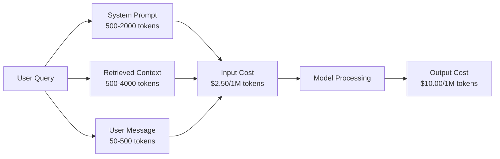
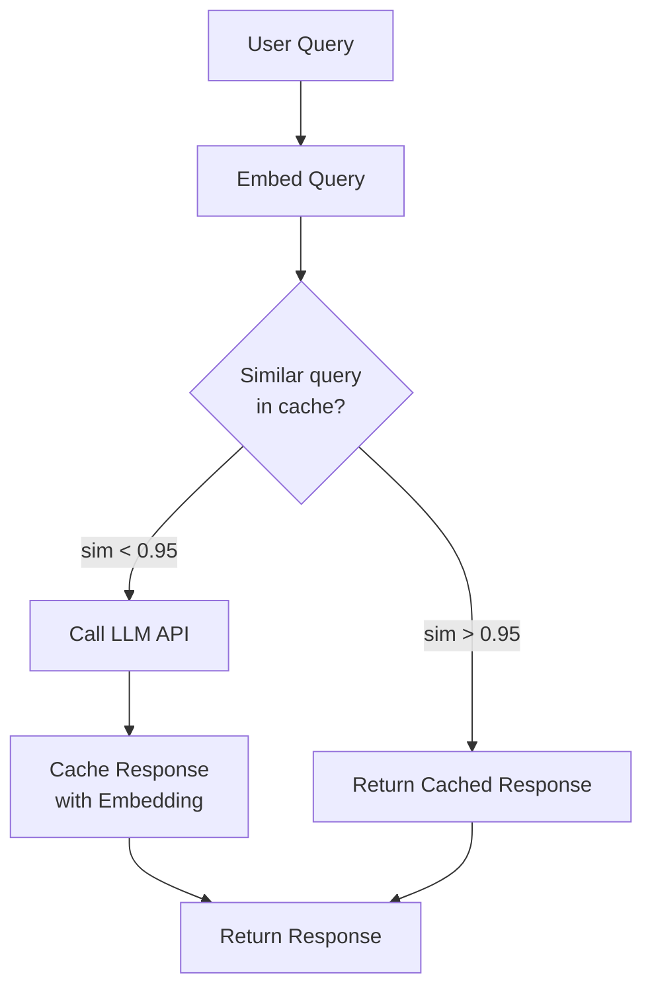
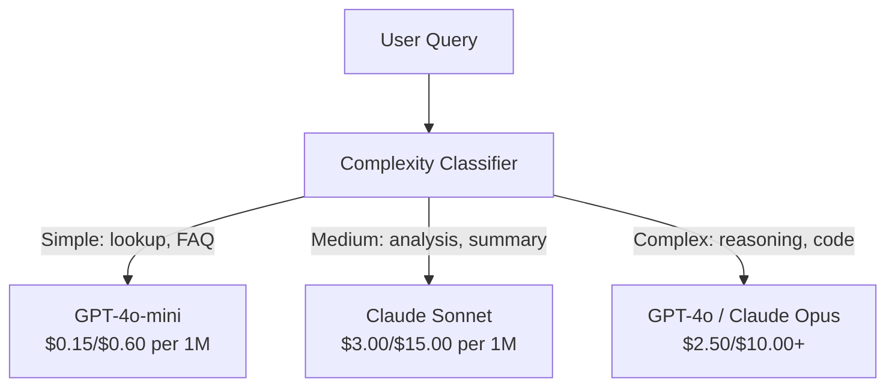

# 快取、Rate Limiting 與成本最佳化 (Caching, Rate Limiting & Cost Optimization)

> 大多數 AI 新創不是死在糟糕的模型，而是死在糟糕的單位經濟效益 (unit economics)。單次 GPT-4o 呼叫的成本只有零點幾分錢。但一萬名使用者每天各呼叫十次，光是 input token 就要 $250 -- 而你還沒收到一塊錢。能存活下來的公司，都把每一次 API 呼叫視為一筆財務交易，而不是一次函式呼叫。

**Type:** Build
**Languages:** Python
**Prerequisites:** Phase 11 Lesson 09 (Function Calling)
**Time:** ~45 分鐘
**Related:** Phase 11 · 15 (Prompt Caching) — 這堂課涵蓋應用層的快取（semantic cache、exact hash cache、模型路由）。第 15 課涵蓋供應商層的 prompt caching（Anthropic cache_control、OpenAI 自動快取、Gemini CachedContent）。兩者結合可降低 50-95% 的成本。

## 學習目標 (Learning Objectives)

- 實作 semantic caching，讓重複或相似的查詢直接從快取回應，而不用發出新的 API 呼叫
- 計算各供應商每次請求的成本，並實作以 token 為單位的 rate limiting 與預算警示
- 建立成本最佳化層，包含 prompt 壓縮、模型路由（昂貴對便宜）與回應快取
- 針對不同的查詢類型，設計分層的快取策略，結合 exact match、語意相似度與 prefix caching

## 問題 (The Problem)

你做了一個 RAG 聊天機器人。它運作得很漂亮，使用者很喜歡。

然後帳單來了。

GPT-5 的費用是每百萬 input token $1.25、每百萬 output token $10。Claude Opus 4.7 是 input $5 / output $25。Gemini 3.1 Pro 是 input $2 / output $12（prompt 在 200K token 以內）。GPT-5-mini 是 $0.25/$2。GPT-4o，也就是下面算式用的模型，是 $2.50/$10。價格僅供參考，請務必查看供應商目前的定價頁面。

以下是會害死新創的算式：

- 10,000 名每日活躍使用者
- 每位使用者每天 10 次查詢
- 每次查詢 1,000 個 input token（system prompt + context + 使用者訊息）
- 每次回應 500 個 output token

**每日 input 成本：**10,000 x 10 x 1,000 / 1,000,000 x $2.50 = **$250/天**
**每日 output 成本：**10,000 x 10 x 500 / 1,000,000 x $10.00 = **$500/天**
**每月總計：** **$22,500/月**

這還只是 LLM。再加上 embedding、向量資料庫託管、基礎設施。一個聊天機器人，你要面對的是每月 $30,000。

殘酷的是：這些查詢中有 40-60% 是近乎重複的。使用者用稍微不同的字句問同樣的問題。你的 system prompt -- 在每個請求中都完全相同 -- 每一次都被計費。RAG 檢索到的 context 文件，會在詢問同一主題的不同使用者之間重複出現。

你是在為多餘的運算付全額的價錢。

## 核心概念 (The Concept)

### 一次 LLM 呼叫的成本構成 (The Cost Anatomy of an LLM Call)

每次 API 呼叫都有五個成本組成。



System prompt 是無聲的殺手。一個 1,500 token 的 system prompt 隨每個請求送出，光是那段 prefix，每百萬次請求就要花 $3.75。以每天 10 萬次請求計算，就是每天 $375 -- 每月 $11,250 -- 花在永遠不會改變的文字上。

### 供應商快取：內建的折扣 (Provider Caching: Built-in Discounts)

2026 年，三大主流供應商都提供供應商端的 prompt caching，但機制各不相同。深入說明請見 Phase 11 · 15。

| 供應商 | 機制 | 折扣 | 最低門檻 | 快取時間 |
|----------|-----------|----------|---------|----------------|
| Anthropic | 明確的 cache_control 標記 | 快取命中享 90% 折扣（寫入時多付 25%） | 1,024 tokens（Sonnet/Opus）、2,048（Haiku） | 預設 5 分鐘；延長版 1 小時（寫入費用 2 倍） |
| OpenAI | 自動 prefix 比對 | 快取命中享 50% 折扣 | 1,024 tokens | 盡力而為，最長 1 小時 |
| Google Gemini | 明確的 CachedContent API | 約減少 75%（外加儲存費用） | 4,096（Flash）/ 32,768（Pro） | 使用者可設定 TTL |

**Anthropic 的做法**是明確的。你用 `cache_control: {"type": "ephemeral"}` 標記 prompt 的某些段落。第一個請求要付 25% 的寫入加價。之後使用相同 prefix 的請求享有 90% 折扣。一個 2,000 token 的 system prompt，正常成本是 $0.005，在快取命中時只要 $0.000625。在 10 萬次請求下，每天可省下 $437.50。

**OpenAI 的做法**是自動的。任何與先前請求相符的 prompt prefix，都享有 50% 折扣。不需要標記。取捨是：折扣較少、控制較少，但完全不需要實作。

### Semantic Caching：你的自訂層 (Semantic Caching: Your Custom Layer)

供應商快取只適用於相同的 prefix。Semantic caching 處理的是更困難的情況：語意相同但文字不同的查詢。

「What is the return policy?」和「How do I return an item?」是不同的字串，但意圖相同。Semantic cache 會對兩個查詢做 embedding、計算 cosine similarity，如果相似度超過門檻（通常是 0.92-0.95），就回傳快取的回應。



Embedding 的成本可以忽略。OpenAI 的 text-embedding-3-small 每百萬 token 只要 $0.02。與完整的 LLM 呼叫相比，檢查快取幾乎不花錢。

### Exact Caching：Hash 與比對

對於確定性的呼叫（temperature=0、相同模型、相同 prompt），exact caching 更簡單也更快。對完整的 prompt 做 hash、檢查快取，找到就回傳。

這在以下情況完美適用：
- System prompt + 固定 context + 相同的使用者查詢
- 搭配相同 tool 定義的 function calling
- 同一份文件被多次處理的批次作業

### Rate Limiting：保護你的預算 (Rate Limiting: Protecting Your Budget)

Rate limiting 不只是為了公平，而是為了生存。

**Token bucket 演算法：**每位使用者有一個容量為 N 個 token 的桶子，以每秒 R 的速率補充。請求會從桶子中消耗 token。如果桶子空了，請求就被拒絕。這允許突發流量（一次用掉整個桶子），同時強制維持平均速率。

**每位使用者的配額：**依使用者等級設定每日/每月的 token 上限。

| 等級 | 每日 Token 上限 | 每分鐘最大請求數 | 可用模型 |
|------|------------------|------------------|-------------|
| Free | 50,000 | 10 | 僅 GPT-4o-mini |
| Pro | 500,000 | 60 | GPT-4o、Claude Sonnet |
| Enterprise | 5,000,000 | 300 | 所有模型 |

### 模型路由：讓對的模型做對的工作 (Model Routing)

不是每個查詢都需要 GPT-4o。

「What time does the store close?」不需要每百萬 output token $10 的模型。每百萬 output token $0.60 的 GPT-4o-mini 就能處理得很好。每百萬 output token $1.25 的 Claude Haiku 也能處理。一個簡單的分類器，把便宜的查詢送給便宜的模型，把複雜的查詢送給昂貴的模型。



調校良好的路由器，光是模型成本就能省下 40-70%。

### 成本追蹤：知道錢花到哪裡去 (Cost Tracking)

無法衡量的東西就無法最佳化。請記錄每次 API 呼叫的：

- 時間戳記
- 模型名稱
- Input token 數
- Output token 數
- 延遲 (ms)
- 計算出的成本 ($)
- 使用者 ID
- 快取命中/未命中
- 請求類別

這些資料能揭露哪些功能很貴、哪些使用者是重度使用者，以及快取在哪裡最有效。

### Batching：量大折扣 (Batching: Bulk Discounts)

OpenAI 的 Batch API 以非同步方式處理請求，享有 50% 折扣。你一次提交最多 50,000 個請求的批次，結果會在 24 小時內回來。

Batching 適用於：
- 夜間的文件處理
- 大量分類
- Eval 執行
- 資料充實 (data enrichment) pipeline

不適用於：即時、面向使用者的查詢（延遲很重要）。

### 預算警示與 Circuit Breaker (Budget Alerts and Circuit Breakers)

Circuit breaker 會在你達到上限時停止花費。沒有它的話，一個 bug 或濫用行為可能在幾小時內燒光你整個月的預算。

設定三個門檻：
1. **警告**（預算的 70%）：發出警示
2. **節流**（預算的 85%）：只切換到較便宜的模型
3. **停止**（預算的 95%）：拒絕新請求，只回傳快取的回應

### 最佳化堆疊 (The Optimization Stack)

依序套用這些技術。每一層都會在前一層的基礎上產生複利效果。

| 層 | 技術 | 一般節省幅度 | 實作難度 |
|-------|-----------|----------------|----------------------|
| 1 | 供應商 prompt caching | 30-50% | 低（加上快取標記） |
| 2 | Exact caching | 10-20% | 低（hash + dict） |
| 3 | Semantic caching | 15-30% | 中（embedding + 相似度） |
| 4 | 模型路由 | 40-70% | 中（分類器） |
| 5 | Rate limiting | 保護預算 | 低（token bucket） |
| 6 | Prompt 壓縮 | 10-30% | 中（改寫 prompt） |
| 7 | Batching | 符合資格者省 50% | 低（batch API） |

套用第 1 到 5 層的 RAG 應用程式，通常能把成本從每月 $22,500 降到 $4,000-6,000。這就是燒光資金跑道與建立一門生意之間的差別。

### 真實的節省：前後對照 (Real Savings: Before and After)

以下是服務 10,000 DAU 的 RAG 聊天機器人的真實分解。

| 指標 | 最佳化前 | 最佳化後 | 節省 |
|--------|--------------------|--------------------|---------|
| 每月 LLM 成本 | $22,500 | $5,200 | 77% |
| 平均每次查詢成本 | $0.0075 | $0.0017 | 77% |
| 快取命中率 | 0% | 52% | -- |
| 被路由到 mini 的查詢 | 0% | 65% | -- |
| P95 延遲 | 2,800ms | 900ms（快取命中：50ms） | 68% |
| 每月 embedding 成本 | $0 | $180 | （新增成本） |
| 每月總成本 | $22,500 | $5,380 | 76% |

Semantic caching 的 embedding 成本（每月 $180），在快取命中的第一個小時內就能回本。

```figure
semantic-cache
```

## 動手做 (Build It)

### 步驟 1：成本計算器

建立一個了解主流模型目前定價的 token 成本計算器。

```python
import hashlib
import time
import json
import math
from dataclasses import dataclass, field


MODEL_PRICING = {
    "gpt-4o": {"input": 2.50, "output": 10.00, "cached_input": 1.25},
    "gpt-4o-mini": {"input": 0.15, "output": 0.60, "cached_input": 0.075},
    "gpt-4.1": {"input": 2.00, "output": 8.00, "cached_input": 0.50},
    "gpt-4.1-mini": {"input": 0.40, "output": 1.60, "cached_input": 0.10},
    "gpt-4.1-nano": {"input": 0.10, "output": 0.40, "cached_input": 0.025},
    "o3": {"input": 2.00, "output": 8.00, "cached_input": 0.50},
    "o3-mini": {"input": 1.10, "output": 4.40, "cached_input": 0.55},
    "o4-mini": {"input": 1.10, "output": 4.40, "cached_input": 0.275},
    "claude-opus-4": {"input": 15.00, "output": 75.00, "cached_input": 1.50},
    "claude-sonnet-4": {"input": 3.00, "output": 15.00, "cached_input": 0.30},
    "claude-haiku-3.5": {"input": 0.80, "output": 4.00, "cached_input": 0.08},
    "gemini-2.5-pro": {"input": 1.25, "output": 10.00, "cached_input": 0.3125},
    "gemini-2.5-flash": {"input": 0.15, "output": 0.60, "cached_input": 0.0375},
}


def calculate_cost(model, input_tokens, output_tokens, cached_input_tokens=0):
    if model not in MODEL_PRICING:
        return {"error": f"Unknown model: {model}"}
    pricing = MODEL_PRICING[model]
    non_cached = input_tokens - cached_input_tokens
    input_cost = (non_cached / 1_000_000) * pricing["input"]
    cached_cost = (cached_input_tokens / 1_000_000) * pricing["cached_input"]
    output_cost = (output_tokens / 1_000_000) * pricing["output"]
    total = input_cost + cached_cost + output_cost
    return {
        "model": model,
        "input_tokens": input_tokens,
        "output_tokens": output_tokens,
        "cached_input_tokens": cached_input_tokens,
        "input_cost": round(input_cost, 6),
        "cached_input_cost": round(cached_cost, 6),
        "output_cost": round(output_cost, 6),
        "total_cost": round(total, 6),
    }
```

### 步驟 2：Exact Cache

對完整的 prompt 做 hash，並對相同的請求回傳快取的回應。

```python
class ExactCache:
    def __init__(self, max_size=1000, ttl_seconds=3600):
        self.cache = {}
        self.max_size = max_size
        self.ttl = ttl_seconds
        self.hits = 0
        self.misses = 0

    def _hash(self, model, messages, temperature):
        key_data = json.dumps({"model": model, "messages": messages, "temperature": temperature}, sort_keys=True)
        return hashlib.sha256(key_data.encode()).hexdigest()

    def get(self, model, messages, temperature=0.0):
        if temperature > 0:
            self.misses += 1
            return None
        key = self._hash(model, messages, temperature)
        if key in self.cache:
            entry = self.cache[key]
            if time.time() - entry["timestamp"] < self.ttl:
                self.hits += 1
                entry["access_count"] += 1
                return entry["response"]
            del self.cache[key]
        self.misses += 1
        return None

    def put(self, model, messages, temperature, response):
        if temperature > 0:
            return
        if len(self.cache) >= self.max_size:
            oldest_key = min(self.cache, key=lambda k: self.cache[k]["timestamp"])
            del self.cache[oldest_key]
        key = self._hash(model, messages, temperature)
        self.cache[key] = {
            "response": response,
            "timestamp": time.time(),
            "access_count": 1,
        }

    def stats(self):
        total = self.hits + self.misses
        return {
            "hits": self.hits,
            "misses": self.misses,
            "hit_rate": round(self.hits / total, 4) if total > 0 else 0,
            "cache_size": len(self.cache),
        }
```

### 步驟 3：Semantic Cache

對查詢做 embedding，當相似度超過門檻時回傳快取的回應。

```python
def simple_embed(text):
    words = text.lower().split()
    vocab = {}
    for w in words:
        vocab[w] = vocab.get(w, 0) + 1
    norm = math.sqrt(sum(v * v for v in vocab.values()))
    if norm == 0:
        return {}
    return {k: v / norm for k, v in vocab.items()}


def cosine_similarity(a, b):
    if not a or not b:
        return 0.0
    all_keys = set(a) | set(b)
    dot = sum(a.get(k, 0) * b.get(k, 0) for k in all_keys)
    return dot


class SemanticCache:
    def __init__(self, similarity_threshold=0.85, max_size=500, ttl_seconds=3600):
        self.entries = []
        self.threshold = similarity_threshold
        self.max_size = max_size
        self.ttl = ttl_seconds
        self.hits = 0
        self.misses = 0

    def get(self, query):
        query_embedding = simple_embed(query)
        now = time.time()
        best_match = None
        best_sim = 0.0
        for entry in self.entries:
            if now - entry["timestamp"] > self.ttl:
                continue
            sim = cosine_similarity(query_embedding, entry["embedding"])
            if sim > best_sim:
                best_sim = sim
                best_match = entry
        if best_match and best_sim >= self.threshold:
            self.hits += 1
            best_match["access_count"] += 1
            return {"response": best_match["response"], "similarity": round(best_sim, 4), "original_query": best_match["query"]}
        self.misses += 1
        return None

    def put(self, query, response):
        if len(self.entries) >= self.max_size:
            self.entries.sort(key=lambda e: e["timestamp"])
            self.entries.pop(0)
        self.entries.append({
            "query": query,
            "embedding": simple_embed(query),
            "response": response,
            "timestamp": time.time(),
            "access_count": 1,
        })

    def stats(self):
        total = self.hits + self.misses
        return {
            "hits": self.hits,
            "misses": self.misses,
            "hit_rate": round(self.hits / total, 4) if total > 0 else 0,
            "cache_size": len(self.entries),
        }
```

### 步驟 4：Rate Limiter

具備每位使用者配額的 token bucket rate limiter。

```python
class TokenBucketRateLimiter:
    def __init__(self):
        self.buckets = {}
        self.tiers = {
            "free": {"capacity": 50_000, "refill_rate": 500, "max_requests_per_min": 10},
            "pro": {"capacity": 500_000, "refill_rate": 5_000, "max_requests_per_min": 60},
            "enterprise": {"capacity": 5_000_000, "refill_rate": 50_000, "max_requests_per_min": 300},
        }

    def _get_bucket(self, user_id, tier="free"):
        if user_id not in self.buckets:
            tier_config = self.tiers.get(tier, self.tiers["free"])
            self.buckets[user_id] = {
                "tokens": tier_config["capacity"],
                "capacity": tier_config["capacity"],
                "refill_rate": tier_config["refill_rate"],
                "last_refill": time.time(),
                "request_timestamps": [],
                "max_rpm": tier_config["max_requests_per_min"],
                "tier": tier,
                "total_tokens_used": 0,
            }
        return self.buckets[user_id]

    def _refill(self, bucket):
        now = time.time()
        elapsed = now - bucket["last_refill"]
        refill = int(elapsed * bucket["refill_rate"])
        if refill > 0:
            bucket["tokens"] = min(bucket["capacity"], bucket["tokens"] + refill)
            bucket["last_refill"] = now

    def check(self, user_id, tokens_needed, tier="free"):
        bucket = self._get_bucket(user_id, tier)
        self._refill(bucket)
        now = time.time()
        bucket["request_timestamps"] = [t for t in bucket["request_timestamps"] if now - t < 60]
        if len(bucket["request_timestamps"]) >= bucket["max_rpm"]:
            return {"allowed": False, "reason": "rate_limit", "retry_after_seconds": 60 - (now - bucket["request_timestamps"][0])}
        if bucket["tokens"] < tokens_needed:
            deficit = tokens_needed - bucket["tokens"]
            wait = deficit / bucket["refill_rate"]
            return {"allowed": False, "reason": "token_limit", "tokens_available": bucket["tokens"], "retry_after_seconds": round(wait, 1)}
        return {"allowed": True, "tokens_available": bucket["tokens"]}

    def consume(self, user_id, tokens_used, tier="free"):
        bucket = self._get_bucket(user_id, tier)
        bucket["tokens"] -= tokens_used
        bucket["request_timestamps"].append(time.time())
        bucket["total_tokens_used"] += tokens_used

    def get_usage(self, user_id):
        if user_id not in self.buckets:
            return {"error": "User not found"}
        b = self.buckets[user_id]
        return {
            "user_id": user_id,
            "tier": b["tier"],
            "tokens_remaining": b["tokens"],
            "capacity": b["capacity"],
            "total_tokens_used": b["total_tokens_used"],
            "utilization": round(b["total_tokens_used"] / b["capacity"], 4) if b["capacity"] else 0,
        }
```

### 步驟 5：成本追蹤器

記錄每次呼叫，並計算累計總額。

```python
class CostTracker:
    def __init__(self, monthly_budget=1000.0):
        self.logs = []
        self.monthly_budget = monthly_budget
        self.alerts = []

    def log_call(self, model, input_tokens, output_tokens, cached_input_tokens=0, latency_ms=0, user_id="anonymous", cache_status="miss"):
        cost = calculate_cost(model, input_tokens, output_tokens, cached_input_tokens)
        entry = {
            "timestamp": time.time(),
            "model": model,
            "input_tokens": input_tokens,
            "output_tokens": output_tokens,
            "cached_input_tokens": cached_input_tokens,
            "latency_ms": latency_ms,
            "cost": cost["total_cost"],
            "user_id": user_id,
            "cache_status": cache_status,
        }
        self.logs.append(entry)
        self._check_budget()
        return entry

    def _check_budget(self):
        total = self.total_cost()
        pct = total / self.monthly_budget if self.monthly_budget > 0 else 0
        if pct >= 0.95 and not any(a["level"] == "stop" for a in self.alerts):
            self.alerts.append({"level": "stop", "message": f"Budget 95% consumed: ${total:.2f}/${self.monthly_budget:.2f}", "timestamp": time.time()})
        elif pct >= 0.85 and not any(a["level"] == "throttle" for a in self.alerts):
            self.alerts.append({"level": "throttle", "message": f"Budget 85% consumed: ${total:.2f}/${self.monthly_budget:.2f}", "timestamp": time.time()})
        elif pct >= 0.70 and not any(a["level"] == "warning" for a in self.alerts):
            self.alerts.append({"level": "warning", "message": f"Budget 70% consumed: ${total:.2f}/${self.monthly_budget:.2f}", "timestamp": time.time()})

    def total_cost(self):
        return round(sum(e["cost"] for e in self.logs), 6)

    def cost_by_model(self):
        by_model = {}
        for e in self.logs:
            m = e["model"]
            if m not in by_model:
                by_model[m] = {"calls": 0, "cost": 0, "input_tokens": 0, "output_tokens": 0}
            by_model[m]["calls"] += 1
            by_model[m]["cost"] = round(by_model[m]["cost"] + e["cost"], 6)
            by_model[m]["input_tokens"] += e["input_tokens"]
            by_model[m]["output_tokens"] += e["output_tokens"]
        return by_model

    def cache_savings(self):
        cache_hits = [e for e in self.logs if e["cache_status"] == "hit"]
        if not cache_hits:
            return {"saved": 0, "cache_hits": 0}
        saved = 0
        for e in cache_hits:
            full_cost = calculate_cost(e["model"], e["input_tokens"], e["output_tokens"])
            saved += full_cost["total_cost"]
        return {"saved": round(saved, 4), "cache_hits": len(cache_hits)}

    def summary(self):
        if not self.logs:
            return {"total_calls": 0, "total_cost": 0}
        total_latency = sum(e["latency_ms"] for e in self.logs)
        cache_hits = sum(1 for e in self.logs if e["cache_status"] == "hit")
        return {
            "total_calls": len(self.logs),
            "total_cost": self.total_cost(),
            "avg_cost_per_call": round(self.total_cost() / len(self.logs), 6),
            "avg_latency_ms": round(total_latency / len(self.logs), 1),
            "cache_hit_rate": round(cache_hits / len(self.logs), 4),
            "cost_by_model": self.cost_by_model(),
            "cache_savings": self.cache_savings(),
            "budget_remaining": round(self.monthly_budget - self.total_cost(), 2),
            "budget_utilization": round(self.total_cost() / self.monthly_budget, 4) if self.monthly_budget > 0 else 0,
            "alerts": self.alerts,
        }
```

### 步驟 6：模型路由器

把查詢路由給能夠處理它的最便宜的模型。

```python
SIMPLE_KEYWORDS = ["what time", "hours", "address", "phone", "price", "return policy", "hello", "hi", "thanks", "yes", "no"]
COMPLEX_KEYWORDS = ["analyze", "compare", "explain why", "write code", "debug", "architect", "design", "trade-off", "evaluate"]


def classify_complexity(query):
    q = query.lower()
    if len(q.split()) <= 5 or any(kw in q for kw in SIMPLE_KEYWORDS):
        return "simple"
    if any(kw in q for kw in COMPLEX_KEYWORDS):
        return "complex"
    return "medium"


def route_model(query, tier="pro"):
    complexity = classify_complexity(query)
    routing_table = {
        "simple": {"free": "gpt-4.1-nano", "pro": "gpt-4o-mini", "enterprise": "gpt-4o-mini"},
        "medium": {"free": "gpt-4o-mini", "pro": "claude-sonnet-4", "enterprise": "claude-sonnet-4"},
        "complex": {"free": "gpt-4o-mini", "pro": "gpt-4o", "enterprise": "claude-opus-4"},
    }
    model = routing_table[complexity].get(tier, "gpt-4o-mini")
    return {"query": query, "complexity": complexity, "model": model, "tier": tier}
```

### 步驟 7：執行 Demo

```python
def simulate_llm_call(model, query):
    input_tokens = len(query.split()) * 4 + 500
    output_tokens = 150 + (len(query.split()) * 2)
    latency = 200 + (output_tokens * 2)
    return {
        "model": model,
        "response": f"[Simulated {model} response to: {query[:50]}...]",
        "input_tokens": input_tokens,
        "output_tokens": output_tokens,
        "latency_ms": latency,
    }


def run_demo():
    print("=" * 60)
    print("  Caching, Rate Limiting & Cost Optimization Demo")
    print("=" * 60)

    print("\n--- Model Pricing ---")
    for model, pricing in list(MODEL_PRICING.items())[:6]:
        cost_1k = calculate_cost(model, 1000, 500)
        print(f"  {model}: ${cost_1k['total_cost']:.6f} per 1K in + 500 out")

    print("\n--- Cost Comparison: 100K Requests ---")
    for model in ["gpt-4o", "gpt-4o-mini", "claude-sonnet-4", "claude-haiku-3.5"]:
        cost = calculate_cost(model, 1000 * 100_000, 500 * 100_000)
        print(f"  {model}: ${cost['total_cost']:.2f}")

    print("\n--- Anthropic Cache Savings ---")
    no_cache = calculate_cost("claude-sonnet-4", 2000, 500, 0)
    with_cache = calculate_cost("claude-sonnet-4", 2000, 500, 1500)
    saving = no_cache["total_cost"] - with_cache["total_cost"]
    print(f"  Without cache: ${no_cache['total_cost']:.6f}")
    print(f"  With 1500 cached tokens: ${with_cache['total_cost']:.6f}")
    print(f"  Savings per call: ${saving:.6f} ({saving/no_cache['total_cost']*100:.1f}%)")

    exact_cache = ExactCache(max_size=100, ttl_seconds=300)
    semantic_cache = SemanticCache(similarity_threshold=0.75, max_size=100)
    rate_limiter = TokenBucketRateLimiter()
    tracker = CostTracker(monthly_budget=100.0)

    print("\n--- Exact Cache ---")
    messages_1 = [{"role": "user", "content": "What is the return policy?"}]
    result = exact_cache.get("gpt-4o-mini", messages_1, 0.0)
    print(f"  First lookup: {'HIT' if result else 'MISS'}")
    exact_cache.put("gpt-4o-mini", messages_1, 0.0, "You can return items within 30 days.")
    result = exact_cache.get("gpt-4o-mini", messages_1, 0.0)
    print(f"  Second lookup: {'HIT' if result else 'MISS'} -> {result}")
    result = exact_cache.get("gpt-4o-mini", messages_1, 0.7)
    print(f"  With temp=0.7: {'HIT' if result else 'MISS (non-deterministic, skip cache)'}")
    print(f"  Stats: {exact_cache.stats()}")

    print("\n--- Semantic Cache ---")
    test_queries = [
        ("What is the return policy?", "Items can be returned within 30 days with receipt."),
        ("How do I return an item?", None),
        ("What are your store hours?", "We are open 9am-9pm Monday through Saturday."),
        ("When does the store open?", None),
        ("Tell me about quantum computing", "Quantum computers use qubits..."),
        ("Explain quantum mechanics", None),
    ]
    for query, response in test_queries:
        cached = semantic_cache.get(query)
        if cached:
            print(f"  '{query[:40]}' -> CACHE HIT (sim={cached['similarity']}, original='{cached['original_query'][:40]}')")
        elif response:
            semantic_cache.put(query, response)
            print(f"  '{query[:40]}' -> MISS (stored)")
        else:
            print(f"  '{query[:40]}' -> MISS (no match)")
    print(f"  Stats: {semantic_cache.stats()}")

    print("\n--- Rate Limiting ---")
    for i in range(12):
        check = rate_limiter.check("user_1", 1000, "free")
        if check["allowed"]:
            rate_limiter.consume("user_1", 1000, "free")
        status = "OK" if check["allowed"] else f"BLOCKED ({check['reason']})"
        if i < 5 or not check["allowed"]:
            print(f"  Request {i+1}: {status}")
    print(f"  Usage: {rate_limiter.get_usage('user_1')}")

    print("\n--- Model Routing ---")
    routing_queries = [
        "What time do you close?",
        "Summarize this quarterly earnings report",
        "Analyze the trade-offs between microservices and monoliths",
        "Hello",
        "Write code for a binary search tree with deletion",
    ]
    for q in routing_queries:
        route = route_model(q, "pro")
        print(f"  '{q[:50]}' -> {route['model']} ({route['complexity']})")

    print("\n--- Full Pipeline: Before vs After Optimization ---")
    queries = [
        "What is the return policy?",
        "How do I return something?",
        "What are your hours?",
        "When do you open?",
        "Explain the difference between TCP and UDP",
        "Compare TCP vs UDP protocols",
        "Hello",
        "What is your phone number?",
        "Write a Python function to sort a list",
        "Analyze the pros and cons of serverless architecture",
    ]

    print("\n  [Before: no caching, single model (gpt-4o)]")
    tracker_before = CostTracker(monthly_budget=1000.0)
    for q in queries:
        result = simulate_llm_call("gpt-4o", q)
        tracker_before.log_call("gpt-4o", result["input_tokens"], result["output_tokens"], latency_ms=result["latency_ms"], cache_status="miss")
    before = tracker_before.summary()
    print(f"  Total cost: ${before['total_cost']:.6f}")
    print(f"  Avg cost/call: ${before['avg_cost_per_call']:.6f}")
    print(f"  Avg latency: {before['avg_latency_ms']}ms")

    print("\n  [After: caching + routing + rate limiting]")
    exact_c = ExactCache()
    semantic_c = SemanticCache(similarity_threshold=0.75)
    tracker_after = CostTracker(monthly_budget=1000.0)

    for q in queries:
        messages = [{"role": "user", "content": q}]
        cached = exact_c.get("gpt-4o", messages, 0.0)
        if cached:
            tracker_after.log_call("gpt-4o-mini", 0, 0, latency_ms=5, cache_status="hit")
            continue
        sem_cached = semantic_c.get(q)
        if sem_cached:
            tracker_after.log_call("gpt-4o-mini", 0, 0, latency_ms=15, cache_status="hit")
            continue
        route = route_model(q)
        result = simulate_llm_call(route["model"], q)
        tracker_after.log_call(route["model"], result["input_tokens"], result["output_tokens"], latency_ms=result["latency_ms"], cache_status="miss")
        exact_c.put(route["model"], messages, 0.0, result["response"])
        semantic_c.put(q, result["response"])

    after = tracker_after.summary()
    print(f"  Total cost: ${after['total_cost']:.6f}")
    print(f"  Avg cost/call: ${after['avg_cost_per_call']:.6f}")
    print(f"  Avg latency: {after['avg_latency_ms']}ms")
    print(f"  Cache hit rate: {after['cache_hit_rate']:.0%}")

    if before["total_cost"] > 0:
        savings_pct = (1 - after["total_cost"] / before["total_cost"]) * 100
        print(f"\n  SAVINGS: {savings_pct:.1f}% cost reduction")
        print(f"  Latency improvement: {(1 - after['avg_latency_ms'] / before['avg_latency_ms']) * 100:.1f}% faster")

    print("\n--- Budget Alerts Demo ---")
    alert_tracker = CostTracker(monthly_budget=0.01)
    for i in range(5):
        alert_tracker.log_call("gpt-4o", 5000, 2000, latency_ms=500)
    print(f"  Total spent: ${alert_tracker.total_cost():.6f} / ${alert_tracker.monthly_budget}")
    for alert in alert_tracker.alerts:
        print(f"  ALERT [{alert['level'].upper()}]: {alert['message']}")

    print("\n--- Cost Breakdown by Model ---")
    multi_tracker = CostTracker(monthly_budget=500.0)
    for _ in range(50):
        multi_tracker.log_call("gpt-4o-mini", 800, 200, latency_ms=150)
    for _ in range(30):
        multi_tracker.log_call("claude-sonnet-4", 1500, 500, latency_ms=400)
    for _ in range(10):
        multi_tracker.log_call("gpt-4o", 2000, 800, latency_ms=600)
    for _ in range(10):
        multi_tracker.log_call("claude-opus-4", 3000, 1000, latency_ms=1200)
    breakdown = multi_tracker.cost_by_model()
    for model, data in sorted(breakdown.items(), key=lambda x: x[1]["cost"], reverse=True):
        print(f"  {model}: {data['calls']} calls, ${data['cost']:.6f}, {data['input_tokens']:,} in / {data['output_tokens']:,} out")
    print(f"  Total: ${multi_tracker.total_cost():.6f}")

    print("\n" + "=" * 60)
    print("  Demo complete.")
    print("=" * 60)


if __name__ == "__main__":
    run_demo()
```

## 實際使用 (Use It)

### Anthropic Prompt Caching

```python
# import anthropic
#
# client = anthropic.Anthropic()
#
# response = client.messages.create(
#     model="claude-sonnet-5",
#     max_tokens=1024,
#     system=[
#         {
#             "type": "text",
#             "text": "You are a helpful customer support agent for Acme Corp...",
#             "cache_control": {"type": "ephemeral"},
#         }
#     ],
#     messages=[{"role": "user", "content": "What is the return policy?"}],
# )
#
# print(f"Input tokens: {response.usage.input_tokens}")
# print(f"Cache creation tokens: {response.usage.cache_creation_input_tokens}")
# print(f"Cache read tokens: {response.usage.cache_read_input_tokens}")
```

第一次呼叫會寫入快取（加價 25%）。之後每次使用相同 system prompt prefix 的呼叫，都從快取讀取（享 90% 折扣）。快取持續 5 分鐘，每次命中都會重設計時器。

### OpenAI 自動快取

```python
# from openai import OpenAI
#
# client = OpenAI()
#
# response = client.chat.completions.create(
#     model="gpt-4o",
#     messages=[
#         {"role": "system", "content": "You are a helpful customer support agent..."},
#         {"role": "user", "content": "What is the return policy?"},
#     ],
# )
#
# print(f"Prompt tokens: {response.usage.prompt_tokens}")
# print(f"Cached tokens: {response.usage.prompt_tokens_details.cached_tokens}")
# print(f"Completion tokens: {response.usage.completion_tokens}")
```

OpenAI 會自動快取。任何 1,024 token 以上、且與近期請求相符的 prompt prefix，都享有 50% 折扣。不需要修改程式碼 -- 只要檢查回應中的 `prompt_tokens_details.cached_tokens`，就能確認它是否運作。

### OpenAI Batch API

```python
# import json
# from openai import OpenAI
#
# client = OpenAI()
#
# requests = []
# for i, query in enumerate(queries):
#     requests.append({
#         "custom_id": f"request-{i}",
#         "method": "POST",
#         "url": "/v1/chat/completions",
#         "body": {
#             "model": "gpt-4o-mini",
#             "messages": [{"role": "user", "content": query}],
#         },
#     })
#
# with open("batch_input.jsonl", "w") as f:
#     for r in requests:
#         f.write(json.dumps(r) + "\n")
#
# batch_file = client.files.create(file=open("batch_input.jsonl", "rb"), purpose="batch")
# batch = client.batches.create(input_file_id=batch_file.id, endpoint="/v1/chat/completions", completion_window="24h")
# print(f"Batch ID: {batch.id}, Status: {batch.status}")
```

Batch API 對所有 token 提供固定的 50% 折扣。結果會在 24 小時內送達。非常適合非即時的工作負載：評估、資料標註、大量摘要。

### 用 Redis 實作 Production 的 Semantic Cache

```python
# import redis
# import numpy as np
# from openai import OpenAI
#
# r = redis.Redis()
# client = OpenAI()
#
# def get_embedding(text):
#     response = client.embeddings.create(model="text-embedding-3-small", input=text)
#     return response.data[0].embedding
#
# def semantic_cache_lookup(query, threshold=0.95):
#     query_emb = np.array(get_embedding(query))
#     keys = r.keys("cache:emb:*")
#     best_sim, best_key = 0, None
#     for key in keys:
#         stored_emb = np.frombuffer(r.get(key), dtype=np.float32)
#         sim = np.dot(query_emb, stored_emb) / (np.linalg.norm(query_emb) * np.linalg.norm(stored_emb))
#         if sim > best_sim:
#             best_sim, best_key = sim, key
#     if best_sim >= threshold and best_key:
#         response_key = best_key.decode().replace("cache:emb:", "cache:resp:")
#         return r.get(response_key).decode()
#     return None
```

在 production 中，請把線性掃描換成向量索引（Redis Vector Search、Pinecone 或 pgvector）。線性掃描在 1,000 筆以內可行。超過這個數量，請使用 ANN（近似最近鄰），以 $O(\log n)$ 進行查找。

## 交付 (Ship It)

這堂課會產出 `outputs/prompt-cost-optimizer.md` -- 一個可重複使用的 prompt，用來分析你的 LLM 應用程式，並建議具體的成本最佳化方案，附上預估的節省幅度。

它也會產出 `outputs/skill-cost-patterns.md` -- 一個決策框架，依據你的使用情境，選出合適的快取策略、rate limiting 設定與模型路由規則。

## 練習 (Exercises)

1. **為 semantic cache 實作 LRU eviction。**把最舊優先的淘汰方式換成最近最少使用 (LRU)。追蹤每筆資料最後一次存取的時間，並在快取滿了時淘汰存取時間最舊的那一筆。在 100 個查詢上比較兩種策略的命中率。

2. **建立成本預測工具。**給定一份 API 呼叫的紀錄（CostTracker 的 log），依據過去 7 天的平均值預測每月成本。考慮平日/假日的模式。如果預測的每月成本超出預算超過 20%，就觸發警示。

3. **實作分層的 semantic caching。**使用兩個相似度門檻：0.98 代表高信心命中（立即回傳），0.90 代表中信心命中（附上免責聲明回傳：「Based on a similar previous question...」）。追蹤每次命中來自哪一層，並量測使用者滿意度的差異。

4. **建立模型路由分類器。**把以關鍵字為基礎的分類器換成以 embedding 為基礎的分類器。對 50 個已標註的查詢（simple/medium/complex）做 embedding，然後找出最接近的已標註範例來分類新查詢。用 20 個查詢的測試集量測分類準確度。

5. **實作具有降級層級的 circuit breaker。**在預算 70% 時記錄警告。在 85% 時，自動把所有路由切換到最便宜的模型（gpt-4o-mini）。在 95% 時，只提供快取的回應並拒絕新查詢。以 $1.00 的預算模擬 1,000 個請求來測試，並驗證每個門檻都正確觸發。

## 關鍵術語 (Key Terms)

| 術語 | 一般說法 | 實際意義 |
|------|----------------|----------------------|
| Prompt caching | 「快取 system prompt」 | 供應商層級的快取，重複的 prompt prefix 可享折扣（Anthropic 90%、OpenAI 50%）-- OpenAI 不需修改程式碼，Anthropic 需要明確標記 |
| Semantic caching | 「聰明的快取」 | 對查詢做 embedding、計算與過去查詢的相似度，並在相似度超過門檻時回傳快取的回應 -- 能抓到 exact match 漏掉的改寫句 |
| Exact caching | 「Hash 快取」 | 對完整的 prompt（模型 + 訊息 + temperature）做 hash，並對相同的輸入回傳快取的回應 -- 只適用於 temperature=0 的確定性呼叫 |
| Token bucket | 「Rate limiter」 | 一種演算法，每位使用者有一個容量為 N 個 token 的桶子，以每秒 R 的速率補充 -- 允許最多 N 的突發流量，同時強制維持平均速率 R |
| Model routing | 「省錢路由」 | 用分類器把簡單的查詢送給便宜的模型（GPT-4o-mini、Haiku），把複雜的查詢送給昂貴的模型（GPT-4o、Opus）-- 可省下 40-70% 的模型成本 |
| Cost tracking | 「計量」 | 記錄每次 API 呼叫的模型、token、延遲、成本與使用者 ID，讓你清楚知道錢花在哪裡、哪些功能很貴 |
| Circuit breaker | 「緊急開關」 | 當花費接近預算上限時，自動降級服務（較便宜的模型、僅提供快取），或完全停止請求 |
| Batch API | 「量大折扣」 | OpenAI 以 50% 折扣進行的非同步處理 -- 提交最多 50,000 個請求，在 24 小時內取得結果 |
| Prompt compression | 「Token 減肥」 | 改寫 system prompt 與 context，在保留語意的前提下使用更少的 token -- 較短的 prompt 成本更低，表現往往也更好 |
| Cache hit rate | 「快取效率」 | 由快取而非呼叫 LLM 來回應的請求所佔的百分比 -- production 聊天機器人的典型值是 40-60%，成本也依比例節省 |

## 延伸閱讀 (Further Reading)

- [Anthropic Prompt Caching Guide](https://docs.anthropic.com/en/docs/build-with-claude/prompt-caching) -- Anthropic 明確 cache_control 標記、定價與快取存活時間行為的官方文件
- [OpenAI Prompt Caching](https://platform.openai.com/docs/guides/prompt-caching) -- OpenAI 的自動快取、如何透過 usage 欄位驗證快取命中，以及最小 prefix 長度
- [OpenAI Batch API](https://platform.openai.com/docs/guides/batch) -- 非同步處理的 50% 折扣、JSONL 格式、24 小時完成期限，以及 50K 請求的上限
- [GPTCache](https://github.com/zilliztech/GPTCache) -- 開源的 semantic caching 函式庫，支援多種 embedding 後端、向量儲存與淘汰策略
- [Martian Model Router](https://docs.withmartian.com) -- production 的模型路由，自動選擇能夠處理每個查詢的最便宜模型
- [Not Diamond](https://www.notdiamond.ai) -- 以 ML 為基礎的模型路由器，從你的流量模式中學習，在各供應商之間最佳化成本與品質的取捨
- [Helicone](https://www.helicone.ai) -- LLM observability 平台，以 proxy 層的形式提供成本追蹤、快取、rate limiting 與預算警示
- [Dean & Barroso, "The Tail at Scale" (CACM 2013)](https://research.google/pubs/the-tail-at-scale/) -- 延遲、吞吐量、TTFT/TPOT 百分位數與 hedged request；「挑選仍能滿足 P95 的最便宜模型」背後的成本模型。
- [Kwon et al., "Efficient Memory Management for Large Language Model Serving with PagedAttention" (SOSP 2023)](https://arxiv.org/abs/2309.06180) -- vLLM 論文；為什麼 paged KV-cache 加 continuous batching 在吞吐量上勝過單純的 server 24 倍，是「快取與成本」底下的基礎設施層。
- [Dao et al., "FlashAttention-2: Faster Attention with Better Parallelism and Work Partitioning" (ICLR 2024)](https://arxiv.org/abs/2307.08691) -- 與 prompt caching 正交的 kernel 層級成本降低；請與 speculative decoding 和 GQA 一併閱讀，以掌握完整的成本曲線。
