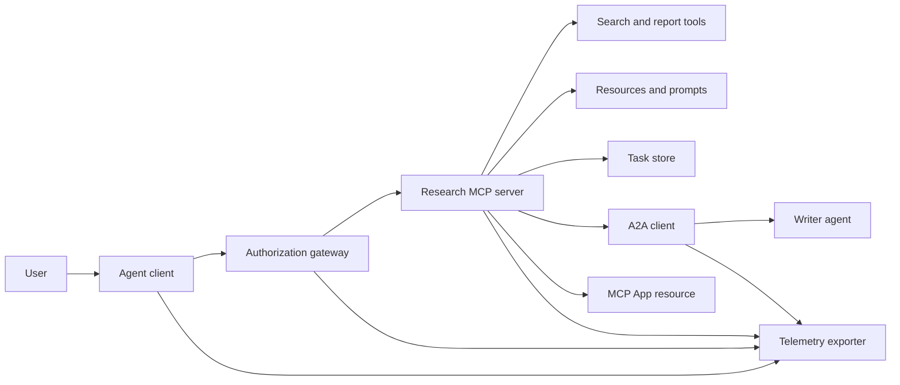
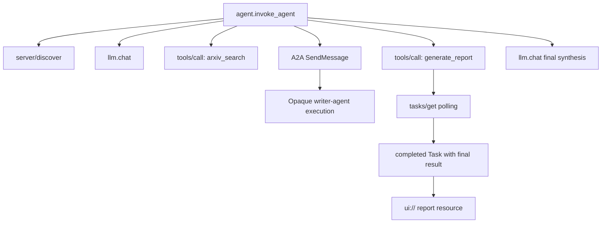
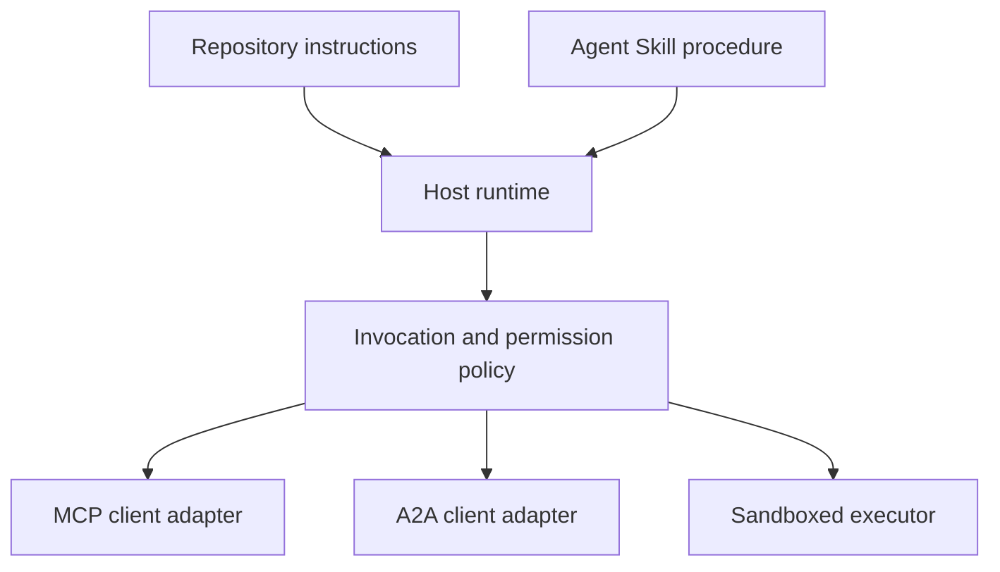

# Capstone：無狀態的 Tool 生態系 (Capstone: Stateless Tool Ecosystem)

> Production 的 agent 系統是一組邊界，而不是一堆功能。這個 capstone 把易讀的 in-process 模擬，與真實部署仍然需要的 protocol client、authorization server、sandbox 和 telemetry exporter 分開。

**Type:** Build
**Languages:** Python (stdlib, in-process simulation)
**Prerequisites:** Phase 13 · 01 through 22, using MCP revision `2026-07-28`
**Time:** ~120 分鐘

## 學習目標 (Learning Objectives)

- 把 tool call、task 形狀的結果、委派的工作、UI resource、授權政策與 trace 紀錄組合成一個流程。
- 在每個 MCP 請求上攜帶 protocol version、client identity 與 capabilities，而不是依賴連線 session。
- 在使用前先 discover server，並透過官方的 Tasks extension 驅動長時間的工作。
- 區分 protocol 形狀的模擬，與 MCP、A2A、OAuth 或 OpenTelemetry 的真正實作。
- 把每個模擬的邊界，對應到必須取代它的 production 元件。
- 讓 `AGENTS.md`、Agent Skill、runtime adapter、tool 與安全政策各自扮演正確的角色。
- 說明哪些主張可以從本地輸出驗證，哪些需要即時的整合測試。

## 問題 (The Problem)

設計一個研究與報告系統。使用者要求提供關於 agent protocol 的論文。系統搜尋論文目錄、委派摘要、產生報告、回傳 UI resource，並記錄在系統中經過的路徑。

那一句話藏著幾個獨立的合約：

- 面向模型的 tool schema；
- 無狀態的請求 envelope 與 server discovery 合約；
- 針對 actor、scope 與 tool identity 的 gateway 決定；
- 長時間執行的操作合約；
- 委派 protocol；
- host 對 app 的 bridge；
- trace 的傳播與匯出；
- 可重複使用的操作程序。

`code/main.py` 用一般的 Python 函式與 dict，讓這些邊界保持可見。它不會開啟 transport、不會連絡 arXiv、不會執行 OAuth、不會呼叫 A2A server、不會轉譯 MCP App，也不會匯出 telemetry。這讓控制流程容易檢視，同時不把模擬說成是合規的服務。

## 核心概念 (The Concept)

### 目標架構 (Target architecture)



這個架構是公開 protocol 模式的概念性組合。它不是關於任何產品私有內部實作的主張。

### 目標 trace (Target trace)



在真實的實作中，每一跳都會傳播 trace context。Span 名稱與屬性必須遵循所選 instrumentation 版本支援的 OpenTelemetry 語意慣例。單單共用的 trace 識別碼，無法證明父子關係、匯出或 backend 的接收是正確的。

### 目前的 protocol 介面

請使用目前 protocol 定義的 method 名稱，而不是從舊 draft 記得的名稱：

| 邊界 | 目前的介面 | Capstone 模擬的內容 |
|---|---|---|
| MCP discovery | 強制要求的 `server/discover` | 直接的函式，回傳 version、capabilities 與 server identity |
| MCP 請求 context | 每個 `params._meta` 中的 version、capabilities 與 client identity | 傳給每個模擬 call 的全新請求 metadata |
| MCP tool call | `tools/call` | 直接的 Python 函式 dispatch |
| MCP task 輪詢 | 搭配 `tasks/get` 的 `io.modelcontextprotocol/tasks` | 先是 working 的 handle，接著是帶有最終結果的已完成 task |
| A2A 委派 | gRPC 與 JSON-RPC 中的 `SendMessage`；HTTP+JSON 中的 `POST /message:send` | 一個巢狀的 span，沒有遠端呼叫，也沒有人為延遲 |
| MCP App 呼叫 server tool | `app.callServerTool({ name, arguments })` | 一個沒有即時 bridge 的 HTML 字串 |
| OAuth 授權 | Authorization server、protected-resource metadata、audience 與 scope 驗證 | 靜態的 token 查找與 scope 成員檢查 |
| OpenTelemetry | SDK、propagator、exporter，以及 collector 或 backend | 記憶體內的 span dict |

Protocol 名稱只是第一層。Production 的測試必須在真實的 wire 上，演練序列化、驗證失敗、取消、timeout、重試與 version 相容性。

### 無狀態 MCP 改變了整合邊界

Revision `2026-07-28` 移除了 protocol session 和 `initialize` / `notifications/initialized` handshake，也移除了 `Mcp-Session-Id`。每個請求都帶有這些有 namespace 的 `_meta` 欄位：

```json
{
  "io.modelcontextprotocol/protocolVersion": "2026-07-28",
  "io.modelcontextprotocol/clientCapabilities": {
    "extensions": {
      "io.modelcontextprotocol/tasks": {}
    }
  },
  "io.modelcontextprotocol/clientInfo": {
    "name": "capstone-client",
    "version": "1.0.0"
  }
}
```

Server 必須實作 `server/discover`。一般的結果使用 `resultType: "complete"`；task handle 則使用 `resultType: "task"`。每個結果都應該在 `_meta.io.modelcontextprotocol/serverInfo` 中識別 server。

Task extension 有 `tasks/get`、`tasks/update` 和 `tasks/cancel`。Tool 可以先回傳 `resultType: "task"`；`tasks/get` 本身回傳 `resultType: "complete"`，而已完成的 `Task` 包含最終結果。舊的 `tasks/result` 和 `tasks/list` method 不屬於目前的 extension。Client 必須在可能收到 task handle 的同一個請求中，公告 `io.modelcontextprotocol/tasks`。如果沒有，server 會回傳 `-32021`，且 `requiredCapabilities` 的形狀是缺少的 client-capability 物件，包含 `extensions.io.modelcontextprotocol/tasks`。

### 安全態勢 (Security posture)

預期的部署使用縱深防禦：

- 在 client 類型需要時，使用 OAuth 授權搭配 PKCE；
- 對簽發的 access token 做 resource 與 audience 綁定；
- 檢查所請求 tool 與 scope 的 gateway RBAC；
- 上游憑證存放在模型看不到的 context 之外；
- 固定或經過審查的 tool-description manifest；
- 針對不受信任的輸入、敏感資料與 consequential 動作的 Rule of Two 審查；
- 檔案系統、process、網路、憑證與資源限制，都在 skill 之外強制執行的執行 sandbox。

Demo 只實作靜態 token、scope 檢查和 description hash。它對政策流程有用，但不能作為安全驗證。

### Skill 是程序，不是 transport

Agent Skill 可以告訴 runtime 如何執行研究 workflow、預期哪些 tool 合約、要儲存哪些證據，以及何時停止。它無法讓 MCP server 存在、建立 A2A 相容性、授予 scope，或創造 sandbox。



當程序引用附屬檔案時，請交付完整的 skill 目錄。這個較舊的 capstone 中的單一檔案成品，是課程的藍圖，不能證明 host 會保留可攜的套件。課程 24 到 27 會建構並測試完整套件的生命週期。

### 課程成品 metadata 是本地 adapter

課程目錄與 installer 能辨識名為 `skill-*.md` 的單一檔案，但那是 repository 的慣例，不是可攜的 Agent Skills 套件合約。它們的最小 frontmatter parser 只讀取頂層的 key。因此這堂課讓可攜的識別欄位與課程目錄欄位保持在同一層級：

```yaml
---
name: ecosystem-blueprint
description: Produce a full Phase 13 ecosystem architecture for a product need.
version: "1.0.0"
phase: "13"
lesson: "23"
tags: [mcp, capstone, ecosystem, architecture, a2a, otel]
---
```

`name` 和 `description` 是可攜的識別欄位。`version`、`phase`、`lesson` 和 `tags` 是課程專屬的目錄 extension。課程的 parser 要求 `tags` 是 inline 清單，這樣 `--tag capstone` 才能比對到它。

可攜的目錄 skill 可以使用選擇性的 `metadata` map 來放字串值的 extension 資料。這不表示 `metadata` 可以與這個 repository 的目錄 schema 互換。如果這個單一檔案把 `version` 或 `tags` 巢狀放在 `metadata` 底下，最小 parser 會跳過那些縮排的 key，目錄會記錄空的 version，tag 過濾也找不到該成品。Production 的 host 應該使用安全的 YAML parser，並驗證自己文件記載的 schema。

### 模擬 vs production

| 層 | `code/main.py` | Production 的替代品 | 必要的證據 |
|---|---|---|---|
| Discovery | `server_discover()` 加上靜態的 `TOOLS` | `server/discover`，接著是具快取意識的 `tools/list` | Wire transcript、確定性的順序與 schema 驗證 |
| 驗證身分 | 以 token 為 key 的 dict | OAuth 授權與 resource server 驗證 | Issuer、audience、scope、到期與失敗測試 |
| 授權 | Scope 成員檢查 | 綁定 actor、tool、目標與 tenant 的 gateway 政策 | 允許與拒絕的稽核案例 |
| 搜尋 | 靜態的論文 fixture | 搜尋 API 或 MCP server | 來源出處、排序與錯誤測試 |
| Tasks | 本地 handle 加上立即的 `tasks/get` | 具備 `tasks/get`、`tasks/update`、`tasks/cancel` 與 TTL 的持久化 `io.modelcontextprotocol/tasks` store | 狀態轉換、輸入、取消與復原測試 |
| 委派 | Sleep 加上巢狀 span | A2A client 與遠端 Agent Card | 合約、timeout、重試與不透明性測試 |
| App | HTML 字串與 URI | MCP Apps resource 與 `App` bridge | CSP、permission、tool-call 與瀏覽器測試 |
| Telemetry | 記憶體內的清單 | OTel SDK 與 exporter | Collector 接收與 trace-parent 斷言 |
| Sandbox | 無 | Host 強制執行的隔離 executor | 逃脫、egress、機密與資源限制測試 |

這張表就是交接的邊界。本地全綠的執行，只驗證了模擬。

### Phase 13 對照圖

| 課程 | 貢獻 |
|---|---|
| 01-05 | Tool 介面、call、schema、結構化結果與確定性驗證 |
| 06-14 | 無狀態 MCP 請求 envelope、discovery、transport、resource、prompt、extension 與 Apps |
| 15-18 | 汙染防禦、OAuth、gateway、registry 與 production 驗證身分 |
| 19 | A2A 訊息與 task 委派 |
| 20 | OpenTelemetry GenAI trace 設計 |
| 21 | Model-provider routing |
| 22 | 可攜的 skill 合約與 runtime 邊界 |

```figure
t3-capstone-chain
```

## 動手做 (Build It)

執行 in-process harness：

```bash
cd phases/13-tools-and-protocols/23-capstone-tool-ecosystem
python3 code/main.py
```

檢查六件事：

1. `server/discover` 公告 revision `2026-07-28` 與 Tasks extension。
2. Alice 可以讀取並產生報告，而 Bob 帶有寫入 scope 的 call 被拒絕。
3. 同一次 orchestrator 執行中的每個本地 span 共用同一個 trace 識別碼，並記錄父 span 識別碼。
4. 報告一開始是 task handle。`tasks/get` 回傳已完成的 task，其最終結果包含文字與 `ui://` 參照。
5. 被委派的 writer 保持不透明，因為 orchestrator 只記錄邊界 span。
6. 沒有任何輸出宣稱發生過網路連線、OAuth 交換、collector 匯出、瀏覽器轉譯或 sandbox 執行。

腳本會執行兩次，所以會產生兩個 root trace。稽核項目只存在於 process 內，下次執行時會重設。

## 實際使用 (Use It)

一次升級一層：

1. 把 `server_discover()` 和靜態的 tool 清單，換成真正的 `server/discover` 與 `tools/list` call。在每個請求中送出 version、identity 與 capabilities。
2. 把靜態 token 換成 authorization server 與 protected resource 驗證。
3. 實作 `io.modelcontextprotocol/tasks` extension，並測試 `tasks/get`、`tasks/update`、`tasks/cancel`、timeout、TTL 和重啟復原。不要加入 `tasks/result` 或 `tasks/list`。
4. 把委派的 stub 換成 A2A client，解析 Agent Card 並送出訊息。
5. 用官方 SDK 建構 App，並透過 `app.callServerTool` 呼叫 server tool。
6. 把 span 匯出到測試用的 collector，並在接收端斷言父子關係。
7. 在課程 26 的 sandbox 合約內，執行 tool 與腳本。
8. 把程序封裝成完整的目錄套件，並通過課程 27 的發布關卡。

每次升級都需要一個跨越新邊界的整合測試。當 wire 變成真實的之後，不要刪除較底層的政策測試。

## 交付 (Ship It)

這堂課會產出 `outputs/skill-ecosystem-blueprint.md`，這是一個 legacy 的單一檔案課程成品。它要求一頁式的架構，涵蓋 primitive、安全、委派、telemetry、封裝，以及最難處理的營運風險。它的頂層目錄欄位，已由 repository 真正的目錄與 installer parser 演練過。

因為它不是目錄套件，所以無法攜帶 reference、腳本、資產或 eval fixture。當你要在這門課之外發布可重複使用的 skill 時，請使用課程 22 與 24 到 27 的套件格式。

## 練習 (Exercises)

1. 執行 `code/main.py`。把輸出所證明的事實，與仍需要整合證據的 production 主張分開。
2. 新增第二個靜態 backend，並為兩個同名 tool 定義衝突規則。然後把兩份清單都換成真正的 `tools/list` call。
3. 把 writer stub 換成 A2A 測試 server。記錄 Agent Card、訊息請求、timeout 路徑與回傳的 artifact。
4. 新增能撐過 process 重啟的 task store。證明 client 可以用 `tasks/get` 繼續、遵守 `pollIntervalMs`，並在沒有 `tasks/result` 的情況下讀取已完成 task 的最終結果。
5. 建構最小的 MCP App，並在帶有嚴格 CSP 與明確 permission 的瀏覽器中驗證 `app.callServerTool`。
6. 透過 OTel SDK 把模擬的 span 匯出到本地 collector。斷言接收、trace 識別碼、父子關係與錯誤狀態。
7. 為整個 repository 的維護規則撰寫 `AGENTS.md`，並為可重複使用的研究程序撰寫獨立的 skill 套件。說明為什麼這兩個檔案都不授予 tool 權限。

## 關鍵術語 (Key Terms)

| 術語 | 一般說法 | 實際意義 |
|---|---|---|
| Capstone | 「全部接在一起」 | 分階段的整合，其中模擬與即時的邊界保持明確 |
| Protocol-shaped simulation | 「基本上就是 MCP」 | 看起來像 protocol、卻沒有實作其 wire 合約的本地資料與 call |
| Tasks extension | 「長時間的 tool call」 | 選擇性的 `io.modelcontextprotocol/tasks` 生命週期，具備持久的 identity、輪詢、client 輸入、最終結果與取消語意 |
| Opacity boundary | 「另一個 agent 會處理」 | 呼叫者看到宣告的介面與 artifact，看不到私有的推理或內部狀態 |
| Runtime adapter | 「Skill 整合」 | 把可攜的程序對應到 discovery、呼叫、tool、政策與 context 的 host 程式碼 |
| Integration evidence | 「它通過了」 | 證明確實跨越真實邊界的 transcript、成品或接收端觀察 |

## 延伸閱讀 (Further Reading)

- [MCP specification 2026-07-28](https://modelcontextprotocol.io/specification/2026-07-28)：無狀態請求、discovery、tool、授權與 transport 行為。
- [MCP 2026-07-28 key changes](https://modelcontextprotocol.io/specification/2026-07-28/changelog)：session 移除、每請求 metadata、MRTR、extension 與棄用。
- [MCP Tasks extension](https://tasks.extensions.modelcontextprotocol.io/specification/draft/tasks)：`tasks/get`、`tasks/update`、`tasks/cancel`，以及由終結 task 攜帶的最終結果。
- [MCP Apps SDK](https://github.com/modelcontextprotocol/ext-apps/blob/main/docs/overview.md)：`App` 與 `app.callServerTool`。
- [A2A protocol](https://a2a-protocol.org/latest/)：Agent Card、訊息傳遞、task、artifact 與 transport binding。
- [OpenTelemetry GenAI semantic conventions](https://opentelemetry.io/docs/specs/semconv/gen-ai/)：trace 與屬性慣例。
- [Agent Skills specification](https://agentskills.io/specification)：程序層使用的可攜套件合約。
