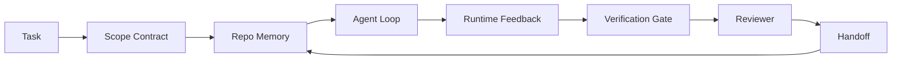

# Agent Workbench 工程：為什麼有能力的模型仍然會失敗 (Agent Workbench Engineering: Why Capable Models Still Fail)

> 有能力的模型還不夠。可靠的 agent 需要一個 workbench：instruction、state、scope、feedback、verification、review 和 handoff。把這些拿掉，即使是前沿模型，產出的工作也不能安全地出貨。

**Type:** Learn + Build
**Languages:** Python (stdlib)
**Prerequisites:** Phase 14 · 01 (Agent Loop), Phase 14 · 26 (Failure Modes)
**Time:** ~45 分鐘

## 學習目標 (Learning Objectives)

- 區分模型能力與執行可靠度。
- 說出決定 agent 能否出貨的七個 workbench 介面。
- 在一個小型 repo 任務上，比較只靠 prompt 的執行與有 workbench 引導的執行。
- 產出一份失敗模式報告，把每個缺少的介面對應到它造成的症狀。

## 問題 (The Problem)

你把前沿模型丟進一個真實的 repo，請它加入輸入驗證。它開了四個檔案，寫出看似合理的程式碼，宣告成功，然後停止。你執行測試。有兩個失敗。第三個檔案被改動了，卻跟驗證毫無關係。沒有任何紀錄說明 agent 做了什麼假設、先嘗試了什麼，或還剩下什麼要做。

模型對 Python 並沒有錯。它錯的是工作本身。它不知道什麼才算完成、可以寫入哪裡、哪些測試才具權威性，或下一個 session 該如何接手。

這不是模型的 bug。這是 workbench 的 bug。Agent 周圍的介面，缺少了能把一次性的生成變成可靠、可恢復的工程所需的部分。

## 核心概念 (The Concept)

Workbench 是在任務期間包住模型的操作環境。它有七個介面：

| 介面 | 它承載的內容 | 缺少時的失敗 |
|---------|-----------------|----------------------|
| Instructions | 啟動規則、禁止的動作、完成的定義 | Agent 猜測出貨代表什麼 |
| State | 目前任務、動過的檔案、阻礙、下一步動作 | 每個 session 都從零開始 |
| Scope | 允許的檔案、禁止的檔案、驗收標準 | 修改洩漏到不相關的程式碼 |
| Feedback | 被擷取進 loop 的真實指令輸出 | Agent 在 400 錯誤時宣告成功 |
| Verification | 測試、lint、smoke run、範圍檢查 | 「看起來沒問題」就進了 main |
| Review | 由不同角色做第二輪檢查 | 建造者自己批改自己的作業 |
| Handoff | 改了什麼、為什麼、還剩下什麼 | 下一個 session 重新發現一切 |

Workbench 與模型無關。你可以換掉模型，保留這些介面。你不能換掉介面，還保有可靠度。



這個 loop 是在 state 檔案上收尾，而不是在聊天歷史上。聊天是易失的。Repo 才是記錄的來源 (system of record)。

### Workbench 對 prompt engineering (Workbench versus prompt engineering)

Prompting 告訴模型你這一輪想要什麼。Workbench 告訴模型如何跨 turn、跨 session 完成工作。大多數 agent 失敗的故事，其實是披著 prompt engineering 外衣的 workbench 失敗。

### Workbench 對 framework (Workbench versus framework)

Framework 給你一個 runtime（LangGraph、AutoGen、Agents SDK）。Workbench 給 agent 一個在該 runtime 內工作的地方。兩者你都需要。這個迷你課程線講的是第二個。

### 從原語推理，而不是從廠商分類法推理 (Reasoning from primitives, not from vendor taxonomies)

現在有很多關於「harness engineering」的文章。Addy Osmani、OpenAI、Anthropic、LangChain、Martin Fowler、MongoDB、HumanLayer、Augment Code、Thoughtworks、walkinglabs 的 awesome 清單，以及 Medium 和 Hacker News 上源源不斷的文章都在談它。它們對 harness 的邊界是什麼、範圍包含什麼，以及該用哪套詞彙，意見不一。我們不需要選邊站。這七個介面是 UX 層；每個 workbench 底下，都是撐起任何可靠後端的同一組分散式系統原語。

暫時拿掉 agent 這個標籤。一次 agent 執行是跨越時間、行程和機器的運算。要讓它可靠，你需要任何正式系統都需要的同一組原語。

| 原語 | 它是什麼 | 對 agent 而言它承載什麼 |
|-----------|------------|------------------------------|
| Function | 有型別的 handler。盡可能純粹。擁有自己的輸入與輸出。 | 一次 tool call、一次規則檢查、一個驗證步驟、一次模型呼叫 |
| Worker | 長時間存活的行程，擁有一個或多個 function 與生命週期 | Builder、reviewer、verifier、MCP server |
| Trigger | 呼叫 function 的事件來源 | Agent loop tick、HTTP 請求、queue 訊息、cron、檔案變更、hook |
| Runtime | 決定什麼在哪裡執行、使用什麼 timeout 與資源的邊界 | Claude Code 的行程、LangGraph 的 runtime、worker container |
| HTTP / RPC | 呼叫者與 worker 之間的連線 | Tool-call 協定、MCP 請求、模型 API |
| Queue | trigger 與 worker 之間的持久 buffer；back-pressure、重試、冪等性 | 任務看板、feedback log、review 收件匣 |
| Session persistence | 能在當機、重啟、換模型後存活的 state | `agent_state.json`、checkpoint、KV store、repo 本身 |
| Authorization policy | 誰能以什麼範圍呼叫哪個 function | 允許/禁止的檔案、核准邊界、MCP capability 清單 |

現在把七個 workbench 介面對應到這些原語。

- **Instructions**：policy + function metadata。規則就是檢查（function）。Router（`AGENTS.md`）是附加在 runtime 啟動上的 policy。
- **State**：session persistence。Runtime 在每一步都會讀取的 keyed store。檔案、KV 或 DB 都可以；重要的是持久化語意，而不是儲存後端。
- **Scope**：每個任務的 authorization policy。允許/禁止的 glob 就是 ACL。需要的核准是權限格 (permission lattice)。
- **Feedback**：寫入 queue 的呼叫 log。每次 shell 呼叫都是一筆記錄，持久、可重播。
- **Verification**：一個 function。對輸入具確定性。在任務關閉時觸發。失敗時關閉 (fails closed)。
- **Review**：獨立的 worker，對 builder 產物只有唯讀授權，對 review 報告只有唯寫授權。
- **Handoff**：由 session 結束 trigger 發出的持久記錄。下一個 session 的啟動 trigger 會讀取它。

Agent loop 本身是一個 worker：它消費事件（使用者訊息、tool 結果、計時器 tick），呼叫 function（模型，然後是模型挑選的 tool），寫入記錄（state、feedback），並發出 trigger（verify、review、handoff）。沒有什麼神祕之處；和 job processor 是同樣的形狀。

### 流行的模式，翻譯成原語 (Patterns in circulation, translated to primitives)

每個流行的 harness 模式都能歸結為這八個原語。對照表如下。

| 廠商或社群的模式 | 它實際上是什麼 |
|------------------------------|--------------------|
| Ralph Loop（Claude Code、Codex、agentic_harness 一書）：當 agent 想提早停止時，把原始意圖重新注入新的 context window | 以乾淨 context 重新排入任務的 trigger；session persistence 把目標延續下去 |
| Plan / Execute / Verify (PEV) | 三個 worker，各擔任一個角色，透過 state 和階段之間的 queue 溝通 |
| Harness-compute 分離（OpenAI Agents SDK，2026 年 4 月）：把控制平面與執行平面分開 | 重新表述 control-plane / data-plane。比 agent 這個標籤早了數十年 |
| Open Agent Passport（OAP，2026 年 3 月）：在執行前，依宣告式 policy 為每次 tool call 簽章並稽核 | 由前置 action worker 強制執行的 authorization policy，加上簽章的稽核 queue |
| Guides and Sensors（Birgitta Böckeler / Thoughtworks）：前饋規則 + 回饋 observability | Authorization policy + verification function + observability trace |
| 漸進式壓縮，5 階段（Claude Code 逆向工程，2026 年 4 月） | 一個 state 管理 worker，以類似 cron 的方式對 session persistence 執行，使其維持在預算內 |
| Hook / middleware（LangChain、Claude Code）：攔截模型與 tool 呼叫 | 包在 runtime 呼叫路徑周圍的 trigger + function |
| 以 Markdown 撰寫、漸進揭露的 skill（Anthropic、Flue） | Function registry，其 function metadata 會即時載入 context |
| Sandbox agent（Codex、Sandcastle、Vercel Sandbox） | 運算平面：具有隔離檔案系統、網路與生命週期的 runtime |
| MCP server | 透過穩定 RPC 公開 function 的 worker，以 capability 清單作為授權 |

那張表中的每一項，都是 agent 社群走到一個在分散式系統中本來就有名字的原語，然後給它取了新名字。作為行銷標籤很有用；作為工程詞彙就沒什麼用。

### 實際數據怎麼說 (What the receipts actually say)

「harness 重於模型」這個主張現在有數字撐腰。值得知道，因為這些也是反駁「等更聰明的模型就好」的唯一誠實論據。

- Terminal Bench 2.0：同一個模型，只改 harness，就讓一個 coding agent 從前 30 名之外升到第五名（LangChain，*Anatomy of an Agent Harness*）。
- Vercel：刪掉 agent 80% 的 tool；成功率從 80% 跳到 100%（MongoDB）。
- Harvey：法律 agent 光靠 harness 最佳化，準確率就翻了一倍多（MongoDB）。
- 88% 的企業 AI agent 專案無法進入正式環境。失敗集中在 runtime，而不是推理（preprints.org，*Harness Engineering for Language Agents*，2026 年 3 月）。
- 一項 2025 年針對三個熱門開源 framework 的 benchmark 研究，回報約 50% 的任務完成率；長 context 的 WebAgent 在長 context 條件下從 40-50% 崩跌到 10% 以下，主要來自無限 loop 和目標遺失（2026 年初的文章廣泛報導）。

重點不是「harness 永遠會贏」。模型確實會隨時間吸收 harness 的技巧。重點是，現在承重的工程是在模型周圍，而不是在模型裡面，而承擔這個負載的原語，正是每個正式系統一直都需要的那些。

### 廠商文章的不足之處 (Where vendor writeups stop short)

這一段你不需要客氣。

- LangChain 的 *Anatomy of an Agent Harness* 走過了核心的 harness 元件：prompt、tool、hook、sandbox、orchestration、memory、skill、subagent，以及 runtime 的「笨 loop」。它沒有點名 queue、作為部署單位的 worker、trigger 語意、獨立關注點的 session persistence，或 authorization policy。它把 harness 當作你設定的物件，而不是你部署的系統。
- Addy Osmani 的 *Agent Harness Engineering* 提出了 `Agent = Model + Harness` 的框架和 ratchet 模式，但沒有說明 harness 是由什麼建成的。讀起來是立場，不是規格。
- Anthropic 和 OpenAI 對這些介面談得最深，但都停留在自己的 runtime 之內。2026 年 4 月 Agents SDK 的「harness-compute separation」公告，是第一篇明確支持 control-plane / data-plane 切分的廠商文章。那是個原語層級的想法，並不新。
- agentic_harness 一書把 harness 當作設定物件（Jaymin West 的 *Agentic Engineering*，第 6 章），其中最有力的一句是「harness 是 agentic 系統的主要安全邊界」。那只是把 authorization policy 重新講了一遍。
- Hacker News 的討論串不斷走到同一個地方。2026 年 4 月的討論串 *The agent harness belongs outside the sandbox* 主張 harness 應該坐落在「更像是在一切之外的 hypervisor，依據 context 和使用者來授權存取」。這同樣是把 authorization policy 當作獨立的平面。

你不需要不同意其中任何一篇，也能注意到這個缺口。它們是在為一個已經存在的系統撰寫 UX 描述。我們寫的是那個系統。當系統建得對，七個介面就會從原語中自然浮現。當它建錯了，再多的 `AGENTS.md` 修飾也補不了缺少的 queue。

所以當你在別處聽到「harness engineering」時，請翻譯成原語。Prompt 和規則是 policy 與 function。Scaffolding 是 runtime。Guardrail 是 authorization + verification。Hook 是 trigger。Memory 是 session persistence。Ralph Loop 是 requeue。Subagent 是 worker。Sandbox 是運算平面。詞彙會變；工程不會。Workbench 是面向 agent 的 UX；而能撐過下一次廠商重新包裝的 harness，是正確接在一起的 function、worker、trigger、runtime、queue、persistence 和 policy。

```figure
wb-seven-surfaces
```

## 動手做 (Build It)

`code/main.py` 把一個小型 repo 任務執行兩次。第一次只靠 prompt，第二次接上七個介面。同一個模型，同一個任務。腳本會統計失敗的那次缺少哪些介面，並印出失敗模式報告。

這個 repo 任務刻意設得很小：為一個單檔、FastAPI 風格的 handler 加入輸入驗證，並寫出通過的測試。

執行：

```
python3 code/main.py
```

輸出：兩次執行的並排 log、總結只靠 prompt 那次執行的 `failure_modes.json`，以及 workbench 那次執行的一行判定。

這個 agent 是個微小的規則式 stub；重點是介面，不是模型。在這個迷你課程線的其餘部分，你會把每個介面重建成真正可重複使用的成品。

## 實際使用 (Use It)

工作台介面已經以三種形式存在於現實中，即使沒人這樣稱呼它們：

- **Claude Code、Codex、Cursor。** `AGENTS.md` 和 `CLAUDE.md` 是 instructions 介面。Slash command 是 scope。Hook 是 verification。
- **LangGraph、OpenAI Agents SDK。** Checkpoint 和 session store 是 state 介面。Handoff 是 handoff 介面。
- **真實 repo 上的 CI。** 測試、lint 和 type-check 是 verification。PR 模板是 handoff。CODEOWNERS 是 review。

Workbench 工程是把這些介面變得明確且可重複使用的學問，而不是讓每個團隊各自重新發現它們。

## 交付 (Ship It)

`outputs/skill-workbench-audit.md` 是可攜的 skill，用來稽核既有 repo 的七個 workbench 介面，並回報哪些缺少、哪些不完整、哪些健康。把它放在任何 agent 設定旁邊；它會告訴你該先修什麼。

## 練習 (Exercises)

1. 挑一個你已經在跑 agent 的 repo。為七個介面各打 0（缺少）到 2（健康）分。你最弱的介面是哪個？
2. 擴充 `main.py`，讓只靠 prompt 的那次執行也產生一個假的「成功」宣稱。驗證 verification 閘門能抓到它。
3. 為你自己的產品加上第八個介面。說明為什麼它不能併入現有的七個之一。
4. 用另一個會 hallucinate 額外檔案寫入的 stub agent 重新執行腳本。哪個介面最先抓到它？
5. 把 Phase 14 · 26 中產業反覆出現的五種失敗模式對應到這七個介面。每個介面被設計來吸收哪一種模式？

## 關鍵術語 (Key Terms)

| Term | 一般說法 | 實際意義 |
|------|----------------|------------------------|
| Workbench | 「那套設定」 | 圍繞模型、讓工作變可靠的工程化介面 |
| Surface | 「一份文件」或「一支腳本」 | agent 每個 turn 都會讀取或寫入、具名且機器可讀的輸入 |
| System of record | 「筆記」 | 聊天歷史消失後，agent 視為真相的那個檔案 |
| Definition of done | 「驗收」 | agent 無法偽造、客觀且由檔案支撐的檢查清單 |
| Workbench audit | 「Repo 就緒檢查」 | 在工作開始前，對七個介面做一輪檢查，標出缺少的部分 |

## 延伸閱讀 (Further Reading)

請把這些當作資料點來讀，不要當作權威。每一篇都只是部分的分類法。在決定是否採用之前，把每個概念翻譯回原語（function、worker、trigger、runtime、HTTP/RPC、queue、persistence、policy）。

廠商的框架：

- [Addy Osmani, Agent Harness Engineering](https://addyosmani.com/blog/agent-harness-engineering/)：`Agent = Model + Harness` 與 ratchet 模式；基礎設施部分偏薄
- [LangChain, The Anatomy of an Agent Harness](https://blog.langchain.com/the-anatomy-of-an-agent-harness/)：核心 harness 元件：prompt、tool、hook、orchestration、sandbox、memory、skill、subagent、runtime；省略了 queue、部署、authz
- [OpenAI, Harness engineering: leveraging Codex in an agent-first world](https://openai.com/index/harness-engineering/)：Codex 團隊對其 runtime 周圍介面的看法
- [OpenAI, Unrolling the Codex agent loop](https://openai.com/index/unrolling-the-codex-agent-loop/)：把 agent loop 簡化為對 function call 的 `while`
- [Anthropic, Effective harnesses for long-running agents](https://www.anthropic.com/engineering/effective-harnesses-for-long-running-agents)：特定 runtime 內的長時程介面
- [Anthropic, Harness design for long-running application development](https://www.anthropic.com/engineering/harness-design-long-running-apps)：應用設計筆記
- [LangChain Deep Agents harness capabilities](https://docs.langchain.com/oss/python/deepagents/harness)：runtime 設定介面

有實用細節的實務者文章：

- [Martin Fowler / Birgitta Böckeler, Harness engineering for coding agent users](https://martinfowler.com/articles/harness-engineering.html)：guides（前饋）+ sensors（回饋）；最清楚的控制理論框架
- [HumanLayer, Skill Issue: Harness Engineering for Coding Agents](https://www.humanlayer.dev/blog/skill-issue-harness-engineering-for-coding-agents)："it's not a model problem, it's a configuration problem"
- [MongoDB, The Agent Harness: Why the LLM Is the Smallest Part of Your Agent System](https://www.mongodb.com/company/blog/technical/agent-harness-why-llm-is-smallest-part-of-your-agent-system)：數據佐證：Vercel 80% 到 100%、Harvey 準確率 2 倍、Terminal Bench 前 30 名到前 5 名
- [Augment Code, Harness Engineering for AI Coding Agents](https://www.augmentcode.com/guides/harness-engineering-ai-coding-agents)：以限制為先的逐步說明
- [Sequoia podcast, Harrison Chase on Context Engineering Long-Horizon Agents](https://sequoiacap.com/podcast/context-engineering-our-way-to-long-horizon-agents-langchains-harrison-chase/)：runtime 議題勝過模型議題

書籍、論文與參考實作：

- [Jaymin West, Agentic Engineering — Chapter 6: Harnesses](https://www.jayminwest.com/agentic-engineering-book/6-harnesses)：整本書規模的論述，把 harness 視為主要安全邊界
- [preprints.org, Harness Engineering for Language Agents (March 2026)](https://www.preprints.org/manuscript/202603.1756)：以 control / agency / runtime 為學術框架
- [walkinglabs/awesome-harness-engineering](https://github.com/walkinglabs/awesome-harness-engineering)：涵蓋 context、評估、observability、orchestration 的精選閱讀清單
- [ai-boost/awesome-harness-engineering](https://github.com/ai-boost/awesome-harness-engineering)：另一份精選清單（tool、eval、memory、MCP、權限）
- [HKUDS/OpenHarness](https://github.com/HKUDS/OpenHarness)：內建個人 agent 的開放 agent harness

值得為了其中的分歧、而不是共識而讀的 Hacker News 討論串：

- [HN: Effective harnesses for long-running agents](https://news.ycombinator.com/item?id=46081704)
- [HN: Improving 15 LLMs at Coding in One Afternoon. Only the Harness Changed](https://news.ycombinator.com/item?id=46988596)
- [HN: The agent harness belongs outside the sandbox](https://news.ycombinator.com/item?id=47990675)：主張把授權當作獨立的平面

本課程內的交叉參照：

- Phase 14 · 23：OpenTelemetry GenAI conventions：sensors 文獻所指向的 observability 層
- Phase 14 · 26：這七個介面所要吸收的失敗模式目錄
- Phase 14 · 27：位於 authorization-policy 原語的 prompt injection 防禦
- Phase 14 · 29：正式環境 runtime（queue、event、cron）：本課原語在部署中所在之處
