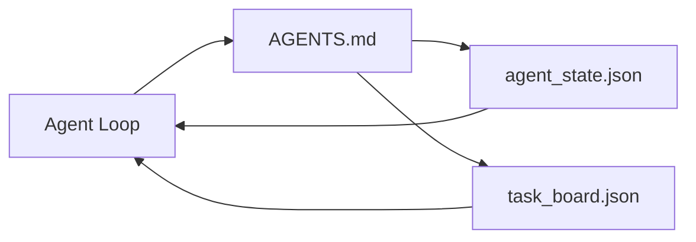

# 最小的 Agent Workbench (The Minimal Agent Workbench)

> 最小而有用的 workbench 只有三個檔案：根目錄的 instruction router、state 檔案和任務看板。其他一切都疊在這之上。如果一個 repo 連這三個都撐不起來，沒有任何模型救得了它。

**Type:** Build
**Languages:** Python (stdlib)
**Prerequisites:** Phase 14 · 31 (Why Capable Models Still Fail)
**Time:** ~45 分鐘

## 學習目標 (Learning Objectives)

- 定義構成最小可行 workbench 的三個檔案。
- 解釋為什麼簡短的根目錄 router 勝過冗長的單體 `AGENTS.md`。
- 建立一個 agent 每個 turn 都能讀取、結束時寫入的 state 檔案。
- 建立一個在沒有聊天歷史下仍能撐過多 session 工作的任務看板。

## 問題 (The Problem)

大多數團隊靠寫一份 3000 行的 `AGENTS.md` 就以為擁有 workbench 了。模型載入它，忽略自己無法摘要的部分，然後在它一直都失敗的那些介面上照樣失敗。

你需要相反的做法。一個很小的根目錄檔案，只在相關時才把 agent 導向更深的檔案。Agent 行動前讀取、行動後寫入的持久 state。一個說明什麼正在進行、什麼被阻擋、接下來是什麼的任務看板。

三個檔案。每個都有一項職責。每個都夠機器可讀，之後可以演進成真正的系統。

## 核心概念 (The Concept)



### AGENTS.md 是 router，不是手冊 (AGENTS.md is a router, not a manual)

好的 `AGENTS.md` 很短。它把 agent 指向：

- State 檔案（你在哪裡）。
- 任務看板（還剩下什麼）。
- 更深的規則（在 `docs/agent-rules.md` 底下）。
- 驗證指令（如何知道它能運作）。

任何更長的內容都放進更深的文件，只在需要時才載入。長篇手冊會被忽略。簡短的 router 會被遵循。

### agent_state.json 是記錄的來源 (agent_state.json is the system of record)

State 承載：目前任務的 id、動過的檔案、做過的假設、阻礙，以及下一步動作。Agent 在每個 turn 讀取它。下一個 session 讀它，而不是重播聊天。

State 放在檔案裡，因為聊天歷史不可靠。Session 會死掉。對話會被裁剪。檔案不會。

### task_board.json 是 queue (task_board.json is the queue)

任務看板承載每個任務，狀態為 `todo | in_progress | done | blocked`。當 state 為空時，它是 agent 取任務的 queue；當你想知道 agent 有沒有照進度走時，它是你讀的 queue。

看板上的任務有 id、目標、負責人（`builder`、`reviewer` 或 `human`）和驗收標準。看板刻意保持很小：當它長到超過一個螢幕，你有的是 planning 問題，不是看板問題。

### 三個檔案是底線，不是上限 (Three files is the floor, not the ceiling)

後面的課程會加入 scope contract、feedback runner、verification gate、reviewer 檢查清單和 handoff 封包。這裡的三個檔案是它們全都預設存在的東西。

```figure
wb-three-files
```

## 動手做 (Build It)

`code/main.py` 把最小 workbench 寫進一個空的 repo，並示範單一 agent turn：

1. 讀取 `agent_state.json`。
2. 若 state 為空，從 `task_board.json` 取下一個任務。
3. 在 scope 內只動一個檔案。
4. 寫回更新後的 state。

執行：

```
python3 code/main.py
```

腳本會在自己旁邊建立 `workdir/`，放下這三個檔案，執行一個 turn，並印出 diff。再執行一次，看看第二個 turn 如何從第一個停下的地方接續。

## 實際使用 (Use It)

在正式環境的 agent 產品中，同樣的三個檔案以不同的名稱出現：

- **Claude Code：** router 用 `AGENTS.md` 或 `CLAUDE.md`，state 用 `.claude/state.json` 這類 store，看板用 hook。
- **Codex / Cursor：** router 用 workspace 規則，state 用 session memory，看板用聊天側邊欄中排隊的任務。
- **自訂 Python agent：** 就是你剛剛寫的那些檔案。

名稱會變。形狀不會。

## 實務中的正式環境模式 (Production patterns in the wild)

當最小 workbench 疊上三種模式後，就能撐過真實 monorepo 的考驗。它們彼此獨立；挑你的 repo 真正需要的。

**巢狀 `AGENTS.md`，以最近者優先。** OpenAI 在其主 repo 中出貨了 88 個 `AGENTS.md` 檔案，每個子元件一個。Codex、Cursor、Claude Code 和 Copilot 都會從工作檔案往 repo 根目錄走，並串接沿途找到的每個 `AGENTS.md`。子目錄的檔案會擴充根目錄的檔案。Codex 加了 `AGENTS.override.md` 用來取代而不是擴充；這個 override 機制是 Codex 專屬的，跨工具作業時請避免。Augment Code 的量測才是關鍵：最好的 `AGENTS.md` 檔案帶來的品質提升，相當於從 Haiku 升級到 Opus；最差的則讓輸出比完全沒有檔案還糟。

**即使看起來像是涵蓋範圍，也要拒絕的反模式。** 互相衝突的指令會悄悄讓 agent 從互動模式掉到貪婪模式（ICLR 2026 AMBIG-SWE：解決率 48.8% → 28%）；要為優先順序編號，而不是平鋪堆疊。沒有強制執行指令的不可驗證風格規則（「遵循 Google Python Style Guide」）會讓 agent 自行捏造合規；每條風格規則都要搭配確切的 lint 指令。以風格而非指令開頭，會把驗證路徑埋掉；指令在前，風格在後。為人類而不是 agent 寫作會浪費 context 預算；精簡是一項優點。

**跨工具 symlink。** 一個根目錄檔案加上 symlink（`ln -s AGENTS.md CLAUDE.md`、`ln -s AGENTS.md .github/copilot-instructions.md`、`ln -s AGENTS.md .cursorrules`），讓每個 coding agent 都用同一個事實來源。Nx 的 `nx ai-setup` 能用單一設定，在 Claude Code、Cursor、Copilot、Gemini、Codex 和 OpenCode 之間自動完成這件事。

## 交付 (Ship It)

`outputs/skill-minimal-workbench.md` 為任何新 repo 產生三檔案 workbench：針對專案調整過的 `AGENTS.md` router、鍵值正確的 `agent_state.json`，以及以目前 backlog 為種子的 `task_board.json`。

## 練習 (Exercises)

1. 在 `agent_state.json` 加上 `last_run` 時間戳。如果檔案超過 24 小時，除非操作人員確認，否則拒絕執行。
2. 在任務看板加上 `priority` 欄位，並把取任務的邏輯改為永遠選優先度最高的 `todo`。
3. 把 `task_board.json` 改成 JSON Lines，讓每個任務是一行，在版本控制中 diff 乾淨。
4. 寫一個 `lint_workbench.py`，當 `AGENTS.md` 超過 80 行或參照到不存在的檔案時就失敗。
5. 決定這三個檔案中，失去哪一個傷害最大。替你的答案辯護。

## 關鍵術語 (Key Terms)

| Term | 一般說法 | 實際意義 |
|------|----------------|------------------------|
| Router | `AGENTS.md` | 簡短的根目錄檔案，把 agent 指向更深的文件與檔案 |
| State file | 「筆記」 | 每個 turn 都會寫入、機器可讀、記錄 agent 位置的紀錄 |
| Task board | 「Backlog」 | 帶有狀態、負責人、驗收標準的 JSON 工作 queue |
| System of record | 「事實來源」 | 聊天消失後，workbench 視為權威的檔案 |

## 延伸閱讀 (Further Reading)

- [agents.md — the open spec](https://agents.md/)：Cursor、Codex、Claude Code、Copilot、Gemini、OpenCode 都已採用
- [Augment Code, A good AGENTS.md is a model upgrade. A bad one is worse than no docs at all](https://www.augmentcode.com/blog/how-to-write-good-agents-dot-md-files)：量測到的品質提升
- [Blake Crosley, AGENTS.md Patterns: What Actually Changes Agent Behavior](https://blakecrosley.com/blog/agents-md-patterns)：憑經驗什麼有用、什麼沒用
- [Datadog Frontend, Steering AI Agents in Monorepos with AGENTS.md](https://dev.to/datadog-frontend-dev/steering-ai-agents-in-monorepos-with-agentsmd-13g0)：實務中的巢狀優先順序
- [Nx Blog, Teach Your AI Agent How to Work in a Monorepo](https://nx.dev/blog/nx-ai-agent-skills)：橫跨六種工具的單一來源產生
- [The Prompt Shelf, AGENTS.md Best Practices: Structure, Scope, and Real Examples](https://thepromptshelf.dev/blog/agents-md-best-practices/)：能通過審查的章節順序
- [Anthropic, Claude Code subagents](https://code.claude.com/docs/en/sub-agents)
- Phase 14 · 31：這個最小配置所吸收的失敗模式
- Phase 14 · 34：本課預告的持久 state schema
