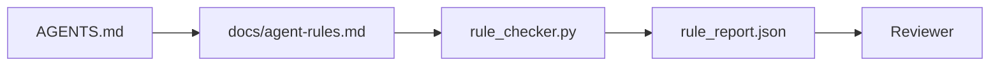

# 把 Agent Instruction 寫成可執行的限制 (Agent Instructions as Executable Constraints)

> 用散文寫的 instruction 只是願望。寫成限制的 instruction 才是測試。Workbench 把每條規則變成 agent 能在執行時檢查、reviewer 能事後驗證的東西。

**Type:** Build
**Languages:** Python (stdlib)
**Prerequisites:** Phase 14 · 32 (Minimal Workbench)
**Time:** ~50 分鐘

## 學習目標 (Learning Objectives)

- 把路由用的散文與操作性規則分開。
- 把啟動規則、禁止的動作、完成的定義、不確定性處理和核准邊界，表達成機器可檢查的限制。
- 實作一個為執行過程對照規則集打分的規則檢查器。
- 讓規則集對 diff 友善，這樣 review 時看得出改了什麼。

## 問題 (The Problem)

典型的 `AGENTS.md` 讀起來像新人教育訓練文件。它叫 agent「要小心」、「徹底測試」、「不確定就問」。三天後，agent 出貨了一個沒有測試的變更、寫入了禁止的目錄，而且從沒問過，因為它根本不知道界線在哪裡。

Instruction 在操作性強時很有力量，在只是期望時很薄弱。修法是寫出 workbench 能解讀、reviewer 能打分的規則。

## 核心概念 (The Concept)

規則屬於 `docs/agent-rules.md`，遠離簡短的根目錄 router。每條規則有名稱、類別和一個檢查。



### 涵蓋大多數規則的五個類別 (Five categories that cover most rules)

| 類別 | 這條規則回答的問題 | 範例 |
|----------|---------------------------|---------|
| Startup | 工作開始前，什麼必須為真？ | 「state 檔案存在且是新的」 |
| Forbidden | 什麼絕不能發生？ | 「不要編輯 `scripts/release.sh`」 |
| Definition of done | 什麼能證明任務完成？ | 「pytest 以 0 結束，且驗收那一行通過」 |
| Uncertainty | 不確定時 agent 該怎麼做？ | 「開一則疑問筆記，而不是亂猜」 |
| Approval | 什麼需要人工核准？ | 「任何新相依套件、任何正式環境寫入」 |

不屬於這五類之一的規則，通常其實是兩條規則。強迫自己拆開。

### 規則是機器可讀的 (Rules are machine-readable)

每條規則有 slug、類別、一行說明，以及一個指向 `rule_checker.py` 中某個 function 的 `check` 欄位。新增規則就意味著新增檢查；檢查器隨 workbench 一起成長。

### 規則對 diff 友善 (Rules are diff-friendly)

規則在單一 markdown 檔案中，每個標題一條。重新命名在 diff 中看得見。新規則放在其類別的最上面。過時的規則要刪除，而不是註解掉，因為 workbench 才是事實來源，不是團隊上一季心情的聊天紀錄。

### 規則對 framework guardrail (Rules versus framework guardrails)

Framework guardrail（OpenAI Agents SDK guardrail、LangGraph interrupt）在 runtime 層級強制執行規則。本課的規則集是人類可讀、可審查的合約，而那些 guardrail 就是在實作它。兩者你都需要：runtime 在 turn 期間抓出違規，規則集則證明 runtime 做的是對的事。

### 漸進式揭露：地圖，而非百科全書 (Progressive disclosure: a map, not an encyclopedia)

`AGENTS.md` 一直變長的原因，是每次事件都會加一條規則，卻沒有任何事件會移除一條。一年後，檔案有兩千行，agent 讀了第一個螢幕就耗盡注意力預算，只照著其中一小部分行事。巨大的 instruction 檔案失敗的原因，與四十頁的新人文件相同：讀者只瀏覽一次，從此再也不會回頭看真正重要的那一部分。

解法不是更短的檔案，而是分層的檔案。根目錄 router 要小到每個 session 都能讀完，而且只放指標。深度存在於主題檔案中，agent 只在任務碰到它們時才載入。給 agent 一張地圖，而不是整部百科全書，讓它自己走到需要的那一頁。

```
AGENTS.md                  # router, < 50 lines: what this repo is, where to look, the 5 hard rules
docs/
  agent-rules.md           # the full rule set (this lesson)
  architecture.md          # loaded when the task touches module boundaries
  testing.md               # loaded when the task writes or runs tests
  deploy.md                # loaded only for release work, gated behind an approval rule
feature_list.json          # the backlog (Phase 14 · 36)
```

| 層級 | 存放位置 | 何時讀取 | 大小預算 |
|------|----------|-----------|-------------|
| Router | `AGENTS.md` | 每個 session，永遠 | 約 50 行以內 |
| Rules | `docs/agent-rules.md` | 每個 session，在啟動時 | 每個類別一個螢幕 |
| Topic docs | `docs/<topic>.md` | 只在任務碰到該主題時 | 需要多深就多深 |

兩項測試讓分層保持誠實。可達性測試：agent 應該能從 router 出發，最多兩次跳轉就到達任何規則，所以 router 必須以路徑連結每份主題文件，而不是用散文描述它。新鮮度測試：router 短到 reviewer 每個 PR 都會重讀一遍，這是唯一能阻止它悄悄長回它所取代的那部百科全書的方法。一個不再有效的指標，比缺少一條規則更糟，所以 router 中的壞連結本身就是違反 startup 檢查的行為。

```figure
wb-rule-checkoff
```

## 動手做 (Build It)

`code/main.py` 提供：

- `agent-rules.md` 解析器，把規則載入 dataclass。
- `rule_checker.py` 風格的檢查函式，每個 `check` 參照一個。
- 一次違反兩條規則的 demo agent 執行，以及抓出它們的檢查流程。

執行：

```
python3 code/main.py
```

輸出：解析後的規則集、執行 trace、每條規則的通過/失敗，以及存在腳本旁邊的 `rule_report.json`。

## 實務中的正式環境模式 (Production patterns in the wild)

有三種模式，區分了能撐過一季的規則集和一週就衰敗的規則集。

**在撰寫時就標上嚴重度。** 每條規則帶有 `severity`：`block`、`warn` 或 `info`。檢查器回報三種；runtime 只在 `block` 時拒絕。大多數團隊一開始會高估嚴重度，然後在期限壓力下悄悄削弱；在撰寫時就標記，可以強迫一開始就校準。搭配 verification gate（Phase 14 · 38），它會把任何對 `block` 規則的 override 簽名寫入 `overrides.jsonl` 稽核 log。

**把規則到期當作強制手段。** 每條規則帶有 `expires_at` 日期（預設從撰寫日起 90 天）。當一條未到期的規則已連續 60 天零違規，檢查器就發出警告；下一次季度審查要嘛證明它值得保留，要嘛把它降為 `info`，要嘛刪除。Cloudflare 的正式環境 AI Code Review 資料（2026 年 4 月，30 天內橫跨 5,169 個 repo 的 131,246 次 review 執行）顯示，有明確到期機制的規則集，每個 repo 都維持在 30 條以下；沒有的則成長到 80 條以上，且大多從未觸發。

**Markdown 為來源，JSON 為快取。** `agent-rules.md` 是撰寫的檔案；`agent-rules.lock.json` 是檢查器在熱路徑上讀取的快取。Lock 由 pre-commit hook 重新產生。Markdown 的 diff 可供審查；Markdown 解析則不會出現在每個 turn 中，因為檢查器只載入預先建好的小型 JSON。形態與 `package.json` / `package-lock.json` 以及 `Cargo.toml` / `Cargo.lock` 相同。

## 實際使用 (Use It)

在正式環境中：

- Claude Code、Codex、Cursor 在 session 開始時讀取規則，並在拒絕動作時引用它們。檢查器在 CI 中重新執行它們，以抓出悄悄發生的漂移。
- OpenAI Agents SDK guardrail 把相同的檢查註冊為輸入與輸出 guardrail。Markdown 是文件介面；SDK 是 runtime 介面。
- LangGraph interrupt 在執行中的節點違反規則時觸發。Interrupt handler 讀取規則、詢問人類，然後恢復執行。

規則集可以跨這三者移植，因為它只是 markdown 加上 function 名稱。

## 交付 (Ship It)

`outputs/skill-rule-set-builder.md` 會訪談專案負責人，把他們現有的散文 instruction 歸入五個類別，並輸出有版本的 `agent-rules.md` 加上檢查器 stub。

## 練習 (Exercises)

1. 如果你的產品真的需要，就加第六個類別。說明為什麼它不能併入這五個之一。
2. 擴充檢查器，讓規則可以帶有嚴重度（`block`、`warn`、`info`），報告也據此彙整。
3. 把檢查器接進 CI：如果最新一次 agent 執行中有 block 嚴重度的規則失敗，就讓 build 失敗。
4. 為每條規則加上「到期」欄位。90 天內沒有任何檢查失敗，這條規則就要接受審查。
5. 找一份真實的 `AGENTS.md`，把它改寫成五類別的規則。其中有多少行是操作性的？有多少行只是期望？

## 關鍵術語 (Key Terms)

| Term | 一般說法 | 實際意義 |
|------|----------------|------------------------|
| Operational rule | 「真正的 instruction」 | workbench 能在執行時檢查的規則 |
| Aspirational rule | 「要小心」 | 沒有檢查的規則；要嘛刪除，要嘛升級 |
| Definition of done | 「驗收」 | 任務完成的客觀、由檔案支撐的證明 |
| Block severity | 「硬性規則」 | 違規會中止執行；沒有操作人員無法消音 |
| Rule expiry | 「清掃過時規則」 | N 天內沒有失敗的規則，列入退場審查 |

## 延伸閱讀 (Further Reading)

- [OpenAI Agents SDK guardrails](https://openai.github.io/openai-agents-python/guardrails/)
- [LangGraph interrupts](https://langchain-ai.github.io/langgraph/how-tos/human_in_the_loop/breakpoints/)
- [Anthropic, Building Effective Agents](https://www.anthropic.com/research/building-effective-agents)
- [Rick Hightower, Agent RuleZ: A Deterministic Policy Engine](https://medium.com/@richardhightower/agent-rulez-a-deterministic-policy-engine-for-ai-coding-agents-9489e0561edf)：正式環境中的 block/warn/info 嚴重度
- [Cloudflare, Orchestrating AI Code Review at Scale](https://blog.cloudflare.com/ai-code-review/)：131k 次 review 執行、規則組合的經驗
- [microservices.io, GenAI development platform — part 1: guardrails](https://microservices.io/post/architecture/2026/03/09/genai-development-platform-part-1-development-guardrails.html)：規則與 CI 之間的縱深防禦
- [Type-Checked Compliance: Deterministic Guardrails (arXiv 2604.01483)](https://arxiv.org/pdf/2604.01483)：以 Lean 4 作為規則即檢查的上限
- [logi-cmd/agent-guardrails](https://github.com/logi-cmd/agent-guardrails)：merge-gate 實作：scope、mutation testing、違規預算
- Phase 14 · 32：這個規則集要放進去的最小 workbench
- Phase 14 · 38：使用規則報告的 verification gate
- Phase 14 · 39：為規則遵守度打分的 reviewer agent
