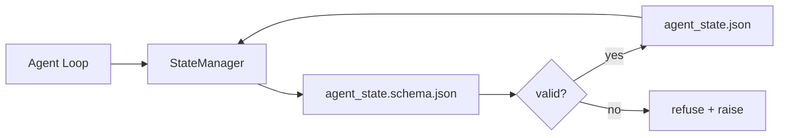

# Repo Memory 與持久 State (Repo Memory and Durable State)

> 聊天歷史是易失的。Repo 是持久的。Workbench 把 agent state 存在有版本的檔案中，讓下一個 session、下一個 agent 和下一位 reviewer 都從同一個事實來源讀取。

**Type:** Build
**Languages:** Python (stdlib + `jsonschema` optional)
**Prerequisites:** Phase 14 · 32 (Minimal Workbench)
**Time:** ~60 分鐘

## 學習目標 (Learning Objectives)

- 定義什麼屬於 repo memory，什麼屬於聊天歷史。
- 為 `agent_state.json` 和 `task_board.json` 撰寫 JSON Schema。
- 建立一個能以原子方式載入、驗證、變更並持久化 state 的 state manager。
- 利用 schema，在壞的寫入破壞 workbench 之前就拒絕它們。

## 問題 (The Problem)

Agent 結束了一個 session。聊天關閉。下一個 session 開啟，問該從哪裡開始。模型說「讓我看看檔案」，讀了過時的筆記，然後重做已經完成的工作。更糟的是，它重寫一個已完成的檔案，因為沒有人告訴它那個檔案已經完成了。

Workbench 的修法是 repo memory：state 存在 repo 的 JSON 檔案中，依 schema 寫入、以原子方式持久化，並且在 code review 中對 diff 友善。聊天是暫時的串流；repo 才是記錄的來源。

## 核心概念 (The Concept)



### 什麼屬於 repo memory (What belongs in repo memory)

| 屬於 | 不屬於 |
|---------|-----------------|
| 目前任務 id | 原始聊天 transcript |
| 本 session 動過的檔案 | Token 層級的推理 trace |
| Agent 做過的假設 | 「使用者看起來很沮喪」 |
| 未解決的阻礙 | 取樣的補全結果 |
| 下一步動作 | 廠商專屬的模型 id |

測試標準是持久性：三個月後在 CI 重新執行時，這還有用嗎？有，就放 repo。沒有，就是 telemetry。

### Schema 優先的 state (Schema-first state)

JSON Schema 就是合約。沒有它，每個 agent 都會發明新欄位，每位 reviewer 都得學習新的形狀，每個 CI 腳本都得為過去的版本做特例處理。有了它，壞的寫入就是被拒絕的寫入。

Schema 涵蓋：

- 必要的 key。
- 允許的 `status` 值。
- 禁止的值（例如陣列不可為 `null`）。
- 樣式限制（任務 id 符合 `T-\d{3,}`）。
- 供遷移使用的版本欄位。

### 原子寫入 (Atomic writes)

State 寫入必須能撐過部分失敗：寫入暫存檔、fsync，再 rename 覆蓋目標檔。State 檔案是事實來源；寫到一半的檔案比完全沒有檔案更糟。

### 遷移 (Migrations)

當 schema 改變時，在 schema 版本升級旁邊提供遷移腳本。State 檔案帶有 `schema_version` 欄位；manager 會拒絕載入它無法遷移的版本的檔案。

```figure
wb-state-persist
```

## 動手做 (Build It)

`code/main.py` 實作：

- `agent_state.schema.json` 和 `task_board.schema.json`。
- 只用 stdlib 的 validator（JSON Schema 的子集：required、type、enum、pattern、items）。
- `StateManager.load`、`StateManager.update`、`StateManager.commit`，使用原子的 temp-and-rename 寫入。
- 一個變更 state、持久化、重新載入並證明來回一致的 demo。

執行：

```
python3 code/main.py
```

腳本會寫入 `workdir/agent_state.json` 和 `workdir/task_board.json`，在兩個 turn 中變更它們，並在每一步印出驗證後的 state。

## 實務中的正式環境模式 (Production patterns in the wild)

有四種模式，把本課的最小版本變成多 agent monorepo 撐得過去的東西。

**原子的 temp-and-rename 不是可選的。** 2026 年 3 月 Hive 專案的 bug 回報乾淨地記錄了這種失敗模式：`state.json` 是透過 `write_text()` 寫入，而例外被攔截並靜默掉。部分寫入讓 session 對著損毀的 state 恢復，卻沒有任何訊號。修法永遠是：在目標檔案所在的同一目錄用 `tempfile.mkstemp`，寫入、`fsync`、`os.replace`（在 POSIX 與 Windows 上都是原子的 rename）。本課的 `atomic_write` 做的就是這件事。

**每個非冪等的 tool call 都要有冪等鍵。** 如果 agent 在呼叫 tool 之後、為結果做 checkpoint 之前當機，恢復時會重試該 tool call。對讀取是安全的；對 email、DB 插入、檔案上傳則很危險。模式：在執行之前，把每個 tool call 的 ID 記錄到 `pending_calls.jsonl`。重試時檢查該 ID；若存在，就跳過呼叫並使用快取的結果。Anthropic 和 LangChain 在 2026 年的指引中都有提到這一點；LangGraph 的 checkpointer 也是為了同樣的理由而持久化待處理的寫入。

**把大型成品與 state 分開。** 不要把 CSV、長篇 transcript 或產生的檔案存進 `agent_state.json`。把成品另存為獨立檔案（或上傳到物件儲存），state 中只保留路徑。Checkpoint 維持小而快；成品則各自獨立成長。

**用 event sourcing 做稽核，用 snapshot 做恢復。** 每次變更都附加到事件 log（`state.events.jsonl`）；定期對 `state.json` 做 snapshot。恢復時讀取 snapshot，再重播 snapshot 時間戳之後的任何事件。這會多用一些磁碟，但讓你能逐字重播 agent 的決策，這在 debug 長時程執行時不可或缺。Postgres 在儲存層用它的 WAL 做同樣的 log 加 checkpoint 想法，只是層級比應用程式事件低得多。

**要嘛做 schema 遷移，要嘛拒絕載入。** `schema_version` 整數就是合約。當 manager 載入未知版本的檔案時，它會拒絕讀取。在 schema 版本升級旁邊提供遷移腳本；`tools/migrate_state.py` 在每次啟動時以冪等方式執行。

## 實際使用 (Use It)

在正式環境中：

- **LangGraph checkpointer。** 同樣的想法，不同的儲存。Checkpointer 把 graph state 持久化到 SQLite、Postgres 或自訂後端。當 checkpointer 掛掉、你需要手動讀取 state 時，就會用到本課教的 schema。
- **Letta memory block。** 帶有結構化 schema 的持久 block（Phase 14 · 08）。同樣的紀律，範圍限定在長時間執行的 persona。
- **OpenAI Agents SDK session store。** 可抽換的後端，感知 schema。本課的 state 檔案就是本地檔案後端。

## 交付 (Ship It)

`outputs/skill-state-schema.md` 產生針對專案的 JSON Schema 組合（state + board）、接上原子寫入的 Python `StateManager`，以及遷移骨架，讓下一次 schema 升級不會破壞 workbench。

## 練習 (Exercises)

1. 加一個 `last_human_touch` 時間戳。在人類編輯後五秒內，拒絕任何 agent 的寫入。
2. 擴充 validator 以支援 `oneOf`，讓任務可以是 build 任務或 review 任務，各有不同的必要欄位。
3. 加一個 `schema_version` 欄位，並寫從 v1 到 v2 的遷移（把 `blockers` 改名為 `risks`）。
4. 把儲存後端從本地檔案改為 SQLite。保持 `StateManager` API 完全相同。
5. 讓兩個 agent 對同一個 state 檔案以 50 ms 的寫入競爭執行。會出什麼問題？原子 rename 如何救你？

## 關鍵術語 (Key Terms)

| Term | 一般說法 | 實際意義 |
|------|----------------|------------------------|
| Repo memory | 「筆記檔」 | 依 schema 儲存在 repo 內受追蹤檔案中的 state |
| Schema-first | 「驗證輸入」 | 在寫入者之前先定義合約，拒絕漂移 |
| Atomic write | 「直接 rename」 | 寫到暫存檔、fsync、rename，讓部分失敗無法造成損毀 |
| Migration | 「Schema 升級」 | 把 vN state 轉成 v(N+1) state 的腳本 |
| System of record | 「事實來源」 | workbench 視為權威的成品 |

## 延伸閱讀 (Further Reading)

- [JSON Schema specification](https://json-schema.org/specification.html)
- [LangGraph checkpointers](https://langchain-ai.github.io/langgraph/concepts/persistence/)
- [Letta memory blocks](https://docs.letta.com/v1-sdk/memory/memory-blocks)
- [Fast.io, AI Agent State Checkpointing: A Practical Guide](https://fast.io/resources/ai-agent-state-checkpointing/)：schema 優先的 checkpoint 與冪等性
- [Fast.io, AI Agent Workflow State Persistence: Best Practices 2026](https://fast.io/resources/ai-agent-workflow-state-persistence/)：並行控制、TTL、event sourcing
- [Hive Issue #6263 — non-atomic state.json writes silently ignored](https://github.com/aden-hive/hive/issues/6263)：真實專案中的失敗模式
- [eunomia, Checkpoint/Restore Systems: Evolution, Techniques, Applications](https://eunomia.dev/blog/2025/05/11/checkpointrestore-systems-evolution-techniques-and-applications-in-ai-agents/)：把 OS 歷史中的 CR 原語套用到 agent
- [Indium, 7 State Persistence Strategies for Long-Running AI Agents in 2026](https://www.indium.tech/blog/7-state-persistence-strategies-ai-agents-2026/)
- [Microsoft Agent Framework, Compaction](https://learn.microsoft.com/en-us/agent-framework/agents/conversations/compaction)：廠商的 checkpoint manager
- Phase 14 · 08：memory block 與 sleep-time compute
- Phase 14 · 32：本課要 schema 化的三檔案最小配置
- Phase 14 · 40：從同一個 schema 讀取的 handoff 封包
