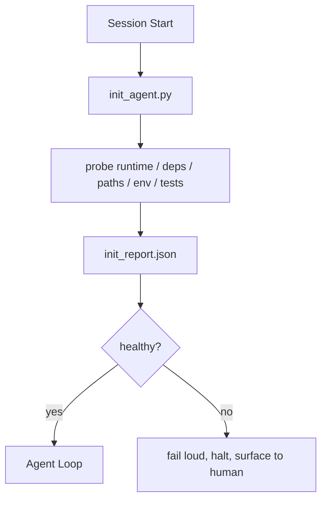

# Agent 的初始化腳本 (Initialization Scripts for Agents)

> 每個冷啟動的 session 都要付一筆稅。Agent 讀同樣的檔案、重試同樣的探測、重新發現同樣的路徑。Init 腳本只付一次稅，並把答案寫進 state。

**Type:** Build
**Languages:** Python (stdlib)
**Prerequisites:** Phase 14 · 32 (Minimal Workbench), Phase 14 · 34 (Repo Memory)
**Time:** ~45 分鐘

## 學習目標 (Learning Objectives)

- 找出 agent 每個 session 都不該重做的工作。
- 建立確定性的 init 腳本，探測 runtime、相依套件和 repo 健康狀態。
- 持久化探測結果，讓 agent 讀取它，而不是重新執行檢查。
- 初始化失敗時，要大聲、快速失敗，而且只有一個地方可以查。

## 問題 (The Problem)

開啟一個 session。Agent 猜 Python 版本。猜測試指令。列出 repo 根目錄五次才找到進入點。嘗試 import 一個沒安裝的套件。問使用者設定檔在哪裡。等它真正做出一次編輯時，已經有一萬個 token 花在本該只是一支腳本的設定工作上。

解法是一支初始化腳本，在 agent 做任何事之前先執行，並寫出一份 agent 啟動時讀取的 `init_report.json`。

## 核心概念 (The Concept)



### Init 腳本探測什麼 (What the init script probes)

| 探測 | 為什麼重要 |
|-------|----------------|
| Runtime 版本 | Python 或 Node 版本錯誤，會造成無聲的版本錯誤 bug |
| 相依套件可用性 | 之後才發現缺少套件的成本，是現在就抓到的十倍 |
| 測試指令 | Agent 必須知道如何驗證；如果指令不存在，workbench 就是壞的 |
| Repo 路徑 | 寫死的路徑會漂移；解析一次並固定 |
| 環境變數 | 缺少 `OPENAI_API_KEY` 是一個失敗面，不是 runtime 的神祕事件 |
| State + board 新鮮度 | 來自當機 session 的過時 state 是個陷阱 |
| 最後已知良好 commit | session 結束時 handoff diff 的錨點 |

### 要大聲、快速、在同一個地方失敗 (Fail loud, fail fast, fail in one place)

探測失敗代表中止，並呈現給人類。不要有「agent 會自己想辦法」這種事。Init 的全部意義，就是在 workbench 壞掉時拒絕啟動。

### 冪等 (Idempotent)

連續執行兩次。第二次除了新的時間戳之外，應該是 no-op。冪等性讓你能把腳本接進 CI、hook 或任務前的 slash command。

### Init 對啟動規則 (Init versus startup rules)

規則（Phase 14 · 33）描述行動前什麼必須為真。Init 是確立這些規則可以被檢查的腳本。沒有 init 的規則會變成「要小心」。沒有規則的 init 會變成精緻的失敗。

```figure
wb-init-probes
```

## 動手做 (Build It)

`code/main.py` 實作 `init_agent.py`：

- 五個探測：Python 版本、透過 `importlib.util.find_spec` 檢查列出的相依套件、測試指令是否可解析、必要的環境變數、state 檔案新鮮度。
- 每個探測回傳 `(name, status, detail)`。
- 腳本寫出含完整探測集合的 `init_report.json`，如果任何 block 嚴重度的探測失敗，就以非零狀態結束。

執行：

```
python3 code/main.py
```

腳本會印出探測表格、寫出 `init_report.json`，並在順利時以零結束，或在有失敗探測清單時以非零結束。

## 實務中的正式環境模式 (Production patterns in the wild)

有三種模式，區分了有用的 init 腳本和流於形式的儀式。

**最後已知良好 commit 的錨定。** 把目前的 commit 對照在上次成功 merge 時寫入的 `LKG` 檔案來探測。如果 diff 超過預算（預設 50 個檔案），就拒絕啟動，並要求人類確認新的 baseline。Cloudflare 的 AI Code Review 就是用這個來界定 reviewer agent 的範圍：每個 review session 都以同一個最後已知良好為錨點，絕不跨 session 累積漂移。

**帶 TTL 的 lock 檔案。** 第一次探測成功通過後，寫出 `prereqs.lock`。後續執行在 N 小時內（預設 24 小時）信任該 lock，並跳過昂貴的探測。Init 腳本先讀 lock；如果它是新的，且相依套件清單的 hash 相符，就短路。這與 Docker 對 layer cache 使用的模式相同：冪等探測 + 內容 hash = 跳過。

**熱路徑中沒有網路、沒有 LLM、沒有意外。** Init 探測是確定性的管線工作。一個呼叫 LLM 來分類失敗，或去連外部服務檢查授權的探測，就不是探測，而是 workflow。如果探測在 dry run 中花超過三秒，就把它當作 workbench 的壞味道，要嘛把它移出 init，要嘛快取其結果。

## 實際使用 (Use It)

在正式環境中：

- **Claude Code hook。** `pre-task` hook 呼叫 init 腳本，若失敗則拒絕啟動 agent。
- **GitHub Actions。** 一個 `setup-agent` job 執行 init 腳本；agent job 依賴它。
- **Docker entrypoint。** Agent container 在 exec agent runtime 之前先執行 init 腳本；失敗時 log 會浮現。

Init 腳本之所以可移植，是因為它不呼叫任何特定 framework。Bash、Make 或 tasks 檔案都能包裝它。

## 交付 (Ship It)

`outputs/skill-init-script.md` 訪談專案，把它的設定工作歸類為探測，並輸出針對專案的 `init_agent.py`，以及在任何 agent 步驟之前執行它的 CI workflow。

## 練習 (Exercises)

1. 加一個探測，把目前 commit 與最後已知良好 commit 做 diff，如果變更超過 50 個檔案就拒絕啟動。
2. 讓腳本寫出 `prereqs.lock` 檔案，且當 lock 超過七天時拒絕啟動。
3. 加一個 `--fix` 旗標，自動安裝缺少的 dev 相依套件，但未經核准絕不修改 runtime 相依套件。
4. 把探測從寫死的函式改成 YAML registry。為這個取捨辯護。
5. 為每個探測加上時間預算。執行超過三秒的探測是 workbench 的壞味道。

## 關鍵術語 (Key Terms)

| Term | 一般說法 | 實際意義 |
|------|----------------|------------------------|
| Probe | 「一個檢查」 | 回傳 `(name, status, detail)` 的確定性 function |
| Init report | 「設定輸出」 | 寫在 state 旁邊、含探測結果的 JSON |
| Idempotent | 「重新執行是安全的」 | 連續兩次執行產生的報告，除了時間戳之外完全相同 |
| Fail loud | 「不要吞掉」 | 中止並呈現給人類；沒有無聲的備援 |
| Setup tax | 「啟動成本」 | Agent 每個 session 重新發現顯而易見之事所花的 token |

## 延伸閱讀 (Further Reading)

- [Anthropic, Effective harnesses for long-running agents](https://www.anthropic.com/engineering/effective-harnesses-for-long-running-agents)
- [GitHub Actions, composite actions for setup](https://docs.github.com/en/actions/sharing-automations/creating-actions/creating-a-composite-action)
- [microservices.io, GenAI dev platform: guardrails](https://microservices.io/post/architecture/2026/03/09/genai-development-platform-part-1-development-guardrails.html)：pre-commit + CI 檢查作為 init
- [Augment Code, How to Build Your AGENTS.md (2026)](https://www.augmentcode.com/guides/how-to-build-agents-md)：對 init 的期望
- [Codex Blog, Codex CLI Context Compaction](https://codex.danielvaughan.com/2026/03/31/codex-cli-context-compaction-architecture/)：session 開始即感知壓縮的 init
- Phase 14 · 33：這支腳本所啟用的規則集
- Phase 14 · 34：這支腳本所播種的 state 檔案
- Phase 14 · 38：init 腳本餵入的 verification gate
- Phase 14 · 40：使用 init 報告中最後已知良好 commit 的 handoff
