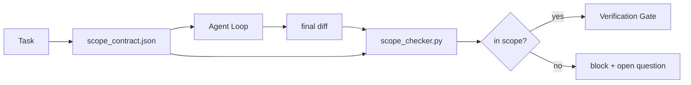

# Scope Contract 與任務邊界 (Scope Contracts and Task Boundaries)

> 模型不知道工作在哪裡結束。Scope contract 是每個任務一份的檔案，說明工作從哪裡開始、在哪裡結束，以及如果外溢了該如何 rollback。這份合約把「留在範圍內」從願望變成檢查。

**Type:** Build
**Languages:** Python (stdlib)
**Prerequisites:** Phase 14 · 32 (Minimal Workbench), Phase 14 · 33 (Rules as Constraints)
**Time:** ~50 分鐘

## 學習目標 (Learning Objectives)

- 撰寫一份 agent 在任務開始時讀取、verifier 在任務結束時讀取的 scope contract。
- 指定允許的檔案、禁止的檔案、驗收標準、rollback 計畫和核准邊界。
- 實作一個 scope 檢查器，把 diff 與合約比對並標出違規。
- 讓 scope creep 變得可見、自動且可審查。

## 問題 (The Problem)

Agent 會蔓延。任務是「修好登入 bug」。Diff 卻動到登入路由、email 輔助函式、資料庫 driver、README 和 release 腳本。每一次動到，在當下都有看似合理的理由。合在一起，卻是和被審查的變更不同的另一個變更。

Scope creep 是 agent 工作中最缺乏監控的失敗模式，因為 agent 是懷著善意描述每一步的。解法不是更嚴格的 prompt。解法是磁碟上一份說明承諾內容的合約，以及一個把結果對照承諾的檢查。

## 核心概念 (The Concept)



### Scope contract 裡放什麼 (What goes in a scope contract)

| 欄位 | 用途 |
|-------|---------|
| `task_id` | 連到看板上的任務 |
| `goal` | reviewer 能驗證的一句話 |
| `allowed_files` | agent 可以寫入的 glob |
| `forbidden_files` | agent 即使無意也不得碰觸的 glob |
| `acceptance_criteria` | 證明完成的測試指令或斷言行 |
| `rollback_plan` | 需要中止時，操作人員可以執行的一段話 |
| `approvals_required` | 超出 scope、需要明確人工簽核的動作 |

沒有 `forbidden_files` 的合約是不完整的。負空間佔了合約的一半。

### 用 glob，不要用原始路徑 (Globs, not raw paths)

真實的 repo 會移動檔案。把合約固定在 glob 上（`app/**/*.py`、`tests/test_signup*.py`），這樣 session 之間的重構就不會讓合約失效。

### Rollback 是 scope 的一部分 (Rollback is part of scope)

列出如何 rollback，會迫使合約作者思考什麼可能出錯。一份你無法 rollback 的合約，就是一份不該被核准的合約。

### Scope 檢查就是 diff 檢查 (Scope check is a diff check)

Agent 寫出 diff。檢查器讀取 diff、允許的 glob、禁止的 glob，以及任何已執行的驗收指令清單。每個違規都是一個帶標籤的發現，verification gate 可以拒絕它。

### Scope 的兩個高度：功能清單與任務合約 (Two altitudes of scope: the feature list and the task contract)

Scope contract 界定的是一個任務，而不是專案。Agent 可以完美地待在登入修復的合約內，然後在下一個 turn 又決定專案還需要一個設定頁面、一個深色模式開關，以及一次 router 重寫。合約從沒被問過專案的哪些工作在範圍內，只被問過任務的哪些檔案在範圍內。

第二個高度需要它自己的原語：agent 在 session 開始時讀取的 `feature_list.json`。它是以機器可讀、有序的檔案表示的專案 backlog。Agent 精確挑選一個 `status` 為 `todo` 的功能，把它的 `id` 寫進目前的 scope contract，並且禁止在同一個 session 中開始第二個功能。「一次一個功能」不再是 agent 可以合理化繞過的 prompt 裡的一行字，而是它從磁碟讀取的值，以及 gate 強制執行的檢查。

```json
{
  "project": "knowledge-base",
  "active": "import-pdf",
  "features": [
    { "id": "import-pdf",   "status": "in_progress", "goal": "import a PDF into the library",        "done_when": "pytest tests/test_import.py && a sample PDF appears in the library view" },
    { "id": "full-text-search", "status": "todo",     "goal": "search document text and rank hits",   "done_when": "query returns ranked results with snippets" },
    { "id": "cite-answers", "status": "todo",         "goal": "answers carry source citations",        "done_when": "every answer renders at least one clickable citation" }
  ]
}
```

| 欄位 | 用途 |
|-------|---------|
| `active` | 目前 session 可以碰觸的唯一功能；空值代表要挑一個並設定 |
| `features[].id` | scope contract 的 `task_id` 所指向的穩定 slug |
| `features[].status` | `todo`、`in_progress`、`done`、`blocked`；同一時間只能有一個 `in_progress` |
| `features[].goal` | reviewer 能驗證的一句話 |
| `features[].done_when` | 將 `in_progress` 翻轉成 `done` 的驗收那一行 |

有兩條規則讓這份清單成為承重的，而不是裝飾。第一，「最多一個 `in_progress`」這個不變式本身就是啟動檢查（Phase 14 · 33）：如果清單顯示有兩個，session 會拒絕啟動，直到人類解決。第二，功能清單是檔案，不是聊天訊息，因為聊天會捲出 context，而檔案會跨 session、跨 agent 持續存在。Handoff（Phase 14 · 40）會把完成功能的狀態寫回 `done`，這樣下一個 session 一打開看到的就是準確的看板，而不是重新推導還剩下什麼。

合約與清單依最小權限原則組合，與下面描述的是同一種合併：任務合約的 `allowed_files` 必須落在目前功能所碰觸的範圍之內，絕不能超出它。

```figure
wb-scope-bounce
```

## 動手做 (Build It)

`code/main.py` 實作：

- `scope_contract.json` schema（JSON Schema 的子集，glob 陣列）。
- 一個 diff 解析器，把動過的檔案清單加上執行過的指令清單，轉成 `RunSummary`。
- 一個 `scope_check`，對照合約回傳 `(violations, in_scope, off_scope)`。
- 兩次 demo 執行：一次留在 scope 內，一次蔓延。檢查器以確切的檔案與原因標出蔓延。

執行：

```
python3 code/main.py
```

輸出：合約、兩次執行、每次執行的判定，以及存下來的 `scope_report.json`。

## 實務中的正式環境模式 (Production patterns in the wild)

一位實踐「specsmaxxing」（在呼叫 agent 之前先用 YAML 寫 scope contract）的實務者回報，在不更換 agent 的情況下，三週內兔子洞比率從 52% 降到 21%。是合約在做事，不是模型。有三種模式讓成效持續。

**違規預算，而不是二元的失敗。** `agent-guardrails`（Claude Code、Cursor、Windsurf、Codex 透過 MCP 使用的開源 merge gate）為每個任務提供一個 `violationBudget`：預算內的輕微 scope 偏離會以警告呈現；只有超出預算時，merge gate 才會拒絕。搭配 `violationSeverity: "error" | "warning"`。預算是「能出貨的 gate」和「被討厭它的團隊停用的 gate」之間的差別。

**依路徑家族設定不對稱的嚴重度。** 對 `docs/**` 的越界寫入通常是 `warn`；對 `scripts/**`、`migrations/**`、`config/prod/**` 的越界寫入永遠是 `block`。這個不對稱必須寫在合約裡，而不是 runtime 裡，因為它是專案專屬的，並且每個任務都會變。

**時間與網路預算，與檔案預算並列。** `time_budget_minutes` 欄位限制 wall clock；runtime 在未經重新核准的情況下拒絕超過它繼續執行。對主機名稱設定的 `network_egress` 允許清單，可防止 agent 悄悄連到不屬於任務的外部 API。這些也是 scope 的維度；檔案 glob 是必要的，但不充分。

**多合約合併語意（最小權限）。** 當兩份 scope contract 都適用時（例如專案層級的合約加上任務專屬的合約），合併方式是：`allowed_files` **取交集**（兩份合約都必須允許該路徑）、`forbidden_files` **取聯集**（任一份都可以禁止）、`time_budget_minutes` 取最嚴格的（min）、`approvals_required` 累加。`network_egress` 為 `None` 表示不強制、`[]` 表示全部拒絕、`[...]` 表示允許清單；合併時，`None` 由另一方決定，兩份清單取交集，全部拒絕仍然是全部拒絕。把這寫進合約 schema，讓合併是機械性且可審查的。

## 實際使用 (Use It)

正式環境的模式：

- **Claude Code slash command。** `/scope` 指令寫出合約，並將它固定為 session context。Subagent 在行動前先讀取合約。
- **GitHub PR。** 把合約以 JSON 檔案放在 PR 描述中，或作為提交進去的成品。CI 針對 merge diff 執行 scope 檢查器。
- **LangGraph interrupt。** Scope 違規會觸發 interrupt；handler 詢問人類，是合約需要擴大，還是 agent 需要退回。

合約隨任務一起移動。任務關閉時，合約會被封存到 `outputs/scope/closed/`。

## 交付 (Ship It)

`outputs/skill-scope-contract.md` 針對任務描述產生 scope contract，以及一個在 CI 中對每個 agent diff 執行、感知 glob 的檢查器。

## 練習 (Exercises)

1. 加一個 `network_egress` 欄位，列出允許的外部主機。拒絕碰觸其他主機的執行。
2. 擴充檢查器，對 `docs/**` 軟性失敗，對 `scripts/**` 硬性失敗。為這個不對稱辯護。
3. 讓合約用一組靜態規則（不用 LLM）從 `goal` 欄位推導 `allowed_files`。第一個邊界案例就會出什麼錯？
4. 加一個 `time_budget_minutes`，並在 wall clock 超過它之後拒絕繼續。
5. 對同一個 diff 套用兩份合約。當兩份都適用時，正確的合併語意是什麼？

## 關鍵術語 (Key Terms)

| Term | 一般說法 | 實際意義 |
|------|----------------|------------------------|
| Scope contract | 「任務簡報」 | 每個任務一份的 JSON，列出允許/禁止的檔案、驗收、rollback |
| Scope creep | 「它也順便動了...」 | 同一個任務中，合約之外的檔案被改動 |
| Rollback plan | 「我們可以 revert」 | 用於中止的一段話操作人員 runbook |
| Approval boundary | 「需要簽核」 | 合約中列為需要明確人工核准的動作 |
| Diff check | 「路徑稽核」 | 把動過的檔案與合約 glob 比對 |

## 延伸閱讀 (Further Reading)

- [LangGraph human-in-the-loop interrupts](https://langchain-ai.github.io/langgraph/concepts/human_in_the_loop/)
- [OpenAI Agents SDK tool approval policies](https://platform.openai.com/docs/guides/agents-sdk)
- [logi-cmd/agent-guardrails — merge gates and scope validation](https://github.com/logi-cmd/agent-guardrails)：違規預算、嚴重度分級
- [Dev|Journal, Preventing AI Agent Configuration Drift with Agent Contract Testing](https://earezki.com/ai-news/2026-05-05-i-built-a-tiny-ci-tool-to-keep-ai-agent-configs-from-drifting-in-my-repo/)：不需外部相依的 `--strict` 模式
- [Agentic Coding Is Not a Trap (production logs)](https://dev.to/jtorchia/agentic-coding-is-not-a-trap-i-answered-the-viral-hn-post-with-my-own-production-logs-33d9)：specsmaxxing 的數據：52% → 21%
- [OpenCode permission globs](https://opencode.ai/docs/agents/)：細粒度的逐權限 scope
- [Knostic, AI Coding Agent Security: Threat Models and Protection Strategies](https://www.knostic.ai/blog/ai-coding-agent-security)：scope 作為最小權限的一部分
- [Augment Code, AI Spec Template](https://www.augmentcode.com/guides/ai-spec-template)：三層邊界系統（must/ask/never）
- Phase 14 · 27：與 scope 鎖搭配的 prompt injection 防禦
- Phase 14 · 33：這份合約依任務特化的規則集
- Phase 14 · 38：檢查器回報到的 verification gate
