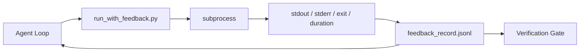

# Runtime Feedback Loop (Runtime Feedback Loops)

> 看不到真實指令輸出的 agent 只能猜。Feedback runner 會把 stdout、stderr、exit code 和耗時擷取成下一個 turn 可以讀的結構化記錄。這樣 agent 就是對事實做出反應，而不是對自己預測的事實做出反應。

**Type:** Build
**Languages:** Python (stdlib)
**Prerequisites:** Phase 14 · 32 (Minimal Workbench), Phase 14 · 35 (Init Script)
**Time:** ~50 分鐘

## 學習目標 (Learning Objectives)

- 區分 runtime feedback 與 observability telemetry。
- 建立包裝 shell 指令並持久化結構化記錄的 feedback runner。
- 確定性地截斷大型輸出，讓 loop 維持在 token 預算內。
- 當 feedback 缺少時，拒絕推進 loop。

## 問題 (The Problem)

Agent 說「現在執行測試」。下一則訊息說「所有測試都通過」。實際上沒有任何測試執行過。Agent 想像出輸出，或是執行了指令卻從沒讀結果，或是讀了結果卻悄悄截掉了失敗那一行。

Feedback runner 消除了這個缺口。每個指令都經過 runner。每筆記錄都帶著指令、擷取到的 stdout 與 stderr、exit code、wall-clock 耗時，以及一行 agent 的備註。Agent 在下一個 turn 讀取記錄。Verification gate 在任務結束時讀取這些記錄。

## 核心概念 (The Concept)



### Feedback 記錄裡放什麼 (What goes in a feedback record)

| 欄位 | 為什麼重要 |
|-------|----------------|
| `command` | 確切的 argv，沒有 shell 展開的意外 |
| `stdout_tail` | 最後 N 行，確定性截斷 |
| `stderr_tail` | 最後 N 行，與 stdout 分開 |
| `exit_code` | 無歧義的成功訊號 |
| `duration_ms` | 揭露緩慢的探測與失控的行程 |
| `started_at` | 供重播用的時間戳 |
| `agent_note` | agent 寫下它預期會發生什麼的一行字 |

### 截斷是確定性的 (Truncation is deterministic)

50 MB 的 log 會毀掉 loop。Runner 用 `...truncated N lines...` 標記截掉頭部與尾部，且是確定性的，所以相同的輸出永遠產生相同的記錄。不做取樣；agent 需要看的部分（最終錯誤、最終摘要）都在尾端。

### Feedback 對 telemetry (Feedback versus telemetry)

Telemetry（Phase 14 · 23，OTel GenAI conventions）是給人類維運人員跨時間檢視執行用的。Feedback 是給這次執行的下一個 turn 用的。它們共用欄位，但存在不同的檔案，保存期限也不同。

### 沒有 feedback 就拒絕推進 (Refuse to advance without feedback)

如果 runner 在擷取 exit 之前出錯，記錄會帶 `exit_code: null` 和 `error: <reason>`。Agent loop 必須拒絕在 `null` 的 exit 上宣稱成功。沒有 exit，就沒有進展。

```figure
wb-feedback-loop
```

## 動手做 (Build It)

`code/main.py` 實作：

- `run_with_feedback(command, agent_note)`：包裝 `subprocess.run`，擷取 stdout/stderr/exit/耗時，確定性地截斷，並附加到 `feedback_record.jsonl`。
- 一個小型 loader，把 JSONL 串流成 Python list。
- 一個 demo，執行三個指令（成功、失敗、緩慢），並印出每個指令的最後一筆記錄。

執行：

```
python3 code/main.py
```

輸出：附加到 `feedback_record.jsonl` 的三筆 feedback 記錄，每個指令的最後一筆會內嵌印出。跨多次重新執行 tail 這個檔案，看 loop 如何累積。

## 實務中的正式環境模式 (Production patterns in the wild)

有三種模式把 runner 強化到足以出貨。

**在寫入時遮蔽，而不是在讀取時。** 任何碰到 stdout 或 stderr 的記錄都可能洩漏機密。Runner 在 JSONL 附加之前帶有一道遮蔽處理：移除符合 `^Bearer `、`password=`、`api[_-]?key=`、`AKIA[0-9A-Z]{16}`（AWS）、`xox[baprs]-`（Slack）的行。在讀取時遮蔽是個陷阱；磁碟上的檔案才是攻擊者能碰到的。每季對照正式 runtime 觀察到的機密格式，稽核遮蔽樣式。

**輪替政策，而不是單一檔案。** 把 `feedback_record.jsonl` 限制在每個檔案 1 MB；溢出時輪替到 `.1`、`.2`，丟掉 `.5`。Agent 的 loop 只讀目前的檔案，所以 runtime 成本有上限。CI 成品儲存取得完整的輪替集合。沒有輪替，這個檔案會成為每次 loader 呼叫的瓶頸。

**重試鏈的父指令 id。** 每筆記錄都有 `command_id`；重試則帶有指向前一次嘗試的 `parent_command_id`。Reviewer 的「失敗嘗試」清單（Phase 14 · 40）和 verification gate 的稽核都會追蹤這條鏈。沒有這個連結，重試看起來就像獨立的成功，稽核就隱藏了失敗歷史。

## 實際使用 (Use It)

正式環境的模式：

- **Claude Code Bash tool。** 這個 tool 已經會擷取 stdout、stderr、exit 和耗時。本課的 runner 是適用於任何 agent 產品、與 framework 無關的對等物。
- **LangGraph 節點。** 用 runner 包住任何 shell 節點，讓記錄持久化在 graph state 之外。
- **CI log。** 把 JSONL 導進你的 CI 成品儲存；reviewer 不必重新執行 session，就能重播任何指令。

Runner 是個薄薄的包裝，因為它擁有記錄的形狀，所以能撐過每一次 framework 遷移。

## 交付 (Ship It)

`outputs/skill-feedback-runner.md` 產生針對專案的 `run_with_feedback.py`，附有合適的截斷預算、接上 workbench 的 JSONL 寫入器，以及 agent 每個 turn 都讀取的 loader。

## 練習 (Exercises)

1. 為每筆記錄加一個 `cwd` 欄位，讓從不同目錄執行的同一個指令可以區分。
2. 加一道 `redaction` 步驟，移除符合 `^Bearer ` 或 `password=` 的行。用測試用的 fixture 記錄測試。
3. 透過輪替到 `.1`、`.2` 檔案，把 `feedback_record.jsonl` 的總大小限制在 1 MB。為輪替政策辯護。
4. 加一個 `parent_command_id`，讓重試鏈可見：哪個指令產生了下一個指令所消費的輸入。
5. 把 JSONL 導進一個小型 TUI，標示最新的非零 exit。列出這個 TUI 要在 review 中有用，必須顯示的八個關鍵功能。

## 關鍵術語 (Key Terms)

| Term | 一般說法 | 實際意義 |
|------|----------------|------------------------|
| Feedback record | 「執行 log」 | 帶有指令、輸出、exit、耗時的結構化 JSONL 條目 |
| Tail truncation | 「裁掉 log」 | 確定性的頭尾擷取，讓記錄符合 token 預算 |
| Refuse-on-null | 「缺資料就擋」 | 當 `exit_code` 為 null 時，loop 不得推進 |
| Agent note | 「預期標籤」 | agent 在讀取結果之前寫下的一行預測 |
| Telemetry split | 「兩個 log 檔」 | Feedback 給下一個 turn，telemetry 給維運人員 |

## 延伸閱讀 (Further Reading)

- [OpenTelemetry GenAI semantic conventions](https://opentelemetry.io/docs/specs/semconv/gen-ai/)
- [Anthropic, Effective harnesses for long-running agents](https://www.anthropic.com/engineering/effective-harnesses-for-long-running-agents)
- [Guardrails AI x MLflow — deterministic safety, PII, quality validators](https://guardrailsai.com/blog/guardrails-mlflow)：把遮蔽樣式當作回歸測試
- [Aport.io, Best AI Agent Guardrails 2026: Pre-Action Authorization Compared](https://aport.io/blog/best-ai-agent-guardrails-2026-pre-action-authorization-compared/)：tool 前/後的擷取
- [Andrii Furmanets, AI Agents in 2026: Practical Architecture for Tools, Memory, Evals, Guardrails](https://andriifurmanets.com/blogs/ai-agents-2026-practical-architecture-tools-memory-evals-guardrails)：observability 介面
- Phase 14 · 23：telemetry 這一側的 OTel GenAI conventions
- Phase 14 · 24：agent observability 平台（Langfuse、Phoenix、Opik）
- Phase 14 · 33：要求在宣告完成之前必須有 feedback 的規則
- Phase 14 · 38：讀取該 JSONL 的 verification gate
