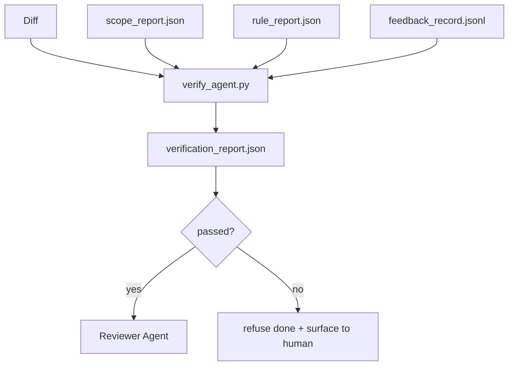

# Verification Gate (Verification Gates)

> Agent 不能自己把自己的工作標記為完成。Verification gate 會讀取 scope contract、feedback log、規則報告和 diff，並回答一個問題：這個任務真的完成了嗎？如果 gate 說沒有，那不管聊天裡怎麼說，任務就是沒完成。

**Type:** Build
**Languages:** Python (stdlib)
**Prerequisites:** Phase 14 · 33 (Rules), Phase 14 · 36 (Scope), Phase 14 · 37 (Feedback)
**Time:** ~55 分鐘

## 學習目標 (Learning Objectives)

- 把 verification gate 定義為作用在 workbench 成品上的確定性函式。
- 把規則報告、scope 報告、feedback 記錄和 diff 合併成單一判定。
- 輸出 reviewer agent 和 CI 都能讀取的 `verification_report.json`。
- 在任何 block 嚴重度的失敗上都拒絕推進任務，沒有例外。

## 問題 (The Problem)

Agent 太容易宣告成功。三種失敗形態佔主導：

- 「看起來不錯。」模型讀了自己的 diff，就判定它是正確的。
- 「測試通過了。」說得很有自信。卻沒有測試實際執行過的紀錄。
- 「驗收達成。」驗收標準被詮釋得很寬鬆，意思變成「任何接近完成的東西」。

Workbench 的修法是單一的 verification gate，讀取 agent 已經產出的成品並做出判斷。Gate 是確定性的。Gate 在版本控制中。Gate 接進了 CI。Agent 沒辦法賄賂它。

## 核心概念 (The Concept)



### Gate 檢查什麼 (What the gate checks)

| 檢查 | 來源成品 | 嚴重度 |
|-------|-----------------|----------|
| 所有驗收指令都已執行 | `feedback_record.jsonl` | block |
| 所有驗收指令都以零結束 | `feedback_record.jsonl` | block |
| Scope 檢查沒有禁止的寫入 | `scope_report.json` | block |
| Scope 檢查沒有越界的寫入 | `scope_report.json` | block 或 warn |
| 所有 block 嚴重度的規則都通過 | `rule_report.json` | block |
| Feedback 中沒有 `null` 的 exit code | `feedback_record.jsonl` | block |
| 動過的檔案符合 `scope.allowed_files` | 兩者 | warn |

`warn` 發現會為判定加上註記；`block` 發現會阻止 `passed: true`。

### 確定性，而非機率性 (Deterministic, not probabilistic)

對於相同的成品集合，gate 每次都必須產生相同的判定。不用 LLM judge。LLM judge 屬於 reviewer 這一側（Phase 14 · 39），那裡的目標是質性評估，不是狀態。

### 一份報告，一個路徑 (One report, one path)

Gate 在每個任務結案時輸出一份 `verification_report.json`，寫在 `outputs/verification/<task_id>.json` 之下。CI 使用同一個路徑。多個 gate 使用不同路徑，會讓事實來源分叉。

### 無例外地拒絕 (Refuse without exception)

Block 嚴重度的發現不能被 agent override。只有人類可以 override，並且要記錄 `override_reason` 和 `overridden_by` 使用者 id。Override 是簽名過的變更，不是 agent 的決定。

```figure
wb-gate-sequence
```

## 動手做 (Build It)

`code/main.py` 實作：

- 每個輸入成品的 loader，全都在本地 stub，讓本課自成一體。
- 一個 `verify(task_id, artifacts) -> VerdictReport` 純函式。
- 一個印出每項檢查結果與最終通過/失敗的列印器。
- 一個有三種任務情境的 demo：乾淨通過、scope 蔓延、缺少驗收。

執行：

```
python3 code/main.py
```

輸出：三份判定報告，各自存在腳本旁邊。

## 實務中的正式環境模式 (Production patterns in the wild)

有五種模式把 gate 從「又一個 lint job」提升為「做決定的那條邊」。

**縱深防禦，而不是單一 gate。** Pre-commit hook → CI status check → pre-tool authz hook → pre-merge gate。每一層都是確定性的，所以某一層的失敗會被下一層抓到。microservices.io 2026 年 3 月的作法手冊說得很明確：pre-commit hook 是無法繞過的，因為與模型端的 skill 不同，它不依賴 agent 遵循指示。Verification gate 位於 CI / pre-merge 這一層。

**以確定性檢查防禦，只在細微差別上用模型評審。** Anthropic 2026 年的 Hybrid Norm 搭配：可驗證的獎勵（unit test、schema 檢查、exit code）回答「這段程式碼解決問題了嗎？」，LLM 評分標準回答「這段程式碼可讀、安全、風格正確嗎？」。Gate 執行第一類；reviewer（Phase 14 · 39）執行第二類。把它們混在一起會讓訊號崩壞。

**簽名的 override log，而不是 Slack 討論串。** 每次 override 都會在 `outputs/verification/overrides.jsonl` 中寫一列：時間戳、發現代碼、理由、簽名的使用者、目前的 HEAD commit。Runtime 會拒絕任何缺少簽名的 override；稽核軌跡由 git 追蹤。這是 override 政策與 override 作秀之間的分界線。

**把覆蓋率下限當作一級檢查。** `coverage_report.json` 餵給 `coverage_floor`（預設 80%）檢查。如果測得的覆蓋率低於下限，或比上次 merge 的下限低超過 1 個百分點，gate 就失敗。沒有這項檢查，agent 會悄悄刪除失敗的測試，而驗證報告仍然是綠的。

**`--strict` 模式把 warn 升級為 block。** 對於 release 分支、阻擋出貨的 PR 或事後分流，`--strict` 讓每個警告都變成硬性失敗。這個旗標是依分支 opt-in 的；不是全域預設，因為處處嚴格會侵蝕日常的工作流程。

## 實際使用 (Use It)

正式環境的模式：

- **CI 步驟。** `verify_agent` job 對 agent 的最終成品執行 gate。Merge 保護在沒有 `passed: true` 時拒絕。
- **Pre-handoff hook。** Agent runtime 在產生 handoff 文件之前呼叫 gate。沒有綠色判定，就沒有 handoff。
- **手動分流。** 當 agent 宣稱成功而人類懷疑時，維運人員讀取這份報告。

Gate 是 workbench 流程中做決定的那條邊。其他每個介面都在它的上游。

## 交付 (Ship It)

`outputs/skill-verification-gate.md` 把 gate 接進特定專案：哪些驗收指令餵給它、哪些規則是 block 嚴重度、哪些越界寫入可以容忍、override 稽核 log 如何儲存。

## 練習 (Exercises)

1. 加一個 `coverage_floor` 檢查：測試指令必須產生至少 80% 的覆蓋率報告。決定由哪個成品承載這個下限。
2. 支援一個把每個 `warn` 升級為 `block` 的 `--strict` 模式。記錄 strict 模式是正確預設的情況。
3. 讓 gate 除了 JSON 之外也產生 Markdown 摘要。為摘要應包含哪些欄位辯護。
4. 加一個 `time_since_last_human_touch` 檢查：在人類按鍵後 60 秒內編輯的任何檔案，免於越界旗標。
5. 對你產品中真實的 agent diff 執行 gate。有多少發現是真的，多少是雜訊？Gate 需要在哪裡成長？

## 關鍵術語 (Key Terms)

| Term | 一般說法 | 實際意義 |
|------|----------------|------------------------|
| Verification gate | 「阻止事情的檢查」 | 作用於 workbench 成品、產生通過/失敗判定的確定性函式 |
| Block severity | 「硬性失敗」 | 阻止 `passed: true`、需要簽名 override 的發現 |
| Override log | 「為什麼我們放行了」 | 帶有理由和使用者 id、接受 review 稽核的簽名條目 |
| Acceptance command | 「證明」 | 以零 exit 代表 `done` 的 shell 指令 |
| One report path | 「事實來源」 | `outputs/verification/<task_id>.json`，CI 與人類共用 |

## 延伸閱讀 (Further Reading)

- [Anthropic, Harness design for long-running application development](https://www.anthropic.com/engineering/harness-design-long-running-apps)
- [OpenAI Agents SDK guardrails](https://openai.github.io/openai-agents-python/guardrails/)
- [microservices.io, GenAI dev platform: guardrails](https://microservices.io/post/architecture/2026/03/09/genai-development-platform-part-1-development-guardrails.html)：pre-commit 與 CI 之間的縱深防禦
- [ICMD, The 2026 Playbook for Agentic AI Ops](https://icmd.app/article/the-2026-playbook-for-agentic-ai-ops-guardrails-costs-and-reliability-at-scale-1776661990431)：核准 gate 階梯（草稿 → 核准 → 在門檻內自動）
- [Type-Checked Compliance: Deterministic Guardrails (arXiv 2604.01483)](https://arxiv.org/pdf/2604.01483)：以 Lean 4 作為確定性 gate 的上限
- [logi-cmd/agent-guardrails — merge gate spec](https://github.com/logi-cmd/agent-guardrails)：scope + mutation-testing gate
- [Guardrails AI x MLflow](https://guardrailsai.com/blog/guardrails-mlflow)：把確定性 validator 當作 CI 評分器
- Phase 14 · 27：prompt injection 防禦（gate 的對抗性搭檔）
- Phase 14 · 36：這個 gate 強制執行的 scope contract
- Phase 14 · 37：這個 gate 評分的 feedback log
- Phase 14 · 39：gate 交棒給的 reviewer agent
