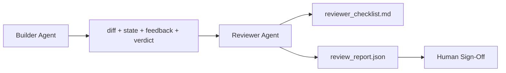

# Reviewer Agent：把 Builder 和打分者分開 (Reviewer Agent: Separate Builder from Marker)

> 寫程式碼的 agent 不能替它打分數。Reviewer 是第二個 loop，有不同的 system prompt、不同的目標，並且對 builder 產出的一切都只有唯讀存取。Builder 與 reviewer 之間的落差，就是大部分可靠度所在。

**Type:** Build
**Languages:** Python (stdlib)
**Prerequisites:** Phase 14 · 38 (Verification Gate)
**Time:** ~55 分鐘

## 學習目標 (Learning Objectives)

- 說明為什麼同一個 agent 無法可靠地審查自己的工作。
- 建立一個消費 builder 成品並輸出結構化 review 報告的 reviewer agent loop。
- 撰寫針對具體維度、而不是憑感覺打分的 reviewer 評分標準。
- 把 reviewer 接進 workbench，讓人工 review 這一步從真實的成品開始。

## 問題 (The Problem)

你請 agent 修一個 bug。它編輯了四個檔案、執行測試，然後回報完成。Verification gate（Phase 14 · 38）確認驗收有執行、scope 守住了。Gate 說 `passed: true`。你 merge 了。兩天後你發現，這個修復解決的是 bug 的錯誤那一半。

驗收是必要的，但不充分。Reviewer 問的是驗收問不出來的問題：這解決了對的問題嗎？它有沒有在未標示的情況下擴大 scope？它有沒有記錄下本該被質疑的假設？它有沒有讓 workbench 留在下一個 session 能接手的狀態？

## 核心概念 (The Concept)



### Reviewer 評分標準 (Reviewer rubric)

五個維度，每個維度打 0 到 2 分。

| 維度 | 問題 |
|-----------|----------|
| Problem fit | 這個變更解決的是如所述的任務，而不是相近的另一個任務嗎？ |
| Scope discipline | 編輯是否侷限在合約內，或者合約是被刻意擴大的？ |
| Assumptions | 所有隱藏的假設是否都寫在某個可供審查的地方？ |
| Verification quality | 驗收指令真的證明了目標嗎，還是只證明了較弱的版本？ |
| Handoff readiness | 下一個 session 能從目前的 state 乾淨地接手嗎？ |

總分滿分 10。低於 7 是軟性失敗；低於 5，或任何一個維度為 0，是硬性失敗。

### Reviewer 是獨立的角色，不是獨立的模型 (The reviewer is a separate role, not a separate model)

你可以用與 builder 相同的模型來執行 reviewer。紀律在於角色分離：不同的 system prompt、不同的輸入、對 diff 沒有寫入權限。姿態的改變就是訊號的改變。

### Reviewer 不能編輯 diff (The reviewer cannot edit the diff)

Reviewer 讀取 diff、state、feedback、判定。它寫出一份報告。它不修補 diff。如果報告說「修這個」，由下一個 builder turn 來修；reviewer 回頭繼續做 review。混用角色就會破壞這個落差。

### Reviewer 評分標準對 verification gate (Reviewer rubric versus verification gate)

Gate（Phase 14 · 38）檢查確定性的事實：驗收有執行嗎、規則通過了嗎、scope 守住了嗎。Reviewer 做質性的判斷：這是對的工作嗎、有記錄嗎、handoff 能用嗎。兩者都需要。

```figure
wb-builder-marker
```

## 動手做 (Build It)

`code/main.py` 實作：

- 一個 `ReviewerInputs` dataclass，打包 reviewer 讀取的成品。
- 一個評分標準打分器，每個維度一個函式。每個函式都是確定性的，且為了本課只做到 stub 等級；真正的實作會呼叫 LLM。
- 一個 `review_report.json` 寫入器，包含五個分數、總分和判定（`pass`、`soft_fail`、`hard_fail`）。
- 兩個 demo 案例：乾淨的變更，以及「測試對了，問題錯了」的變更。

執行：

```
python3 code/main.py
```

輸出：寫到磁碟的兩份 review 報告，以及各維度分數的主控台表格。

## 實務中的正式環境模式 (Production patterns in the wild)

數據：Cloudflare 2026 年 4 月的 AI Code Review 系統，在 30 天內橫跨 5,169 個 repo 的 48,095 個 merge request 上跑了 131,246 次 review。Review 完成時間的中位數是 3 分 39 秒。最多七位專家 reviewer（安全、效能、程式碼品質、文件、release 管理、合規、Engineering Codex）在一位 Review Coordinator 之下平行執行，由 Coordinator 去除重複的發現並判斷嚴重度。頂級模型只保留給 coordinator；專家則跑在較便宜的層級。

有四種模式讓這個做法能在規模上運作。

**專家池，而不是一個大 reviewer。** 單一個有 5 維度評分標準的 reviewer，適用於單人 repo。一旦程式碼庫有安全關鍵、效能關鍵和文件等多個面向，就拆成 prompt 較小的專家。Coordinator 做去重；專家從不執行完整的評分標準。模型層級的分離自然隨之出現：便宜的專家，昂貴的 coordinator。

**把偏誤緩解當作設計需求，而不是最佳化。** LLM judge 顯示出四種可靠的偏誤（Adnan Masood，2026 年 4 月）：位置偏誤（GPT-4 在 (A,B) 對 (B,A) 順序上約 40% 不一致）、冗長偏誤（對較長輸出約 15% 的分數膨脹）、自我偏好（judge 偏好同一模型家族的輸出）、權威偏誤（judge 高估對知名作者的參照）。緩解方式：兩種順序都評估，只計入一致的勝出；使用明確獎勵簡潔的 1-4 量表；在不同模型家族之間輪替 judge；打分前移除作者姓名。

**校準集，而不是憑感覺。** 一組 10-20 個、已知正確判定的歷史任務。每次 prompt 變更都對它執行 reviewer。如果與歷史紀錄的一致率低於 80%，評分標準在 reviewer 出貨前就需要修訂。這是每個團隊最終都會重新發現的事；最好一開始就這樣做。

**與 gate 的混合準則。** Verification gate（Phase 14 · 38）處理確定性的檢查（驗收有執行嗎、測試通過了嗎、scope 守住了嗎）。Reviewer 處理語意的檢查（這是對的工作嗎、假設有記錄嗎、handoff 能用嗎）。Anthropic 2026 年的指引對這個切分說得很明確：不要要求 reviewer 重做 gate 已經證明的事。

## 實際使用 (Use It)

正式環境的模式：

- **Claude Code subagent。** Reviewer subagent 在 builder 結束任務後執行。它在 PR 上貼一則附有評分標準分數的留言。
- **OpenAI Agents SDK handoff。** Builder 在任務完成時 handoff 給 Reviewer。Reviewer 可以帶著一份發現清單交回，或往上交給人類。
- **雙模型搭配。** Builder 跑在更快更便宜的模型上。Reviewer 跑在 context 較小、專注於判斷的更強模型上。

當人類無法親自做每一次 review 時，reviewer 就是 workbench 長出來的第二雙眼睛。

## 交付 (Ship It)

`outputs/skill-reviewer-agent.md` 產生針對專案的 reviewer 評分標準、接上 builder 成品的 reviewer agent stub，以及與 verification gate 的整合，讓人工 review 從一份書面報告開始，而不是從空白頁開始。

## 練習 (Exercises)

1. 加一個專屬於你產品領域的第六個維度。為它為什麼不被現有的五個吸收辯護。
2. 用兩種不同的 system prompt（簡潔、冗長）執行 reviewer。哪一個產生的報告人類更可能閱讀？
3. 為每個維度加一個 `confidence` 欄位。當最低維度的信心低於 0.6 時，拒絕出貨報告。
4. 建立一組校準集：10 個已知正確判定的歷史任務結案。對它們執行 reviewer。它在哪裡與歷史紀錄不一致？
5. 加一個「要求更多證據」的功能：reviewer 可以在打分前要求 builder 執行特定的測試。怎樣的退避方式才能避免這個過程無限循環？

## 關鍵術語 (Key Terms)

| Term | 一般說法 | 實際意義 |
|------|----------------|------------------------|
| Reviewer rubric | 「檢查清單」 | 五個維度、0-2 分的評分，每個維度有一個書面問題 |
| Soft fail | 「需要修訂」 | 總分低於 7；builder 取得要處理的發現 |
| Hard fail | 「拒絕」 | 總分低於 5 或任何維度為 0；中止並呈現給人類 |
| Role separation | 「不同的 prompt」 | 同一個模型可以同時擔任兩個角色；紀律在於輸入與姿態 |
| Confidence floor | 「不要出貨低訊號的報告」 | 當評分標準不確定時，拒絕輸出判定 |

## 延伸閱讀 (Further Reading)

- [OpenAI Agents SDK handoffs](https://openai.github.io/openai-agents-python/handoffs/)
- [Anthropic Claude Code subagents](https://code.claude.com/docs/en/sub-agents)
- [Cloudflare, Orchestrating AI Code Review at Scale](https://blog.cloudflare.com/ai-code-review/)：7 位專家 + coordinator 架構，30 天內 131k 次執行
- [Agent-as-a-Judge: Evaluating Agents with Agents (OpenReview / ICLR)](https://openreview.net/forum?id=DeVm3YUnpj)：DevAI benchmark，366 項階層式解決方案需求
- [Adnan Masood, Rubric-Based Evaluations and LLM-as-a-Judge: Methodologies, Biases, Empirical Validation](https://medium.com/@adnanmasood/rubric-based-evals-llm-as-a-judge-methodologies-and-empirical-validation-in-domain-context-71936b989e80)：四種偏誤與緩解方式
- [MLflow, LLM-as-a-Judge Evaluation](https://mlflow.org/llm-as-a-judge)：builder/evaluator 分離的正式環境工具
- [LangChain, How to Calibrate LLM-as-a-Judge with Human Corrections](https://www.langchain.com/articles/llm-as-a-judge)：校準集工作流程
- [Evidently AI, LLM-as-a-judge: a complete guide](https://www.evidentlyai.com/llm-guide/llm-as-a-judge)
- [Arize, LLM as a Judge — Primer and Pre-Built Evaluators](https://arize.com/llm-as-a-judge/)
- Phase 14 · 05：Self-Refine 與 CRITIC（單一 agent 自我 review 的基準）
- Phase 14 · 30：以 eval 驅動的 agent 開發（校準集產生器）
- Phase 14 · 38：reviewer 讀取的 verification gate
- Phase 14 · 40：reviewer 報告餵入的 handoff 封包
