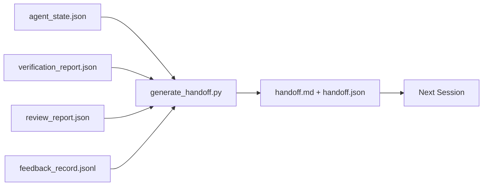

# 多 Session Handoff (Multi-Session Handoff)

> Session 會結束。工作不會。Handoff 封包是把「agent 工作了一個小時」變成「下一個 session 在第一分鐘就能有產出」的成品。要刻意地建它，而不是事後才補。

**Type:** Build
**Languages:** Python (stdlib)
**Prerequisites:** Phase 14 · 34 (Repo Memory), Phase 14 · 38 (Verification), Phase 14 · 39 (Reviewer)
**Time:** ~50 分鐘

## 學習目標 (Learning Objectives)

- 找出每個 handoff 封包都需要的七個欄位。
- 從 workbench 成品產生 handoff，而不用手寫散文。
- 把大型 feedback log 修剪成 handoff 大小的摘要。
- 讓下一個 session 的第一個動作是確定性的。

## 問題 (The Problem)

Session 結束了。Agent 說「太好了，我們有進展」。下一個 session 開啟。下一個 agent 問「我們上次做到哪裡？」第一個 agent 的答案已經消失了。下一個 agent 重新發現、重新執行同樣的指令、重新問人類同樣的問題，花了三十分鐘才找回上一個 session 的最後三十秒。

糟糕 handoff 的成本，在任務的整個生命週期中每個 session 都要付一次。解法是在 session 結束時自動產生的封包：改了什麼、為什麼、試過什麼、什麼失敗了、還剩下什麼、下次先做什麼。

## 核心概念 (The Concept)



### 每個 handoff 都帶的七個欄位 (Seven fields every handoff carries)

| 欄位 | 它回答的問題 |
|-------|---------------------|
| `summary` | 一段話說明做了什麼 |
| `changed_files` | 一眼看完的 diff |
| `commands_run` | 實際執行了什麼 |
| `failed_attempts` | 試過什麼、為什麼沒用 |
| `open_risks` | 下個 session 可能踩到什麼，附嚴重度 |
| `next_action` | 下個 session 要採取的第一個具體步驟 |
| `verdict_pointer` | 指向 verification + review 報告的路徑 |

`next_action` 欄位是承重的。一份除了 `next_action` 之外什麼都有的 handoff，是狀態報告，不是 handoff。

### Handoff 是產生的，不是寫的 (Handoffs are generated, not written)

手寫的 handoff 就是在困難的日子裡會被跳過的 handoff。產生器讀取 workbench 成品並輸出封包。Agent 的工作是讓 workbench 留在產生器能摘要的狀態，而不是寫摘要。

### 兩種形式：人類可讀與機器可讀 (Two forms: human-readable and machine-readable)

`handoff.md` 是人類閱讀的。`handoff.json` 是下一個 agent 載入的。兩者來自相同的來源成品。如果它們出現分歧，以 JSON 為準。

### 修剪 feedback log (Feedback log trimming)

完整的 `feedback_record.jsonl` 可能有數百筆。Handoff 只帶最後 K 筆，加上每一筆非零 exit 的條目。下一個 session 如果需要，可以載入完整的 log，但封包保持精簡。

### 留下乾淨的狀態 (Leave a clean state)

Handoff 描述工作。乾淨的狀態讓工作可以被恢復。兩者並不相同。如果下一個 session 一打開就看到套用到一半的 diff、agent 忘記的暫存檔、一條遺留的分支，以及連執行都還沒開始就出錯的測試，那麼再完美的 `handoff.md` 也毫無價值。下一個 agent 於是把最初十分鐘花在收拾上一個 agent 留下的爛攤子，而不是在建造，這個成本在任務的整個生命週期中每個 session 都會累積。

所以 session 不是在功能能運作時結束。它是在 workbench 處於產生器能摘要、下一個 session 能信任的狀態時才結束。清理是獨立的階段，在 handoff 之前執行，而且它是檢查，不是習慣，因為習慣是在困難的日子裡會被跳過的東西。

| 檢查 | 乾淨代表 | 髒了為什麼要擋 |
|-------|-------------|----------------------|
| 工作樹 | 每個變更都已 commit，或明確附註 stash | 套用到一半的 diff 對下一個 agent 而言看起來像是刻意的工作 |
| 暫存成品 | 沒有遺留 `*.tmp`、暫存目錄、debug 輸出或被註解掉的區塊 | 零散的檔案會污染 diff 和下一個 agent 的心智模型 |
| 測試 | 綠色，或紅色但失敗已在 `open_risks` 中具名 | 無聲的紅色測試是下個 session 會踩進去的陷阱 |
| 功能看板 | `feature_list.json` 的狀態反映實際情況（Phase 14 · 36） | 過時的看板會把下個 session 送去做已經完成的工作 |
| 分支 | 在預期的分支上，沒有 detached HEAD，沒有孤立分支 | 錯誤的分支意味著下個 session 的第一個 commit 會落在錯的地方 |

清理階段會輸出一份列有阻擋問題的 `clean_state.json`；空清單是 handoff 產生器在寫出封包之前所斷言的前提。建立在髒的工作樹上的 handoff 不是 handoff，而是轉寄的爛攤子。這兩個成品互為搭檔：清理證明 workbench 可以安全離開，handoff 證明下一個 session 知道從哪裡開始。

```figure
wb-handoff-packet
```

## 動手做 (Build It)

`code/main.py` 實作：

- 一個 loader，把 state、判定、review 和 feedback 收集成單一的 `WorkbenchSnapshot`。
- 一個 `generate_handoff(snapshot) -> (markdown, payload)` 函式。
- 一個挑選最後 K 筆 feedback 條目加上所有非零 exit 的過濾器。
- 一次 demo 執行，在腳本旁邊寫出 `handoff.md` 和 `handoff.json`。

執行：

```
python3 code/main.py
```

輸出：印出的 handoff 本文，加上磁碟上的兩個檔案。

## 實務中的正式環境模式 (Production patterns in the wild)

Codex CLI、Claude Code 和 OpenCode 各自提供不同的壓縮做法；結構化的 handoff 封包則位於這三者之上。

**壓縮策略各異；封包 schema 不變。** Codex CLI 的 POST /v1/responses/compact 是伺服器端不透明的 AES blob（OpenAI 模型的快速路徑）；備援則是在本地附加為 `_summary` user-role 訊息的「handoff 摘要」。Claude Code 在 context 達到 95% 時執行五階段漸進式壓縮。OpenCode 則是以時間戳隱藏訊息，加上 5 個標題的 LLM 摘要。三種不同的機制，同樣的需求：把壓縮後留下的東西序列化成可攜的成品。封包就是那個成品。

**全新 session 的 handoff 不是壓縮。** 壓縮是延長 session；handoff 是乾淨地結束一個 session 並開始下一個。Hermes Issue #20372 的框架（2026 年 4 月）是對的：當就地壓縮開始劣化時，agent 應該寫出精簡的 handoff、結束 session，並在全新的 context 中恢復。封包就是讓這個轉換變得便宜的東西。錯誤在於一直壓縮到品質崩壞；解法是為提早、乾淨的 handoff 編列預算。

**每個分支與主題只有一份有效的 handoff。** Multi-agent 協作更常因為過時的 handoff 而崩潰，而不是因為壞的模型輸出。一律包含 `branch`、`last_known_good_commit`，以及 `active | superseded | archived` 的 `status`。過時的 handoff 要封存；只有有效的那一份能驅動下一個 session。這就是 handoff-as-notes 與 handoff-as-state 之間的差別。

**在 50-75% 的 context 之前收尾，而不是撞牆時。** 手寫模式的作法手冊（CLAUDE.md + HANDOVER.md）回報，當 session 在 context 預算的 50-75% 而不是 95% 時結束，效果最好。封包產生器在壓縮的痕跡污染來源 state 之前就乾淨地執行。在 context 還完整時寫很便宜；當模型已經迷失方向時就很昂貴。

## 實際使用 (Use It)

正式環境的模式：

- **Session 結束 hook。** Runtime 在使用者關閉聊天時觸發產生器。封包放進 `outputs/handoff/<session_id>/`。
- **PR 模板。** 產生器的 markdown 同時也是 PR 本文。Reviewer 不用打開其他五個檔案就能讀。
- **跨 agent handoff。** 用一個產品建構（Claude Code），用另一個繼續（Codex）。封包就是通用語言。

封包小、規則、產生成本低。節省的成本隨著每個 session 累積。

## 交付 (Ship It)

`outputs/skill-handoff-generator.md` 產生針對專案成品路徑調整過的產生器、執行它的 session 結束 hook，以及下一個 agent 在啟動時讀取的 `handoff.json` schema。

## 練習 (Exercises)

1. 加一個 `assumptions_to_validate` 欄位，呈現每個 builder 記錄過、但 reviewer 打分未超過 1 的假設。
2. 針對失敗的執行與通過的執行，以不同方式修剪 feedback 摘要。為這個不對稱辯護。
3. 納入一份「給人類的問題」清單。一個問題進入封包而不是進入聊天訊息的門檻是什麼？
4. 讓產生器冪等：執行兩次產生相同的封包。要讓這成立，什麼必須是穩定的？
5. 加一個「下個 session 前置條件」章節，精確列出下個 session 在行動前必須載入的成品。

## 關鍵術語 (Key Terms)

| Term | 一般說法 | 實際意義 |
|------|----------------|------------------------|
| Handoff packet | 「Session 摘要」 | 帶有七個欄位、同時有 markdown 與 JSON 的產生成品 |
| Next action | 「先做什麼」 | 啟動下一個 session 的那一個具體步驟 |
| Feedback trim | 「Log 摘要」 | 最後 K 筆記錄加上每一筆非零 exit |
| Status report | 「我們做了什麼」 | 缺少 `next_action` 的文件；有用，但不是 handoff |
| Verdict pointer | 「收據」 | 指向 verification + review 報告的路徑，供追溯 |

## 延伸閱讀 (Further Reading)

- [Anthropic, Effective harnesses for long-running agents](https://www.anthropic.com/engineering/effective-harnesses-for-long-running-agents)
- [OpenAI Agents SDK handoffs](https://openai.github.io/openai-agents-python/handoffs/)
- [Codex Blog, Codex CLI Context Compaction: Architecture, Configuration, Managing Long Sessions](https://codex.danielvaughan.com/2026/03/31/codex-cli-context-compaction-architecture/)：POST /v1/responses/compact 與本地備援
- [Justin3go, Shedding Heavy Memories: Context Compaction in Codex, Claude Code, OpenCode](https://justin3go.com/en/posts/2026/04/09-context-compaction-in-codex-claude-code-and-opencode)：三家廠商的壓縮比較
- [JD Hodges, Claude Handoff Prompt: How to Keep Context Across Sessions (2026)](https://www.jdhodges.com/blog/ai-session-handoffs-keep-context-across-conversations/)：CLAUDE.md + HANDOVER.md，50-75% context 預算
- [Mervin Praison, Managing Handoffs in Multi-Agent Coding Sessions: Fresh Context Without Losing Continuity](https://mer.vin/2026/04/managing-handoffs-in-multi-agent-coding-sessions-fresh-context-without-losing-continuity/)：分散式系統的框架
- [Hermes Issue #20372 — automatic fresh-session handoff when compression becomes risky](https://github.com/NousResearch/hermes-agent/issues/20372)
- [Hermes Issue #499 — Context Compaction Quality Overhaul](https://github.com/NousResearch/hermes-agent/issues/499)：Codex CLI 中以 handoff 為導向的 prompt
- [Microsoft Agent Framework, Compaction](https://learn.microsoft.com/en-us/agent-framework/agents/conversations/compaction)
- [OpenCode, Context Management and Compaction](https://deepwiki.com/sst/opencode/2.4-context-management-and-compaction)
- [LangChain, Context Engineering for Agents](https://www.langchain.com/blog/context-engineering-for-agents)
- Phase 14 · 34：產生器讀取的 state 檔案
- Phase 14 · 38：封包指向的 verification 判定
- Phase 14 · 39：被打包進封包的 reviewer 報告
