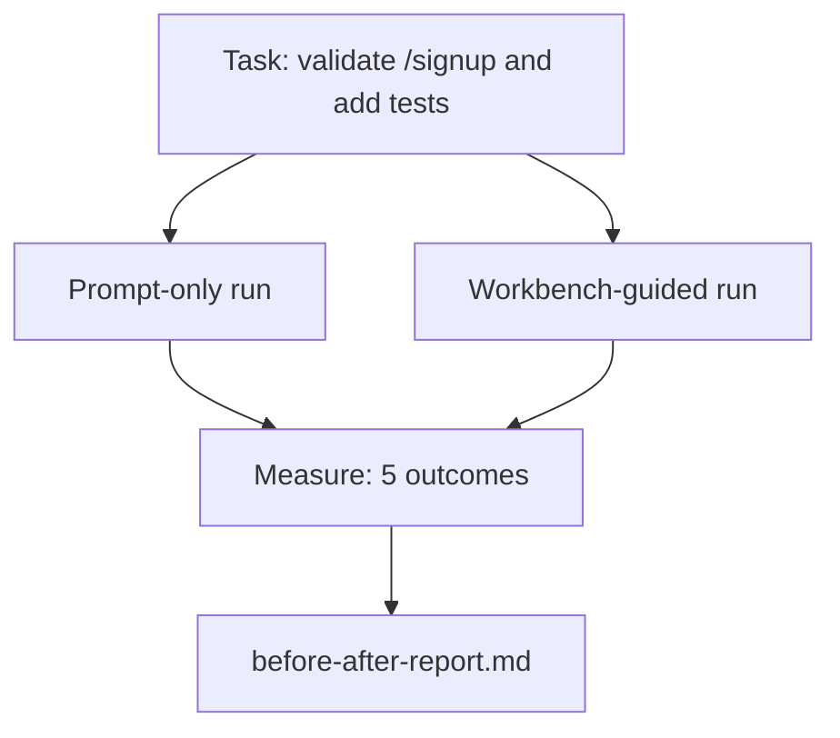

# 真實 Repo 上的 Workbench (The Workbench on a Real Repo)

> 如果十一課的 workbench 介面撐不過與真實程式碼庫的接觸，就一文不值。這一課在一個小型範例應用程式上，把同一個任務執行兩次：只靠 prompt 對比 workbench 引導。讓數字來說話。

**Type:** Build
**Languages:** Python (stdlib)
**Prerequisites:** Phases 14 · 32 to 14 · 40
**Time:** ~60 分鐘

## 學習目標 (Learning Objectives)

- 在小型應用程式上把七個 workbench 介面整合起來。
- 把同一個任務執行兩次（只靠 prompt 與 workbench 引導），並量測五項結果。
- 閱讀前後對照報告，判斷哪些介面帶來最大的槓桿效果。
- 面對「但我的模型已經夠好了」的反駁，為 workbench 辯護。

## 問題 (The Problem)

在玩具任務上的 demo 說服不了任何人。要證明 workbench 的價值，是當一個感覺真實的任務在感覺真實的 repo 上，以更少的失敗、更少的 revert，以及下一個 session 能用的封包上線到正式環境。

這一課提供那個感覺真實的 repo，並讓同一個任務走過兩條 pipeline。結果是一份你可以交給懷疑者的前後對照報告。

## 核心概念 (The Concept)



### 範例應用程式 (The sample app)

`sample_app/` 中一個最小的 FastAPI 風格 handler：

- `app.py`，含 `/signup`（還沒有驗證）。
- `test_app.py`，含一個 happy-path 測試。
- `README.md` 和 `scripts/release.sh` 作為禁區的誘餌。

### 任務 (The task)

> 為 `/signup` 加入輸入驗證：拒絕短於 8 個字元的密碼，回傳 422 與有型別的錯誤 envelope。加一個測試來證明新的行為。

### 兩條 pipeline (The two pipelines)

只靠 prompt：

1. 讀 README。
2. 讀 `app.py`。
3. 編輯檔案。
4. 宣稱完成。

Workbench 引導：

1. 執行 init 腳本（Lesson 35）。
2. 讀 scope contract（Lesson 36）。
3. 讀 state（Lesson 34）。
4. 只編輯允許的檔案。
5. 透過 feedback runner 執行驗收指令（Lesson 37）。
6. 執行 verification gate（Lesson 38）。
7. 執行 reviewer（Lesson 39）。
8. 產生 handoff（Lesson 40）。

### 量測的五項結果 (The five outcomes measured)

| 結果 | 為什麼重要 |
|---------|----------------|
| `tests_actually_run` | 大多數「測試通過」的宣稱都無法驗證 |
| `acceptance_met` | 證明目標的測試，必須是真的有執行的那個測試 |
| `files_outside_scope` | Scope creep 是主要的無聲失敗 |
| `handoff_quality` | 下一個 session 要為此付出代價，或從中受益 |
| `reviewer_total` | 在 gate 之上的質性判斷 |

```figure
wb-ab-runs
```

## 動手做 (Build It)

`code/main.py` 針對同一個範例應用程式 fixture 編排這兩條 pipeline。兩條 pipeline 都是腳本化的（loop 中沒有 LLM），因此量測是可重現的。腳本把比較結果寫進 `before-after-report.md` 和 `comparison.json`。

執行：

```
python3 code/main.py
```

輸出：每條 pipeline 的結果主控台表格、存在腳本旁邊的 markdown 報告，以及給想畫圖的人用的 JSON。

## 實務中的正式環境模式 (Production patterns in the wild)

懷疑者的問題是「workbench 到底幫助多少？」2026 年的數字說的比解釋多得多。

**同一個模型，Terminal Bench 從前 30 名到前 5 名。** LangChain 的 *Anatomy of an Agent Harness*（2026 年 4 月）：一個 coding agent 僅僅因為更換 harness，就在 Terminal Bench 2.0 上從前 30 名之外躍升到第五名。同一個模型。不同的介面。二十五名的差距。

**Vercel 靠刪除 tool 從 80% 到 100%。** Vercel 回報，刪除 agent 80% 的 tool，把成功率從 80% 提升到 100%。更小的 tool 介面、更銳利的 scope、更少失敗的方式。負空間獲勝。

**Harvey 光靠 harness 就讓準確率翻倍。** 法律 agent 光靠 harness 最佳化，準確率就翻了一倍多，模型沒有改變。

**88% 的企業 AI agent 專案無法進入正式環境。** preprints.org 的 *Harness Engineering for Language Agents* 論文（2026 年 3 月）把失敗追溯到 runtime，而不是推理：過時的 state、脆弱的重試、過度膨脹的 context、從中間錯誤恢復不佳。

**長 context 崩潰。** WebAgent baseline 的成功率 40-50%，在長 context 條件下掉到 10% 以下，主要來自無限 loop 和目標遺失。Ralph Loop 與 handoff 封包就是為了吸收這個問題而存在的。

**偽陰性仍然存在。** 單步驟的事實性任務、一行 lint、formatter 執行、任何模型逐字記住的東西，這些只靠 prompt 跑得更快。Benchmark 應該誠實地列舉它們，這樣 workbench 才不會被框成殺雞用牛刀。

重點不是「harness 永遠會贏」。模型確實會隨時間吸收 harness 的技巧。重點是，現在工程的負載落在這七個介面上，而數字證明了這一點。

## 實際使用 (Use It)

這一課是你在以下情況可以引用的案例檔案：

- 有人問為什麼每個 PR 都帶有 `agent-rules.md` 和 scope contract。
- 團隊想「只在這個 sprint」拿掉 verification gate。
- 新的 agent 產品上市，你需要一個可攜的 benchmark，判斷它是否真的節省時間。

數字比解釋傳得更遠。

## 交付 (Ship It)

`outputs/skill-workbench-benchmark.md` 是可攜的評估 harness，能讓任何 agent 產品針對專案自己的範例應用程式，走過這兩條 pipeline，並回報五項結果。

## 練習 (Exercises)

1. 加第六項結果：到第一次有意義編輯的時間。如何乾淨地量測它？
2. 在你的程式碼庫的真實第二天任務上執行比較。Workbench 的數字在哪裡下滑？
3. 加一輪「偽陰性」：只靠 prompt 會更快、而 workbench 的額外負擔是實際成本的任務。為仍然保留 workbench 辯護。
4. 把腳本化的「agent」換成真正的 LLM 呼叫。哪些結果會變得更有雜訊？
5. 撰寫一份給非工程師看的一頁摘要。哪些內容在刪減後仍能保留？

## 關鍵術語 (Key Terms)

| Term | 一般說法 | 實際意義 |
|------|----------------|------------------------|
| Sample app | 「玩具 repo」 | 小，但夠真實，足以演練全部七個介面 |
| Pipeline | 「Workflow」 | agent 遵循的、有順序的介面讀寫序列 |
| Before/after report | 「數據證明」 | 你交給懷疑者的成品 |
| False negative | 「Workbench 殺雞用牛刀」 | 只靠 prompt 更快的任務；值得誠實列舉 |
| Workbench benchmark | 「可靠度分數」 | 在你的程式碼庫上執行比較的可攜 harness |

## 延伸閱讀 (Further Reading)

- [LangChain, The Anatomy of an Agent Harness](https://blog.langchain.com/the-anatomy-of-an-agent-harness/)：Terminal Bench 前 30 名到前 5 名的數據
- [MongoDB, The Agent Harness: Why the LLM Is the Smallest Part of Your Agent System](https://www.mongodb.com/company/blog/technical/agent-harness-why-llm-is-smallest-part-of-your-agent-system)：Vercel + Harvey 的數字
- [preprints.org, Harness Engineering for Language Agents](https://www.preprints.org/manuscript/202603.1756)：88% 企業失敗率、runtime 的根本原因
- [HN: Improving 15 LLMs at Coding in One Afternoon. Only the Harness Changed](https://news.ycombinator.com/item?id=46988596)：在 15 個模型上重現
- [Cloudflare, Orchestrating AI Code Review at Scale](https://blog.cloudflare.com/ai-code-review/)：正式環境 30 天內 131k 次 review 執行
- [Anthropic, Building Effective Agents](https://www.anthropic.com/research/building-effective-agents)
- Phases 14 · 32 to 14 · 40：本課端到端演練的介面
- Phase 14 · 19：SWE-bench、GAIA、AgentBench 作為本課所補充的宏觀 benchmark
- Phase 14 · 30：同一個 harness 所接入的以 eval 驅動的 agent 開發
