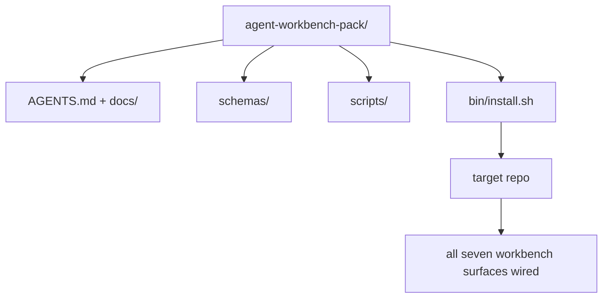

# Capstone：交付可重複使用的 Agent Workbench Pack (Capstone: Ship a Reusable Agent Workbench Pack)

> 這個迷你課程線以一個可以丟進任何 repo 的 pack 作結。十一課的介面被壓縮成一個你可以 `cp -r`、隔天早上就能讓 agent 可靠運作的目錄。Capstone 是這套課程所仰賴的成品。

**Type:** Build
**Languages:** Python (stdlib)
**Prerequisites:** Phases 14 · 31 to 14 · 41
**Time:** ~75 分鐘

## 學習目標 (Learning Objectives)

- 把七個 workbench 介面打包成一個隨插即用的目錄。
- 固定 schema、腳本和模板，讓新的 repo 取得已知良好的 baseline。
- 加入單一安裝腳本，以冪等方式放下這個 pack。
- 決定哪些留在 pack 裡、哪些留在外面，並為每個取捨辯護。
- 示範一次有 agent 協助的 repository 變更，並附上 reviewer 可重現的證據。

## 問題 (The Problem)

存在於 Google Doc、聊天歷史和三支記不太清楚的腳本中的 workbench，是每一季都得重建的 workbench。解法是有版本的 pack：一個 repo 或目錄，裡面有介面、schema、腳本，以及一個指令的安裝器。

這一課結束時，你會在磁碟上有出貨的 `outputs/agent-workbench-pack/`，以及一個能把它放進任何目標 repo 的 `bin/install.sh`。

## 核心概念 (The Concept)



### Pack 的結構 (The pack layout)

```
outputs/agent-workbench-pack/
├── AGENTS.md
├── docs/
│   ├── agent-rules.md
│   ├── reliability-policy.md
│   ├── handoff-protocol.md
│   └── reviewer-rubric.md
├── schemas/
│   ├── agent_state.schema.json
│   ├── task_board.schema.json
│   └── scope_contract.schema.json
├── scripts/
│   ├── init_agent.py
│   ├── run_with_feedback.py
│   ├── verify_agent.py
│   └── generate_handoff.py
├── bin/
│   └── install.sh
└── README.md
```

### 哪些留、哪些不留 (What stays in, what stays out)

留下：

- 介面 schema。它們就是合約。
- 上面的四支腳本。它們就是 runtime。
- 四份文件。它們就是規則與評分標準。

不留：

- 專案專屬的任務。任務屬於目標 repo 的看板，不屬於 pack。
- 廠商 SDK 的呼叫。Pack 與 framework 無關。
- 入門引導的散文。Pack 與團隊現有的入門引導並存，而不是放在其中。

### 安裝器 (The installer)

一支簡短的 `bin/install.sh`（或 `bin/install.py`）：

1. 在沒有 `--force` 時，拒絕覆蓋安裝既有的 pack。
2. 把 pack 複製進目標 repo。
3. 如果存在 `.github/workflows/`，就接上 CI。
4. 印出後續步驟：填寫看板、設定驗收指令、執行 init 腳本。

### 版本管理 (Versioning)

Pack 帶有 `VERSION` 檔案。需要遷移的 schema 升級與腳本變更，提升 major。只改文件的變更，提升 patch。目標 repo 的 `agent_state.json` 記錄它是依據哪個 pack 版本初始化的。

```figure
wb-pack-install
```

## 動手做 (Build It)

`code/main.py` 把 pack 組裝進課程旁邊的 `outputs/agent-workbench-pack/`，以這個迷你課程線前面各課的 schema 和腳本，以及你已經寫好的文件作為種子。

執行：

```
python3 code/main.py
```

腳本會複製並固定各介面、寫出 README、印出 pack 的樹狀結構，並以零結束。重複執行是冪等的。

## 實務中的正式環境模式 (Production patterns in the wild)

Pack 只有在撐得過 fork、更新，以及不友善的上游時才有價值。有四種模式讓這件事成立。

**`VERSION` 是合約，不是行銷。** Major 升級需要 state 遷移。Minor 升級需要重新執行檢查器。Patch 升級只改文件。安裝器在每次安裝時，把 `.workbench-version` 寫進目標 repo；如果目標的 lock 與 pack 的 `VERSION` 不一致，`lint_pack.py` 會拒絕出貨。`npm`、`Cargo` 和 `pyproject.toml` 就是這樣撐過 10 年的變動；agent 並沒有改變這些規則。

**跨工具散布的單一來源。** Nx 出貨一個 `nx ai-setup`，用單一設定放下 `AGENTS.md`、`CLAUDE.md`、`.cursor/rules/`、`.github/copilot-instructions.md` 和一個 MCP server。Pack 應該做同樣的事；安裝器輸出 symlink（`ln -s AGENTS.md CLAUDE.md`），讓單一事實來源擴散到每個 coding agent。為了支援某一個工具而 fork pack，是一種失敗模式。

**遇到非瑣碎的 state 就拒絕的 `uninstall.sh`。** 解除安裝 pack 時，不得刪除使用者的 `agent_state.json`、`task_board.json` 或 `outputs/`。解除安裝程式會移除 schema、腳本、文件和 `AGENTS.md`（可用 `--keep-agents-md` 選擇不移除），而且如果 state 檔案有任何未 commit 的變更，就拒絕繼續。State 屬於使用者；pack 並不擁有它。

**可發佈的 Skill。SkillKit 式的散布。** Pack 以 SkillKit skill 的形式出貨：`skillkit install agent-workbench-pack` 從單一來源在 32 個 AI agent 上放下它。Pack 的 repo 是事實來源；SkillKit 是散布管道。廠商綁定瓦解；七個介面維持不變。

## 實際使用 (Use It)

Pack 的三種出貨方式：

- **作為你丟進 repo 的目錄。** `cp -r outputs/agent-workbench-pack /path/to/repo`。
- **作為公開的模板 repo。** Fork 後客製化，由 `VERSION` 控制漂移。
- **作為 SkillKit skill。** 接進你的 agent 產品，讓一個指令就能放下它。

Pack 是食譜。每次安裝是一份餐點。

## 交付 (Ship It)

`outputs/skill-workbench-pack.md` 產生針對專案調整的 pack：依團隊歷史磨利的規則、符合 repo 的 scope glob，以及加上一個領域專屬項目的評分標準維度。

## 練習 (Exercises)

1. 決定哪一份選用的第五份文件值得升級進標準 pack。為這個取捨辯護。
2. 把安裝器改寫成帶 `--dry-run` 旗標的 Python。與 bash 比較使用體驗。
3. 加一個 `bin/uninstall.sh`，安全地移除 pack，且在 state 檔案有非瑣碎歷史時拒絕。什麼算非瑣碎？
4. 加一個 `lint_pack.py`，當 pack 偏離 `VERSION` 時失敗。把它接進 pack 自己 repo 的 CI。
5. 撰寫從手工打造的 workbench 遷移到這個 pack 的遷移 runbook。讓停機時間最小的操作順序是什麼？

## 職涯實作：證明一次 Repository 變更 (Career Practice: Prove One Repository Change)

打包的 demo 證明組裝器能執行並產生檔案。它並不證明你的 agent 能完成新任務、產生的檢查能證明該任務，或是已部署的系統能運作。把這些宣稱分開。

挑一個你擁有、或獲准修改的 repository 中的小型真實任務。使用一個你已經能使用的 coding agent。修一個 bug、一個有邊界的功能，或一項營運改善都夠了；安裝好幾個 agent 不在這個練習的範圍內。

在打包實驗之外，另外預留一段獨立的工作時間。把下方連結的證據模板複製到你自己的 `learning-artifacts/` 目錄。保留已提交的模板和 pack 作為參考資料。

### 1. 框定任務並選擇自主程度 (Frame the task and choose the autonomy)

使用 lesson 43 的任務框架和 lesson 44 的證據計畫。記錄起始 revision、可觀察的目標、非目標、允許的路徑，以及驗收證據。找出真正需要這項行為的使用者或操作人員。

選擇一種工作模式：引導式步驟、有 checkpoint 的實作，或有邊界的自主執行。說明不確定性、後果和可逆性為什麼支持這個選擇。小型的本地重構可能比存取控制的變更需要更少的 checkpoint。

設定 wall-time 預算，以及如果 agent 有提供的話，設定 token 或成本上限。如實記錄無法取得的量測。為重複失敗、新權限、預算耗盡或未解決的合約決策定義停止條件；指名誰可以解決。

### 2. 準備最小而有用的環境 (Prepare the smallest useful environment)

取回相關的實作、呼叫端、測試和本地 instruction。記錄每個來源為什麼屬於 context，以及哪些目前的證據會推翻過時的筆記。預設不要載入整個 repository。

對每個相關的擴充功能做出一個明確選擇：skill 提供可重複的程序；MCP tool 提供存取；hook 執行確定性的檢查；plugin 打包能力。只有在任務需要時才保留擴充功能，並給予能讓它運作的最小權限。

記錄你拒絕的一項擬議新增項目所帶來的 context 或維護成本。重新檢查一則過時的 memory 或 instruction，然後在證據支持該決定時，在你自己的設定中將其退場或取代。重新執行受影響的檢查，確認移除並未遺失必要的限制。

### 3. 擷取 baseline 並實作 (Capture the baseline and implement)

在編輯之前，執行最接近的既有檢查，並展示所要求行為目前的狀態。保留指令、revision、結果和證據位置。尚不存在的功能也有 baseline：記錄觀察到的回應或不支援的操作。

讓 agent 在合約內實作。保留一份介入 log，記錄每次修正、權限變更或計畫修訂的理由。委派是選用的；如果有用，在加入另一個 worker 之前，套用 lesson 45 的所有權與整合合約。

### 4. 挑戰證據 (Challenge the evidence)

選擇能觀察到被改動介面的證明。對於 UI，重新建置並在相關寬度下檢查所提供的使用流程。對於 API，檢查請求與序列化後的回應。對於 CLI，執行建置後的指令，並檢查其 exit code 與輸出。挑選你任務需要的檢查，並說明它們的限制。

獨立於 agent 的實作，依任務合約寫下預期結果。在一份可拋棄的副本中，引入一個特定的錯誤結果，例如接受無效值或遺漏必要的回應欄位。執行同一個驗收檢查：它必須因為這個原因而失敗。

如果它仍然是綠的，在信任它之前，先強化斷言或觀察方式。恢復正確的實作並成功重新執行。保留兩份憑證。語法錯誤或損壞的測試設定，不算偵測到退化。

對照原始目標與允許的路徑，審查最終的 diff（包括變更的測試）。請同儕或獨立的 reviewer session 挑戰最薄弱的證明，但不得編輯實作。最終判斷仍由你負責；另一個 agent 的同意並不是執行證據。

### 5. 演練營運與復原 (Rehearse operation and recovery)

在可拋棄的本地或 staging 環境中執行變更後的成品。把每一項觀察標註為 `local`、`staging` 或 `live`，並附上確切的 revision 或成品身分。本地演練支持本地的宣稱；本練習不需要部署到正式環境。

選擇一個與任務相關的失敗訊號、一個門檻、一個觀察時間窗，以及一位負責人。說明越過該門檻時的回應。在演練中安全地觸發這個訊號，並保留觀察到的 log、指標或回應。

演練 rollback 到已知良好的成品，並檢查先前的行為已恢復。適用時要把持久資料算進去；光是替換 binary 可能無法還原資料變更。記錄任何你無法驗證的復原步驟。

### 6. 改善下一次執行並 handoff (Improve the next run and hand it off)

把結果與 baseline 比較，包括經過的時間、可取得的使用量資料，以及人為介入。一個任務只顯示該任務發生了什麼；它並不能確立 agent 通常更快或更可靠。

使用 lesson 46，把一項觀察到的修正升級為測試、更小的權限邊界、自動化，或更清楚的範例。重新執行受影響的檢查。移除暫時的 mutation，並明確留下最終分支、變更的檔案、未解決的風險，以及供下個 session 使用的下一步動作。

### 人工 review 評分標準 (Manual review rubric)

請 reviewer 檢查證據檔案，並至少重現最薄弱的那個驗收檢查。每一列使用 `demonstrated`、`needs revision` 或 `unverified`，並附上證據指標與理由。填好的欄位和通過的打包腳本，並不能取代這些觀察。

| 維度 | Reviewer 應該挑戰的證據 |
|---|---|
| 任務與自主程度 | 起始行為、有邊界的目標、合理的權限、預算，以及可用的停止規則 |
| Context 與環境 | 相關的來源、合理的 tool 存取，以及經過重新檢查的退場決定 |
| 驗證 | 實際的前後行為，以及同一個檢查會拒絕的刻意錯誤結果 |
| Review 與營運 | 檢視過的 diff、獨立挑戰、標註過的 runtime 觀察，以及演練過的復原 |
| 迭代與 handoff | 一項經過驗證的改善、誠實的限制、乾淨的最終狀態，以及可重現的下一步動作 |

在宣稱任務完成之前，先解決 `needs revision` 的發現。無法取得的證據保持 `unverified`，並相應縮小你的宣稱。這份作品集展示的是你在有邊界任務上的工程判斷；它不是錄用或部署的保證。

## 交付的成品 (Shipped Artifact)

保留可重複使用的 pack，以及你填寫完成的 [career-agent-evidence.md](https://github.com/rohitg00/ai-engineering-from-scratch/blob/main/phases/14-agent-engineering/42-agent-workbench-capstone/outputs/career-agent-evidence.md)。這份模板把任務框架、執行計畫、runtime 憑證、review、復原演練和 handoff 連結成一個可供審查的案例研究。

## 關鍵術語 (Key Terms)

| Term | 一般說法 | 實際意義 |
|------|----------------|------------------------|
| Workbench pack | 「入門套件」 | 承載全部七個介面、有版本的目錄 |
| Installer | 「設定腳本」 | 以冪等方式放下 pack 的 `bin/install.sh` |
| Pack version | 「VERSION」 | schema/腳本變更升 major，只改文件升 patch |
| Drop-in pack | 「cp -r 就能用」 | Pack 在第一天不需要每個 repo 的客製化就能運作 |
| Forkable template | 「GitHub 模板」 | GitHub 的「Use this template」可以複製的公開 repo |

## 延伸閱讀 (Further Reading)

- Phases 14 · 31 to 14 · 41：這個 pack 打包的每個介面
- [SkillKit](https://github.com/rohitg00/skillkit)：在 32 個 AI agent 上安裝這個 skill
- [Nx Blog, Teach Your AI Agent How to Work in a Monorepo](https://nx.dev/blog/nx-ai-agent-skills)：橫跨六種工具的單一來源產生器
- [agents.md — the open spec](https://agents.md/)：你的 pack 的 router 必須實作的內容
- [HKUDS/OpenHarness](https://github.com/HKUDS/OpenHarness)：等同於 pack 的參考實作
- [Augment Code, A good AGENTS.md is a model upgrade](https://www.augmentcode.com/blog/how-to-write-good-agents-dot-md-files)：pack 文件的品質標竿
- [Anthropic, Effective harnesses for long-running agents](https://www.anthropic.com/engineering/effective-harnesses-for-long-running-agents)
- [Anthropic, Harness design for long-running application development](https://www.anthropic.com/engineering/harness-design-long-running-apps)
- Phase 14 · 30：使用 pack 的 verification gate 的以 eval 驅動的 agent 開發
- Phase 14 · 41：這個 pack 所改進的前後對照 benchmark
