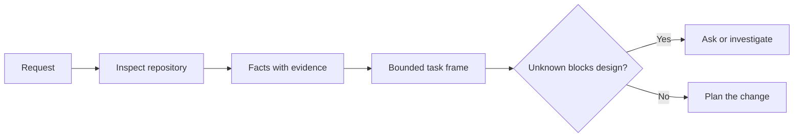

# 在 Agent 寫程式碼之前先框定任務 (Frame the Task Before the Agent Writes Code)

> Coding agent 可以很快地實作一個清楚的任務。它也可以很快地實作一個不清楚的任務。速度相同。成本卻不同。

**Type:** Learn + Build
**Languages:** Python (stdlib)
**Prerequisites:** Phase 14 lessons 31 and 36
**Time:** ~60 分鐘

## 學習目標 (Learning Objectives)

- 在編輯之前，把請求轉成有邊界的任務框架。
- 區分 repository 的事實、假設和未解決的問題。
- 定義允許的路徑、禁止的路徑和驗收證據。
- 判斷偵察做到什麼程度就足以開始工作。

## 昂貴的失敗 (The Expensive Failure)

「加入重複 email 保護」聽起來很具體。其實不然。唯一性屬於 API、domain service，還是資料庫？比對是否區分大小寫？哪種錯誤格式已經是公開的？可以做 migration 嗎？哪個測試能證明這個行為？

有能力的 agent 會用看似合理的選擇填補這些缺口。這是危險的情況，因為實作可以很乾淨、有測試，卻仍與系統不相容。

因此 coding agent 工作的第一個單位不是編輯。它是由 repository 證據支撐的任務框架。

## 任務框架 (The Task Frame)

有用的框架有六個欄位：

| 欄位 | 問題 |
|---|---|
| Goal | 哪個可觀察的行為必須改變？ |
| Repository facts | 你在程式碼、測試、設定或歷史中驗證了什麼？ |
| Allowed paths | 變更可以落在哪裡？ |
| Forbidden paths | 什麼必須保持不動？ |
| Acceptance evidence | 哪些指令或觀察能證明目標達成？ |
| Unknowns | 哪些決定仍需要證據或人類判斷？ |

事實需要憑證。「API 對重複使用 409」在你能指出現有的測試或 handler 之前，都不算事實。一個檔案路徑和行號就夠了。當行為很重要時，指令的結果更好。



## 偵察是在尋找限制 (Reconnaissance Is a Search for Constraints)

不要讀整個 repository。搜尋會限制這次變更的介面：

1. 目前的行為及其呼叫端。
2. 最接近的既有測試。
3. 公開的合約或序列化後的形狀。
4. 管轄該路徑的專案 instruction。
5. 建置與驗證指令。
6. 能揭露本地模式的類似已完成變更。

當每個計畫中的決定都已有證據支持、被明確委派，或被列為未知時就停止。在那之後繼續閱讀，往往是在逃避。

## 未知不是失敗 (Unknowns Are Not Failures)

未知是受控的缺口。假設則是對該缺口不受控的回答。

為每個未知分類：

- **可發現 (Discoverable)：** repository 或執行中的系統可以回答。
- **可決定 (Decidable)：** 任務合約賦予 agent 選擇的權限。
- **人類 (Human)：** 這個選擇會改變產品行為、成本、風險或公開相容性。
- **延後 (Deferred)：** 這個選擇不在這個切片內，屬於非目標。

Agent 應該繼續處理可發現和已委派的未知。在選擇被埋進程式碼之前，它應該在人類未知處暫停。

## 實作之前先有驗收 (Acceptance Before Implementation)

在 patch 之前先寫證明。證明可以是：

- 聚焦的 unit 或整合測試指令；
- 有指定 viewport 和預期狀態的瀏覽器使用流程；
- 連線請求和確切的回應合約；
- 附門檻的效能量測；
- 確認沒有不相關檔案被改動的 scope 檢查。

「測試通過」不是證明計畫。要指名具權威性的測試，以及它所支持的宣稱。

## 動手做 (Build It)

這個實驗建立 `TaskFrame`、驗證它的邊界與證據，並寫出 `outputs/task-frame.md`。

從這一課的目錄執行：

```bash
python3 code/main.py
python3 -m unittest discover code/tests -v
```

用四種方式弄壞這個範例：移除 goal、移除一個事實憑證、讓允許與禁止的路徑重疊，以及移除驗收指令。驗證器應該因為不同的理由，拒絕每一個框架。

## 在真實 Repository 中使用 (Use It in a Real Repository)

在請 agent 編輯之前：

1. 把 goal 寫成行為，而不是檔案變更。
2. 記錄兩三個附確切證據的事實。
3. 指名最小的允許路徑集合。
4. 明確指名負空間。
5. 寫下能結案的指令或觀察。
6. 列出你還沒有資格做出的決定。

框架應該能放進一個螢幕。如果放不下，這個任務可能包含多個可獨立驗證的變更。

## 練習 (Exercises)

1. 為你某個 repository 中的真實 bug 框定任務，且不提出解法。
2. 在框架中找出一項其實是假設的宣稱。用證據取代它。
3. 加一個人類未知，其答案會改變公開合約。
4. 把一個寬鬆的允許路徑切成最小的安全集合。
5. 在驗收證據中加入 scope 憑證。

## 延伸閱讀 (Further Reading)

- [Nuseibeh and Easterbrook, Requirements Engineering: A Roadmap](https://www.cs.toronto.edu/~sme/papers/2000/ICSE2000.pdf)，讓實作錨定在真實世界的目標與演變中的限制。
- [Yang et al., SWE-agent: Agent-Computer Interfaces Enable Automated Software Engineering](https://arxiv.org/abs/2405.15793)，證明 coding agent 周圍的介面會改變它的效能。

## 你要保留的東西 (What You Keep)

保留 `outputs/task-frame.md`。它是下一課的輸入，在那裡框架會變成有證據支撐的執行計畫。
