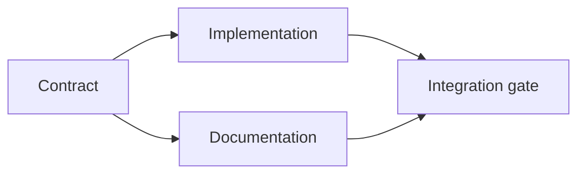

# 建立有證據支撐的執行計畫 (Build an Evidence-Backed Execution Plan)

> 計畫不是比較漂亮的待辦清單。它是一張相依圖，其中每個變更都有理由，每個終端節點都有證明。

**Type:** Learn + Build
**Languages:** Python (stdlib)
**Prerequisites:** Phase 14 lesson 43
**Time:** ~65 分鐘

## 學習目標 (Learning Objectives)

- 把任務框架轉換成帶有證據與證明的工作項目。
- 把順序建模為相依關係，而不是散文式的先後順序。
- 在編輯之前偵測缺少的事實、未知的相依關係和循環。
- 區分可以同時執行的步驟與必須等待的步驟。

## Agent 計畫為什麼會失敗 (Why Agent Plans Fail)

薄弱的計畫只是把請求用未來式再說一遍：

1. 更新 API。
2. 加測試。
3. 更新文件。

那份清單裡沒有任何東西說明發現了什麼、為什麼那些檔案是對的、哪個合約要先變、什麼可以同時進行。Agent 可以遵循每一步，卻仍然造成重工。

強大的計畫為每個工作項目做出五項承諾：

| 承諾 | 目的 |
|---|---|
| Identifier | 供相依關係與 handoff 使用的穩定參照 |
| Change | 最小的行為或合約變更 |
| Evidence | 能證明該變更合理的 repository 事實 |
| Dependencies | 必須先成立的工作 |
| Proof | 能結案該項目的確切檢查 |

## 先規劃合約，再規劃其實作 (Plan the Contract Before Its Implementations)

當多個介面依賴同一個行為時，先定義行為。測試、實作、文件與整合就能共用一份合約，而不是各自發明四個版本。



這張圖揭露了安全的並行。合約確定之後，實作與文件可以同時進行。整合要等兩者都完成。

## 證據會改變計畫 (Evidence Changes the Plan)

Repository 證據不是裝飾。它應該有能力改變工作：

- 既有的 helper 讓原本計畫的新抽象不再需要。
- 相容性測試迫使加入 migration 步驟。
- 部署限制把 schema 變更移到另一個任務。
- 公開的回應型別改變實作與文件的順序。

如果證據無法改變計畫，它大概就不是那個決定的證據。

## 為中斷而設計 (Design for Interruption)

Coding agent 的 session 會意外結束。可恢復的計畫，其工作項目小到讓另一個 session 能判斷：

- 哪個項目已完成；
- 哪個證明已執行；
- 哪些成品已改變；
- 哪些相依關係現在已解除阻擋；
- 下一個安全的項目是什麼。

不要只把狀態編碼在聊天裡打勾的方框中。把計畫存放在工作旁邊。

## 計畫驗證 (Plan Validation)

在執行之前，遇到下列情況就拒絕計畫：

- identifier 重複；
- 工作項目沒有證據；
- 工作項目沒有證明；
- 相依關係指向未知的項目；
- 圖中含有循環；
- 第一個不可逆的動作，發生在相關的不確定性被解決之前。

前五項檢查是機械性的。最後一項需要判斷，應該被明確點出來。

## 動手做 (Build It)

`code/main.py` 為工作項目建模、驗證它們的憑證、用拓撲排序計算執行波次 (wave)，並寫出 `outputs/evidence-plan.json`。

執行：

```bash
python3 code/main.py
python3 -m unittest discover code/tests -v
```

這個範例產生三個波次。合約定義先執行。實作與文件一起執行。整合 gate 最後執行。

## 搭配 Coding Agent 使用 (Use It with a Coding Agent)

請 agent 在改檔案之前先產生計畫。檢視計畫的三件事：

1. 每個路徑與行為宣稱都有 repository 憑證。
2. 每個項目都有一個明確的完成證明。
3. 這張圖把昂貴或不可逆的工作，延後到它所依賴的不確定性被解決之後。

核准計畫，而不是核准一句含糊的「我會小心」。

## 練習 (Exercises)

1. 加一個需要明確人工核准的 migration 項目。
2. 製造一個循環，並解釋它背後隱藏的產品分歧。
3. 切開一個有兩個證明指令的項目。
4. 加一個可以在第二個波次執行、且不碰任何既有分支的工作項目。
5. 把計畫輸出成 Markdown，同時以 JSON 作為事實來源。

## 延伸閱讀 (Further Reading)

- [Nuseibeh and Easterbrook, Requirements Engineering: A Roadmap](https://www.cs.toronto.edu/~sme/papers/2000/ICSE2000.pdf)，談目標、規格、共識與演進之間的迭代關係。
- [Barry Boehm, A Spiral Model of Software Development and Enhancement](https://dl.acm.org/doi/10.1145/12944.12948)，談以風險消除而不是固定線性順序來安排開發。

## 你要保留的東西 (What You Keep)

保留 `outputs/evidence-plan.json`。它會在下一課變成委派合約。
