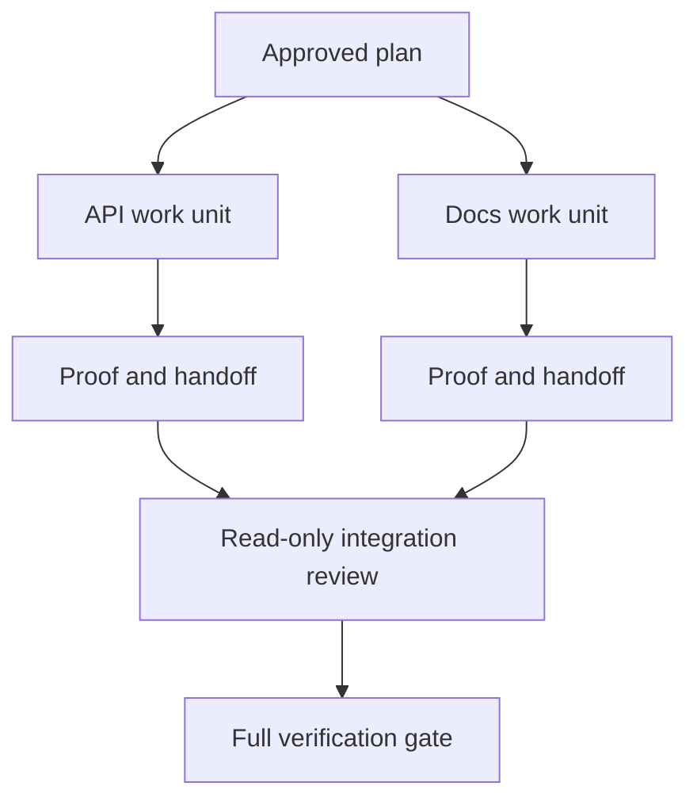

# 以隔離與 Merge Contract 委派 Agent 工作 (Delegate Agent Work with Isolation and Merge Contracts)

> 只有當工作彼此獨立時，平行 agent 才能節省 wall time。否則它們會把一個清楚的任務，變成一個失敗速度更快的協調問題。

**Type:** Learn + Build
**Languages:** Python (stdlib)
**Prerequisites:** Phase 14 lessons 39 and 44
**Time:** ~70 分鐘

## 學習目標 (Learning Objectives)

- 判斷委派是否有真正的獨立性作為依據。
- 給每個 worker 獨占的檔案所有權與明確的證明。
- 從相依關係計算執行波次。
- 設計 merge contract，安全地合併 agent 的工作。

## 平行化測試 (The Parallelism Test)

不要因為有更多 agent 可用就委派。至少符合下列其中一項時才委派：

- 兩項調查可以各自獨立回答不同的未知；
- 兩個實作擁有互不相交的檔案與合約；
- reviewer 可以在不更動的情況下檢查已完成的成品；
- 慢速的外部檢查可以在本地工作繼續進行時同時執行。

當 agent 需要相同的檔案、相同的未解決決定，或相同的可變環境時，讓工作保持串行。

## 工作單位就是一份合約 (A Work Unit Is a Contract)

每個被委派的單位需要：

| 欄位 | 意義 |
|---|---|
| Goal | 一個可觀察的結果 |
| Owner | 一個負責的 worker |
| Paths | 獨占的寫入所有權 |
| Dependencies | 開始之前必須完成的單位 |
| Proof | 回傳給 integrator 的確切證據 |
| Handoff | 改變的檔案、做出的決定、剩餘的風險 |

「處理 backend」不是一個工作單位。「在 `app/accounts.py` 實作重複檢查，並以聚焦的 account 測試證明它」才是。

## 隔離有三層 (Isolation Has Three Layers)

1. **檔案系統隔離 (Filesystem isolation)：** 獨立的 worktree 或 sandbox 避免意外的共用編輯。
2. **所有權隔離 (Ownership isolation)：** 合約避免兩個 worker 刻意編輯同一個路徑。
3. **State 隔離 (State isolation)：** 獨立的 log 與輸出避免一個 worker 覆蓋另一個 worker 的證據。

檔案系統隔離無法解決所有權問題。兩個乾淨的 worktree 仍然可能產生互相衝突的設計。Merge contract 必須在工作開始之前，就解決共用的介面。



## Integrator 不重做這些工作 (The Integrator Does Not Rebuild the Work)

Integrator 應該：

1. 確認每份 handoff 都符合其被指派的 scope；
2. 閱讀證明的輸出，而不只是 worker 的摘要；
3. 依相依順序合併變更；
4. 執行完整的跨單位 gate；
5. 拒絕隱藏的 scope 擴張；
6. 把衝突記錄為新的決定，而不是悄悄編輯。

如果整合需要重寫 worker 大部分的結果，那麼原本的分解就是錯的。

## 人類與 Agent 的角色 (Human and Agent Roles)

委派不會移除人類的判斷。人類仍然擁有那些會改變公開行為、風險、權限或不可逆成本的選擇。Agent 可以擁有有邊界的調查、實作、驗證與 review。

這就是校準過的自主性 (calibrated autonomy)：系統在證據與 rollback 都很強的地方給予自由，在後果嚴重的地方要求 checkpoint。

## 動手做 (Build It)

這個實驗檢查路徑重疊、驗證相依關係、計算安全的執行波次，並寫出 `outputs/delegation-plan.json`。

執行：

```bash
python3 code/main.py
python3 -m unittest discover code/tests -v
```

把 docs 單位改成擁有 `app/`。計畫應該被擋下，因為那個父路徑與 API 單位重疊。

## 練習 (Exercises)

1. 把一個真實的變更分解成兩個獨立的工作單位和一個 integrator。
2. 找出一個只是看起來獨立的擬議平行切分。說明共用的決定是什麼。
3. 加一個唯讀的研究 worker，其輸出是事實表。
4. 加一個 merge gate，把最終變更的檔案集合與所有單位的合約比對。
5. 為相依關係變得無效的 worker 定義取消規則。

## 延伸閱讀 (Further Reading)

- [Reid Smith, The Contract Net Protocol](https://doi.org/10.1109/TC.1980.1675516)，早期對分散式任務分配與結果回報的正式論述。
- [Eric Horvitz, Principles of Mixed-Initiative User Interfaces](https://dl.acm.org/doi/10.1145/302979.303030)，談自動化何時該行動，何時該把控制權交還給人。

## 你要保留的東西 (What You Keep)

保留 `outputs/delegation-plan.json`。它記錄了為什麼這個切分是安全的、誰擁有每個路徑，以及整合必須收到什麼證明。
