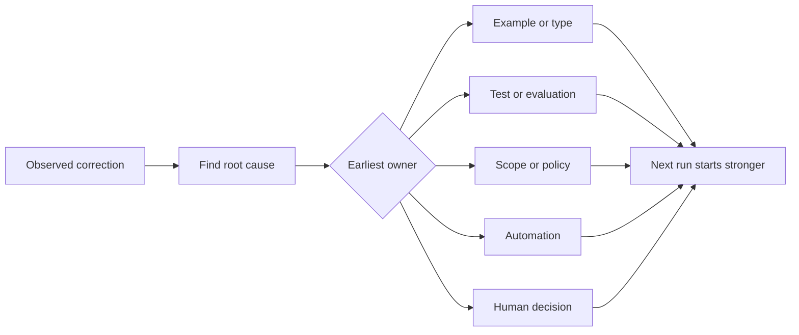

# 把每一次 Agent 修正轉化為系統改進 (Turn Every Agent Correction into a System Improvement)

> 只存在於聊天中的修正，只修好一次執行。被升級成測試、邊界、範例或 tool 的修正，會改善之後的每一次執行。

**Type:** Learn + Build
**Languages:** Python (stdlib)
**Prerequisites:** Phase 14 lessons 37 to 41
**Time:** ~65 分鐘

## 學習目標 (Learning Objectives)

- 把 agent 的修正轉換成持久的控制。
- 把每個控制放在能防止重複發生的最早一層。
- 用穩定的指紋 (fingerprint) 對重複的教訓去重。
- 讓不再保護真實風險的控制退場。

## 修正就是證據 (Corrections Are Evidence)

當你告訴 agent「不要編輯那個檔案」，你就學到 scope 邊界不是可執行的。當你說「這個輸出形狀是錯的」，你就學到缺少了範例或測試。當設定再次失敗，你就學到環境知識應該屬於自動化。

把修正視為對工作系統的觀察，而不是 prompt 撰寫上的失敗。

## 升級到最早的有效層級 (Promote to the Earliest Effective Layer)

使用這個順序：

| 反覆出現的失敗 | 持久的目的地 |
|---|---|
| 錯誤的結果或退化 | 測試或評估 |
| 越界或不安全的動作 | Scope 或權限政策 |
| 反覆出現的設定或指令錯誤 | 自動化或 tool |
| 反覆出現的輸出格式錯誤 | 標準範例加 validator |
| 含糊的本地慣例 | 附情境檢查的 instruction |
| 產品分歧 | 人類決策紀錄 |

越早的控制成本越低。能阻止無效狀態的型別，比事後才抓到它的 review 留言更強。聚焦的測試，比一段要求 agent 記住的文字更強。



## Ratchet 紀錄 (The Ratchet Record)

擷取：

- 症狀；
- 根本原因；
- 後果；
- 重複發生的次數；
- 選擇的控制；
- 該控制的驗證；
- 負責人；
- 審查或退場的日期。

不要升級每一個一次性的偏好。當重複發生或後果足以證明永久的複雜度合理時，才升級一項修正。

## 區分原因與症狀 (Separate Cause from Symptom)

「Agent 編輯了 README」是症狀。可能的原因包括：

- 任務允許 repository 根目錄；
- 文件被隱含地視為安全；
- 計畫把實作與文件綑綁在一起；
- 兩個 worker 的所有權重疊。

每個原因都屬於不同的控制。只重複症狀的規則，在下一個稍有不同的案例中就會失敗。

## 控制也會衰退 (Controls Also Decay)

舊的控制可能衝突、膨脹 context，並且編碼一個已不存在的系統。每條升級過的規則都需要退場檢查。在下列情況移除或重寫它：

- 底層架構改變了；
- 更強的可執行控制取代了它；
- 在有意義的時間窗內，該失敗並未再發生；
- 這個控制造成的摩擦，超過它所防止的風險。

目標不是最長的 instruction 檔案。而是能保留得來不易的判斷的最小系統。

## 動手做 (Build It)

這個實驗為修正分類、把它們升級成控制、為重複項目取指紋，並寫出 `outputs/feedback-ratchet.json`。

執行：

```bash
python3 code/main.py
python3 -m unittest discover code/tests -v
```

加入兩個措辭不同、但原因相同的修正。改進正規化，讓它們合併成一個控制，同時不合併不相關的失敗。

## 練習 (Exercises)

1. 取最近一次 coding session 的五項修正，並為它們分類真正的負責方。
2. 把一條散文規則換成可執行的測試。
3. 加入後果加權，讓嚴重的第一次發生可以立即被升級。
4. 在實驗輸出中加入負責人與退場日期。
5. 檢視一條既有的 agent instruction，只有在證明存在更強的控制之後才刪除它。

## 延伸閱讀 (Further Reading)

- [Basili, Caldiera, and Rombach, The Goal Question Metric Approach](https://www.cs.toronto.edu/~sme/CSC444F/handouts/GQM-paper.pdf)，把目標轉換成問題和可操作的量測。
- [Shinn et al., Reflexion](https://arxiv.org/abs/2303.11366)，利用回饋 trace 在不改變模型權重的情況下改進之後的決策。
- [Madaan et al., Self-Refine](https://arxiv.org/abs/2303.17651)，在任務 loop 內進行迭代的回饋與修訂。

## 你要保留的東西 (What You Keep)

保留 `outputs/feedback-ratchet.json`。它是 Agent-Assisted Engineering 路徑的持久終點，也是未來 workbench 變更的輸入。
