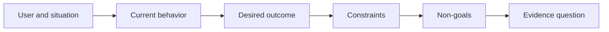

# 先定義成果，再選擇產出 (Define the Outcome Before You Choose the Output)

> 快速的實作會提高選錯問題的代價。先塑造成果，讓速度指向正確的方向。

**Type:** Learn + Build
**Languages:** Python (stdlib)
**Prerequisites:** None
**Time:** ~60 分鐘

## 學習目標 (Learning Objectives)

- 在不指名解法的情況下寫出成果框架。
- 找出使用者、情境、目前行為和期望的改變。
- 明確寫出限制與非目標。
- 在解法洩漏硬化成 scope 之前偵測它。

## 產出不是成果 (Output Is Not Outcome)

「建一個事件助理」指名的是產出。它沒有說誰需要它、什麼會變得更好，或什麼必須保持安全。

成果框架是這麼說的：

> 當正式環境的告警到來時，值班工程師能在兩分鐘內找出失敗的服務和安全的下一步動作，同時診斷維持唯讀且可稽核。

這句話可以由軟體、runbook、資料修復或更小的介面變更來滿足。它讓團隊緊扣結果，而不是某人想像的第一個成品。

## 六部分框架 (The Six-Part Frame)

| 部分 | 問題 |
|---|---|
| User | 誰直接經歷這個問題？ |
| Situation | 它在何時何地發生？ |
| Current behavior | 今天發生了什麼，包括各種變通做法？ |
| Desired outcome | 哪個可觀察的狀態應該改善？ |
| Constraints | 哪些安全、政策、成本或相容性限制是固定的？ |
| Non-goals | 哪些誘人的相鄰工作被排除？ |



## 找出解法洩漏 (Find Solution Leakage)

當成果陳述包含了尚未被證據證明的產品形式、介面、模型選擇、framework 或架構時，就洩漏了解法。

- 「使用者每週收到 AI 摘要」洩漏了摘要與頻率。
- 「使用者在核准之前了解帳戶變更」陳述的是結果。
- 「部署 vector database」洩漏了基礎設施。
- 「review 期間可取得相關的政策證據」陳述的是能力。

當相容性真的固定了技術時，限制可以指名技術。記錄它為什麼是固定的。

## 限制保護成果 (Constraints Protect the Outcome)

限制不是實作細節。它們是真實世界目標的一部分：

- 診斷期間不寫入正式環境；
- 在事件時間預算內回應；
- 既有的稽核事件仍然具權威性；
- 沒有新的 runtime 相依；
- 無障礙行為保持完整。

靠違反限制而達成成果的建置，並沒有達成成果。

## 非目標建立邊界 (Non-Goals Create a Boundary)

非目標防止一個有用的切片演變成一個平台。好的非目標要具體到足以拒絕工作：

- 不做自動修復；
- 不做新的告警路由系統；
- 不取代事件指揮官；
- 這個切片不做歷史分析。

## 動手做 (Build It)

這個實驗驗證 `OutcomeFrame`，並寫出 `outputs/outcome-frame.json`。

```bash
python3 code/main.py
python3 -m unittest discover code/tests -v
```

把期望的成果換成「使用事件助理」。驗證器應該標出所提出的產出洩漏進了成果。

## 練習 (Exercises)

1. 把你 backlog 中的一個功能請求改寫成成果框架。
2. 加一項會改變哪些解法仍然可行的限制。
3. 加兩項讓第一個切片保持小的非目標。
4. 找出最早能推翻期望成果的觀察。
5. 寫出三種不同的、都能滿足同一個成果的產出。

## 延伸閱讀 (Further Reading)

- [Nuseibeh and Easterbrook, Requirements Engineering: A Roadmap](https://www.cs.toronto.edu/~sme/papers/2000/ICSE2000.pdf)，把真實世界的目標視為軟體工作的錨點。
- [Dardenne, van Lamsweerde, and Fickas, Goal-Directed Requirements Acquisition](https://doi.org/10.1016/0167-6423(93)90021-G)，把高層目標細化為限制與可操作的需求。

## 你要保留的東西 (What You Keep)

保留 `outputs/outcome-frame.json`。下一課會拿它對照人們實際執行的工作流程來測試。
