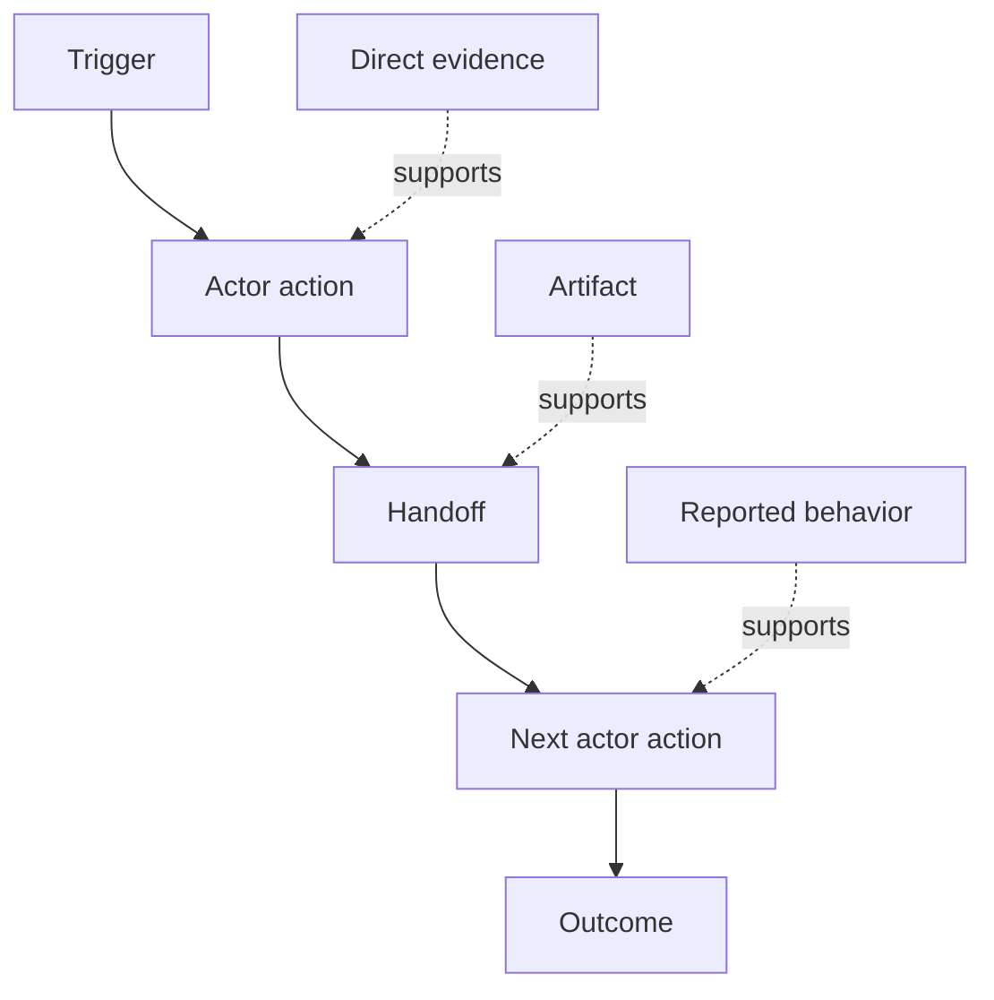

# 探索人們實際執行的 Workflow (Discover the Workflow People Actually Perform)

> 需求不是在會議中等著被收集。它們散落在行動、變通做法、紀錄和分歧之中。

**Type:** Learn + Build
**Languages:** Python (stdlib)
**Prerequisites:** Phase 14 lesson 47
**Time:** ~70 分鐘

## 學習目標 (Learning Objectives)

- 把目前的 workflow 建模為帶有證據的有序行動。
- 區分直接觀察與被回報或推論出的行為。
- 找出摩擦、交接、權限和隱藏的 state。
- 讓不確定的宣稱保持可見，而不是把它們變成需求。

## 從目前的系統開始 (Start with the Current System)

不要一開始就問人們想要什麼功能。從重建現在發生的事開始。

為每一步記錄：

| 欄位 | 範例 |
|---|---|
| Actor | 值班工程師 |
| Trigger | 正式環境告警到來 |
| Action | 開啟告警，然後搜尋儀表板 |
| Input | 告警 payload 與部署紀錄 |
| Output | 候選服務與負責人 |
| Friction | 在三個工具之間切換 context |
| Authority | 事件指揮官核准寫入 |
| Evidence | 螢幕錄影、事件 log、runbook |

這個 workflow 比螢幕更大。它包含等待、複製貼上、旁路溝通、核准、錯誤復原，以及人們已經不再注意的步驟。

## 證據有強度之分 (Evidence Has Strength)

使用簡單的證據階梯：

1. **直接行為 (Direct behavior)：** 觀察、trace、錄影或系統事件。
2. **成品 (Artifact)：** 工單、runbook、log、表單或已完成的輸出。
3. **被回報的行為 (Reported behavior)：** 某人描述他們做了什麼。
4. **推論 (Inference)：** 團隊推斷大概發生了什麼。

四種都有用。只有前兩種能直接證明目前的行為。標示其餘的，這樣信心就不會悄悄膨脹。



## 尋找四件事 (Search for Four Things)

- **摩擦 (Friction)：** 重複的努力、延遲、重新輸入或復原。
- **隱藏的 state (Hidden state)：** 存在記憶、聊天或個人筆記中的事實。
- **權限 (Authority)：** 被允許做出重大變更的人或系統。
- **例外 (Exceptions)：** 正常 workflow 不再正常的那種情況。

AI 功能常常在交接和例外處失敗，因為只有 happy path 被塑造過。

## 不要把分歧平均掉 (Do Not Average Away Disagreement)

兩位使用者可能基於好的理由執行不同的 workflow。保留這些變體，直到你了解它們代表的是：

- 不同的角色；
- 不同的風險等級；
- 舊的與現行的流程；
- 專業程度的差異；
- 真正的政策分歧。

被平均過的 workflow 可能不描述任何人。

## 動手做 (Build It)

這個實驗在每個 workflow 步驟上儲存證據、驗證順序與信心、計算直接證據的比例，並寫出 `outputs/workflow-evidence.json`。

```bash
python3 code/main.py
python3 -m unittest discover code/tests -v
```

加入一條部署紀錄遺失的例外路徑。保持主要順序不變，並記錄分支從哪裡開始。

## 練習 (Exercises)

1. 不訪問任何人，從 log 重建一個 workflow。
2. 訪問一位使用者，並標出每一項仍缺乏直接證據的宣稱。
3. 加入一個權限邊界和一個失敗復原的步驟。
4. 為兩個 workflow 變體建模，而不合併它們。
5. 找出一個移除了可見步驟、卻沒有動到隱藏工作的擬議功能。

## 延伸閱讀 (Further Reading)

- [Nuseibeh and Easterbrook, Requirements Engineering: A Roadmap](https://www.cs.toronto.edu/~sme/papers/2000/ICSE2000.pdf)，特別是它把需求引出視為詮釋、建模與驗證，而不是單純的擷取。
- [Gotel and Finkelstein, An Analysis of the Requirements Traceability Problem](https://doi.org/10.1109/ICRE.1994.292398)，談保留需求與其來源之間關係的困難。

## 你要保留的東西 (What You Keep)

保留 `outputs/workflow-evidence.json`。它會在下一課把觀察到的摩擦與不確定性，轉成假設地圖。
