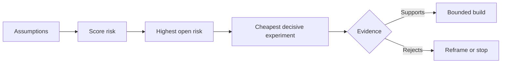

# 繪製假設地圖，先解決風險最高的那個 (Map Assumptions and Resolve the Riskiest One First)

> Roadmap 把不確定性藏在功能裡。假設地圖則揭露，這些功能值得存在之前，什麼必須為真。

**Type:** Learn + Build
**Languages:** Python (stdlib)
**Prerequisites:** Phase 14 lesson 48
**Time:** ~65 分鐘

## 學習目標 (Learning Objectives)

- 把擬議的工作轉換成明確的假設。
- 分別為影響、不確定性和不可逆性打分。
- 依風險而不是熱情來選擇下一個實驗。
- 用證據與決定取代已測試過的假設。

## 每次建置都包含賭注 (Every Build Contains Bets)

事件工具可能依賴下列所有條件都為真：

- 告警 context 含有足夠的資訊來辨識服務；
- 工程師信任一個不是自己推導出來的建議；
- 期望的回應時間在營運上確實重要；
- 可以在沒有不安全權限的情況下存取所需資料；
- 這個 workflow 發生得夠頻繁，足以證明維護是值得的。

這些不是實作任務。它們是這次建置要有價值、可用、可行且安全的條件。

## 假設類別 (Assumption Classes)

| 類別 | 問題 |
|---|---|
| Value | 成果夠重要嗎？ |
| Usability | 使用者能理解並據此行動嗎？ |
| Feasibility | 系統能用可取得的資料與限制產出它嗎？ |
| Viability | 組織能負擔成本、所有權與營運嗎？ |
| Safety | 失敗時不會有不可接受的後果嗎？ |

把假設寫成可證偽的陳述。「這個功能有用」無法測試。「十位值班工程師中有八位，用唯讀結果能更快辨識出正確的服務」就可以。

## 風險不是單一數字 (Risk Is Not One Number)

這個實驗使用從一到五的三個維度：

- **影響 (Impact)：** 假設為假時造成的損害。
- **不確定性 (Uncertainty)：** 目前證據的薄弱程度。
- **不可逆性 (Irreversibility)：** 承諾之後才學到的成本。

範例分數是影響乘以不確定性，再加上不可逆性。這個公式並非通用。它的目的是迫使團隊說明，為什麼一個未知應該先於另一個被解決。



## 設計實驗，而不是確認儀式 (Design an Experiment, Not a Confirmation Ritual)

有用的測試具有：

- 可能為假的宣稱；
- 母體或寫實的樣本；
- 可觀察的結果；
- 在看到結果之前就決定好的門檻；
- 針對通過、失敗和含糊證據的下一個決定。

避免只展示團隊能夠建出這個點子的測試。

## 可逆性改變順序 (Reversibility Changes Order)

後果嚴重、不可逆的選擇需要更早的證據。唯讀重播可以先於正式環境整合。暫時的 adapter 可以先於資料 migration。人工核准的建議可以先於自動行動。

建置的形狀應該跟隨不確定性的形狀。

## 動手做 (Build It)

這個實驗為假設排名、區分已測試與未解決的宣稱、選出最高的未解決風險，並寫出 `outputs/assumption-map.json`。

```bash
python3 code/main.py
python3 -m unittest discover code/tests -v
```

改變風險最高的假設的證據，並觀察下一個實驗如何改變。

## 練習 (Exercises)

1. 為你想建的功能寫下五個假設。
2. 加入一個你的功能清單遺漏的安全假設。
3. 定義一個會讓你停止這次建置的門檻。
4. 用更便宜的決定性測試取代一個大型實驗。
5. 比較風險排名與 roadmap 的優先順序，並解釋兩者的不一致。

## 延伸閱讀 (Further Reading)

- [Barry Boehm, A Spiral Model of Software Development and Enhancement](https://dl.acm.org/doi/10.1145/12944.12948)，談在更深的承諾之前先解決不確定性的風險驅動開發週期。
- [Dardenne, van Lamsweerde, and Fickas, Goal-Directed Requirements Acquisition](https://doi.org/10.1016/0167-6423(93)90021-G)，談在細化目標的同時揭露障礙與限制。

## 你要保留的東西 (What You Keep)

保留 `outputs/assumption-map.json`。下一課用它來選擇能產生決定性證據的最小切片。
