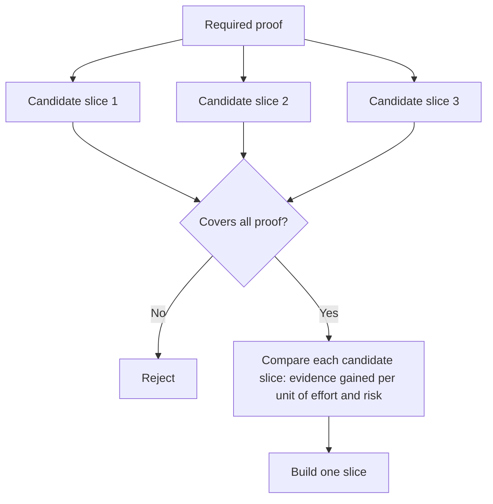

# 選擇能改變決定的最小切片 (Choose the Smallest Slice That Can Change the Decision)

> 只有當小的東西能證明重要的事時，小才有用。一個無法改變下一個決定的微小建置，只是不完整而已。

**Type:** Learn + Build
**Languages:** Python (stdlib)
**Prerequisites:** Phase 14 lesson 49
**Time:** ~65 分鐘

## 學習目標 (Learning Objectives)

- 以切片所證明的假設來定義切片。
- 在成果價值、不確定性降低、投入成本和後果之間取得平衡。
- 偏好可逆的證據，而不是過早的正式環境承諾。
- 拒絕省略 workflow 中風險部分的切片。

## 垂直代表端到端的證據 (Vertical Means Evidence End to End)

有用的切片橫跨觀察成果所需的最小真實 workflow。它在使用者、資料、期間和能力上可以很窄。它不應該靠移除你需要測試的那個確切不確定性而變窄。

範例：

- 對十個真實事件的唯讀重播，能測試服務辨識和操作人員的信任。
- 在合成資料上的精緻儀表板，可能測試理解度，但不測試資料的可行性。
- 正式環境的自動修復器一次測試所有東西，卻帶來不可接受的後果。

## 先定義所需的證明 (Define Required Proof First)

取最高風險的未解決假設，並把它們轉成所需證明集合。候選切片只有在涵蓋該集合時才合格。

然後在下列面向比較合格的切片：

| 維度 | 方向 |
|---|---|
| 成果價值 | 越多越好 |
| 降低的不確定性 | 越多越好 |
| 投入成本 | 越少越好 |
| 後果 | 越少越好 |
| 可逆性 | 越多越好 |

實驗的分數刻意保持簡單。合格門檻比算術更重要。



## 常見的假最小值 (Common False Minimums)

- **只做 UI 的最小值：** 移除了資料與營運上的不確定性。
- **只做基礎設施的最小值：** 證明技術上可行，卻沒有使用者價值。
- **只走 happy path 的最小值：** 省略了造成大部分風險的例外。
- **Demo 的最小值：** 產生有說服力的成品，卻沒有可重複的量測。
- **平台的最小值：** 在單一 workflow 證明其價值之前，就先建好可重複使用的機制。

## 加上停止規則 (Add a Stop Rule)

在實作之前，寫下切片失敗時會發生什麼：

- 放棄這個成果；
- 改變目標使用者或情境；
- 測試不同的機制；
- 收集更好的證據；
- 進一步縮小權限。

如果每個結果都導向「繼續建置」，這個切片就不是實驗。

## 動手做 (Build It)

這個實驗依所需證明篩選候選項、為合格的切片打分，並寫出 `outputs/slice-decision.json`。

```bash
python3 code/main.py
python3 -m unittest discover code/tests -v
```

加入一個只證明一項所需假設的更便宜的候選項。即使它的數值分數很高，它仍應保持不合格。

## 練習 (Exercises)

1. 為同一個成果，設計三個不同後果等級的切片。
2. 在為它們打分之前，先陳述所需的證明集合。
3. 移除一項能力，同時保留決定性的證據。
4. 為失敗的 pilot 加上停止規則。
5. 找出一個應該等到切片之後才建的、可重複使用的平台元件。

## 延伸閱讀 (Further Reading)

- [Barry Boehm, A Spiral Model of Software Development and Enhancement](https://dl.acm.org/doi/10.1145/12944.12948)，談讓每個開發週期對應到它必須解決的風險。
- [Lenarduzzi and Taibi, MVP Explained: A Systematic Mapping Study on the Definitions of Minimal Viable Product](https://arxiv.org/abs/1609.07592)，談軟體產品實務中「最小」與「可行」的含糊之處。

## 你要保留的東西 (What You Keep)

保留 `outputs/slice-decision.json`。它記錄了為什麼這個切片是能改變決定的最小切片。
