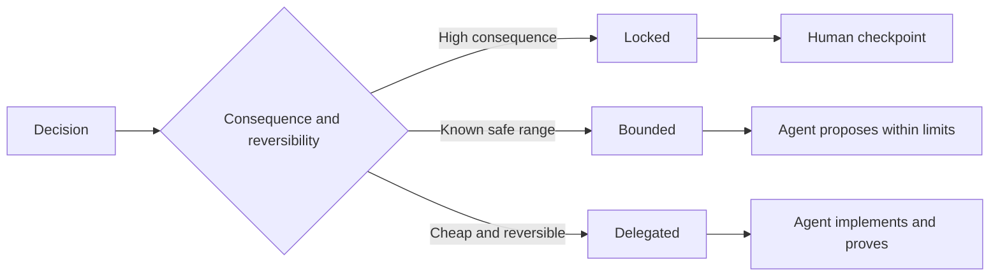

# 撰寫能保留判斷力的規格 (Write Specifications That Preserve Judgment)

> 有用的規格會固定不變式 (invariant) 與證據，同時讓可逆的實作選擇保持開放。它是決策邊界，不是劇本。

**Type:** Learn + Build
**Languages:** Python (stdlib)
**Prerequisites:** Phase 14 lesson 50
**Time:** ~75 分鐘

## 學習目標 (Learning Objectives)

- 區分成果、不變式、範例、非目標和證明。
- 把決定標記為鎖定 (locked)、有界 (bounded) 或委派 (delegated)。
- 在選擇便宜且可逆的地方，保留 agent 的判斷。
- 在後果或公開行為改變的地方，要求人類 checkpoint。

## 兩個壞的極端 (Two Bad Extremes)

規格不足的任務要求 agent 去猜系統。規格過度的任務要求它抄寫一份可能本來就是錯的設計。

有用的中間地帶是可執行的合約：

| 介面 | 目的 |
|---|---|
| Outcome | 可觀察的結果 |
| Invariants | 必須永遠保持為真的條件 |
| Examples | 揭露意圖的具體案例 |
| Non-goals | 刻意排除的相鄰行為 |
| Decision policy | 哪些選擇是鎖定、有界或委派的 |
| Proof | 完成之前必須具備的證據 |

## 三種決策模式 (Three Decision Modes)

- **鎖定 (Locked)：** agent 不得選擇。用於公開相容性、權限、安全、不可逆的成本，或產品承諾。
- **有界 (Bounded)：** agent 可以在明確的限制內選擇。用於搜尋預算、重試次數、允許的相依套件，或已知的介面家族。
- **委派 (Delegated)：** agent 擁有這個選擇，且必須解釋它。用於本地結構、命名、可逆的重構和實作細節。



## 透過範例來規範行為 (Specify Behavior Through Examples)

範例比形容詞更能壓縮意圖。「有幫助的」、「穩健的」和「可上線的」都不可執行。一小組正常、邊界、失敗和禁止的範例，給了建造者和驗證者具體的東西。

範例不取代不變式。一個通過的案例無法證明一條通用的安全規則。

## 證明必須符合宣稱 (Proof Must Match the Claim)

- Unit test 證明本地函式的合約。
- 連線測試證明序列化與傳輸行為。
- 瀏覽器使用流程證明介面路徑。
- 重播集合證明在代表性案例上的行為。
- 稽核 log 證明權限邊界守住了。

不要接受較低層的東西，作為較高層宣稱的證明。

## 刻意保留未知 (Preserve Unknowns Deliberately)

規格可以說「實作可以選擇任何在時間預算內回傳的唯讀來源」。這不是含糊。這是有邊界、有證明、刻意委派的決定。

當證據改變時，規格應該演進。保留鎖定與有界選擇背後的理由，這樣之後的團隊才能修訂它們，而不必考古。

## 動手做 (Build It)

這個實驗驗證每個合約介面、檢查決策模式，並寫出 `outputs/executable-specification.json`。

```bash
python3 code/main.py
python3 -m unittest discover code/tests -v
```

把正式環境寫入的決定從鎖定改為委派。解釋為什麼 schema 接受這個值，但產品風險不接受。

## 練習 (Exercises)

1. 把一張 backlog 工單轉成這六個規格介面。
2. 用一個不變式和兩個範例，取代三條實作指示。
3. 標記每一個決定，並為每個鎖定或有界的選擇辯護。
4. 為每個不變式加上一份證明憑證。
5. 移除沒有證據或風險理由的限制。

## 延伸閱讀 (Further Reading)

- [Nuseibeh and Easterbrook, Requirements Engineering: A Roadmap](https://www.cs.toronto.edu/~sme/papers/2000/ICSE2000.pdf)，談目標、精確規格、驗證、共識與演進之間的關係。
- [Zave and Jackson, Four Dark Corners of Requirements Engineering](https://doi.org/10.1145/237432.237434)，談區分環境假設、需求與規格。
- [Gotel and Finkelstein, An Analysis of the Requirements Traceability Problem](https://doi.org/10.1109/ICRE.1994.292398)，談保留需求為何存在及來自何處。

## 你要保留的東西 (What You Keep)

保留 `outputs/executable-specification.json`。它會成為 coding agent 與人類 reviewer 共享的合約。
