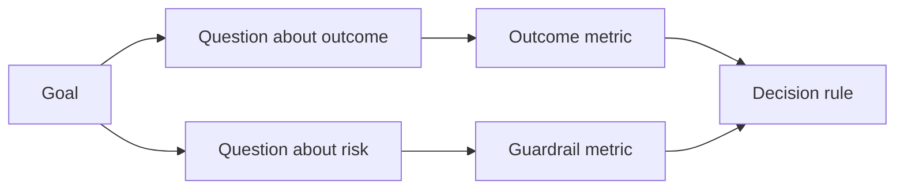

# 在結果出現之前設計成功指標 (Design Success Metrics Before the Result Exists)

> 量測應該回答一個決定，而不是裝飾儀表板。從目標開始，推導出問題，然後選擇能回答它們的最小指標。

**Type:** Learn + Build
**Languages:** Python (stdlib)
**Prerequisites:** Phase 14 lessons 47 and 51
**Time:** ~70 分鐘

## 學習目標 (Learning Objectives)

- 從成果目標推導出問題與指標。
- 在觀察結果之前，定義門檻、時間窗、來源和方向。
- 把成果指標與 guardrail 和反指標 (counter-metric) 配對。
- 讓評估證據符合這次建置必須支援的決定。

## 目標、問題、指標 (Goal, Question, Metric)

從一個目標開始：

> 縮短辨識受影響服務的時間，同時不增加不安全的動作。

推導問題：

- 正確的服務多快被辨識出來？
- 被辨識的服務多常是正確的？
- 診斷是否維持唯讀？
- 這個 workflow 是否增加告警被忽略或操作人員的工作負擔？

然後選擇能把這些問題操作化的指標。



## 指標需要一份合約 (A Metric Needs a Contract)

每個指標需要：

| 欄位 | 範例 |
|---|---|
| Name | `median_identification_seconds` |
| Direction | 最多 (at most) |
| Threshold | 120 |
| Window | 十次事件重播 |
| Source | 重播事件 log |
| Population | pilot 中的值班工程師 |
| Kind | 成果 (outcome) 或 guardrail |

沒有來源和時間窗，數字就無法重現。沒有門檻，它就無法驅動決定。

## 成果、Guardrail 與反指標 (Outcome, Guardrail, and Counter-Metric)

- **成果指標 (Outcome metric)：** 期望的狀態改善了嗎？
- **Guardrail：** 固定的限制仍然成立嗎？
- **反指標 (Counter-metric)：** 局部的改善是否把成本或傷害轉移到別處？

對於事件 workflow 來說，速度還不夠。正確性、正式環境寫入、操作人員工作負擔和漏掉的告警，保護我們不會得到一個快速但不安全的結果。

## 離線與線上證據 (Offline and Online Evidence)

離線重播適用於可重複性和邊界案例涵蓋。有界的 pilot 適用於真實行為、信任和 workflow 的效應。兩者都無法取代對方。

使用能回答當前決定的最便宜證據。不要只因為實作準備好了，就讓真實使用者暴露其中。

## 在量測之前先決定 (Decide Before You Measure)

在看到結果之前，寫下通過、失敗和含糊的路徑。否則團隊會為了保護這次建置而移動門檻。

範例：

- 通過：正確服務率至少 0.9，且中位時間最多 120 秒；
- 失敗：任何正式環境寫入，或正確率低於 0.75；
- 含糊：小幅改善但變異很大，需要更大的重播集合。

## 動手做 (Build It)

這個實驗驗證量測計畫、評估含邊界值的門檻、記錄缺少的值，並寫出 `outputs/measurement-report.json`。

```bash
python3 code/main.py
python3 -m unittest discover code/tests -v
```

移除 guardrail 指標，並觀察為什麼即使成果指標仍在，計畫也會變成無效。

## 練習 (Exercises)

1. 從一個成果目標推導出三個問題。
2. 加一個能抓到成本被轉移給另一個角色的反指標。
3. 為每個指標定義來源、母體和時間窗。
4. 在產生數值之前，寫下通過、失敗和含糊的決定。
5. 找出一個容易收集、但無法改變決定的指標。移除它。

## 延伸閱讀 (Further Reading)

- [Basili, Software Modeling and Measurement: The Goal/Question/Metric Paradigm](https://drum.lib.umd.edu/items/8119803a-362b-42ec-b6ce-2311713e7236)，談從明確的目標推導出可操作的量測。
- [Basili, Caldiera, and Rombach, The Goal Question Metric Approach](https://www.cs.toronto.edu/~sme/CSC444F/handouts/GQM-paper.pdf)，談把這個方法當作回饋與改進系統來應用。

## 你要保留的東西 (What You Keep)

保留 `outputs/measurement-report.json`。它定義了 prototype、pilot 或 production 階段的證據閘門。
