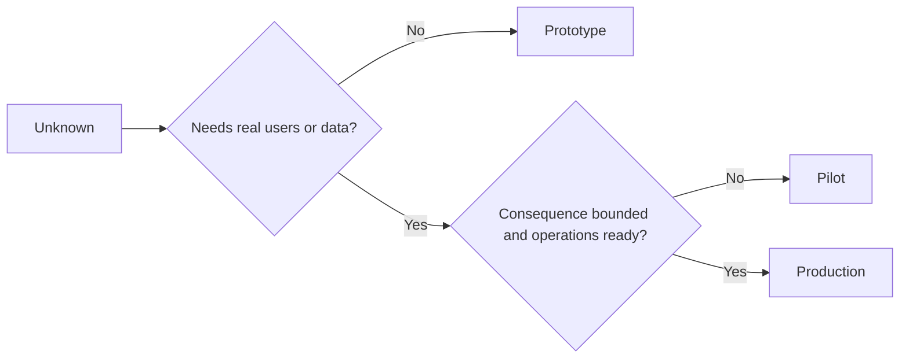

# 刻意選擇 Prototype、Pilot 或 Production (Choose Prototype, Pilot, or Production Deliberately)

> 這些是不同的學習環境，不是不同程度的精緻度。選擇能以最少不必要後果回答當前未知的階段。

**Type:** Learn + Build
**Languages:** Python (stdlib)
**Prerequisites:** Phase 14 lessons 50 to 52
**Time:** ~70 分鐘

## 學習目標 (Learning Objectives)

- 依未知、受眾、資料、後果和就緒程度選擇建置階段。
- 定義各階段專屬的控制與退出條件。
- 防止 prototype 悄悄變成 production 系統。
- 在證據與營運都證明合理之前，延後賦予真正的權限。

## 三個不同的問題 (Three Different Questions)

| 階段 | 主要問題 |
|---|---|
| Prototype | 這個機制到底能不能產生證據？ |
| Pilot | 它能在有界的真實受眾與真實條件下安全運作嗎？ |
| Production | 我們能以承諾的可靠度與風險等級持續擁有它嗎？ |

Prototype 可以在技術上完整，仍然是可拋棄的。Pilot 可以使用 production 資料，同時在受眾與權限上受到限制。Production 始於組織接受持續責任的時候。

## Prototype

當未知不需要真實使用者或真實資料時，使用 prototype。讓它：

- 可拋棄；
- 隔離；
- 行為狹窄；
- 對學習問題明確；
- 沒有虛假的營運保證。

在機制贏得下一個階段之前，不要最佳化架構。

## Pilot

當未知需要真實行為、真實資料或真實 workflow，但後果或就緒程度尚不適合廣泛發布時，使用 pilot。

Pilot 需要：

- 指名的受眾；
- 一位人類負責人；
- 有界的期間與權限；
- 稽核與 rollback；
- 成果與 guardrail 的門檻；
- 擴大、修訂或停止的退出條件。

## Production

Production 需要的不只是部署：

- 服務水準目標 (SLO)；
- 值班與事件的負責歸屬；
- 安全與隱私審查；
- 成本與容量控制；
- rollback 與復原；
- 持續監控；
- 退場路徑。



## 階段漂移 (Stage Drift)

當 prototype 程式碼取得使用者、資料或權限，卻沒有取得所有權時，就變得危險。在設定、存取控制、telemetry 和文件中標示 prototype 與 pilot 的邊界。警告橫幅是不夠的。

階段應該能從系統本身觀察到。

## 動手做 (Build It)

這個實驗依決策情境選擇階段、回傳所需的控制，並寫出 `outputs/stage-decisions.json`。

```bash
python3 code/main.py
python3 -m unittest discover code/tests -v
```

把 pilot 範例改成低後果、且營運就緒。解釋哪些額外的證據才能證明進入 production 是合理的。

## 練習 (Exercises)

1. 依學習階段，而不是部署狀態，為三個目前的專案分類。
2. 撰寫包含停止決定的 pilot 退出條件。
3. 加一個技術控制，防止 prototype 觸及 production 資料。
4. 找出讓這次建置成為 production 的第一個營運責任。
5. 為有界的 pilot 設計 rollback 憑證。

## 延伸閱讀 (Further Reading)

- [Barry Boehm, A Spiral Model of Software Development and Enhancement](https://dl.acm.org/doi/10.1145/12944.12948)，談讓每次迭代的承諾對應到已解決的風險。
- [Fagerholm et al., Building Blocks for Continuous Experimentation](https://doi.org/10.1145/2601248.2601276)，談持續執行實驗所需的組織與技術條件。

## 你要保留的東西 (What You Keep)

保留 `outputs/stage-decisions.json`。它記錄了每個階段為何合理，以及進入下一個階段之前必須存在哪些控制。
