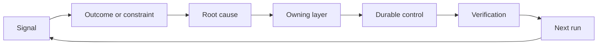

# 建立有負責人與退場機制的 Feedback Ratchet (Build a Feedback Ratchet with Ownership and Retirement)

> 出貨結束一個建置 loop，並開啟學習 loop。證據必須改變系統，否則它就只是沒人擁有的 telemetry。

**Type:** Learn + Build
**Languages:** Python (stdlib)
**Prerequisites:** Phase 14 lessons 46 and 53
**Time:** ~75 分鐘

## 學習目標 (Learning Objectives)

- 把事件、評估、使用者行為和修正，轉成有負責人的行動。
- 把每個訊號導向 context、評估、政策、runtime 或 backlog。
- 依嚴重度與頻率為重複發生的問題排優先順序。
- 給每個控制一個退場條件。
- 以證據、取捨和負責的擁有者，溝通一項交付決定。

## Feedback 是基礎設施 (Feedback Is Infrastructure)

團隊可以收集 trace、評估、客服工單和事件 log，卻從中什麼都沒學到。缺少的機制是升級 (promotion)：從觀察到持久變更的明確路徑，附有負責人和證明。

這個 loop 是：

1. 觀察一個具體的訊號；
2. 把它連到一個成果、限制或假設；
3. 找出擁有該原因的最早系統層級；
4. 建立有邊界的變更；
5. 驗證重複發生的可能性變低；
6. 審視該控制是否應該保留。

## 導向擁有它的層級 (Route to the Owning Layer)

| 訊號 | 目的地 |
|---|---|
| 偽陽性、退化、錯誤的結果 | 評估或測試 |
| 缺少 context、重複工作、過時的事實 | Context 來源或 retrieval 路由 |
| 不安全的動作或權限缺口 | 政策或權限邊界 |
| Timeout、重試風暴、無法使用的相依服務 | Runtime 控制 |
| 新的產品需求或未解決的取捨 | 已成形的 backlog 項目 |

在最早的有效層級修復原因。當測試或權限能讓失敗不可能發生時，不要再多加一段 prompt。



## 負責歸屬是控制的一部分 (Ownership Is Part of the Control)

每個 ratchet 行動都需要：

- 一位負責人；
- 依後果與重複發生次數決定的優先順序；
- 要改變的成品；
- 證明該變更的驗證；
- 審查或到期的時間窗；
- 退場條件。

沒有負責人的改進，只是格式更好的觀察。

## 讓過時的控制退場 (Retire Stale Controls)

Feedback 系統會累積政策。這些政策可能變得互相矛盾，而且昂貴。在下列情況審查控制：

- 架構或 workflow 改變；
- 較低層級的不變式取代了較高層級的 instruction；
- 在選定的時間窗內，所保護的失敗沒有出現；
- 該控制阻擋合法工作的頻率，高於它防止傷害的頻率。

退場也需要證據。不要因為一個控制感覺老舊就刪除它。

## 連結建置與 Coding-Agent 的 Feedback (Connect Build and Coding-Agent Feedback)

同一個 ratchet 為兩條路徑服務：

- 產品證據改變成果框架、假設、切片或量測計畫。
- Coding-agent 的修正改變測試、context、scope、自動化或 handoff。
- 事件可以同時改變產品邊界與 agent workbench。

這就是為什麼塑造建置不是在寫程式之前就結束的階段。它會持續貫穿每一項被接受的變更。

## 動手做 (Build It)

這個實驗為訊號分類、建立有負責人的 ratchet 行動、為它們排優先順序，並寫出 `outputs/feedback-backlog.json`。

```bash
python3 code/main.py
python3 -m unittest discover code/tests -v
```

加入一個 runtime timeout 訊號，並確認它被導向 runtime，而不是一般的 backlog。

## 實作練習：在遭遇挫折後承擔一項決定 (Practice Lab: Own a Decision After a Setback)

從你職涯路線的作品集專案中選一個 workflow。帶著它走過一次決定、一個小型實驗和一次 review。把證據保留在 [career delivery template](https://github.com/rohitg00/ai-engineering-from-scratch/blob/main/phases/14-agent-engineering/54-build-the-feedback-ratchet/outputs/career-delivery-evidence.md) 中。

這個 Python 實驗只產生範例的 backlog 行動。它不會觀察使用者、不會量測介入的效果，也無法證明職涯就緒程度。完成它的執行，是為這個練習做準備。

### 1. 釐清發生了什麼 (Establish What Happened)

記錄使用者、任務、目前的 workflow，以及你想改善的成果。連結一份經同意的觀察、一份遮蔽過的客服紀錄，或可重現的任務 trace。把你觀察到的、別人回報的，以及你推論的區分開來。

找出一次挫折：失敗的假設、無法使用的結果、意料之外的成本，或延遲的交接。解釋哪項證據改變了你的理解。挫折需要的是回應與決定，而不是圍繞它編寫的成功故事。

如果你無法與使用者合作，就與同儕或根據明確陳述的情境，執行一次明確標示的模擬。把模擬的觀察與真實使用者的證據分開。不要捏造訪談、核准、採用或商業影響。

### 2. 在你的權限內取得進展 (Make Progress Within Your Authority)

列出未知，並選擇最便宜、可逆、能解決最重大那個未知的行動。說明你能決定什麼、什麼受既有協議所限，以及什麼需要在執行前取得授權。

例如，你可以在等待使用客戶資料的許可時，準備一個遮蔽過的離線重播。展現主動性，指的是推進已獲授權的工作，並讓被擋住的決定清楚浮現。它不會擴大你的存取權或核准權。

### 3. 比較選項並向決策者簡報 (Compare Options and Brief the Decision Owner)

為不需要知道實作細節的人，寫一份簡短的決策簡報。包含：

- 使用者問題，以及改變計畫的證據；
- 至少兩個選項，包括在可信的情況下，更便宜的手動或不建置選項；
- 品質、互動設計、投入成本、營運成本和風險的取捨；
- 你的建議、剩餘的不確定性，以及需要做出的決定；
- 決策者、受影響的利害關係人，以及需要做出決定的日期。

請一位同儕代表受影響的利害關係人，並挑戰其中一項取捨。記錄這項反對意見，以及它如何改變（或沒有改變）你的建議。把角色扮演的回饋標示為模擬；它不能代替真實利害關係人的同意。

### 4. 執行有邊界的實驗 (Run a Bounded Experiment)

依你需要回答的問題，選擇 prototype、pilot 或 production 工作。在收集結果之前，先定義受眾、資料、權限、期間、rollback，以及繼續、改變或停止的條件。

走過從使用者起點到完成任務的互動。包含一個不正確的輸出或缺少資料的案例。觀察使用者能不能注意到失敗、修正它，並且在沒有你暗中幫忙的情況下復原。

把人類 review 和修正的時間算進 workflow。更快的模型回應，仍可能讓整個任務更慢，或更難以信任。

### 5. 比較成果與經濟面 (Compare Outcomes and Economics)

使用相同的指標定義、任務母體、收集方法和可比較的觀察時間窗，記錄 baseline 與後續追蹤。把樣本數、排除項目和證據連結，放在數字旁邊。如果這些條件改變，解釋為什麼這個比較有其限制。

包含一個使用者成果、一個品質或安全 guardrail，以及人類 review 的總投入。即使未達目標，也要記錄結果。小型或模擬的樣本，支持的是有邊界的學習宣稱，而不是已被證明的商業影響。

用模型呼叫、重試、輔助服務和人類 review，估算每個成功完成任務的成本。說明人力費率的假設，並區分實測用量與估計值。把這個成本與手動的替代方案，或專案背後的價值假設做比較。

使用既有的 [FinOps for LLMs lesson](https://aiengineeringfromscratch.com/lesson?path=phases/17-infrastructure-and-production/27-finops-llms) 來深化歸因與單位經濟。更換模型只是可能的回應之一；縮小 workflow 或保留手動步驟，可能是更好的產品決定。

### 6. 關閉 loop (Close the Loop)

使用事先宣告的標準，建議繼續、改變或停止。如果證據無法下結論，說出缺少的觀察和下一個有邊界的測試。記錄負責的決策者的回應；若尚未做出決定，就保持待定。

選擇一項針對交付流程本身的改進：更清楚的任務框架、更早的使用者演練、更好的 review 檢查清單、更小的 agent handoff，或更嚴格的評估案例。指定負責人和審查日期。

審查時，決定要保留、修訂或讓這項改進退場。記錄這個選擇的證據。一份新增了工作卻沒有防止目標失敗的新檢查清單，還沒有贏得永久保留的資格。

## 交付的成品 (Shipped Artifact)

把 [career-delivery-evidence.md](https://github.com/rohitg00/ai-engineering-from-scratch/blob/main/phases/14-agent-engineering/54-build-the-feedback-ratchet/outputs/career-delivery-evidence.md) 複製到你自己的專案，並以證據連結填寫完成。保持已提交的模板可重複使用。把決策簡報、互動演練、量測比較和有負責人的後續行動，與你的職涯作品集成品放在一起。

## 驗證 (Verify It)

與同儕一起使用這份人工驗收評分標準。把每一列標為 **met**、**needs work** 或 **not observed**，並附上證據連結，或具體缺少的觀察。填好的欄位並不能證明判斷是合理的。

| 檢查 | 符合的證據 |
|---|---|
| Workflow 有依據 | 可追溯的觀察支持這個問題；被回報的宣稱、推論和模擬都有標示。 |
| 尊重權限 | 可逆的下一步工作很清楚，任何受限的動作都等待其真正的決策者。 |
| 傳達了取捨 | 記錄了可信的替代方案、利害關係人的反對意見、一項建議，以及明確的決定請求。 |
| 測試了互動 | 演練涵蓋成功、失敗、復原，以及人類 review 的投入。 |
| 比較了成果 | Baseline 與後續追蹤的定義一致；樣本、guardrail、成本和比較限制皆可見。 |
| 承擔了挫折 | 證據改變了繼續/改變/停止的決定，以及一項負責的下一步行動。 |
| 改進了流程 | 一項 workflow 改進有負責人、審查日期，以及依證據做出的保留/修訂/退場決定。 |

即使每個模擬步驟都通過，未被觀察到的真實使用者行為仍然是缺口。在作品集的宣稱中保留這道界線，並指出要補上它所需要的下一個觀察。

## 練習 (Exercises)

1. 把一個事件和一則使用者抱怨轉成 ratchet 行動。
2. 說出能防止每個重複發生情況的最早層級。
3. 在實驗輸出中加入驗證指令或觀察。
4. 為一條政策規則定義退場條件。
5. 把一項被接受的修正，追溯回下一個任務框架。

## 延伸閱讀 (Further Reading)

- [Basili, Caldiera, and Rombach, The Goal Question Metric Approach](https://www.cs.toronto.edu/~sme/CSC444F/handouts/GQM-paper.pdf)，談透過以目標為導向的量測進行組織學習。
- [Fagerholm et al., Building Blocks for Continuous Experimentation](https://doi.org/10.1145/2601248.2601276)，談連結證據與持續產品開發的技術與組織 loop。
- [Nuseibeh and Easterbrook, Requirements Engineering: A Roadmap](https://www.cs.toronto.edu/~sme/papers/2000/ICSE2000.pdf)，談把需求視為在系統生命週期中持續演進。

## 你要保留的東西 (What You Keep)

保留 `outputs/feedback-backlog.json` 作為路由範例，並保留你完成的職涯交付證據，作為你自己決定的紀錄。兩者合起來，關閉了 Product Judgment and Delivery 路徑，並為下一個成果框架提供資訊。
