# 通訊協定 (Communication Protocols)

> 無法使用同一種語言的 agent，不是團隊，而是在虛空中互相大喊的陌生人。

**Type:** Build
**Languages:** TypeScript
**Prerequisites:** Phase 14 (Agent Engineering), Lesson 16.01 (Why Multi-Agent)
**Time:** ~120 分鐘

## 學習目標 (Learning Objectives)

- 實作 MCP tool discovery 與 invocation，讓 agent 能使用外部 server 提供的 tool
- 建立 A2A agent card 與 task endpoint，讓一個 agent 能透過 HTTP 把工作委派給另一個 agent
- 比較 MCP（tool 存取）、A2A（agent 對 agent）、ACP（企業稽核）與 ANP（去中心化信任），並說明各個 protocol 解決哪種問題
- 在單一系統中串接多個 protocol：agent 透過 MCP 發現 tool，並透過 A2A 委派任務

## 問題 (The Problem)

你把系統拆成多個 agent：researcher、coder、reviewer。它們各自的工作都做得很好。但現在你需要它們真正彼此溝通。

你第一個想到的做法很直覺：傳字串。Researcher 回傳一大段文字，coder 想辦法自己解析。這樣可以運作，直到 coder 誤解了研究摘要，或兩個 agent 互相等對方而 deadlock，或你需要讓不同團隊做的 agent 協作。突然間，「只要傳字串」就崩潰了。

這就是通訊 protocol 的問題。如果 agent 交換資訊的方式沒有共享的契約，multi-agent 系統就會脆弱、無法稽核，也沒辦法擴展到超過你親手寫的那幾個 agent。

AI 生態系的回應是四種 protocol，各自解決問題的一部分：

- **MCP**：tool 存取
- **A2A**：agent 對 agent 的協作
- **ACP**：企業級可稽核性
- **ANP**：去中心化的身分與信任

這堂課會深入探討。你會讀到各份規格的真實 wire format、建立可運作的實作，並把四者接成一個整合的系統。

## 核心概念 (The Concept)

### Protocol 全景 (The Protocol Landscape)

把這四個 protocol 想成幾個層次，各自回答不同的問題：

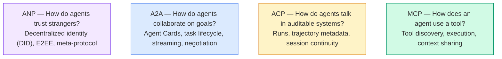

它們不是競爭對手，而是在不同層級解決不同的問題。

### MCP（回顧）(MCP (Recap))

MCP 在 Phase 13 有深入介紹。快速回顧：MCP 標準化了 LLM 連接外部 tool 和資料來源的方式。它是 **client-server** protocol，agent（client）發現並呼叫 server 所提供的 tool。

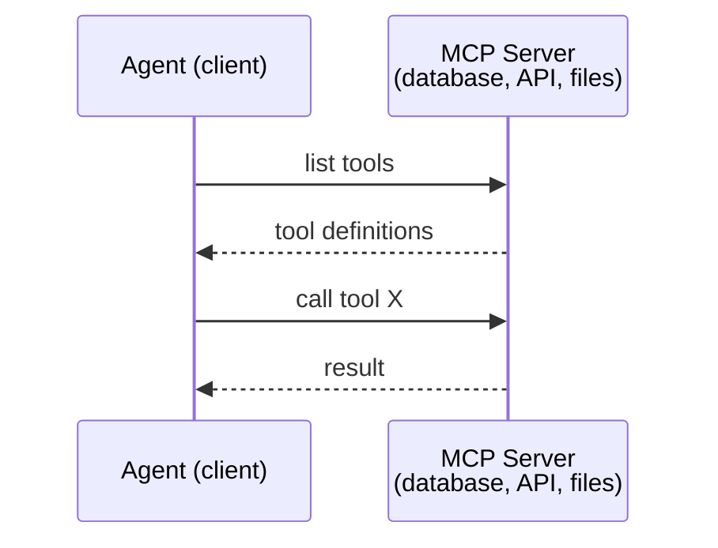

MCP 是 **agent 對 tool** 的通訊。它無法幫助 agent 彼此溝通。

### A2A (Agent2Agent Protocol)

**建立者：** Google（現隸屬 Linux Foundation，為 `lf.a2a.v1`）
**規格版本：** 1.0.1
**問題：** 自主 agent 如何彼此協作、協商，並委派任務？

A2A 是 **點對點 agent 協作** 的 protocol。MCP 把 agent 連到 tool，A2A 則把 agent 連到其他 agent。每個 agent 在一個 well-known URL 發布 **Agent Card**，其他 agent 就能發現它、與它協商，並把任務委派給它。

#### A2A 如何運作 (How A2A Works)

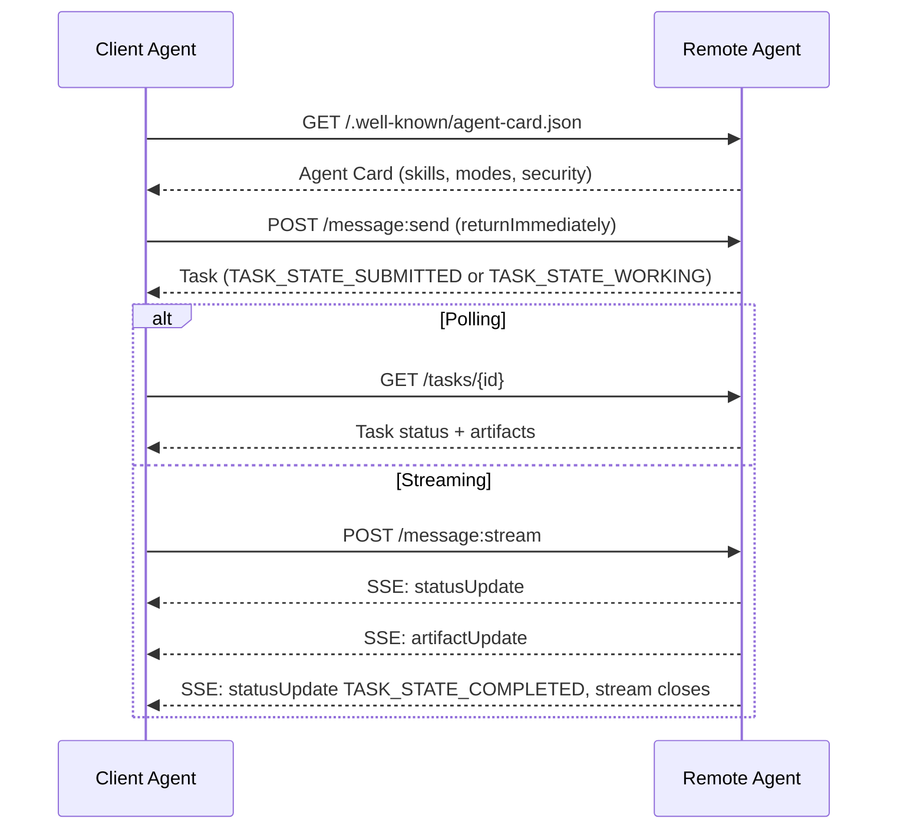

#### 真實的 Agent Card (The Real Agent Card)

這就是實際環境中 A2A Agent Card 的樣子。由 `GET /.well-known/agent-card.json` 提供：

```json
{
  "name": "Research Agent",
  "description": "Searches documentation and summarizes findings",
  "version": "1.0.0",
  "supportedInterfaces": [
    {
      "url": "https://research-agent.example.com/a2a/v1",
      "protocolBinding": "JSONRPC",
      "protocolVersion": "1.0"
    },
    {
      "url": "https://research-agent.example.com/a2a/rest",
      "protocolBinding": "HTTP+JSON",
      "protocolVersion": "1.0"
    }
  ],
  "provider": {
    "organization": "Your Company",
    "url": "https://example.com"
  },
  "capabilities": {
    "streaming": true,
    "pushNotifications": false
  },
  "defaultInputModes": ["text/plain", "application/json"],
  "defaultOutputModes": ["text/plain", "application/json"],
  "skills": [
    {
      "id": "web-research",
      "name": "Web Research",
      "description": "Searches the web and synthesizes findings",
      "tags": ["research", "search", "summarization"],
      "examples": ["Research the latest changes in React 19"]
    },
    {
      "id": "doc-analysis",
      "name": "Documentation Analysis",
      "description": "Reads and analyzes technical documentation",
      "tags": ["docs", "analysis"],
      "inputModes": ["text/plain", "application/pdf"],
      "outputModes": ["application/json"]
    }
  ],
  "securitySchemes": {
    "bearer": {
      "httpAuthSecurityScheme": {
        "scheme": "Bearer",
        "bearerFormat": "JWT"
      }
    }
  },
  "securityRequirements": [{ "schemes": { "bearer": { "list": [] } } }]
}
```

要注意的重點：
- **Skills** 是 agent 能做的事。每個 skill 都有 ID、tag，以及支援的輸入／輸出 MIME type。Client agent 靠這個判斷這個遠端 agent 能不能處理它的請求。
- **supportedInterfaces** 列出多種 protocol binding。同一個 agent 可以同時支援 JSON-RPC、REST 和 gRPC。
- **安全性** 內建在 card 裡：`securitySchemes` 命名每種 scheme，`securityRequirements` 說明哪些適用。Client 在送出任何請求之前，就知道自己需要什麼驗證。

#### Task 生命週期 (Task Lifecycle)

Task 是 A2A 中的核心工作單位。它們會經過定義好的狀態（圖中省略了每個狀態在 wire 上都帶有的 `TASK_STATE_` 前綴）：

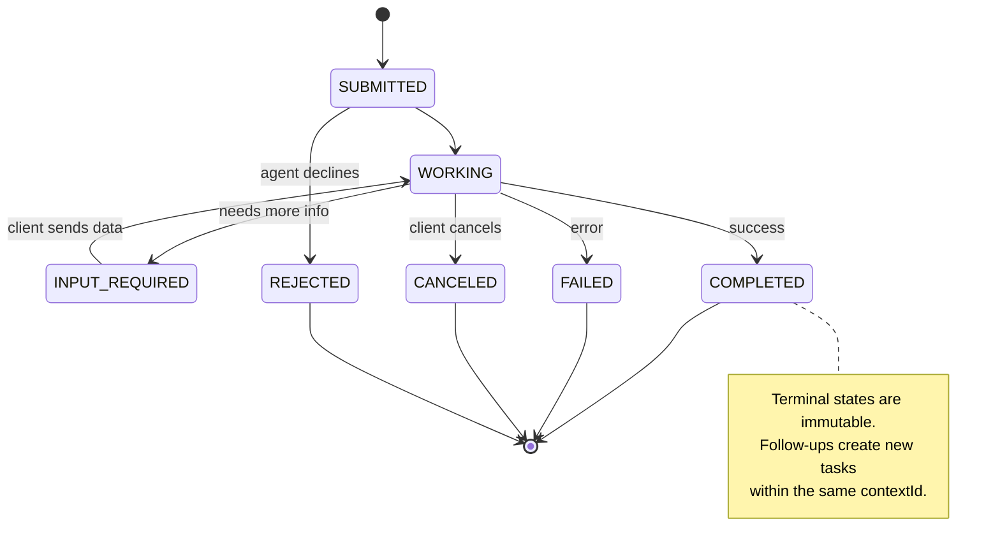

全部 8 個狀態（規格另外定義了 `UNSPECIFIED` 作為哨兵值，這裡省略）：

| 狀態 | 是否為終結狀態？ | 意義 |
|---|---|---|
| `TASK_STATE_SUBMITTED` | 否 | 已確認收到，尚未開始處理 |
| `TASK_STATE_WORKING` | 否 | 正在處理中 |
| `TASK_STATE_INPUT_REQUIRED` | 否 | Agent 需要 client 提供更多資訊 |
| `TASK_STATE_AUTH_REQUIRED` | 否 | 需要驗證 |
| `TASK_STATE_COMPLETED` | 是 | 成功完成 |
| `TASK_STATE_FAILED` | 是 | 因錯誤而結束 |
| `TASK_STATE_CANCELED` | 是 | 在完成前被取消 |
| `TASK_STATE_REJECTED` | 是 | Agent 拒絕了這個任務 |

Task 一旦進入終結狀態，就不可變。不能再有任何訊息。後續的追問會在同一個 `contextId` 下建立新的 task。

#### Wire Format

A2A 使用 JSON-RPC 2.0。真實的訊息往來長這樣：

**Client 送出訊息：**
```json
{
  "jsonrpc": "2.0",
  "id": 1,
  "method": "SendMessage",
  "params": {
    "message": {
      "messageId": "msg-001",
      "role": "ROLE_USER",
      "parts": [{ "text": "Research React 19 compiler features" }]
    },
    "configuration": {
      "acceptedOutputModes": ["text/plain", "application/json"],
      "historyLength": 10
    }
  }
}
```

**Agent 回應一個 task：**
```json
{
  "jsonrpc": "2.0",
  "id": 1,
  "result": {
    "task": {
      "id": "task-abc-123",
      "contextId": "ctx-xyz-789",
      "status": {
        "state": "TASK_STATE_COMPLETED",
        "timestamp": "2026-03-27T10:30:00Z"
      },
      "artifacts": [
        {
          "artifactId": "art-001",
          "name": "research-results",
          "parts": [{
            "data": {
              "findings": [
                "React 19 compiler auto-memoizes components",
                "No more manual useMemo/useCallback needed",
                "Compiler runs at build time, not runtime"
              ]
            },
            "mediaType": "application/json"
          }]
        }
      ]
    }
  }
}
```

**透過 SSE 串流：**
```text
POST /message:stream HTTP/1.1
Content-Type: application/a2a+json
A2A-Version: 1.0

data: {"task":{"id":"task-123","contextId":"ctx-123","status":{"state":"TASK_STATE_WORKING"}}}

data: {"statusUpdate":{"taskId":"task-123","contextId":"ctx-123","status":{"state":"TASK_STATE_WORKING","message":{"messageId":"msg-002","role":"ROLE_AGENT","parts":[{"text":"Searching documentation..."}]}}}}

data: {"artifactUpdate":{"taskId":"task-123","contextId":"ctx-123","artifact":{"artifactId":"art-1","parts":[{"text":"partial findings..."}]},"append":true,"lastChunk":false}}

data: {"statusUpdate":{"taskId":"task-123","contextId":"ctx-123","status":{"state":"TASK_STATE_COMPLETED"}}}
```

### ACP (Agent Communication Protocol)

**建立者：** IBM / BeeAI
**規格版本：** 0.2.0 (OpenAPI 3.1.1)
**狀態：** 正在於 Linux Foundation 之下併入 A2A
**問題：** agent 如何在完整可稽核、session 連續、並追蹤軌跡的前提下溝通？

ACP 是 **企業級 protocol**。和許多摘要的說法不同，ACP **不** 使用 JSON-LD。它是以 OpenAPI 定義的直接了當的 REST/JSON API。它特別的地方是 **TrajectoryMetadata**：每個 agent 回應都可以帶著一份詳細的紀錄，記載產生該回應的推理步驟與 tool call。

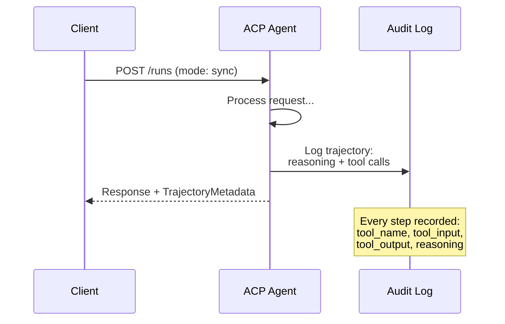

#### ACP 的 Agent Discovery (Agent Discovery in ACP)

ACP 定義了四種 discovery 方法：

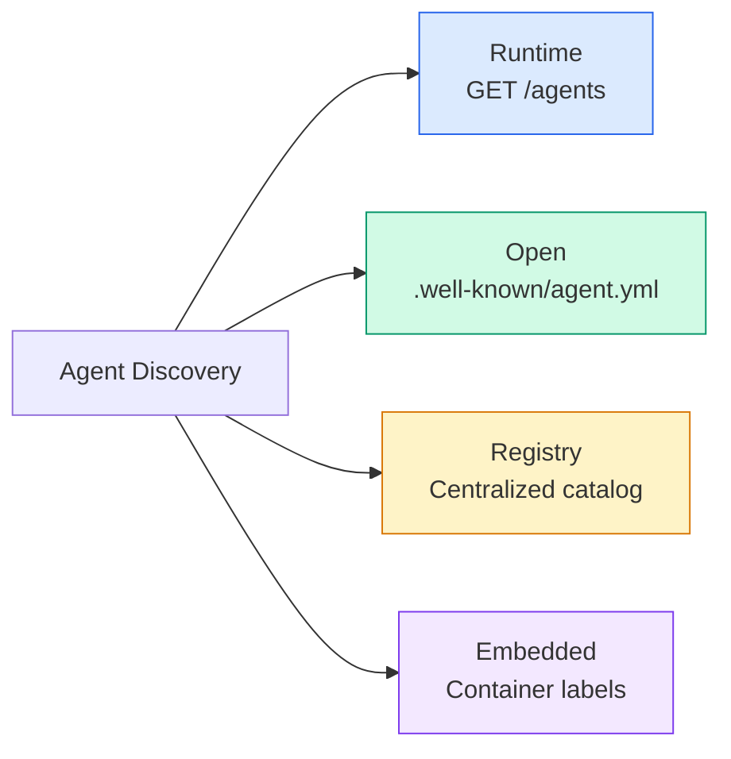

**AgentManifest** 比 A2A 的 Agent Card 簡單：

```json
{
  "name": "summarizer",
  "description": "Summarizes documents with source citations",
  "input_content_types": ["text/plain", "application/pdf"],
  "output_content_types": ["text/plain", "application/json"],
  "metadata": {
    "tags": ["summarization", "RAG"],
    "framework": "BeeAI",
    "capabilities": [
      {
        "name": "Document Summarization",
        "description": "Condenses long documents into key points"
      }
    ],
    "recommended_models": ["llama3.3:70b-instruct-fp16"],
    "license": "Apache-2.0",
    "programming_language": "Python"
  }
}
```

#### Run 生命週期 (Run Lifecycle)

ACP 用「Run」而不是「Task」。一個 Run 是一次 agent 的執行，有三種模式：

| 模式 | 行為 |
|---|---|
| `sync` | 阻塞式。回應包含完整結果。 |
| `async` | 立即回傳 202。輪詢 `GET /runs/{id}` 取得狀態。 |
| `stream` | SSE 串流。Agent 工作時事件陸續送出。 |

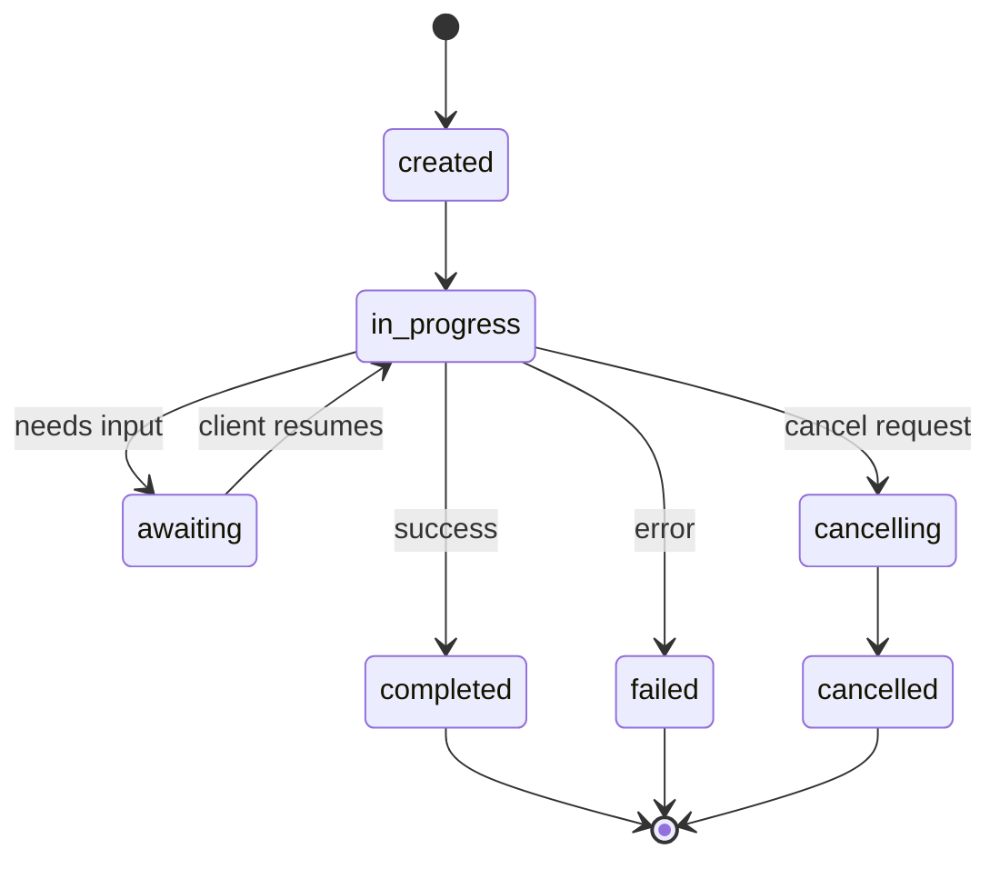

#### TrajectoryMetadata（稽核軌跡）(TrajectoryMetadata (The Audit Trail))

這是 ACP 的關鍵差異點。每個 message part 都可以帶 metadata，精確顯示 agent 做了什麼：

```json
{
  "role": "agent/researcher",
  "parts": [
    {
      "content_type": "text/plain",
      "content": "The weather in San Francisco is 72F and sunny.",
      "metadata": {
        "kind": "trajectory",
        "message": "I need to check the weather for this location",
        "tool_name": "weather_api",
        "tool_input": { "location": "San Francisco, CA" },
        "tool_output": { "temperature": 72, "condition": "sunny" }
      }
    }
  ]
}
```

對受監管的產業來說，這是寶貝。每個答案都附帶一條可證明的推理鏈：呼叫了哪些 tool、用了什麼輸入、收到什麼輸出。沒有黑盒子。

ACP 也支援 **CitationMetadata**，用於標示來源：

```json
{
  "kind": "citation",
  "start_index": 0,
  "end_index": 47,
  "url": "https://weather.gov/sf",
  "title": "NWS San Francisco Forecast"
}
```

### ANP (Agent Network Protocol)

**建立者：** 開源社群（由 GaoWei Chang 發起）
**Repo：** [github.com/agent-network-protocol/AgentNetworkProtocol](https://github.com/agent-network-protocol/AgentNetworkProtocol)
**問題：** 來自不同組織的 agent，如何在沒有中央權威的情況下互相信任？

ANP 是 **去中心化身分 protocol**。它用 W3C Decentralized Identifier (DID) 與端對端加密來建立信任。A2A 是透過已知的 endpoint 發現 agent，ANP 則讓 agent 以密碼學方式證明自己的身分。

ANP 有三層：

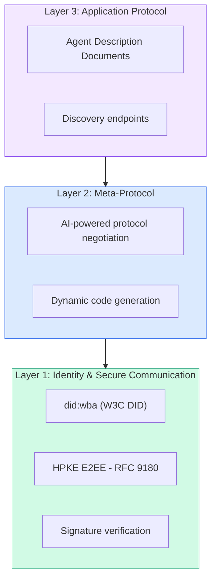

#### DID Document（真實結構）(DID Documents (Real Structure))

ANP 使用自訂的 DID method，叫做 `did:wba`（Web-Based Agent）。DID `did:wba:example.com:user:alice` 會解析到 `https://example.com/user/alice/did.json`：

```json
{
  "@context": [
    "https://www.w3.org/ns/did/v1",
    "https://w3id.org/security/suites/jws-2020/v1",
    "https://w3id.org/security/suites/secp256k1-2019/v1"
  ],
  "id": "did:wba:example.com:user:alice",
  "verificationMethod": [
    {
      "id": "did:wba:example.com:user:alice#key-1",
      "type": "EcdsaSecp256k1VerificationKey2019",
      "controller": "did:wba:example.com:user:alice",
      "publicKeyJwk": {
        "crv": "secp256k1",
        "x": "NtngWpJUr-rlNNbs0u-Aa8e16OwSJu6UiFf0Rdo1oJ4",
        "y": "qN1jKupJlFsPFc1UkWinqljv4YE0mq_Ickwnjgasvmo",
        "kty": "EC"
      }
    },
    {
      "id": "did:wba:example.com:user:alice#key-x25519-1",
      "type": "X25519KeyAgreementKey2019",
      "controller": "did:wba:example.com:user:alice",
      "publicKeyMultibase": "z9hFgmPVfmBZwRvFEyniQDBkz9LmV7gDEqytWyGZLmDXE"
    }
  ],
  "authentication": [
    "did:wba:example.com:user:alice#key-1"
  ],
  "keyAgreement": [
    "did:wba:example.com:user:alice#key-x25519-1"
  ],
  "humanAuthorization": [
    "did:wba:example.com:user:alice#key-1"
  ],
  "service": [
    {
      "id": "did:wba:example.com:user:alice#agent-description",
      "type": "AgentDescription",
      "serviceEndpoint": "https://example.com/agents/alice/ad.json"
    }
  ]
}
```

要注意的重點：
- **Key 分離** 是強制的。簽章 key（secp256k1）與加密 key（X25519）是分開的。
- **`humanAuthorization`** 是 ANP 獨有的。這類 key 在使用前需要明確的人為核准（生物辨識、密碼、HSM）。轉帳這類高風險操作會走這條路徑。
- **`keyAgreement`** key 用於 HPKE 端對端加密（RFC 9180）。
- **service** 區段連結到 Agent Description 文件。

#### ANP 的信任如何運作 (How Trust Works in ANP)

ANP **不** 使用 web-of-trust 或背書圖。信任是雙邊的，並且每次互動都要驗證：

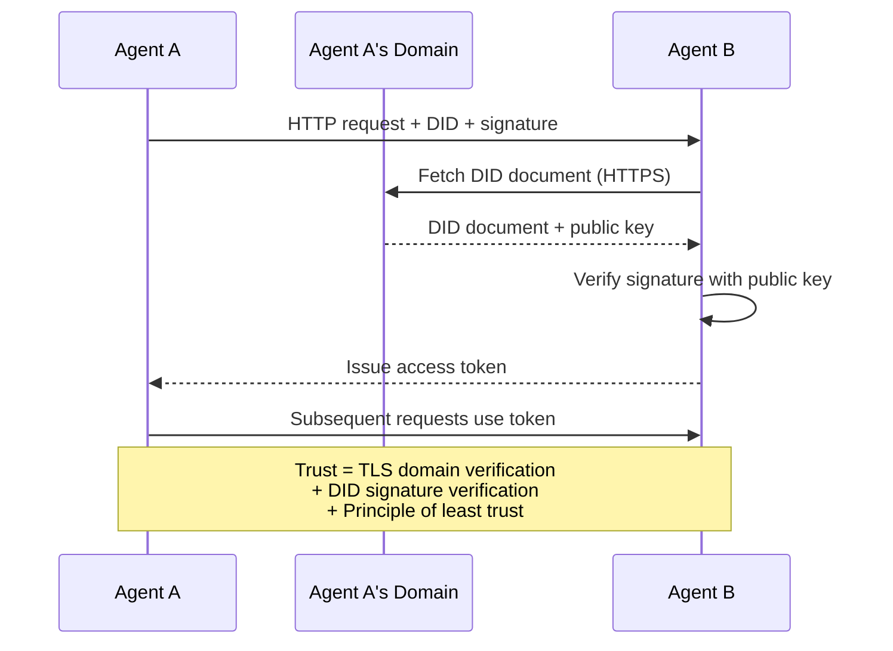

信任來自三個來源：
1. **網域層級的 TLS** 驗證 DID document 的主機
2. **DID 密碼學簽章** 驗證 agent 的身分
3. **最小信任原則 (principle of least trust)** 只授予最低限度的權限

沒有以 gossip 為基礎的信任傳播，也沒有 PageRank 評分。你要透過 DID 直接驗證每個 agent。

#### Meta-Protocol 協商 (Meta-Protocol Negotiation)

這是 ANP 最新穎的功能。來自不同生態系的兩個 agent 相遇時，不需要事先約定好資料格式。它們用自然語言協商：

```json
{
  "action": "protocolNegotiation",
  "sequenceId": 0,
  "candidateProtocols": "I can communicate using:\n1. JSON-RPC with hotel booking schema\n2. REST with OpenAPI 3.1 spec\n3. Natural language over HTTP",
  "modificationSummary": "Initial proposal",
  "status": "negotiating"
}
```

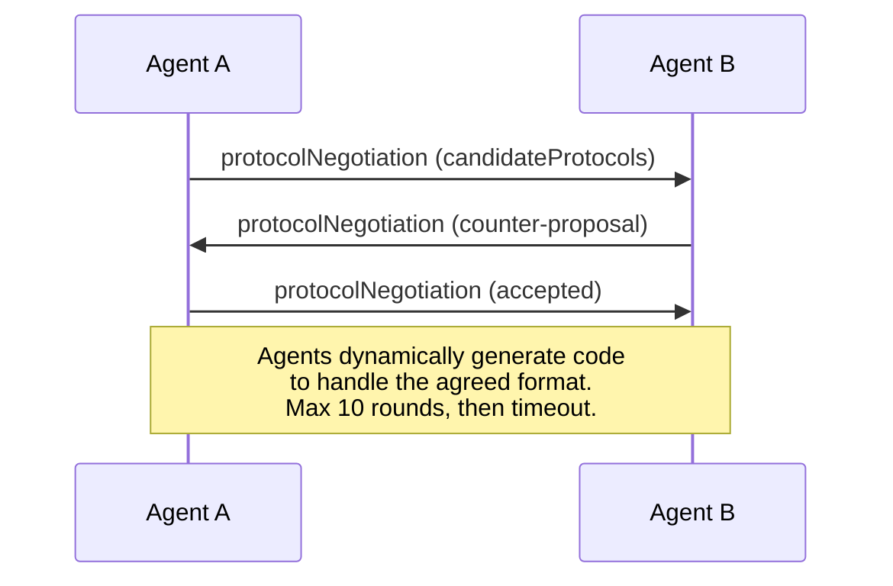

Agent 們來回協商（最多 10 輪）直到同意某種格式，然後動態產生程式碼來處理它。狀態值有：`negotiating`、`rejected`、`accepted`、`timeout`。

這表示兩個從未見過彼此的 agent，不需要任何人事先定義共享的 schema，就能想出如何溝通。

### 比較（已修正）(Comparison (Corrected))

| | MCP | A2A | ACP | ANP |
|---|---|---|---|---|
| **建立者** | Anthropic | Google / Linux Foundation | IBM / BeeAI | 社群 |
| **規格格式** | JSON-RPC | JSON-RPC / REST / gRPC | OpenAPI 3.1 (REST) | JSON-RPC |
| **主要用途** | Agent 對 Tool | Agent 對 Agent | Agent 對 Agent | Agent 對 Agent |
| **Discovery** | Tool 列表 | `/.well-known/agent-card.json` | `GET /agents`, `/.well-known/agent.yml` | `/.well-known/agent-descriptions`, DID service endpoints |
| **身分** | 隱含（本機） | Security scheme (OAuth, mTLS) | Server 層級 | W3C DID (`did:wba`) 搭配 E2EE |
| **稽核軌跡** | N/A | 基本（task 歷史） | TrajectoryMetadata（tool call、推理） | 未正式規範 |
| **狀態機** | N/A | 9 個 task 狀態 | 7 個 run 狀態 | N/A |
| **Streaming** | N/A | SSE | SSE | 與傳輸層無關 |
| **獨特功能** | Tool schema | Agent Card + Skills | 軌跡稽核紀錄 | Meta-protocol 協商 |
| **最適合** | Tool 與資料 | 動態協作 | 受監管的產業 | 跨組織信任 |
| **狀態** | 穩定 | 穩定 (v1.0) | 併入 A2A 中 | 積極開發中 |

### 它們如何一起運作 (How They Work Together)

這些 protocol 並不互斥。實際的企業系統會同時用到多個：

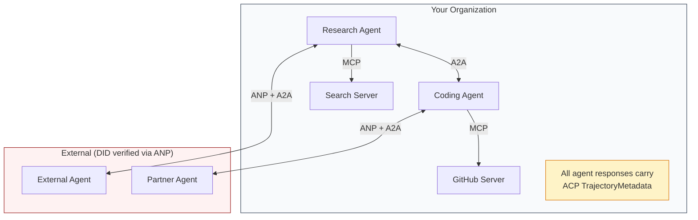

- **MCP** 把每個 agent 連到它的 tool
- **A2A** 處理 agent 之間的協作（內部與外部）
- **ACP** 用 trajectory metadata 包裝回應，以便稽核
- **ANP** 為你無法掌控的 agent 提供身分驗證

```figure
swarm-message-bus
```

## 動手做 (Build It)

### 步驟 1：核心訊息型別 (Core Message Types)

每個 multi-agent 系統都從訊息格式開始。我們定義的型別，對應真實 protocol 所使用的東西：

```typescript
import crypto from "node:crypto";

type MessageRole = "ROLE_USER" | "ROLE_AGENT";

type MessagePart =
  | { text: string }
  | { data: unknown; mediaType: string }
  | { url: string; filename: string; mediaType: string };

type TrajectoryEntry = {
  reasoning: string;
  toolName?: string;
  toolInput?: unknown;
  toolOutput?: unknown;
  timestamp: number;
};

type AgentMessage = {
  id: string;
  role: MessageRole;
  parts: MessagePart[];
  trajectory?: TrajectoryEntry[];
  replyTo?: string;
  timestamp: number;
};

function createMessage(
  role: MessageRole,
  parts: MessagePart[],
  replyTo?: string
): AgentMessage {
  return {
    id: crypto.randomUUID(),
    role,
    parts,
    replyTo,
    timestamp: Date.now(),
  };
}

function textMessage(role: MessageRole, text: string): AgentMessage {
  return createMessage(role, [{ text }]);
}
```

請注意：`MessagePart` 是多模態的（文字、結構化資料、檔案），和真實的 A2A 與 ACP 規格一樣。如同 A2A 1.0，存在的欄位（`text`、`data` 或 `url`）就說明了這個 part 是什麼；沒有 `kind` 標籤。`TrajectoryEntry` 記錄推理鏈，對應 ACP 的 TrajectoryMetadata。

### 步驟 2：A2A Agent Card 與 Registry (A2A Agent Card and Registry)

建立與真實 A2A 規格相符的 agent discovery：

```typescript
type Skill = {
  id: string;
  name: string;
  description: string;
  tags: string[];
  inputModes: string[];
  outputModes: string[];
};

type AgentInterface = {
  url: string;
  protocolBinding: string;
  protocolVersion: string;
};

type AgentCard = {
  name: string;
  description: string;
  version: string;
  supportedInterfaces: AgentInterface[];
  capabilities: {
    streaming: boolean;
    pushNotifications: boolean;
  };
  defaultInputModes: string[];
  defaultOutputModes: string[];
  skills: Skill[];
};

class AgentRegistry {
  private cards: Map<string, AgentCard> = new Map();

  register(card: AgentCard) {
    this.cards.set(card.name, card);
  }

  discoverBySkillTag(tag: string): AgentCard[] {
    return [...this.cards.values()].filter((card) =>
      card.skills.some((skill) => skill.tags.includes(tag))
    );
  }

  discoverByInputMode(mimeType: string): AgentCard[] {
    return [...this.cards.values()].filter(
      (card) =>
        card.defaultInputModes.includes(mimeType) ||
        card.skills.some((skill) => skill.inputModes.includes(mimeType))
    );
  }

  resolve(name: string): AgentCard | undefined {
    return this.cards.get(name);
  }

  listAll(): AgentCard[] {
    return [...this.cards.values()];
  }
}
```

這比單純的「名稱對應能力」map 豐富得多。你可以依 skill tag、輸入 MIME type 或名稱來發現 agent，就像真實的 A2A 規格所支援的那樣。

### 步驟 3：A2A Task 生命週期 (A2A Task Lifecycle)

建立完整的 task 狀態機：

```typescript
type TaskState =
  | "TASK_STATE_SUBMITTED"
  | "TASK_STATE_WORKING"
  | "TASK_STATE_INPUT_REQUIRED"
  | "TASK_STATE_AUTH_REQUIRED"
  | "TASK_STATE_COMPLETED"
  | "TASK_STATE_FAILED"
  | "TASK_STATE_CANCELED"
  | "TASK_STATE_REJECTED";

const TERMINAL_STATES: TaskState[] = [
  "TASK_STATE_COMPLETED",
  "TASK_STATE_FAILED",
  "TASK_STATE_CANCELED",
  "TASK_STATE_REJECTED",
];

type TaskStatus = {
  state: TaskState;
  message?: AgentMessage;
  timestamp: number;
};

type Artifact = {
  id: string;
  name: string;
  parts: MessagePart[];
};

type Task = {
  id: string;
  contextId: string;
  status: TaskStatus;
  artifacts: Artifact[];
  history: AgentMessage[];
};

type TaskEvent =
  | { statusUpdate: { taskId: string; status: TaskStatus } }
  | {
      artifactUpdate: {
        taskId: string;
        artifact: Artifact;
        append: boolean;
        lastChunk: boolean;
      };
    };

type TaskHandler = (
  task: Task,
  message: AgentMessage
) => AsyncGenerator<TaskEvent>;

class TaskManager {
  private tasks: Map<string, Task> = new Map();
  private handlers: Map<string, TaskHandler> = new Map();
  private listeners: Map<string, ((event: TaskEvent) => void)[]> = new Map();

  registerHandler(agentName: string, handler: TaskHandler) {
    this.handlers.set(agentName, handler);
  }

  subscribe(taskId: string, listener: (event: TaskEvent) => void) {
    const existing = this.listeners.get(taskId) ?? [];
    existing.push(listener);
    this.listeners.set(taskId, existing);
  }

  async sendMessage(
    agentName: string,
    message: AgentMessage,
    contextId?: string
  ): Promise<Task> {
    const handler = this.handlers.get(agentName);
    if (!handler) {
      const task = this.createTask(contextId);
      task.status = {
        state: "TASK_STATE_REJECTED",
        timestamp: Date.now(),
        message: textMessage("ROLE_AGENT", `No handler for ${agentName}`),
      };
      return task;
    }

    const task = this.createTask(contextId);
    task.history.push(message);
    task.status = { state: "TASK_STATE_SUBMITTED", timestamp: Date.now() };

    this.processTask(task, handler, message).catch((err) => {
      task.status = {
        state: "TASK_STATE_FAILED",
        timestamp: Date.now(),
        message: textMessage("ROLE_AGENT", String(err)),
      };
    });
    return task;
  }

  getTask(taskId: string): Task | undefined {
    return this.tasks.get(taskId);
  }

  cancelTask(taskId: string): boolean {
    const task = this.tasks.get(taskId);
    if (!task || TERMINAL_STATES.includes(task.status.state)) return false;
    task.status = { state: "TASK_STATE_CANCELED", timestamp: Date.now() };
    this.emit(taskId, {
      statusUpdate: { taskId, status: task.status },
    });
    return true;
  }

  private createTask(contextId?: string): Task {
    const task: Task = {
      id: crypto.randomUUID(),
      contextId: contextId ?? crypto.randomUUID(),
      status: { state: "TASK_STATE_SUBMITTED", timestamp: Date.now() },
      artifacts: [],
      history: [],
    };
    this.tasks.set(task.id, task);
    return task;
  }

  private async processTask(
    task: Task,
    handler: TaskHandler,
    message: AgentMessage
  ) {
    task.status = { state: "TASK_STATE_WORKING", timestamp: Date.now() };
    this.emit(task.id, {
      statusUpdate: { taskId: task.id, status: task.status },
    });

    try {
      for await (const event of handler(task, message)) {
        if (TERMINAL_STATES.includes(task.status.state)) break;

        if ("statusUpdate" in event) {
          task.status = event.statusUpdate.status;
        }
        if ("artifactUpdate" in event) {
          const update = event.artifactUpdate;
          const existing = task.artifacts.find(
            (a) => a.id === update.artifact.id
          );
          if (existing && update.append) {
            existing.parts.push(...update.artifact.parts);
          } else {
            task.artifacts.push(update.artifact);
          }
        }
        this.emit(task.id, event);
      }
    } catch (err) {
      task.status = {
        state: "TASK_STATE_FAILED",
        timestamp: Date.now(),
        message: textMessage("ROLE_AGENT", String(err)),
      };
      this.emit(task.id, {
        statusUpdate: { taskId: task.id, status: task.status },
      });
    }
  }

  private emit(taskId: string, event: TaskEvent) {
    for (const listener of this.listeners.get(taskId) ?? []) {
      listener(event);
    }
  }
}
```

這實作了真實的 A2A task 生命週期：`TASK_STATE_SUBMITTED`、`TASK_STATE_WORKING`、`TASK_STATE_INPUT_REQUIRED`，然後是終結狀態。Handler 是 async generator，會 yield `statusUpdate` 與 `artifactUpdate` 事件，也就是 SSE 串流所攜帶的同一種包裝。

### 步驟 4：ACP 風格的稽核軌跡 (ACP-Style Audit Trail)

用軌跡追蹤來包裝通訊：

```typescript
type AuditEntry = {
  runId: string;
  agentName: string;
  input: AgentMessage[];
  output: AgentMessage[];
  trajectory: TrajectoryEntry[];
  status: "created" | "in-progress" | "completed" | "failed" | "awaiting";
  startedAt: number;
  completedAt?: number;
  sessionId?: string;
};

class AuditableRunner {
  private log: AuditEntry[] = [];
  private handlers: Map<
    string,
    (input: AgentMessage[]) => Promise<{
      output: AgentMessage[];
      trajectory: TrajectoryEntry[];
    }>
  > = new Map();

  registerAgent(
    name: string,
    handler: (input: AgentMessage[]) => Promise<{
      output: AgentMessage[];
      trajectory: TrajectoryEntry[];
    }>
  ) {
    this.handlers.set(name, handler);
  }

  async run(
    agentName: string,
    input: AgentMessage[],
    sessionId?: string
  ): Promise<AuditEntry> {
    const entry: AuditEntry = {
      runId: crypto.randomUUID(),
      agentName,
      input: structuredClone(input),
      output: [],
      trajectory: [],
      status: "created",
      startedAt: Date.now(),
      sessionId,
    };
    this.log.push(entry);

    const handler = this.handlers.get(agentName);
    if (!handler) {
      entry.status = "failed";
      return entry;
    }

    entry.status = "in-progress";
    try {
      const result = await handler(input);
      entry.output = structuredClone(result.output);
      entry.trajectory = structuredClone(result.trajectory);
      entry.status = "completed";
      entry.completedAt = Date.now();
    } catch (err) {
      entry.status = "failed";
      entry.trajectory.push({
        reasoning: `Error: ${String(err)}`,
        timestamp: Date.now(),
      });
      entry.completedAt = Date.now();
    }
    return entry;
  }

  getFullAuditLog(): AuditEntry[] {
    return structuredClone(this.log);
  }

  getAuditLogForAgent(agentName: string): AuditEntry[] {
    return structuredClone(
      this.log.filter((e) => e.agentName === agentName)
    );
  }

  getAuditLogForSession(sessionId: string): AuditEntry[] {
    return structuredClone(
      this.log.filter((e) => e.sessionId === sessionId)
    );
  }

  getTrajectoryForRun(runId: string): TrajectoryEntry[] {
    const entry = this.log.find((e) => e.runId === runId);
    return entry ? structuredClone(entry.trajectory) : [];
  }
}
```

每次 agent 執行都會產生一筆完整的稽核紀錄：輸入了什麼、輸出了什麼，以及中間 tool call 與推理步驟的完整軌跡。你可以依 agent、依 session 或依單次 run 查詢。

### 步驟 5：ANP 風格的身分驗證 (ANP-Style Identity Verification)

建立以 DID 為基礎的身分與驗證：

```typescript
type VerificationMethod = {
  id: string;
  type: string;
  controller: string;
  publicKeyDer: string;
};

type DIDDocument = {
  id: string;
  verificationMethod: VerificationMethod[];
  authentication: string[];
  keyAgreement: string[];
  humanAuthorization: string[];
  service: { id: string; type: string; serviceEndpoint: string }[];
};

type AgentIdentity = {
  did: string;
  document: DIDDocument;
  privateKey: crypto.KeyObject;
  publicKey: crypto.KeyObject;
};

class IdentityRegistry {
  private documents: Map<string, DIDDocument> = new Map();

  publish(doc: DIDDocument) {
    this.documents.set(doc.id, doc);
  }

  resolve(did: string): DIDDocument | undefined {
    return this.documents.get(did);
  }

  verify(did: string, signature: string, payload: string): boolean {
    const doc = this.documents.get(did);
    if (!doc) return false;

    const authKeyIds = doc.authentication;
    const authKeys = doc.verificationMethod.filter((vm) =>
      authKeyIds.includes(vm.id)
    );

    for (const key of authKeys) {
      const publicKey = crypto.createPublicKey({
        key: Buffer.from(key.publicKeyDer, "base64"),
        format: "der",
        type: "spki",
      });
      const isValid = crypto.verify(
        null,
        Buffer.from(payload),
        publicKey,
        Buffer.from(signature, "hex")
      );
      if (isValid) return true;
    }
    return false;
  }

  requiresHumanAuth(did: string, operationKeyId: string): boolean {
    const doc = this.documents.get(did);
    if (!doc) return false;
    return doc.humanAuthorization.includes(operationKeyId);
  }
}

function createIdentity(domain: string, agentName: string): AgentIdentity {
  const did = `did:wba:${domain}:agent:${agentName}`;
  const { publicKey, privateKey } = crypto.generateKeyPairSync("ed25519");

  const publicKeyDer = publicKey
    .export({ format: "der", type: "spki" })
    .toString("base64");

  const keyId = `${did}#key-1`;
  const encKeyId = `${did}#key-x25519-1`;

  const document: DIDDocument = {
    id: did,
    verificationMethod: [
      {
        id: keyId,
        type: "Ed25519VerificationKey2020",
        controller: did,
        publicKeyDer,
      },
      {
        id: encKeyId,
        type: "X25519KeyAgreementKey2019",
        controller: did,
        publicKeyDer,
      },
    ],
    authentication: [keyId],
    keyAgreement: [encKeyId],
    humanAuthorization: [],
    service: [
      {
        id: `${did}#agent-description`,
        type: "AgentDescription",
        serviceEndpoint: `https://${domain}/agents/${agentName}/ad.json`,
      },
    ],
  };

  return { did, document, privateKey, publicKey };
}

function signPayload(identity: AgentIdentity, payload: string): string {
  return crypto
    .sign(null, Buffer.from(payload), identity.privateKey)
    .toString("hex");
}
```

這對應真實的 ANP 身分模型：agent 有 DID document，裡面包含各自獨立的 authentication、key agreement 和 human authorization key。`IdentityRegistry` 模擬 DID 解析（正式環境中這會是對 agent 網域發出的 HTTP 請求）。

### 步驟 6：Protocol Gateway

把四個 protocol 接成一個整合的系統：

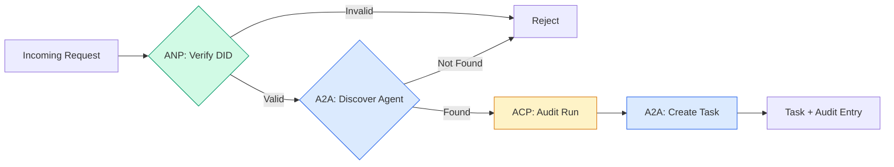

```typescript
class ProtocolGateway {
  private registry: AgentRegistry;
  private taskManager: TaskManager;
  private auditRunner: AuditableRunner;
  private identityRegistry: IdentityRegistry;

  constructor(
    registry: AgentRegistry,
    taskManager: TaskManager,
    auditRunner: AuditableRunner,
    identityRegistry: IdentityRegistry
  ) {
    this.registry = registry;
    this.taskManager = taskManager;
    this.auditRunner = auditRunner;
    this.identityRegistry = identityRegistry;
  }

  async delegateTask(
    fromDid: string,
    signature: string,
    targetAgent: string,
    message: AgentMessage,
    sessionId?: string
  ): Promise<{ task: Task; audit: AuditEntry } | { error: string }> {
    if (!this.identityRegistry.verify(fromDid, signature, message.id)) {
      return { error: "Identity verification failed" };
    }

    const card = this.registry.resolve(targetAgent);
    if (!card) {
      return { error: `Agent ${targetAgent} not found in registry` };
    }

    const audit = await this.auditRunner.run(
      targetAgent,
      [message],
      sessionId
    );
    const task = await this.taskManager.sendMessage(targetAgent, message);

    return { task, audit };
  }

  discoverAndDelegate(
    fromDid: string,
    signature: string,
    skillTag: string,
    message: AgentMessage
  ): Promise<{ task: Task; audit: AuditEntry } | { error: string }> {
    const candidates = this.registry.discoverBySkillTag(skillTag);
    if (candidates.length === 0) {
      return Promise.resolve({
        error: `No agents found with skill tag: ${skillTag}`,
      });
    }
    return this.delegateTask(
      fromDid,
      signature,
      candidates[0].name,
      message
    );
  }
}
```

這個 gateway 一次呼叫就做四件事：
1. **ANP**：透過 DID 簽章驗證呼叫者的身分
2. **A2A**：發現目標 agent 並檢查其能力
3. **ACP**：用帶有軌跡的稽核紀錄包裝這次執行
4. **A2A**：建立一個 task，並完整追蹤生命週期

### 步驟 7：全部串在一起 (Wire It All Together)

```typescript
async function protocolDemo() {
  const registry = new AgentRegistry();
  registry.register({
    name: "researcher",
    description: "Searches and summarizes findings",
    version: "1.0.0",
    supportedInterfaces: [
      {
        url: "https://researcher.local/a2a/v1",
        protocolBinding: "JSONRPC",
        protocolVersion: "1.0",
      },
    ],
    capabilities: { streaming: true, pushNotifications: false },
    defaultInputModes: ["text/plain"],
    defaultOutputModes: ["text/plain", "application/json"],
    skills: [
      {
        id: "web-research",
        name: "Web Research",
        description: "Searches the web",
        tags: ["research", "search", "summarization"],
        inputModes: ["text/plain"],
        outputModes: ["application/json"],
      },
    ],
  });
  registry.register({
    name: "coder",
    description: "Writes code from specs",
    version: "1.0.0",
    supportedInterfaces: [
      {
        url: "https://coder.local/a2a/v1",
        protocolBinding: "JSONRPC",
        protocolVersion: "1.0",
      },
    ],
    capabilities: { streaming: false, pushNotifications: false },
    defaultInputModes: ["text/plain", "application/json"],
    defaultOutputModes: ["text/plain"],
    skills: [
      {
        id: "code-gen",
        name: "Code Generation",
        description: "Generates code",
        tags: ["coding", "generation"],
        inputModes: ["text/plain", "application/json"],
        outputModes: ["text/plain"],
      },
    ],
  });

  const taskManager = new TaskManager();
  const auditRunner = new AuditableRunner();

  const researchTrajectory: TrajectoryEntry[] = [];

  taskManager.registerHandler(
    "researcher",
    async function* (task, message) {
      yield {
        statusUpdate: {
          taskId: task.id,
          status: {
            state: "TASK_STATE_WORKING" as const,
            timestamp: Date.now(),
          },
        },
      };

      researchTrajectory.push({
        reasoning: "Searching for React 19 documentation",
        toolName: "web_search",
        toolInput: { query: "React 19 compiler features" },
        toolOutput: {
          results: ["react.dev/blog/react-19", "github.com/react/react"],
        },
        timestamp: Date.now(),
      });

      researchTrajectory.push({
        reasoning: "Extracting key findings from search results",
        toolName: "doc_analysis",
        toolInput: { url: "react.dev/blog/react-19" },
        toolOutput: {
          summary:
            "React 19 compiler auto-memoizes, no manual useMemo needed",
        },
        timestamp: Date.now(),
      });

      yield {
        artifactUpdate: {
          taskId: task.id,
          artifact: {
            id: crypto.randomUUID(),
            name: "research-results",
            parts: [
              {
                data: {
                  findings: [
                    "React 19 compiler auto-memoizes components",
                    "No more manual useMemo/useCallback needed",
                    "Compiler runs at build time, not runtime",
                  ],
                  sources: ["react.dev/blog/react-19"],
                },
                mediaType: "application/json",
              },
            ],
          },
          append: false,
          lastChunk: true,
        },
      };

      yield {
        statusUpdate: {
          taskId: task.id,
          status: {
            state: "TASK_STATE_COMPLETED" as const,
            timestamp: Date.now(),
          },
        },
      };
    }
  );

  auditRunner.registerAgent("researcher", async () => ({
    output: [
      textMessage("ROLE_AGENT", "React 19 compiler auto-memoizes components"),
    ],
    trajectory: researchTrajectory,
  }));

  const identityRegistry = new IdentityRegistry();

  const coderIdentity = createIdentity("coder.local", "coder");
  const researcherIdentity = createIdentity("researcher.local", "researcher");

  identityRegistry.publish(coderIdentity.document);
  identityRegistry.publish(researcherIdentity.document);

  const gateway = new ProtocolGateway(
    registry,
    taskManager,
    auditRunner,
    identityRegistry
  );

  console.log("=== Protocol Demo ===\n");

  console.log("1. Agent Discovery (A2A)");
  const researchAgents = registry.discoverBySkillTag("research");
  console.log(
    `   Found ${researchAgents.length} agent(s):`,
    researchAgents.map((a) => a.name)
  );

  console.log("\n2. Identity Verification (ANP)");
  const message = textMessage("ROLE_USER", "Research React 19 compiler features");
  const signature = signPayload(coderIdentity, message.id);
  const verified = identityRegistry.verify(
    coderIdentity.did,
    signature,
    message.id
  );
  console.log(`   Coder DID: ${coderIdentity.did}`);
  console.log(`   Signature verified: ${verified}`);

  console.log("\n3. Task Delegation (A2A + ACP + ANP)");
  const result = await gateway.delegateTask(
    coderIdentity.did,
    signature,
    "researcher",
    message,
    "session-001"
  );

  if ("error" in result) {
    console.log(`   Error: ${result.error}`);
    return;
  }

  console.log(`   Task ID: ${result.task.id}`);
  console.log(`   Task state: ${result.task.status.state}`);
  console.log(`   Artifacts: ${result.task.artifacts.length}`);

  console.log("\n4. Audit Trail (ACP)");
  console.log(`   Run ID: ${result.audit.runId}`);
  console.log(`   Status: ${result.audit.status}`);
  console.log(`   Trajectory steps: ${result.audit.trajectory.length}`);
  for (const step of result.audit.trajectory) {
    console.log(`     - ${step.reasoning}`);
    if (step.toolName) {
      console.log(`       Tool: ${step.toolName}`);
    }
  }

  console.log("\n5. Full Audit Log");
  const fullLog = auditRunner.getFullAuditLog();
  console.log(`   Total runs: ${fullLog.length}`);
  for (const entry of fullLog) {
    const duration = entry.completedAt
      ? `${entry.completedAt - entry.startedAt}ms`
      : "in-progress";
    console.log(`   ${entry.agentName}: ${entry.status} (${duration})`);
  }
}

protocolDemo().catch((err) => {
  console.error("Protocol demo failed:", err);
  process.exitCode = 1;
});
```

## 會出什麼問題 (What Goes Wrong)

Protocol 解決的是順利的路徑。以下是正式環境中會壞掉的地方：

**Schema 漂移 (Schema drift)。** Agent A 發布的 Agent Card 宣稱輸出 `application/json`。但 JSON schema 在不同版本之間改了。Agent B 照舊格式解析，拿到一堆亂碼。解法：替你的 skill 和輸出 schema 加上版本。A2A 規格正是為此在 Agent Card 上支援 `version`。

**狀態機違規 (State machine violations)。** 某個 agent handler yield 了 `TASK_STATE_COMPLETED` 的狀態更新，接著又試圖 yield 更多 artifact。Task 是不可變的。你的程式會默默丟掉這些更新，或丟出例外。解法：yield 之前先檢查是否為終結狀態。上面的 `TaskManager` 就是在終結狀態之後用 `break` 來強制這一點。

**信任解析失敗 (Trust resolution failures)。** Agent A 試著驗證 Agent B 的 DID，但 Agent B 的網域掛了。DID document 抓不到。你要 fail open（接受未驗證的 agent），還是 fail closed（全部拒絕）？ANP 建議依最小信任原則採用 fail closed。

**軌跡膨脹 (Trajectory bloat)。** ACP 的軌跡紀錄很強大但成本很高。一個每次 run 呼叫 200 次 tool 的複雜 agent，會產生龐大的稽核紀錄。解法：以可設定的詳細程度來記錄軌跡。為了合規，記錄 tool 名稱與 IO；對不受監管的工作負載，就略過推理步驟。

**Discovery 驚群效應 (Discovery thundering herd)。** 50 個 agent 在啟動時同時查詢 `GET /agents`。解法：用 TTL 快取 Agent Card、錯開 discovery 的間隔，或改用推送式的註冊，而不是輪詢。

## 實際使用 (Use It)

### 真實的實作 (Real Implementations)

**A2A** 最成熟。Google 的[官方規格](https://github.com/google/A2A)在 Linux Foundation 之下開源。有 Python 與 TypeScript 的 SDK。如果你的 agent 需要動態 discovery 與協作，從這裡開始。

**ACP** 正在併入 A2A。IBM 的 [BeeAI 專案](https://github.com/i-am-bee/acp)把 ACP 做成以 REST 為優先的替代方案，但 trajectory metadata 的概念正被 A2A 生態系吸收。即使你用 A2A 當傳輸層，也可以採用 ACP 的 pattern（軌跡紀錄、run 生命週期）。

**ANP** 是最實驗性的。[社群 repo](https://github.com/agent-network-protocol/AgentNetworkProtocol) 有 Python SDK (AgentConnect)。Meta-protocol 協商的概念真的很新穎。對跨組織的 agent 部署值得關注。

**MCP** 在 Phase 13 已經介紹過。如果你想讓 agent 使用 tool，MCP 就是標準。

### 選擇適合的 Protocol (Picking the Right Protocol)

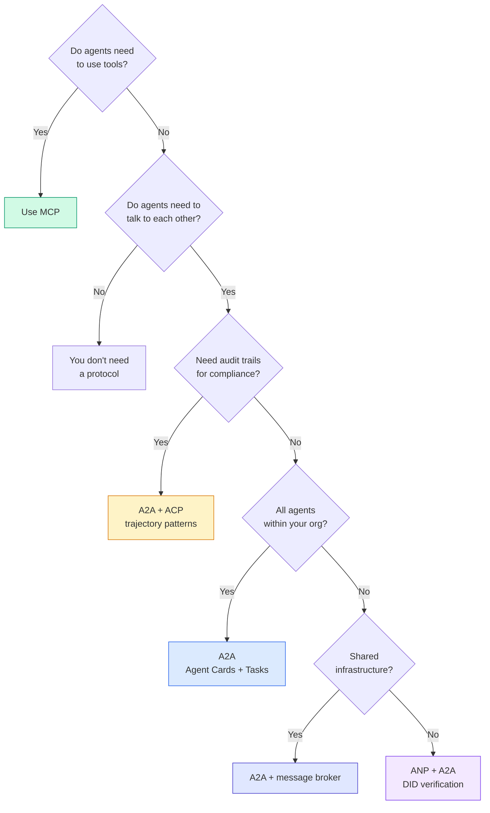

## 交付 (Ship It)

這堂課產出：
- `code/main.ts` -- 四種 protocol pattern 的完整實作
- `outputs/prompt-protocol-selector.md` -- 幫你為系統選擇 protocol 的 prompt

## 練習 (Exercises)

1. **多跳 task 委派。** 擴充 `TaskManager`，讓 agent handler 能把子任務委派給其他 agent。Researcher 收到一個 task，把「search」和「summarize」子任務委派給兩個專家 agent，等兩者都完成，再把結果合併成自己的 artifact。

2. **串流稽核軌跡。** 修改 `AuditableRunner` 以支援 streaming 模式。不要等完整結果，而是在軌跡項目新增時，即時 yield `AuditEntry` 更新。使用會產生稽核快照的 async generator。

3. **DID 輪替。** 在 `IdentityRegistry` 加入 key 輪替。Agent 應該能發布帶有更新 key 的新 DID document，同時保留 `previousDid` 參照。驗證者應在寬限期內同時接受目前與前一把 key 的簽章。

4. **Protocol 協商。** 實作 ANP 的 meta-protocol 概念。兩個 agent 交換帶有候選格式的 `protocolNegotiation` 訊息（例如「我會講 JSON-RPC」對「我偏好 REST」）。最多 3 輪之後，它們同意一種格式，或逾時。談定的格式決定它們使用哪個 `TaskManager` 或 `AuditableRunner`。

5. **限流的 discovery。** 加入 `RateLimitedRegistry` wrapper，用可設定的 TTL 快取 Agent Card 查詢，並限制每個 agent 每秒的 discovery 查詢次數。模擬 100 個 agent 在啟動時互相 discovery 的驚群效應，並測量差異。

## 關鍵術語 (Key Terms)

| 術語 | 一般說法 | 實際意義 |
|------|----------------|----------------------|
| MCP | 「AI tool 的 protocol」 | 讓 agent 發現並使用 tool 的 client-server protocol。是 agent 對 tool，不是 agent 對 agent。 |
| A2A | 「Google 的 agent protocol」 | 在 Linux Foundation 之下、用於 agent 協作的點對點 protocol。透過 Agent Card 做 discovery、9 個狀態的 task 生命週期，並以 SSE 做 streaming。支援 JSON-RPC、REST 和 gRPC binding。 |
| ACP | 「企業級 agent 訊息傳遞」 | IBM/BeeAI 為 agent run 設計的 REST API，附 TrajectoryMetadata：每個回應都帶著完整的推理鏈與 tool call。併入 A2A 中。 |
| ANP | 「去中心化的 agent 身分」 | 社群 protocol，用 `did:wba` (DID) 做密碼學身分、HPKE 做 E2EE，並用 AI 驅動的 meta-protocol 協商，讓從未見過彼此的 agent 能溝通。 |
| Agent Card | 「agent 的名片」 | 位於 `/.well-known/agent-card.json` 的 JSON 文件，描述 skill、支援的 MIME type、security scheme 與 protocol binding。 |
| DID | 「去中心化 ID」 | W3C 標準，用於託管在 agent 自己網域上、可用密碼學驗證的身分。ANP 使用 `did:wba` method。 |
| TrajectoryMetadata | 「稽核收據」 | ACP 的機制，把推理步驟、tool call 及其輸入／輸出附加到每個 agent 回應上。 |
| Meta-protocol | 「agent 協商該怎麼溝通」 | ANP 的做法：agent 用自然語言動態同意資料格式，再產生程式碼來處理。 |
| Task | 「一個工作單位」 | A2A 中有狀態的物件，追蹤工作從提交到完成。一旦進入終結狀態就不可變。 |

## 延伸閱讀 (Further Reading)

- [Google A2A specification](https://github.com/google/A2A) -- 官方規格與 SDK（v1.0.1，Linux Foundation）
- [IBM/BeeAI ACP specification](https://github.com/i-am-bee/acp) -- 描述 agent run 與 trajectory metadata 的 OpenAPI 3.1 規格
- [Agent Network Protocol](https://github.com/agent-network-protocol/AgentNetworkProtocol) -- 以 DID 為基礎的身分、E2EE、meta-protocol 協商
- [Model Context Protocol docs](https://modelcontextprotocol.io/) -- Anthropic 的 MCP 規格（Phase 13 已介紹）
- [W3C Decentralized Identifiers](https://www.w3.org/TR/did-core/) -- 支撐 ANP 的身分標準
- [RFC 9180 (HPKE)](https://www.rfc-editor.org/rfc/rfc9180) -- ANP 用於 E2EE 的加密機制
- [FIPA Agent Communication Language](http://www.fipa.org/specs/fipa00061/SC00061G.html) -- 現代 agent protocol 在學術上的前身
