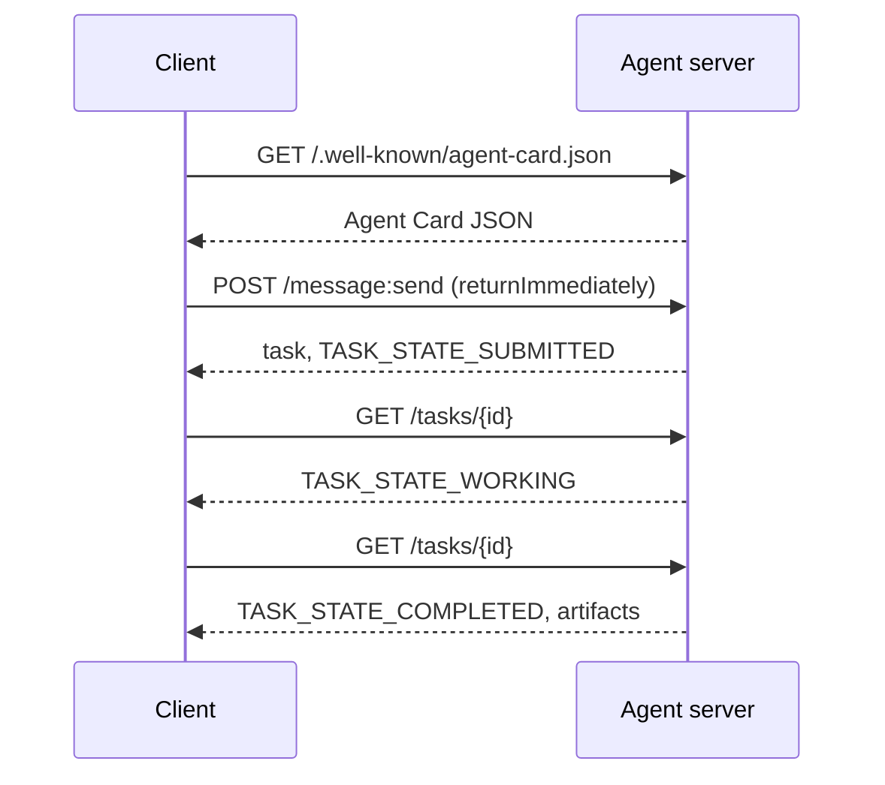

# A2A：Agent-to-Agent Protocol (A2A — The Agent-to-Agent Protocol)

> Google 在 2025 年 4 月宣布 A2A；到 2026 年 4 月，規格位於 https://a2a-protocol.org/latest/specification/，有 150 個以上的組織支持。A2A 是 MCP（Lesson 13）的橫向補充：MCP 是垂直的（agent ↔ tool），A2A 是點對點的（agent ↔ agent）。它定義了 Agent Card（discovery）、帶有 artifact 的 task（文字、結構化資料、影片）、不透明的 task 生命週期，以及驗證。正式環境的系統越來越常把 MCP 和 A2A 搭配使用。Google Cloud 在 2025-2026 年間把 A2A 支援納入 Vertex AI Agent Builder。

**Type:** Learn + Build
**Languages:** Python (stdlib, `http.server`, `json`)
**Prerequisites:** Phase 16 · 04 (Primitive Model)
**Time:** ~75 分鐘

## 問題 (Problem)

你的 agent 需要呼叫另一個系統上的另一個 agent。怎麼做？你可以公開一個 HTTP endpoint、定義一份客製的 JSON schema，然後祈禱對方看得懂。每一對 agent 都會變成一次客製整合。

A2A 就是這種呼叫的通用 wire protocol。標準的 discovery、標準的 task 模型、標準的傳輸、標準的 artifact。就像 HTTP+REST，但把 agent 當作一等公民。

## 核心概念 (Concept)

### 四個元素 (The four elements)

**Agent Card。** 位於 `/.well-known/agent-card.json` 的 JSON 文件，描述這個 agent：名稱、skill、`supportedInterfaces`（endpoint URL、protocol binding、protocol 版本）、預設的輸入與輸出媒體型別，以及驗證需求（`securitySchemes` 加上 `securityRequirements`）。Discovery 就是靠讀這張 card 完成。

```http
GET /.well-known/agent-card.json HTTP/1.1
Host: agent.example.com
```

```json
{
  "name": "code-review-agent",
  "description": "Reviews Python and TypeScript code.",
  "version": "1.0.0",
  "supportedInterfaces": [
    {
      "url": "https://agent.example.com",
      "protocolBinding": "HTTP+JSON",
      "protocolVersion": "1.0"
    }
  ],
  "capabilities": {"streaming": false, "pushNotifications": false},
  "securitySchemes": {
    "bearer": {"httpAuthSecurityScheme": {"scheme": "Bearer"}}
  },
  "securityRequirements": [{"schemes": {"bearer": {"list": []}}}],
  "defaultInputModes": ["text/plain", "application/json"],
  "defaultOutputModes": ["application/json"],
  "skills": [
    {
      "id": "review-python",
      "name": "Review Python",
      "description": "Reviews Python code.",
      "tags": ["code-review", "python"]
    },
    {
      "id": "review-typescript",
      "name": "Review TypeScript",
      "description": "Reviews TypeScript code.",
      "tags": ["code-review", "typescript"]
    }
  ]
}
```

**Task。** 工作單位。一個非同步、有狀態的物件，有生命週期：`TASK_STATE_SUBMITTED` → `TASK_STATE_WORKING` → `TASK_STATE_COMPLETED` / `TASK_STATE_FAILED` / `TASK_STATE_CANCELED`。Client 送出訊息，server 建立 task，client 輪詢或訂閱更新。

**Artifact。** Task 產生的結果型別。文字、結構化 JSON、圖片、影片、音訊。Artifact 是有型別的：每個 part 帶有 `text`、`raw`、`url` 或 `data` 其中之一，並可以標明它的 `mediaType`，所以不同的 modality 都是一等公民。

**不透明的生命週期 (Opaque lifecycle)。** A2A 不規定遠端 agent *如何* 解決 task。Client 看到的是狀態轉換與 artifact；實作可以自由使用任何框架。

### MCP 與 A2A 的分工 (The MCP/A2A split)

- **MCP**（Lesson 13）：agent ↔ tool。Agent 透過 JSON-RPC 對 tool server 讀寫。預設無狀態。
- **A2A**：agent ↔ agent。點對點 protocol；雙方都是有自己推理能力的 agent。

正式環境的 multi-agent 系統兩者都用。A2A 的對等方在自己這一側呼叫 MCP tool。這種分工讓兩個關注點保持乾淨。

### Discovery 流程 (Discovery flow)



這些是 HTTP+JSON binding 的路由，每個請求都帶有 `A2A-Version: 1.0`。預設情況下 `SendMessage` 會阻塞，直到 task 到達終結或被中斷的狀態，所以輪詢的 client 要設定 `configuration.returnImmediately`，才能立刻拿回 task。

或是使用 streaming：`POST /message:stream` 回傳 Server-Sent Events（先是一個 `task`，然後是 `statusUpdate` 和 `artifactUpdate` 事件），而 `/tasks/{id}:subscribe` 則重新接上正在執行的 task。Task 到達終結狀態時串流就會關閉；沒有 `final` 旗標。

### 驗證 (Auth)

A2A 支援三種常見的 pattern：

- **Bearer token**：OAuth2 或不透明的 token（`httpAuthSecurityScheme` 或 `oauth2SecurityScheme`）。
- **mTLS**：雙向 TLS；組織之間互相證明身分（`mtlsSecurityScheme`）。
- **API key**：放在 header、query parameter 或 cookie 裡的 key（`apiKeySecurityScheme`）。

驗證方式宣告在 Agent Card 中：`securitySchemes` 命名每種 scheme，`securityRequirements` 說明 client 必須滿足哪些。Client 自行發現並遵守。

### 到 2026 年 4 月有 150 個以上的組織 (150+ organizations by April 2026)

企業採用推動了 A2A 的規模。重點是：A2A 成為企業 agent 系統跨越信任邊界的方式。Google Cloud 推出 Vertex AI Agent Builder 的 A2A 支援；Microsoft Agent Framework 也支援；大多數主要框架（LangGraph、CrewAI、AutoGen）都提供 A2A adapter。

### A2A 擅長的地方 (Where A2A wins)

- **跨組織呼叫。** A 公司的 agent 呼叫 B 公司的 agent。沒有 A2A，每一對都是客製合約。
- **異質框架。** LangGraph agent 呼叫 CrewAI agent，再呼叫自訂的 Python agent。A2A 把它們正規化。
- **有型別的 artifact。** 影片結果、結構化 JSON、音訊，全都是一等公民。
- **長時間執行的任務。** 不透明的生命週期 + 輪詢，讓長達數小時的任務變得簡單明瞭。

### A2A 吃力的地方 (Where A2A struggles)

- **對延遲敏感的微呼叫。** A2A 的生命週期是非同步的。次毫秒級的 agent 對 agent 呼叫不適合；請用直接的 RPC。
- **緊密耦合的行程內 agent。** 如果兩個 agent 跑在同一個 Python 行程中，A2A 的 HTTP 往返就太過頭了。
- **小型團隊。** 規格的額外負擔是實在的；只在內部使用的 agent 可能不需要這種形式。

### A2A 與 ACP、ANP、NLIP (A2A vs ACP, ANP, NLIP)

2024-2026 年間出現了幾個相關的規格：

- **ACP**（IBM/Linux Foundation）：A2A 的前身，範圍較窄。
- **ANP**（Agent Network Protocol）：重視 peer discovery，以去中心化為優先。
- **NLIP**（Ecma Natural Language Interaction Protocol，2025 年 12 月標準化）：自然語言的內容型別。

截至 2026 年 4 月，A2A 是採用最廣的 peer protocol。比較請見 arXiv:2505.02279（Liu et al., "A Survey of Agent Interoperability Protocols"）。

```figure
sw-agent-card-discovery
```

## 動手做 (Build It)

`code/main.py` 用 `http.server` 和 JSON，在 1.0 HTTP+JSON binding 上實作一個最精簡的 A2A server 與 client。Server：

- 公開 `/.well-known/agent-card.json`，
- 接受 `POST /message:send`，
- 管理 task 狀態，
- 在 `GET /tasks/{id}` 回傳 artifact。

Client：

- 抓取 Agent Card，
- 用 `returnImmediately` 送出訊息，
- 輪詢直到完成，
- 讀取 artifact。

執行：

```
python3 code/main.py
```

這個腳本在背景執行緒啟動 server，然後對它執行 client。你會看到完整的流程：discovery、提交、輪詢、artifact。

## 實際使用 (Use It)

`outputs/skill-a2a-integrator.md` 設計一個 A2A 整合：Agent Card 的內容、task schema、驗證方式的選擇、streaming 還是輪詢。

## 交付 (Ship It)

檢查清單：

- **固定規格版本。** A2A 仍在演進；每個 `supportedInterfaces` 項目都宣告它的 `protocolVersion`，client 會送出 `A2A-Version: 1.0`。
- **冪等的 task 建立。** 重複提交（網路重試）應該只產生一個 task。依 client 的 `messageId` 去重。
- **Artifact schema。** 宣告 agent 回傳的形狀；使用者應該做驗證。
- **限流 + 驗證。** A2A 是對外公開的；套用標準的網路安全措施。
- **失敗 task 的 dead-letter。** 隨時間檢視模式，找出反覆出現的失敗類型。

## 練習 (Exercises)

1. 執行 `code/main.py`。確認 client 發現了 server 並收到正確的 artifact。
2. 在 server 加入第二個 skill（例如「summarize」）。更新 Agent Card。寫一個依 task 類型選擇 skill 的 client。1.0 的請求沒有 skill 欄位，所以 server 要依訊息的 part 來路由。
3. 實作 `POST /message:stream`：用 Server-Sent Events 回應（先是一個 `task`，然後是 `statusUpdate` 事件），並在終結狀態時關閉串流。Client 需要做哪些不同的事？
4. 閱讀 A2A 規格 (https://a2a-protocol.org/latest/specification/)。找出三件規格要求、但這個 demo 沒有實作的事。
5. 比較 A2A（Agent Card discovery）和 MCP（透過 `listTools` 在 server 端列出能力）。自我描述的 agent 與探測能力之間有什麼取捨？

## 關鍵術語 (Key Terms)

| 術語 | 一般說法 | 實際意義 |
|------|----------------|------------------------|
| A2A | 「Agent-to-agent」 | 讓 agent 能跨系統呼叫其他 agent 的點對點 protocol。Google 2025。 |
| Agent Card | 「Agent 的名片」 | 位於 `/.well-known/agent-card.json` 的 JSON，描述 skill、`supportedInterfaces`、驗證。 |
| Task | 「工作單位」 | 有生命週期的非同步有狀態物件；完成時產生 artifact。 |
| Artifact | 「結果」 | 有型別的輸出：文字、結構化 JSON、圖片、影片、音訊。一等公民的媒體。 |
| Opaque lifecycle | 「怎麼解決是 agent 自己的事」 | Client 看到狀態轉換；server 可自由選擇框架／tool。 |
| Discovery | 「找到 agent」 | `GET /.well-known/agent-card.json` 回傳 card。 |
| MCP vs A2A | 「Tool 對 peer」 | MCP：垂直的 agent ↔ tool。A2A：橫向的 agent ↔ agent。 |
| ACP / ANP / NLIP | 「兄弟 protocol」 | 相鄰的規格；A2A 是 2026 年採用最廣的。 |

## 延伸閱讀 (Further Reading)

- [A2A specification](https://a2a-protocol.org/latest/specification/) — 標準規格
- [A2A v1.0.1 release](https://github.com/a2aproject/A2A/tree/v1.0.1)：本課所遵循、已打 tag 的 `docs/specification.md` 與 `specification/a2a.proto`
- [Google Developers Blog — A2A announcement](https://developers.googleblog.com/en/a2a-a-new-era-of-agent-interoperability/) — 2025 年 4 月的發表文章
- [A2A GitHub repo](https://github.com/a2aproject/A2A) — 參考實作與 SDK
- [Liu et al. — A Survey of Agent Interoperability Protocols](https://arxiv.org/html/2505.02279v1) — MCP、ACP、A2A、ANP 的比較
