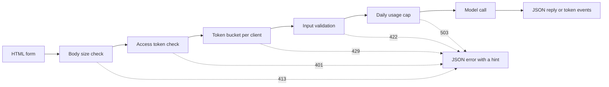

# 模型 Demo 介面 (Model Demo Interfaces)：從一個函式到可分享的 App

> 模型 demo 只有一個契約：一個輸入、一次模型呼叫、一個輸出。在分享連結之前，先替每個部分設下限制。

**Type:** Build
**Languages:** Python
**Prerequisites:** Phase 11 · 13 (Building a Production LLM Application), Phase 17 · 08 (Inference Metrics), Phase 17 · 19 (AI Gateways)
**Time:** ~90 分鐘

## 學習目標 (Learning Objectives)

- 寫出 demo 的輸入、模型呼叫與輸出契約，並替每個部分設下限制。
- 用標準函式庫建立一個 HTTP app，包含一個 HTML 頁面、一個 JSON endpoint 與一個 Server-Sent Events endpoint。
- 依成本順序驗證輸入，並回傳告訴使用者下一步該做什麼的 JSON 錯誤。
- 用每個 client 的 token bucket、每日用量上限，以及可選的 access token 來保護公開 demo。
- 寫出不保留輸入文字、也不保留 client 位址的 request log。
- 比較標準函式庫版本的 demo 與兩個框架版本，並指出 demo 必須成為產品的訊號。

## 問題 (The Problem)

你的模型在 notebook 裡能跑。現在審查者想試十個輸入，客戶想在手機上看一個結果。他們都不會打開你的 notebook。

Notebook 的 cell 沒有輸入限制，也沒有進度顯示。它的錯誤是只有你看得懂的 stack trace。它還使用你的憑證和你的預算執行。如果你不做任何修改就把這個 cell 放到公開 URL 後面，可以預期會發生這些失敗：

- 使用者貼上 40,000 字元的文件。模型呼叫跑了一分鐘，然後帶著 stack trace 失敗。
- 一支腳本在一分鐘內送出 500 個 request。每個 request 都是一次付費的模型呼叫。
- 頁面八秒內什麼都不顯示，所以使用者又多按了四次按鈕。
- 伺服器 log 保留了每個輸入，包括含有客戶帳號的那一個。

Demo 介面用少量程式碼就能避免這些失敗。這堂課用 Python 標準函式庫建立一個，讓你看到每個部分。接著用兩個熱門框架建立同一個 demo，並比較各自的預設行為。

## 核心概念 (The Concept)

### Demo 是一份契約

每個 demo 都有三個部分。輸入是使用者可以送出的內容。模型呼叫把輸入變成輸出。輸出是使用者看到的內容，包括錯誤。

在寫頁面之前，先把契約寫下來：

| 部分 | 要回答的問題 | 本課程中的答案 |
|------|--------------------|-----------------------|
| 輸入 | 什麼型別、多大、哪些字元？ | 1 到 500 個字元的字串，不含控制字元 |
| 模型呼叫 | 一次呼叫要多久、花多少錢？ | 一個玩具關鍵字模型，執行不到一毫秒，無成本 |
| 輸出 | 成功與失敗時使用者看到什麼？ | 一個標籤、一個分數和一則回覆，或是附帶提示的 JSON 錯誤 |

Notebook 對這三個部分都沒有限制。Demo 替每個部分設下限制，而伺服器對每個 client 都套用這些限制。



檢查依成本順序執行。壞掉的 request 會停在它第一個沒通過的檢查，所以伺服器幾乎不花成本。模型呼叫放在最後，因為它是唯一要花錢的步驟。

### 在模型執行之前先驗證

瀏覽器可以在送出任何東西之前檢查輸入。Text area 上的 `maxlength` 和 `required` 屬性，不用網路呼叫就能給使用者回饋。這些檢查只幫得上誠實的使用者。任何 client 都能不經過頁面就送出 request，所以伺服器要重複每一項檢查。

伺服器的檢查依成本排序：

1. 讀取 `Content-Length` header。在讀取 body 之前，拒絕超過上限的 body。
2. 解析 JSON body。拒絕不是 JSON 物件的 body。
3. 檢查欄位。拒絕空文字、超過上限的文字，以及控制字元。
4. 只對通過所有檢查的 request 花一次模型呼叫。

| 失敗的檢查 | HTTP 狀態 | 錯誤碼 |
|--------------|-------------|------------|
| 沒有 `Content-Length` header | 411 Length Required | `length_required` |
| `Content-Length` 不是數字 | 400 Bad Request | `bad_length` |
| Body 超過 4,096 bytes | 413 Content Too Large | `body_too_large` |
| Body 在 `Content-Length` bytes 抵達之前就停了 | 408 Request Timeout | `request_timeout` |
| Content type 不是 JSON | 415 Unsupported Media Type | `unsupported_media_type` |
| Body 不是 JSON 物件 | 400 Bad Request | `bad_json` |
| 文字缺少、為空、太長，或含有控制字元 | 422 Unprocessable Content | `missing_text`, `empty_text`, `text_too_long`, `control_characters` |

RFC 9110 定義了這些狀態碼與名稱。

範例是輸入設計的一部分。範例讓使用者看到好的輸入長什麼樣子，也讓審查者一鍵就能測試。為每個輸出類別挑一個範例。這個 demo 有一個正面、一個負面和一個中性的範例。

### 讓使用者看到模型正在運作

模型呼叫可能需要好幾秒。沒有回饋的話，使用者分不出是模型慢還是頁面壞了。看不到任何變化的使用者可能會再按一次，然後伺服器就收到第二個付費 request。

這堂課的頁面提供四種回饋：

- Request 執行期間，停用送出按鈕。
- 顯示經過的時間，每 100 毫秒更新一次。
- 第一個 token 抵達時，顯示 time to first token。
- Request 結束時，顯示總時間。

當你學習 [inference metrics](../../08-inference-metrics-goodput/) 時，time to first token (TTFT) 是伺服器指標。Demo 頁面把同一個數字呈現給使用者，在瀏覽器中量測。

### 以串流送出輸出

語言模型一次產生回覆的一個 token。如果伺服器等到最後一個 token，使用者就得等完整生成。如果伺服器在每個 token 準備好時就送出，使用者在第一個 token 之後就能開始閱讀。

Server-Sent Events (SSE) 是這件事的標準格式。回應的 content type 是 `text/event-stream`。每個事件是一組 `event:` 與 `data:` 行，空白行結束事件。WHATWG HTML 標準定義了這個格式。

```text
event: token
data: {"index":0,"text":"Label:"}

event: token
data: {"index":1,"text":" positive."}

event: done
data: {"label":"positive","score":1.0,"tokens":11}
```

瀏覽器有用於 SSE 的 `EventSource` 介面，但它只能送 GET request。GET request 會把輸入放進 URL，而網頁伺服器與 proxy 會把 URL 寫進它們的 access log。這個 demo 改為送出帶有 JSON body 的 POST request。頁面用 `fetch()` 與 `response.body.getReader()` 讀取回應，並自己解析事件格式。

串流有一個單一 JSON 回覆沒有的問題。伺服器在第一個 token 之前就送出狀態 200。如果模型在那之後失敗，伺服器無法更改狀態。所以伺服器在串流中送出一個 `error` 事件，頁面把該事件顯示為錯誤。

當你建立 [production LLM application](../../../11-llm-engineering/13-production-app/) 時，框架替你透過 SSE 送出 tokens。這堂課手寫同一個協定，讓你看到伺服器送出的每一行。

### 寫出使用者能採取行動的錯誤

錯誤訊息有兩個工作。告訴使用者發生了什麼事，並告訴使用者下一步該做什麼。Stack trace 對陌生人兩件事都做不到。

這個 demo 中的每個錯誤都有相同的 JSON 形狀：

```json
{
  "error": {
    "code": "text_too_long",
    "message": "The text has 812 characters. The limit is 500.",
    "hint": "Shorten the text to 500 characters or fewer.",
    "request_id": "a8f3c2b435e3"
  }
}
```

- `code` 是穩定的名稱。Client 程式碼與測試以它來比對。
- `message` 陳述事實，並附上使用者需要的數字。
- `hint` 給使用者一個動作。
- `request_id` 把使用者回報連到一筆 log 紀錄。

RFC 9457 為 HTTP API 定義了標準錯誤格式，稱為 problem details。這個 demo 為了同樣的目的使用較小的形狀。當其他團隊呼叫你的 API 時，請使用 RFC 9457。

### 安全地分享公開 demo

公開連結會改變誰能送出 request。針對每個風險規劃一個控制：

| 風險 | 本 demo 中的控制 | 較大受眾的控制 |
|------|----------------------|-------------------------------|
| 一個 client 送出太多 request | 每個 client 一個 token bucket，附 429 和 `Retry-After` | 登入後的每位使用者限制 |
| 陌生人找到連結 | `Authorization` header 中可選的 access token | 搭配身分提供者的單一登入 |
| 總成本無上限成長 | 每日用量上限，附 503 和 `Retry-After` | 模型供應商端的花費上限與告警 |
| 非常大或不尋常的輸入 | Body 大小限制、文字長度限制、控制字元檢查 | 對輸入與輸出做內容審核 |
| Log 保留了私密輸入 | 記錄輸入長度與 client 的 keyed hash | 保留期限與 log 的存取控制 |

Token bucket 使用兩個數字。Capacity 是一個 client 能送出的最大突發量。Refill rate 是長期的 request 速率。每個 request 取走一個 token，bucket 持續補充，直到其 capacity：

```text
tokens = min(capacity, tokens + refill_rate * seconds_since_last_request)
accept the request if tokens >= 1, then subtract 1
```

當 bucket 空了，伺服器回覆 `429 Too Many Requests`。RFC 6585 定義了狀態 429，並讓伺服器可以加上 `Retry-After` header。這個 demo 一律加上該 header，值為到下一個 token 為止的秒數。頁面讀取該 header，並在那段時間內停用按鈕。

這個 demo 使用 client IP 位址作為 bucket 的 key。在 reverse proxy 後面，每個 request 都來自 proxy 的位址，所以所有使用者共用一個 bucket。在這種情況下，請從你自己的 proxy 設定的 header 讀取 client 位址。不要信任來自其他來源的該 header，因為 client 可以在其中放入任何值。

當你學習 [AI gateways](../../19-ai-gateways/) 時，gateway 對每個 tenant 套用 rate limits。Demo 在較小的規模上需要同樣的控制。Rate limit 控制每個 client，但不控制總量。一百個各自低於上限的 client，仍然可能用掉整個預算。用量上限會計算一天中所有模型呼叫，並在達到固定數量後拒絕呼叫。

Log 需要和輸入同樣的小心。預設的 `http.server` handler 會把 client IP 位址與 request line 寫到 standard error。如果輸入在 URL 裡，輸入就會進到 log。這個 demo 取代了那行 log。每個 request 寫一筆紀錄，包含 route、狀態、錯誤碼、latency 與輸入長度。Client 位址變成 keyed hash，所以你可以計算每個 client 的 request 數，而不用儲存位址。

告訴使用者你保留了什麼。Demo 頁面說明，伺服器保留文字的長度，但絕不保留文字本身。

### Demo 何時變成產品

Demo 以單一行程，在短時間的 session 中服務已知的人。這些訊號告訴你 demo 現在是產品了：

- 團隊以外的人每週都在使用。
- 有人要求 uptime 目標，或回報停機。
- 使用者要求登入、儲存結果或查看歷史。
- 每週的模型成本是預算中的一個項目。
- 輸入包含合約或法律所涵蓋的資料。

| 屬性 | Demo | 產品 |
|----------|------|---------|
| 使用者 | 已知的人，短時間 session | 不認識的人，每日使用 |
| 狀態 | 無 | 帳號、歷史、已儲存的結果 |
| 可用性 | 盡力而為，一個行程 | 書面目標、replicas、on-call 負責人 |
| 成本控制 | 一個每日用量上限 | 每位使用者的配額與計費 |
| Observability | 每個 request 一筆 log 紀錄 | Traces、metrics 與告警 |

當你看到這些訊號時，把 demo 搬到 production LLM application 課程中的 production stack。那個 stack 加入了真正的驗證、fallback 模型、tracing，以及每位使用者的成本追蹤。

```figure
demo-token-bucket
```

## 動手做 (Build It)

程式碼是單一檔案 `code/main.py`，除了標準函式庫之外沒有任何相依套件。先執行自我測試：

```bash
python3 code/main.py
```

自我測試會檢查驗證器、token bucket、串流格式，以及一次真實的 HTTP 往返。它會在空閒的 port 上啟動伺服器、送出三個 request、停止伺服器，然後結束。只有在需要時才為瀏覽器啟動伺服器：

```bash
python3 code/main.py --serve
```

在瀏覽器中開啟 `http://127.0.0.1:8000`。按 Ctrl+C 停止伺服器。

### 步驟 1：模型呼叫

模型是一個玩具關鍵字計數器。它把文字標示為正面、負面或中性。它也一次一個 token 地產生一則簡短的回覆。

```python
def classify(text):
    words = WORD_RE.findall(text.lower())
    positive = sum(1 for word in words if word in POSITIVE)
    negative = sum(1 for word in words if word in NEGATIVE)
    score = (positive - negative) / max(1, positive + negative)
    if score > 0:
        label = "positive"
    elif score < 0:
        label = "negative"
    else:
        label = "neutral"
    return {"label": label, "score": round(score, 3), "positive_cues": positive,
            "negative_cues": negative, "words": len(words)}


def generate(text):
    result = classify(text)
    reply = (
        f"Label: {result['label']}. Positive cues: {result['positive_cues']}. "
        f"Negative cues: {result['negative_cues']}. Words read: {result['words']}."
    )
    parts = reply.split(" ")
    yield parts[0]
    for part in parts[1:]:
        yield " " + part
```

真正的模型只取代 `generate`，其他都不變。在裡面放一個 API 呼叫或本機模型。保留簽章：字串進去，tokens 出來。驗證器、限制與頁面都維持不變。

### 步驟 2：驗證與錯誤回應

一個例外類別承載所有錯誤。它包含 HTTP 狀態、一個穩定的 code、一則 message、一個 hint，以及可選的回應 headers。

```python
class DemoError(Exception):
    def __init__(self, status, code, message, hint, headers=None):
        super().__init__(message)
        self.status = status
        self.code = code
        self.message = message
        self.hint = hint
        self.headers = dict(headers or {})


def validate_text(payload, max_chars=MAX_CHARS):
    if "text" not in payload:
        raise DemoError(422, "missing_text", 'The field "text" is missing.', 'Add a "text" field with your input.')
    text = payload["text"]
    if not isinstance(text, str):
        raise DemoError(422, "text_not_string", 'The field "text" is not a string.', "Send the input as a string.")
    text = text.strip()
    if not text:
        raise DemoError(422, "empty_text", "The text is empty.", "Type a sentence or pick an example.")
    if len(text) > max_chars:
        raise DemoError(422, "text_too_long", f"The text has {len(text)} characters. The limit is {max_chars}.",
                        f"Shorten the text to {max_chars} characters or fewer.")
    if CONTROL_RE.search(text):
        raise DemoError(422, "control_characters", "The text contains control characters.",
                        "Remove the hidden characters, then send the text again.")
    return text
```

驗證器先移除前後的空白。只有空格的文字因此會以「為空」失敗，而 hint 會告訴使用者該輸入什麼。`check_body_size` 和 `parse_json_body` 對 411、413、415 與 400 的情況使用相同的模式。`error_body` 把任何 `DemoError` 轉成核心概念章節中的 JSON 形狀。

### 步驟 3：Token bucket

```python
class TokenBucket:
    def __init__(self, capacity, refill_per_second, now):
        if capacity < 1:
            raise ValueError("capacity must be at least 1")
        if refill_per_second <= 0:
            raise ValueError("refill_per_second must be positive")
        self.capacity = float(capacity)
        self.refill_per_second = float(refill_per_second)
        self.tokens = float(capacity)
        self.updated = now

    def take(self, now, cost=1.0):
        elapsed = max(0.0, now - self.updated)
        self.tokens = min(self.capacity, self.tokens + elapsed * self.refill_per_second)
        self.updated = now
        if self.tokens >= cost:
            self.tokens -= cost
            return 0.0
        return (cost - self.tokens) / self.refill_per_second
```

`take` 在接受 request 時回傳 0.0。否則它回傳 bucket 有足夠 tokens 之前的秒數。伺服器把該值進位後，放進 `Retry-After` 送出。

`RateLimiter` 在 `OrderedDict` 中為每個 client 保留一個 bucket。一個 lock 保護這個字典，因為 `ThreadingHTTPServer` 在各自的 thread 中處理每個 request。當字典的項目超過 `max_clients`，limiter 會移除最早有 request 的 client。被移除的 client 在下一個 request 時會得到一個滿的 bucket。請把 `max_clients` 設得高於你預期的活躍 client 數量。

Limiter 接受一個 `clock` 參數。測試傳入 `FakeClock`，所以測試可以不等待就把時間往前撥十秒。`UsageCap` 對每日總量使用同樣的 clock 模式。它以 86,400 秒的固定視窗計算呼叫次數，並在次數滿了時，回傳到下一個視窗為止的秒數。

### 步驟 4：串流

```python
def sse_event(event, data):
    payload = json.dumps(data, separators=(",", ":"), ensure_ascii=False)
    return f"event: {event}\ndata: {payload}\n\n".encode("utf-8")


def stream_events(text, generate_fn=generate, delay=0.0, sleep=time.sleep):
    count = 0
    try:
        for token in generate_fn(text):
            yield sse_event("token", {"index": count, "text": token})
            count += 1
            if delay:
                sleep(delay)
    except Exception:
        yield sse_event("error", MODEL_ERROR)
        return
    result = classify(text)
    yield sse_event("done", {"label": result["label"], "score": result["score"], "tokens": count})
```

`json.dumps` 會把字串內的換行寫成兩個字元 `\n`。因此每個事件只有一行 data，裡面沒有原始換行。資料中的原始換行會破壞事件格式。

Generator 會捕捉模型失敗並送出 `error` 事件，因為伺服器已經送出了狀態行。`delay` 和 `sleep` 參數為瀏覽器放慢串流速度，並讓測試保持快速。

### 步驟 5：Request handler

`DemoHandler` 繼承 `BaseHTTPRequestHandler`。POST handler 依核心概念章節中的順序執行檢查：

```python
def do_POST(self):
    app = self.server.app
    request_id = uuid.uuid4().hex[:12]
    client_id = self.client_address[0]
    started = time.perf_counter()
    route = self.path if self.path in self.routes else "other"
    status, code, chars = 200, None, 0
    try:
        declared = self.headers.get("Content-Length")
        try:
            if route == "other":
                raise DemoError(404, "not_found", "This endpoint does not exist.",
                                "Send requests to /api/predict or /api/stream.")
            size = check_body_size(declared, app.config.max_body_bytes)
        except DemoError:
            self.drain(int(declared) if declared and declared.isdigit() else 0)
            raise
        try:
            body = self.rfile.read(size)
        except TimeoutError:
            self.close_connection = True
            raise DemoError(408, "request_timeout", "The request body did not arrive in time.",
                            "Send the request again with the full body.") from None
        app.admit(client_id, self.headers.get("Authorization"))
        text = app.read_text(self.headers.get("Content-Type"), body)
        chars = len(text)
        app.charge()
        if route == "/api/predict":
            self.send_json(200, predict(text), request_id)
        else:
            code = self.send_stream(text, request_id)
    except DemoError as err:
        status, code = err.status, err.code
        self.send_error_json(err, request_id)
    except TimeoutError:
        status, code = 408, "request_timeout"
        self.close_connection = True
    except Exception:
        status, code = 500, "internal_error"
        self.send_error_json(DemoError(500, "internal_error", "The server failed on this request.",
                                       "Try again. Quote the request id if you report the problem."), request_id)
    finally:
        latency_ms = (time.perf_counter() - started) * 1000
        app.log.record(request_id, route, client_id, status, chars, latency_ms, code)
```

`admit` 檢查 access token 與 token bucket。`charge` 檢查每日上限。它最後執行，所以只有有效的 request 才會計入上限。每個 request 都在 `finally` 區塊中寫一筆 log 紀錄，包括被拒絕的 request。紀錄保留 `route`，絕不保留原始 path，因為 path 可能帶有含使用者文字的 query string。

四個細節能防止容易被忽略的失敗：

- Handler 類別上的 `timeout = 10`，會在 client 停止送資料時關閉連線。沒有它的話，宣告 100 bytes 卻只送 10 bytes 的 client 會永遠占住一個伺服器 thread。Handler 會送出帶有 request id 的 408 JSON 錯誤並關閉連線。串流開始之後的逾時只會關閉連線，因為狀態行已經送出了。
- `log_message` 不輸出就直接回傳。這移除了含有 client 位址與 request line 的預設 log 行。
- `drain` 會讀取並丟棄最多 64 KiB 被拒絕的 body。RFC 1122 指出，主機在有未讀資料的情況下關閉連線時，TCP 會送出 reset。Client 可能因此遺失 413 的回覆。
- `send_stream` 會捕捉 `BrokenPipeError` 並關閉 generator。當使用者關閉分頁時，模型就停止，這個 request 不會再多花任何成本。

`BaseHTTPRequestHandler` 預設使用 HTTP/1.0。串流 body 的結束就是伺服器關閉連線的那一刻。使用 HTTP/1.1 的伺服器則為同樣的目的，用 chunked transfer coding 送出 body。

### 步驟 6：頁面

`render_page` 回傳一份帶有行內 style 與行內 script 的 HTML 文件。頁面不載入外部的 script、字型或圖片。Script 這樣讀取串流：

```javascript
const reader = response.body.getReader();
const decoder = new TextDecoder();
let buffer = "";
while (true) {
  const chunk = await reader.read();
  if (chunk.done) { break; }
  buffer += decoder.decode(chunk.value, { stream: true });
  let cut = buffer.indexOf("\n\n");
  while (cut >= 0) {
    const frame = parseFrame(buffer.slice(0, cut));
    buffer = buffer.slice(cut + 2);
    cut = buffer.indexOf("\n\n");
    if (frame.event === "token") { output.textContent += frame.data.text; }
  }
}
```

網路 chunk 可能在事件的中間結束。Reader 把不完整的部分保留在 `buffer` 中，直到空白行抵達。

頁面以 `textContent` 寫入模型輸出，絕不使用 `innerHTML`。模型輸出是不受信任的文字。假設頁面把回覆當成 HTML 插入，而回覆含有一個帶有 `onerror` 屬性的元素。該屬性就可能在使用者的瀏覽器中執行程式碼。

伺服器也送出一個 `Content-Security-Policy` header，內容為 `default-src 'none'`。該政策允許一個行內 script 和一個行內 style，以它們的 SHA-256 hash 識別。瀏覽器拒絕其他所有 script，包括攻擊者注入頁面的 script。

```python
def csp_hash(source):
    digest = hashlib.sha256(source.encode("utf-8")).digest()
    return "'sha256-" + base64.b64encode(digest).decode("ascii") + "'"
```

### 步驟 7：執行並試著弄壞它

啟動伺服器，然後在第二個終端機使用 `curl`。對全新的伺服器連續送出七個 request。Bucket 有五個 tokens，每兩秒補充一個新的 token：

```bash
for i in 1 2 3 4 5 6 7; do
  curl -s -o /dev/null -w '%{http_code} ' -X POST http://127.0.0.1:8000/api/predict \
    -H 'Content-Type: application/json' -d '{"text": "ok"}'
done
```

```text
200 200 200 200 200 429 429
```

等十秒，然後送出一個空文字：

```bash
curl -s -X POST http://127.0.0.1:8000/api/predict \
  -H 'Content-Type: application/json' -d '{"text": ""}'
```

```json
{"error": {"code": "empty_text", "message": "The text is empty.", "hint": "Type a sentence or pick an example.", "request_id": "e3e3599feaea"}}
```

用 `curl -N` 觀察事件串流，它會關閉輸出緩衝：

```bash
curl -N -X POST http://127.0.0.1:8000/api/stream \
  -H 'Content-Type: application/json' -d '{"text": "The screen is bright."}'
```

若要啟用 access token，請在啟動伺服器之前設定 `DEMO_ACCESS_TOKEN`。頁面接著會顯示一個輸入 token 的欄位。

```bash
export DEMO_ACCESS_TOKEN="$(python3 -c 'import secrets; print(secrets.token_urlsafe(24))')"
echo "$DEMO_ACCESS_TOKEN"
python3 code/main.py --serve
```

執行測試：

```bash
python3 -m unittest discover -s code/tests -v
```

HTTP 測試在 port 0 上啟動伺服器，所以作業系統會挑選一個空閒的 port。`tearDown` 會停止伺服器，並檢查它的 thread 已結束。

## 實際使用 (Use It)

兩個 Python 框架可以用更少的程式碼建立同類的 demo：Gradio 和 Streamlit。下面兩個範例都從 `main.py` 匯入契約，所以驗證器與模型保持不變。執行 `main.py` 或測試並不需要這兩個框架。

### 圍繞一個函式的元件

Gradio 在一個 Python 函式外面包一層網頁介面。輸入與輸出元件描述契約，generator 函式送出部分輸出。

```python
import os

import gradio as gr

from main import EXAMPLES, MAX_CHARS, DemoError, classify, generate, validate_text


def label_text(text):
    try:
        clean = validate_text({"text": text})
    except DemoError as err:
        raise gr.Error(f"{err.message} {err.hint}")
    label = classify(clean)["label"]
    reply = ""
    for token in generate(clean):
        reply += token
        yield reply, label


demo = gr.Interface(
    fn=label_text,
    inputs=gr.Textbox(label="Text to label", lines=5, max_length=MAX_CHARS),
    outputs=[gr.Textbox(label="Reply"), gr.Textbox(label="Label")],
    examples=list(EXAMPLES),
    flagging_mode="never",
)

if __name__ == "__main__":
    demo.queue(max_size=20).launch(auth=("demo", os.environ["DEMO_PASSWORD"]))
```

每個 `yield` 會取代整個輸出值。因此函式在每一步都 yield 到目前為止的完整回覆。

在分享連結之前，請刻意設定 `flagging_mode`。預設模式會顯示一個 flag 按鈕。使用者按下它時，Gradio 會把輸入與輸出寫到伺服器上的 CSV 檔案。值 `"never"` 會移除該按鈕。

`queue(max_size=20)` 限制等待中的 request 數量。預設的並行上限是每個事件一個執行中的呼叫。這會讓慢速的模型一次只服務一位使用者，直到你調高上限。Gradio 在 app 啟動時也會建立 API endpoints，所以腳本可以不經過頁面就呼叫 demo。你的 rate limit 也必須套用在這些 endpoints 上。

### 每次輸入都重新執行的腳本

Streamlit 在使用者每次更改 widget 時，都會從頭到尾重新執行整個腳本。Form 會收集它的 widget 值，並在使用者按下送出按鈕時一次送出。

```python
import streamlit as st

from main import EXAMPLES, MAX_CHARS, DemoError, classify, generate, validate_text

st.title("Toy sentiment demo")
st.caption("Do not paste private data.")

example = st.selectbox("Start from an example", ["", *EXAMPLES])
with st.form("demo"):
    text = st.text_area("Text to label", value=example, max_chars=MAX_CHARS)
    submitted = st.form_submit_button("Run model")

if submitted:
    try:
        clean = validate_text({"text": text})
    except DemoError as err:
        st.error(f"{err.message} {err.hint}")
    else:
        st.write_stream(generate(clean))
        st.write(f"Label: {classify(clean)['label']}")
```

`st.write_stream` 直接接收 generator，並在每個 chunk 抵達時寫出。請用 `@st.cache_resource` 載入真實的模型，因為腳本在每次送出時都會重新執行。該 decorator 會讓所有 session 共用同一份模型。

### 各選項的預設行為

| 需求 | 標準函式庫（本課程） | Gradio | Streamlit |
|------|--------------------------------|--------|-----------|
| Form、範例、結果區 | 你自己寫 HTML | `Interface` 從元件與 `examples` 建立它們 | `st.text_area` 和 `st.selectbox` 等 widget |
| 輸入長度限制 | 頁面上的 `maxlength` 與伺服器檢查 | `Textbox` 上的 `max_length` | `st.text_area` 上的 `max_chars` |
| 部分輸出 | 你自己寫 SSE 與串流 reader | Generator 函式，每個 `yield` 取代輸出 | `st.write_stream` 搭配產生 chunks 的 generator |
| 進度顯示 | 你自己寫計時器 | 輸出區上的進度顯示，由 `show_progress` 設定 | `st.write_stream` 在每個 chunk 抵達時顯示 |
| 給使用者的錯誤 | 含有 `code`、`message`、`hint`、`request_id` 的 JSON | `raise gr.Error(...)` 顯示訊息 | `st.error(...)` 顯示訊息 |
| 並行 | 每個 request 一個 thread，無上限 | 一個佇列，預設每個事件一個執行中的呼叫 | 每次互動都為該 session 重新執行腳本 |
| 公開連結 | 你自己執行伺服器與網域 | `launch(share=True)` 提供一週後過期的連結 | 你把 app 部署到伺服器 |
| 登入 | Bearer token 檢查 | 帶有使用者名稱與密碼的 `launch(auth=...)` | 搭配 OpenID Connect 供應商的 `st.login()` |
| Rate limit 與成本上限 | Token bucket 與每日上限 | 你自己的程式碼，使用 request 中的 client 位址 | 你自己的程式碼 |
| 工具寫到磁碟的輸入 | log 中只有輸入長度 | Flag 的樣本存成 CSV 檔，除非 `flagging_mode="never"` | 由你的程式碼決定 |

框架在頁面上省下最多工作：form、範例、進度顯示與部分輸出。它們對公開連結的風險省下的工作較少。在三個版本中，rate limit、成本上限與 log 隱私都是你的工作。標準函式庫版本展示了這每個部分，所以你知道在框架中該檢查什麼。

## 交付 (Ship It)

這堂課產出 `outputs/skill-demo-interface-checklist.md`。給它一份模型 demo 的描述或程式碼。它會回傳對契約、回饋、錯誤與公開連結控制的通過或失敗審查。每個失敗都附帶一個修法。

## 練習 (Exercises)

1. 把 `BUCKET_CAPACITY` 設為 2，`REFILL_PER_SECOND` 設為 1。預測七個 request 迴圈的輸出。然後執行並比較。
2. 在 request body 加入 `language` 欄位。只接受 `"en"`。對任何其他值回傳附帶 hint 的 422 錯誤，並新增兩個測試。
3. 找出玩具模型標錯的句子，例如「The screen is not good.」。把它加為第四個範例，並在頁面上加註說明這個限制。
4. 在你的機器上把 demo 放到 reverse proxy 後面。新增一個 `trust_proxy` 選項，只從 proxy 位址讀取 `X-Forwarded-For`。寫一個測試證明 client 無法自己選擇 bucket key。
5. 把 `generate` 換成對以串流方式回傳 tokens 的模型 API 的呼叫。保留驗證器、限制與事件格式。比較頁面上的 time to first token 與伺服器 log 中的 latency。

## 關鍵術語 (Key Terms)

| 術語 | 一般說法 | 實際意義 |
|------|-----------------|------------------------|
| Demo contract | 「UI」 | 輸入限制、模型呼叫與輸出形狀，包括錯誤 |
| Token bucket | 「rate limiter」 | 每個 client 一個以固定速率補充、直到 capacity 的計數器。每個 request 使用一個 token |
| Retry-After | 「晚點再試」 | 回應 header，帶有 client 可以再試的秒數或日期 |
| Server-Sent Events | 「串流」 | 由 `event:` 與 `data:` 行組成的 `text/event-stream` 回應，每個事件後面有一個空白行 |
| Time to first token | 「Latency」 | 從 request 到第一個 token 出現在使用者螢幕上的時間 |
| Usage cap | 「預算」 | 對所有 client 合計、在一個時間視窗內模型呼叫總數的上限 |
| Keyed hash | 「匿名 ID」 | 使用祕密 salt 對 client 位址做的 HMAC。它是化名：持有 salt 的人可以測試已知位址 |
| Content Security Policy | 「CSP」 | 告訴瀏覽器頁面可使用哪些 script、style 與連線的回應 header |

## 延伸閱讀 (Further Reading)

- [Python `http.server` documentation](https://docs.python.org/3/library/http.server.html)：伺服器類別、HTTP/1.0 預設、預設 log 行，以及該模組不適用於 production 的警告。
- [WHATWG HTML Standard, server-sent events](https://html.spec.whatwg.org/multipage/server-sent-events.html)：事件串流格式與 `EventSource` 介面。
- [MDN, Using server-sent events](https://developer.mozilla.org/en-US/docs/Web/API/Server-sent_events/Using_server-sent_events)：事件格式與瀏覽器 API 的範例。
- [MDN, Using readable streams](https://developer.mozilla.org/en-US/docs/Web/API/Streams_API/Using_readable_streams)：如何逐 chunk 讀取 `fetch()` 的回應 body。
- [MDN, Using the Fetch API](https://developer.mozilla.org/en-US/docs/Web/API/Fetch_API/Using_Fetch)：帶有 JSON body 的 request，以及回應處理。
- [MDN, 429 Too Many Requests](https://developer.mozilla.org/en-US/docs/Web/HTTP/Reference/Status/429) 與 [MDN, Retry-After](https://developer.mozilla.org/en-US/docs/Web/HTTP/Reference/Headers/Retry-After)：rate limit 狀態及其 header。
- [MDN, Content Security Policy](https://developer.mozilla.org/en-US/docs/Web/HTTP/Guides/CSP)：行內 script 的 hash 與 `default-src` 指令。
- [RFC 6585](https://www.rfc-editor.org/rfc/rfc6585.html)：額外的 HTTP 狀態碼，包括 429。
- [RFC 9110](https://www.rfc-editor.org/rfc/rfc9110.html)：HTTP 語意，包括 413、415 和 422。
- [RFC 9457](https://www.rfc-editor.org/rfc/rfc9457.html)：problem details，HTTP API 的標準 JSON 錯誤格式。
- [RFC 1122](https://www.rfc-editor.org/rfc/rfc1122.html)：主機需求，包括有未讀資料時關閉連線的 TCP reset（第 4.2.2.13 節）。
- [Gradio, Sharing your app](https://gradio.app/guides/sharing-your-app)：分享連結、驗證、API 頁面與 rate limits。
- [Gradio, Streaming outputs](https://gradio.app/guides/streaming-outputs)：以 generator 函式作為部分輸出。
- [Gradio, Interface](https://gradio.app/docs/gradio/interface)：`examples`、`flagging_mode` 與 `concurrency_limit`。
- [Gradio, Using flagging](https://gradio.app/guides/using-flagging)：flag 的樣本在磁碟上的存放位置。
- [Streamlit, Basic concepts](https://docs.streamlit.io/get-started/fundamentals/main-concepts)：重新執行的資料流。
- [Streamlit, st.write_stream](https://docs.streamlit.io/develop/api-reference/write-magic/st.write_stream) 與 [Streamlit, Caching](https://docs.streamlit.io/develop/concepts/architecture/caching)：部分輸出與只載入一次的模型。
- [Streamlit, st.login](https://docs.streamlit.io/develop/api-reference/user/st.login)：搭配 OpenID Connect 供應商登入。
