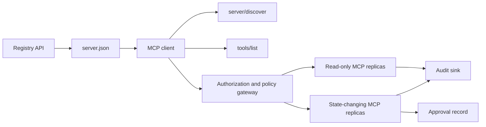

# Capstone 13：具備 Registry 與治理機制的 Stateless MCP Server

> 正式環境的 MCP 不只是一個 server 行程。它是一串契約：可發佈的 metadata、即時探索、stateless 請求信封、授權、政策、稽核，以及部署證據。

**Type:** Capstone
**Languages:** Python and TypeScript reference models; any production language
**Prerequisites:** Phase 11, Phase 13, Phase 14, Phase 17, and Phase 18
**Required MCP deep dives:** [課程 28：Tool Contracts](../../../13-tools-and-protocols/28-mcp-tool-contracts-and-content/docs/en.md)、[課程 29：Reliability](../../../13-tools-and-protocols/29-mcp-reliability-cancellation-and-flow-control/docs/en.md)、[課程 30：Registry Supply Chain](../../../13-tools-and-protocols/30-mcp-registry-supply-chain-and-drift/docs/en.md)，以及 [課程 31：Conformance Operations](../../../13-tools-and-protocols/31-mcp-conformance-versioning-and-operations/docs/en.md)
**Protocol target:** MCP `2026-07-28`
**Time:** ~25 小時

## 學習目標 (Learning Objectives)

- 實作 stateless MCP 的請求與結果信封。
- 讓 Registry metadata 與即時的協定探索保持分離。
- 建立確定性、具快取意識的工具探索。
- 對每次工具呼叫強制檢查 issuer、audience、scope 與核准政策。
- 在沒有 session affinity 的情況下部署 Streamable HTTP。
- 在 wire、授權、政策、registry 與稽核邊界上證明行為正確。

## 必要的 MCP 前置路徑 (Required MCP Prerequisite Path)

在把這個 capstone 視為可上線之前，請依序完成四個連結的 Phase 13 課程：

1. [課程 28](../../../13-tools-and-protocols/28-mcp-tool-contracts-and-content/docs/en.md) 定義這個 server 必須對外提供的 tool、schema、content、分頁、completion、路由與錯誤契約。
2. [課程 29](../../../13-tools-and-protocols/29-mcp-reliability-cancellation-and-flow-control/docs/en.md) 定義取消的競爭條件、deadline、idempotency、backpressure、retry 與重新連線的行為。
3. [課程 30](../../../13-tools-and-protocols/30-mcp-registry-supply-chain-and-drift/docs/en.md) 定義 namespace、來源證明 (provenance)、admission pin、Registry 狀態、drift、ledger 與 rollback 證據。
4. [課程 31](../../../13-tools-and-protocols/31-mcp-conformance-versioning-and-operations/docs/en.md) 定義 golden 與 negative transcript、嚴格的版本時期、SDK 差異檢查、proxy 證明、遮蔽 (redaction)、健康檢查與發佈關卡。

這個 capstone 整合了這些產出物。它不會用單一個 happy-path 的 SDK 測試來取代它們。

## 問題 (The Problem)

一個內部平台需要唯讀的資料工具，以及少數會改變狀態的工具。開發者必須能探索 server、了解如何連線、檢視它的即時能力，並且只呼叫自己有權使用的操作。

困難的部分不是註冊一個函式。困難的部分是讓六個不同的「真相」保持一致：

1. `server.json` 說明 server 可以在哪裡安裝或連線。
2. `server/discover` 說明即時行程目前支援什麼。
3. 每個請求都說明它使用哪個協定版本與哪些 client 能力。
4. 授權把呼叫者綁定到正確的 issuer、resource 與 scope。
5. 政策決定這個特定動作是否可以執行。
6. 稽核證據記錄越過邊界的內容，同時不洩漏 secret 或敏感 payload。

這六項只要有一項 drift，平台就可能列出一個連不上的 server、把請求路由給不相容的 client、接受為另一個 resource 簽發的 token，或是在沒有預期審查的情況下暴露破壞性動作。

## 兩層探索 (The Two Discovery Layers)

Registry 與即時的 MCP server 回答的是不同的問題。

| 層級 | 契約 | 它回答的問題 |
|---|---|---|
| 發佈 (Publication) | `server.json` 與 Registry API | 這個 server 是什麼、它的 package 或遠端 endpoint 在哪裡、如何設定？ |
| 執行期 (Runtime) | `server/discover` | 這個行程支援哪些協定版本、能力、extension 與 server 身分？ |

官方 Registry 使用有版本的 `server.json` schema。遠端項目可以指定 Streamable HTTP URL：

```json
{
  "$schema": "https://static.modelcontextprotocol.io/schemas/2025-12-11/server.schema.json",
  "name": "com.example/internal-readonly",
  "title": "Internal Read-Only Tools",
  "description": "Read-only incident and data lookup tools.",
  "version": "1.0.0",
  "remotes": [
    {
      "type": "streamable-http",
      "url": "https://mcp.internal.example.com/readonly"
    }
  ]
}
```

Registry schema 版本與 MCP 協定版本彼此獨立。不要為了配合一方而改寫另一方的日期。要用各自的契約分別驗證每份文件。

Schema 有效並不代表 namespace 的所有權成立。為 `example.com` 驗證過的發佈者，使用反向 DNS namespace `com.example/*` 或其子 namespace。這份所有權由 Registry 的驗證流程證明。若把網域標籤維持原本的順序，則指的是另一個 namespace。

stdlib 模型中的 `validate_registry_document` 函式刻意只做部分遠端設定檔 (remote-profile) 的驗證。它檢查官方必填的 `name`、`description` 和 `version` 欄位；選填的 `title`；已發佈名稱與長度限制；具體版本的格式；以及每個 `streamable-http` 或 `sse` 遠端的 HTTP(S) URL 格式。它另外要求 `remotes` 清單不得為空，因為這個 capstone 一律會對遠端做即時探測。`validate_publisher_namespace` 另外檢查名稱是否符合已驗證發佈者的網域，而 `validate_runtime_alignment` 則比對發佈的名稱與版本和即時的 `serverInfo`。官方 schema 也支援僅含 package 的記錄與更多遠端欄位。發佈前，請用固定版本的官方 JSON Schema 或 `mcp-publisher` 驗證整份文件；不要把這個無相依套件的子集呈現成完整的 schema 驗證。

Server 必須實作 `server/discover`；client 可以在呼叫其他方法之前先呼叫它。這個 capstone 的 client 會在解析完 endpoint 之後這麼做，並取得目前的協定版本與即時能力：

```json
{
  "resultType": "complete",
  "supportedVersions": ["2026-07-28"],
  "capabilities": {
    "tools": {
      "listChanged": false
    }
  },
  "_meta": {
    "io.modelcontextprotocol/serverInfo": {
      "name": "com.example/internal-readonly",
      "version": "1.0.0"
    }
  },
  "ttlMs": 3600000,
  "cacheScope": "public"
}
```

私有目錄可以索引額外的所有權、審查或生命週期資料，但不得把這些資料捏造成 MCP wire 欄位或根層級的 `server.json` 欄位。把組織政策存放在已發佈記錄的旁邊。當必須公開自訂 metadata 時，使用 Registry 的 `_meta.io.modelcontextprotocol.registry/publisher-provided` 擴充，並維持在 4 KB 的限制內。

## Stateless MCP 核心 (Stateless MCP Core)

MCP 版本 `2026-07-28` 移除了協定 session 與 `initialize` / `notifications/initialized` 握手。它也移除了 `Mcp-Session-Id`。

每個請求都在 `params._meta` 中攜帶協定 context：

```json
{
  "io.modelcontextprotocol/protocolVersion": "2026-07-28",
  "io.modelcontextprotocol/clientCapabilities": {},
  "io.modelcontextprotocol/clientInfo": {
    "name": "internal-platform-client",
    "version": "1.0.0"
  }
}
```

版本與能力是請求層級的事實，不是連線層級的事實。Load balancer 可以把連續的請求送到不同的健康副本，因為任何一個副本都能單憑訊息本身驗證請求。

一般結果包含 `resultType: "complete"`。Server 應該在每個結果的 `_meta.io.modelcontextprotocol/serverInfo` 中放入自己的身分。缺少協定版本，或版本不是字串，屬於無效參數 `-32602`。錯誤 `-32022` 只用於「提供了字串但不被支援」的情況，其 data 必須恰為 `{"supported": ["2026-07-28"], "requested": "..."}`。

### 可快取的探索 (Cacheable discovery)

對相同的有效工具集合，`tools/list` 必須是確定性的。結果包含：

- `ttlMs`，給 client 的新鮮度提示；
- `cacheScope`，值為 `public` 或 `private`；
- 穩定的工具順序，讓相同的清單可以重用 prompt cache；
- `resultType: "complete"` 與 server 身分 metadata。

依使用者而異的授權通常應該產生 `cacheScope: "private"`。不要把依使用者而異的工具可見性放在共用的 public cache 後面。

## Streamable HTTP

網路 server 對外提供一個接受 POST 的 MCP endpoint。每個 JSON-RPC 請求或通知都使用自己的 POST。

對於請求，server 回傳單一 JSON 物件，或是限定於該請求的 SSE 串流。長時間存活的 `subscriptions/listen` 請求負責攜帶使用者選擇接收的變更通知。目前的傳輸中沒有獨立的 GET 串流、session DELETE、session header 或 `Last-Event-ID` 重播。

每個請求包含：

- `MCP-Protocol-Version`，與 body 中的 metadata 一致；
- `Mcp-Method`，與 JSON-RPC 方法一致；
- `Mcp-Name`，用於 `tools/call`、`resources/read` 和 `prompts/get`；
- `Accept: application/json, text/event-stream`。

以規格指定的 `-32020` 錯誤拒絕鏡射 header 不一致的請求。驗證 `Origin`，把本機開發 server 綁定到 loopback，對遠端 client 做身分驗證，並把關閉的請求範圍 SSE 回應視為取消。



```figure
cf-mcp-gate
```

## 授權與政策 (Authorization and Policy)

傳輸層的 metadata 不是授權。每次呼叫都要驗證授權。

對遠端 server：

1. 探索 protected-resource metadata。
2. 為該 resource 選擇授權 server。
3. client 註冊時優先使用 Client ID Metadata Documents。將 Dynamic Client Registration 視為相容性支援。
4. 授權期間送出 resource indicator。
5. 把回傳的 `iss` 值與該流程所記錄的授權 server 比對驗證。
6. 以 issuer 作為 key 保存 client 憑證。絕不跨 issuer 重用註冊資料。
7. 在 MCP server 驗證 token 的 issuer、audience 或 resource、到期時間與 scope。
8. 對具體的工具與參數再套用第二次政策決定。

`readOnlyHint` 與 `destructiveHint` 這類 tool annotation 有助於 client 呈現風險。它們不是可信任的授權控制。

### 核准是一筆記錄，不是神奇的 scope (Approval is a record, not a magic scope)

改變狀態的呼叫需要一筆核准記錄，綁定到 actor、工具、正規化後的參數或其摘要、目標環境、到期時間，以及一次性或可重複使用的政策。單靠一則聊天訊息不能證明已核准。

Python 模型把以 key 排序的標準 JSON 做雜湊，然後把該摘要與 token subject、工具名稱、server URL 和到期時間綁在一起。只要改動任何一個參數，重播這筆記錄就會在 handler 執行前失敗。核准是獨立的證據，不是加在 access token 上的 scope。

當能實質縮小影響範圍時，把高風險工具放在可獨立審查的介面上。只有在憑證、政策、部署身分與稽核控制也一併分離時，這種分離才有用。

## 動手做 (Build It)

### 1. 為發佈 metadata 建模

建立並以 schema 驗證 `server.json`。包含在該發佈者已驗證 namespace 內的穩定名稱，加上版本、描述、適用時的官方 `repository` 或 `packages` metadata，以及遠端或 stdio 傳輸。把 secret 宣告為環境變數輸入，絕不寫成字面值。

### 2. 實作即時探索

在任何功能性 RPC 之前先實作 `server/discover`。公告支援的協定版本、能力、extension 與 server 身分。加入一個使用 `-32022` 的版本拒絕案例。

### 3. 實作 stateless 信封

要求每個請求都帶有協定版本與 client 能力。每個結果都回傳 `resultType` 與 server 身分。移除初始化狀態、連線範圍的能力快取，以及 session 識別碼。

### 4. 建立工具介面

從兩個唯讀工具與一個會改變狀態的工具開始。為每個工具提供有界限的 JSON Schema、精確的描述、確定性的結果形狀，以及誠實的 annotation。當 client 依賴結構化結果時，加入 output schema。

### 5. 加入具快取意識的列表

以穩定的順序回傳工具，附上 `ttlMs` 與 `cacheScope`。分別測試快取到期與列表變更通知的行為。

### 6. 加入授權與政策

驗證 issuer、audience、到期時間與 scope。對每次工具呼叫執行政策決定。把核准綁定到確切的高風險動作。在執行 handler 之前，拒絕缺少或過期的核准。

### 7. 分離 registry 與執行期的驗證

驗證靜態的 `server.json` 記錄，然後用 `server/discover` 探測遠端 endpoint。當已發佈的遠端、身分、版本或必要能力與即時行程不一致時，回報 drift。

### 8. 加入稽核證據

記錄 actor、issuer、resource、工具、政策決定、請求識別碼、trace context、延遲與結果。在持久化之前，遮蔽或雜湊敏感的參數與結果。讓稽核 sink 位於模型可見的 context 之外。

### 9. 測試水平擴展

在 load balancer 後面放兩個 stateless 副本。送出至少 100 個並行請求。證明正確性不依賴 affinity。如果工具需要跨呼叫的狀態，就產生明確的不透明 handle，並存放在共用的持久化系統中。

### 10. 跨越真實的 wire

對實際的 server 二進位檔執行 conformance 檢查。擷取請求 header 與 JSON body，而不只是 SDK 物件。測試錯誤版本、header 不一致、缺少 scope、錯誤的 audience、格式錯誤的參數、handler 失敗、取消與快取到期。

## 必要的證據包 (Required Evidence Pack)

一份提交要包含全部五類證據才算完整：

| 證據 | 最低證明 | 來源課程 |
|---|---|---|
| Wire | golden 與 negative 案例的已遮蔽原始 header 與 JSON-RPC body，包括 metadata 型別失敗、header 不一致、不支援的版本、缺少或未知的 `resultType`、通知無回應，以及 response ID 比對 | [課程 31](../../../13-tools-and-protocols/31-mcp-conformance-versioning-and-operations/docs/en.md) |
| Proxy | 同一個穩定案例，直接執行與經由已部署的中介層各跑一次，附上 ingress、origin 與 egress 的狀態及 body 摘要；證明協定錯誤沒有被壓成一般的 500 回應，且串流沒有被緩衝 | [課程 29](../../../13-tools-and-protocols/29-mcp-reliability-cancellation-and-flow-control/docs/en.md) 與 [31](../../../13-tools-and-protocols/31-mcp-conformance-versioning-and-operations/docs/en.md) |
| Admission | 已驗證的發佈者 namespace、不可變的 Registry 記錄摘要、產出物或遠端的來源證明、即時 `server/discover` 的身分與能力觀察、descriptor pin、目前的 Registry 狀態，以及 admission-ledger 事件 | [課程 30](../../../13-tools-and-protocols/30-mcp-registry-supply-chain-and-drift/docs/en.md) |
| Retry | 取消與完成的競爭條件、明確的 timeout、安全的讀取 retry、變更操作的 idempotency key、重新連線後重新取得資料，以及請求取消無法悄悄變成持久任務取消的證明 | [課程 29](../../../13-tools-and-protocols/29-mcp-reliability-cancellation-and-flow-control/docs/en.md) |
| Rollback | 確切的前一版本、admission 與產出物摘要、descriptor pin、有效的 Registry 狀態、目前的健康視窗、路由還原結果，以及已遮蔽的決策證據 | [課程 30](../../../13-tools-and-protocols/30-mcp-registry-supply-chain-and-drift/docs/en.md) 與 [31](../../../13-tools-and-protocols/31-mcp-conformance-versioning-and-operations/docs/en.md) |

隨發佈保存已遮蔽證據包的摘要。只要缺少任何一類，就暫停發佈。不要從行程內的 dispatcher 推論 proxy 行為、不要從 Registry 中存在就推論 admission、不要從新的 JSON-RPC id 推論 retry 是安全的，也不要從「前一個部署」推論 rollback 已就緒。

## 本機參考模型 (Local Reference Models)

Python 模型示範了 registry metadata、反向 DNS 發佈者 namespace 驗證、發佈到執行期的身分檢查、即時探索、確定性的工具列表、每個請求的 metadata、受信任的 issuer、audience、到期時間與 scope 檢查、與動作綁定的核准、有文件說明的部分 Registry 驗證器、政策與稽核，而且完全不開啟網路 socket：

```bash
cd phases/19-capstone-projects/13-mcp-server-with-registry
python3 code/main.py
python3 -m unittest discover -s code/tests -v
```

TypeScript 專案在不使用 MCP SDK 的情況下，透過 stdio 提供 stateless JSON-RPC 形狀。它的 `tools/call` 路徑強制執行與 `tools/list` 所公告相同的有界限輸入 schema；對已知工具傳入無效參數時，會回傳帶有 `isError: true` 的完整結果，且不會呼叫 executor：

```bash
cd phases/19-capstone-projects/13-mcp-server-with-registry/code/ts
npm install
npm run typecheck
npm test
npm run demo
```

這些模型證明的是本機契約邏輯。它們不能證明 HTTP header、OAuth 交換、Registry 發佈、OPA 整合、負載平衡，或 collector 收據。

## Wire 範例 (Wire Example)

```http
POST /mcp HTTP/1.1
Host: mcp.internal.example.com
Content-Type: application/json
Accept: application/json, text/event-stream
MCP-Protocol-Version: 2026-07-28
Mcp-Method: tools/call
Mcp-Name: postgres.readonly
Authorization: Bearer REDACTED

{
  "jsonrpc": "2.0",
  "id": 42,
  "method": "tools/call",
  "params": {
    "name": "postgres.readonly",
    "arguments": {"sql": "SELECT 1"},
    "_meta": {
      "io.modelcontextprotocol/protocolVersion": "2026-07-28",
      "io.modelcontextprotocol/clientCapabilities": {},
      "io.modelcontextprotocol/clientInfo": {
        "name": "internal-platform-client",
        "version": "1.0.0"
      }
    }
  }
}
```

## 交付 (Ship It)

交付一個包含以下內容的 repository：

- 通過 schema 驗證的 `server.json`；
- 唯讀與會改變狀態的 server 介面；
- `server/discover`、確定性的 `tools/list`，以及由政策把關的 `tools/call`；
- 具備兩個可互換副本的 Streamable HTTP 部署；
- 授權與核准整合；
- Registry 發佈工具，或私有 Registry API 轉接器；
- 政策定義與綁定動作的核准記錄；
- 已遮蔽的稽核輸出與 trace 傳遞；
- wire 與 proxy 失敗證據；
- admission、retry、健康與 rollback 證據，並附上已遮蔽證據包的摘要。

| 權重 | 評分項目 | 證據 |
|---:|---|---|
| 25 | 協定正確性 | Stateless 請求 metadata、探索、結果、header 與 negative 案例 |
| 20 | 授權 | Issuer、audience、到期時間、scope 與綁定動作的核准案例 |
| 15 | Registry 完整性 | 有效的 `server.json`、發佈記錄、即時探索探測與 drift 報告 |
| 15 | 政策與安全 | 允許、拒絕、格式錯誤、核准過期與敏感資料的案例 |
| 15 | 規模與可靠性 | 兩個副本、不依賴 affinity、取消、timeout 與復原 |
| 10 | 可稽核性 | 接收端已遮蔽的稽核與 trace 證據 |

## 練習 (Exercises)

1. 改變已發佈的遠端 URL，同時讓即時 server 保持不變。讓 registry 驗證回報確切的 drift。
2. 以相同輸入送出兩次 `tools/list`，並證明工具順序在 byte 層級穩定。然後讓 `ttlMs` 過期並重新整理。
3. 送出一個 body 有效、但 `MCP-Protocol-Version` header 不同的請求。回傳 `-32020`，並且不要呼叫政策或工具。
4. 為唯讀 server 簽發一個 token，並把它出示給會改變狀態的 server。證明 audience 驗證在 handler 執行前就失敗。
5. 把核准綁定到一個正規化的參數摘要。改動一個欄位，並證明該核准無法被重播。
6. 把連續的呼叫輪流路由到不同副本。凡是工作流程需要持久化的地方，都把隱藏的行程記憶體換成明確的共用 handle。
7. 中斷一個請求範圍的 SSE 連線，並以新的 JSON-RPC 請求 ID 重試。驗證沒有使用任何 `Last-Event-ID` 復原路徑。

## 關鍵術語 (Key Terms)

| 術語 | 一般說法 | 實際意義 |
|---|---|---|
| Stateless MCP | 「完全沒有狀態」 | 沒有協定 session；跨呼叫的狀態是明確的，且由 server 管理 |
| `server.json` | 「工具清單」 | 用於命名、封裝、設定與傳輸的 Registry metadata |
| `server/discover` | 「握手」 | 針對即時版本與能力、一般且必備的 RPC，不是 session 初始化器 |
| Cache scope | 「我能快取嗎？」 | 可快取的結果是否能安全地共用或僅限私有重用 |
| Policy decision | 「token 允許就好」 | 針對 actor、工具、目標、參數與 context 的獨立決定 |
| Approval record | 「有人按了同意」 | 在到期政策下，綁定到單一 actor 與重大動作的證據 |
| Explicit handle | 「Session ID」 | 用於具名、由 server 管理狀態的一般應用程式資料，不是協定連線狀態 |

## 延伸閱讀 (Further Reading)

- [MCP 2026-07-28 key changes](https://modelcontextprotocol.io/specification/2026-07-28/changelog)
- [Streamable HTTP](https://modelcontextprotocol.io/specification/2026-07-28/basic/transports/streamable-http)
- [Server discovery](https://modelcontextprotocol.io/specification/2026-07-28/server/discover)
- [MCP authorization](https://modelcontextprotocol.io/specification/2026-07-28/basic/authorization)
- [Official Registry server.json requirements](https://github.com/modelcontextprotocol/registry/blob/main/docs/reference/server-json/official-registry-requirements.md)
- [Official Registry OpenAPI contract](https://registry.modelcontextprotocol.io/openapi.yaml)
