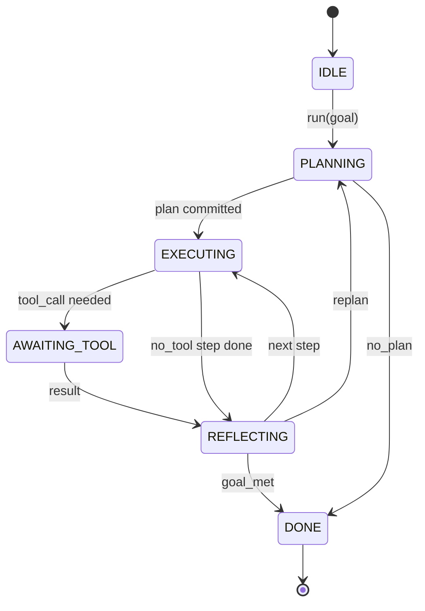

# Agent Harness 迴圈契約 (Agent Harness Loop Contract)

> Harness 才是 agent。模型只是協同處理器。這堂課把迴圈契約固定下來，讓你能把任何模型接上去。

**Type:** Build
**Languages:** Python
**Prerequisites:** Phase 13 lessons 01-07, Phase 14 lesson 01
**Time:** ~90 分鐘

## 學習目標 (Learning Objectives)
- 把 agent harness 迴圈定義成確定性的 state machine，轉移都是明確的。
- 實作十個生命週期 hook 主題，讓操作者把政策、遙測與護欄接進去。
- 定義兩個 pull point，迴圈在這裡把控制權交回呼叫端，並在收到新輸入時繼續。
- 強制執行每個 session 的預算 (回合數、工具呼叫次數、牆鐘時間)，超出時不會洩漏部分狀態。
- 輸出十一種型別的事件串流，讓下游 UI 與 tracer 不必檢查迴圈本身就能訂閱。

```figure
cf-loop-contract
```

## 框架 (The frame)

一個無人看管、連續跑四十回合的 coding agent，不是聊天迴圈。它是一個 state machine，操作者可以攔截它的節點，也可以稽核它的邊。一旦把契約寫下來，更換模型、工具或政策就不再是重構，而是一次註冊呼叫。

這堂課要建立那份契約。我們命名六個狀態、十個 hook 主題、兩個 pull point、十一種事件類型，以及一個預算信封。Harness 的其他部分 (工具註冊表、JSON-RPC 傳輸、dispatcher、planner) 都接在這個形狀上。

## 狀態 (The states)

迴圈有六個狀態。五個是活動狀態，一個是終止狀態。



`IDLE` 是唯一合法的進入點。`DONE` 是唯一合法的出口。`AWAITING_TOOL` 是唯一自己就會產生 pull point 的狀態。第二個 pull point `on_pause` 不是狀態：預算用完或 hook 要求審查時，它會從任何活動狀態觸發。其他所有轉移都是內部的。

這個 state machine 是確定性的。給定相同的事件日誌，harness 會重新進入相同的狀態。這個特性讓你能重播 session 來除錯，而不必再次呼叫模型。

## Hook 主題 (The hook topics)

Hook 是操作者切入迴圈的接縫。Harness 觸發十個主題。每個主題可接受任意數量的訂閱者。訂閱者依註冊順序觸發。訂閱者可以修改 payload、拋出例外中止該回合，或回傳 sentinel 來跳過下一步。

```text
before_plan         after_plan
before_tool_call    after_tool_call
before_step         after_step
on_error
on_pause
on_budget_exceeded
on_complete
```

這個形狀反映了 Claude Code、Cursor 和 OpenCode 在 2025 年中都收斂到的做法。名稱是功能性的，不是品牌。阻擋 `rm -rf` 的 hook 放在 `before_tool_call`。送出 OpenTelemetry span 的 hook 放在 `after_step`。在暫停的 session 上恢復的 hook 放在 `on_pause`。

## Pull point (The pull points)

迴圈兩次交出控制權。第一次是在 `AWAITING_TOOL`，當它沒有工具結果就無法繼續時。第二次是在 `on_pause`，當預算耗盡，或 hook 明確要求人工審查時。

Pull point 不是例外，而是一次 return。呼叫端檢查 harness 狀態、取得 harness 要求的東西，然後呼叫 `resume(payload)`。Harness 從停下的地方繼續。這跟 Python generator 的形狀一樣。Pull point 上的傳輸由你選擇。在 TUI 中是按鍵。透過 MCP 是 `tools/call`。透過佇列則是 job 輪詢。

## 事件串流 (The event stream)

迴圈在契約的特定位置，把事件附加到有型別的串流。串流是僅追加的，訂閱者可以從任何偏移量重播。實作了的十一種事件類型是：

- `session.start` — 呼叫 `run(goal)` 時發出一次
- `plan.draft` — planner 回傳草稿計畫時發出
- `plan.commit` — 草稿被提交為使用中的計畫後發出
- `step.start` — 每個執行中步驟開始時發出
- `step.end` — 每個執行中步驟結束時發出
- `tool.call` — 需要工具的步驟把控制權交給呼叫端時發出
- `tool.result` — 帶著工具結果恢復時發出
- `tool.error` — 帶著錯誤恢復，或 hook 中止該呼叫時發出
- `budget.warn` — 達到預算限制時發出
- `session.pause` — 迴圈因暫停 (預算或 hook) 而交出控制時發出
- `session.complete` — 迴圈到達 `DONE` 時發出一次

事件不重複 hook 的 payload。Hook 是命令式的 (修改、中止)。事件是觀察式的 (記錄、送出)。把它們視為正交的。

## 預算信封 (The budget envelope)

一個 session 帶有三個限制：回合數、工具呼叫次數、牆鐘秒數。每一回合讓回合數加一。每次工具呼叫讓工具呼叫次數加一。牆鐘時間在每次狀態轉移時檢查。任何限制被達到時，迴圈會觸發 `on_budget_exceeded`、發出 `budget.warn`，然後在下一個 pull point 帶著預算超出的原因轉移到 `IDLE`。

預算不是 kill switch，而是一次讓出控制權。呼叫端決定要延長預算並繼續，還是關閉 session。

## 這堂課沒有做的事 (What this lesson does not do)

它不呼叫模型。它不註冊真實的工具。它不實作傳輸。那些是接下來四堂課的內容。這堂課釘住契約，讓接下來四堂課可以接上，而不必重寫。

`main.py` 中確定性的 planner 只是替身。它回傳寫死的三步驟計畫，其中兩步需要工具結果。重點是迴圈，不是計畫。

## 如何閱讀程式碼 (How to read the code)

`HarnessLoop` 是主要的類別。它持有狀態、觸發 hook、發出事件。`Budget` 追蹤限制。`Event` 是串流上有型別的信封。`HookRegistry` 是分派表。`_transition` 是唯一會改變狀態的函式，所以 state machine 的不變條件都集中在一個地方。

由上到下閱讀 `main.py`。然後閱讀 `code/tests/test_loop.py`。測試固定了每一個轉移與每一個 hook 的觸發順序。

## 延伸 (Going further)

在正式環境中建構 harness，最困難的部分不是 state machine，而是讓契約可以被強制執行。契約必須撐得過 planner 的熱重載。必須撐得過回傳格式錯誤 JSON 的工具。必須撐得過在四十回合 session 走到三分之二時，於 `before_tool_call` 中拋出例外的 hook。這堂課的測試會演練這些失敗模式。去執行它們、弄壞它們、再加新案例。

下一堂課加入工具註冊表。再下一堂是 JSON-RPC 傳輸。接著是 dispatcher。到第二十四課時，這個檔案中的迴圈就會對真實的工具執行真實的計畫，並強制執行真實的預算。
