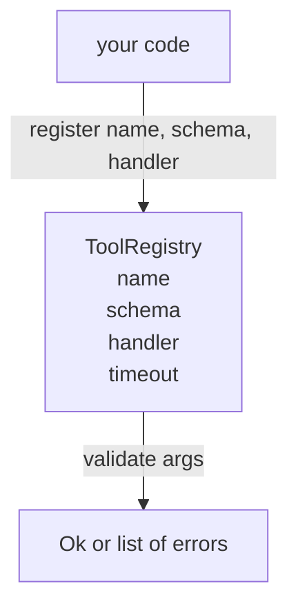

# 具備 Schema 驗證的工具註冊表 (Tool Registry with Schema Validation)

> Agent 無法驗證的工具，就是 agent 無法呼叫的工具。先建立註冊表與 schema 檢查器，再建立工具。

**Type:** Build
**Languages:** Python
**Prerequisites:** Phase 13 lessons 01-07, Phase 14 lesson 01
**Time:** ~90 分鐘

## 學習目標 (Learning Objectives)
- 維護一份有型別的註冊表：工具名稱 → schema → handler，讓 dispatcher 問一次就能信任。
- 實作 JSON Schema 2020-12 的子集，涵蓋九成工具呼叫實際會用到的關鍵字。
- 回傳精確、json-pointer 形式的錯誤路徑，讓模型一個來回就能自我修正。
- 沒有明確 override 就拒絕重新註冊，因為悄悄覆寫正是正式環境工具目錄漂移的原因。
- 保持驗證器為純函式 (無 I/O、無時間、無全域變數)，讓它能在重播日誌上重新執行。

```figure
cf-registry-validate
```

## 為什麼註冊表要先於工具 (Why the registry comes before the tool)

2026 年的 coding agent 註冊的工具，多到模型的單一 context window 放不下。一個不簡單的 harness 會註冊兩百個工具，並在任何一回合只呈現十到四十個。註冊表是「有哪些工具」、「它們的參數是什麼形狀」、「該呼叫哪個 handler」的唯一真相來源。這三個答案一旦釘住，harness 其他部分就不必再猜。

我們要避免的錯誤，是發佈沒有 schema 的 handler，或是發佈沒有驗證的 schema。兩者都很常見。兩者都會讓下一層 (第二十三課的 dispatcher) 變成猜謎遊戲，唯一的失敗模式就是 handler 丟出來的 stack trace。

## 工具記錄長什麼樣 (What a tool record looks like)

```text
ToolRecord
  name        : str          (unique, lowercase alphanumeric and underscore segments separated by dots, e.g., snake_case.segment.case)
  description : str          (one line, shown to the model)
  schema      : dict         (JSON Schema 2020-12 subset)
  handler     : Callable     (async or sync, returns Any)
  idempotent  : bool         (dispatcher uses this for retry decisions)
  timeout_ms  : int          (override per-tool dispatcher default)
```

Schema 是驗證器唯一會碰的欄位。Handler 對它而言是不透明的。我們刻意把它們分開。Schema 是資料，handler 是程式碼。把它們混在一起，會誘使你把驗證邏輯放進 handler，那正是我們要阻止的 bug。

## JSON Schema 2020-12 子集 (The JSON Schema 2020-12 subset)

完整的 2020-12 規格是一篇論文。我們只需要八個關鍵字。

```text
type           string / number / integer / boolean / object / array / null
properties     map of property name -> schema
required       list of property names
enum           list of allowed primitive values
minLength      integer, applies to strings
maxLength      integer, applies to strings
pattern        ECMA-262-compatible regex, applies to strings
items          schema applied to every array element
```

這足以涵蓋工具 API 實際所需。我們不加入的關鍵字 (oneOf、anyOf、allOf、$ref、conditionals) 在正式 schema 中是有效的，但會讓驗證器變成帶有循環的樹走訪器。我們是在建構註冊表，不是 JSON Schema 引擎。

## Json pointer 錯誤路徑 (Json pointer error paths)

驗證失敗時，驗證器回傳錯誤清單。每個錯誤都帶有指向輸入的 json-pointer 路徑。Pointer 是由斜線開頭、由屬性名稱與陣列索引組成的序列。

```text
{"a": {"b": [1, 2, "x"]}}
                    ^
                    /a/b/2
```

模型讀錯誤路徑，比讀句子更好。如果 schema 要求 `args.user.email`，而模型傳了整數，錯誤應該是 `/user/email`，帶 `expected_type: string`。模型在下一次呼叫就會修正，不需要一輪自然語言往返。

## 註冊與 override (Registration and override)

`register(name, schema, handler, **opts)` 預設拒絕重新註冊。呼叫端必須傳入 `override=True` 才能取代。這是營運上的衛生習慣。程式碼庫的兩個部分悄悄註冊相同的工具名稱，是那種在正式環境要花一週才找得到的 bug。

註冊表提供三個讀取方法。`get(name)` 回傳記錄，否則拋出例外。`validate(name, args)` 回傳 `Ok` 或錯誤清單。`names()` 依註冊順序回傳工具名稱。

## 驗證器是什麼、不是什麼 (What the validator is and is not)

它是對 schema 樹的單次遞迴走訪。它是純函式。它不呼叫 handler。它不強制轉型 (字串 `"42"` 無法通過 number schema)。它不會悄悄截斷。

它不是安全邊界。惡意的 handler 在驗證通過後仍然可能作怪。第二十三課的 dispatcher 加入 timeout 和 sandbox 層。註冊表加的是形狀。

## 形狀 (Shape)



## 如何閱讀程式碼 (How to read the code)

`code/main.py` 定義了 `ToolRegistry`、`ToolRecord`、`ValidationError`，以及八個驗證器函式。驗證器依 `schema["type"]` 分派 (或把帶有 `enum` 的 schema 視為無型別的 enum 檢查)。每個型別驗證器回傳空清單或 `ValidationError` 清單。頂層走訪器串接錯誤，並在往下走時於前面加上路徑片段。

`code/tests/test_registry.py` 涵蓋註冊、override、驗證成功、帶路徑的驗證失敗，以及子集中的每個關鍵字。

## 延伸 (Going further)

這堂課完成後，你會想要的兩個擴充是：針對本地 definitions 區塊的 `$ref` 解析，以及用於嚴格形狀的 `additionalProperties: false`。兩者都很小。隨著工具目錄超過五十個工具，兩者也都常被加入。我們把它們留在課外，讓檔案維持在一次能讀完的長度。

下一課 (第二十二課) 建立 JSON-RPC stdio 傳輸，把這個註冊表呈現給模型 client。再下一課 (第二十三課) 則把兩者包在帶有 timeout 與 retry 的 dispatcher 後面。
