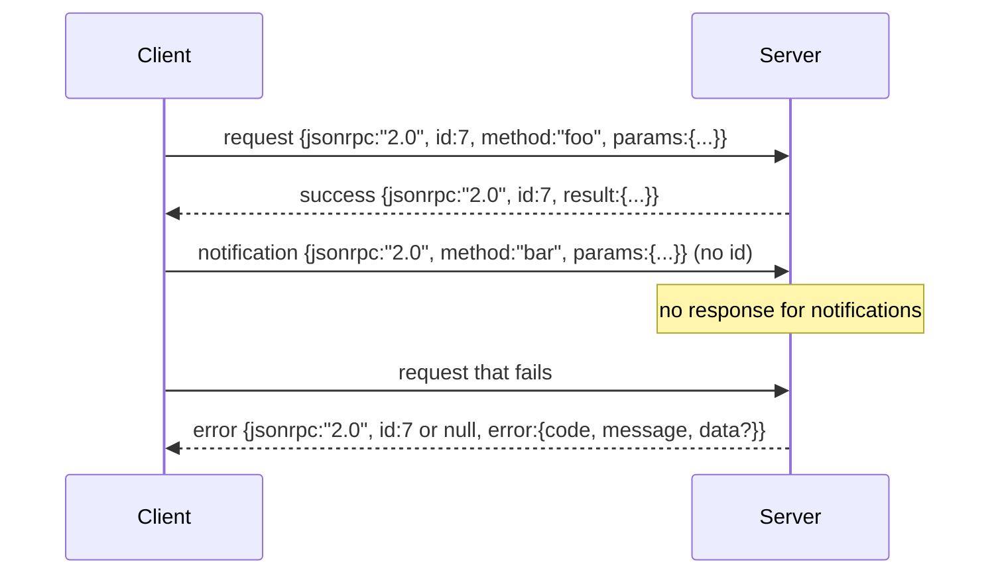

# 以換行分隔的 stdio 傳輸 JSON-RPC 2.0 (JSON-RPC 2.0 Over Newline-Delimited Stdio)

> 模型 client 與工具 server 之間的傳輸是 stdio 上的 JSON-RPC。自己動手做一次，你就會明白每一層 framing 付出了什麼代價。

**Type:** Build
**Languages:** Python
**Prerequisites:** Phase 13 lessons 01-07, Phase 14 lesson 01
**Time:** ~90 分鐘

## 學習目標 (Learning Objectives)
- 以換行分隔 JSON 的形式，在 stdin 與 stdout 上使用 JSON-RPC 2.0。
- 對應五個標準錯誤碼 (-32700、-32600、-32601、-32602、-32603)，並以正確的語意呈現。
- 區分 request、response、notification 與 batch，且不發明新的信封 key。
- 每行最多處理一個 parse error，不污染串流的其餘部分。
- 用 io.BytesIO 建立可自行結束的 demo，讓這堂課不必啟動子行程就能執行。

```figure
cf-jsonrpc-frames
```

## 為什麼 JSON-RPC 仍是通用語言 (Why JSON-RPC stays the lingua franca)

2026 年的 coding agent 在單一 session 中，可能和十二個工具 server 對話。每個 server 是獨立的行程或遠端 endpoint。自 2013 年以來，線上格式一直沒變。JSON-RPC 2.0 是只有兩頁的規格。它能存活，是因為其他替代方案 (gRPC、每次呼叫一次 HTTP、自訂二進位) 都有 JSON-RPC 沒有的取捨：它們要嘛選串流，要嘛選批次，要嘛綁定傳輸。JSON-RPC 在 stdio、socket、websocket 和 HTTP 之間是對稱的，只要雙方遵守規格，client 就能驅動從沒見過的 server。

這堂課建構 stdio 變體。以換行分隔的 JSON。每個 request 是一行。每個 response 是一行。傳輸邊界是 `\n`。

## 線上形狀 (The wire shape)

存在四種信封形狀。兩種由 client 說，兩種由 server 說。



Notification 沒有 `id`。Server 不得回應它。如果 server 對 notification 回傳 response，client 就無法把它附加到任何呼叫點。這一條規則讓 framing 的運算保持簡單。

Batch 是由 request 或 notification 組成的 JSON 陣列。Server 以 response 陣列回覆，順序不拘，每個非 notification 的項目對應一個。如果 batch 中每個項目都是 notification，server 就不回傳任何東西。

## 五個錯誤碼 (The five error codes)

```text
-32700  Parse error      JSON could not be parsed
-32600  Invalid Request  Envelope shape is wrong
-32601  Method not found
-32602  Invalid params
-32603  Internal error
```

-32000 到 -32099 之間的錯誤碼保留給 server 自訂的錯誤。其餘都是應用程式自訂。這堂課只用這五個。如果你的 handler 拋出例外，傳輸層會將它包成 -32603，並把例外類別名稱放在 `data.exception`。

Parse error 有一條特別的規則。Response 中的 `id` 是 `null`，因為 request 從未被解析到足以取出 id 的程度。

## 換行 framing 與 BytesIO demo (Newline framing and the BytesIO demo)

傳輸層一次讀一行。一行是直到並包含 `\n` 的位元組。如果某行無法解析，傳輸層會寫出 `id: null` 的 -32700 response 並繼續。串流沒有被污染。下一行會重新解析。

在這堂課中，我們把一對 `io.BytesIO` 包成 stdin 與 stdout。Server 讀取 request 直到 EOF，為每個寫出 response，然後返回。Client 把 response 讀回來。沒有啟動行程。沒有 timeout。傳輸行為與真實的子行程 pipe 完全相同，因為 Python 的 `io` 介面提供相同的 `.readline()` 與 `.write()` 契約。

## 方法分派 (Method dispatch)

傳輸層不知道有哪些方法存在。它把工作交給 harness 提供的可呼叫物件 `handler(method, params)`。Handler 回傳結果或拋出例外。三個例外類別對應到特定的錯誤碼。

```text
MethodNotFound -> -32601
InvalidParams  -> -32602
Anything else  -> -32603 with exception name in data
```

傳輸層從不接觸工具註冊表。註冊表位在 handler 後面。這就是我們想要的分層。傳輸層說 JSON-RPC。註冊表說工具形狀。Dispatcher (第二十三課) 把它們縫在一起。

## 錯誤時的串流行為 (Stream behavior on errors)

```text
client writes              server reads             server writes
---------------            -----------              -------------
{...valid request...}      parses ok                {...response, id matches...}
{...broken json...         parse fails              {id:null, error: -32700}
{...valid request...}      parses ok                {...response, id matches...}
{...missing method...}     invalid envelope         {id:X, error: -32600}
```

壞掉的 JSON 行不會讓迴圈停止。缺少 `method` 欄位不會讓迴圈停止。Handler 例外不會讓迴圈停止。傳輸層會持續讀取直到 EOF。

## Notification 與非對稱流程 (Notifications and asymmetric flows)

Notification 是發了就不管。Harness 用 notification 傳遞進度事件、取消訊號與日誌行。Notification 讓長時間執行的工具可以串流狀態更新，不必每一次都來回往返。

這堂課實作了一個對外送出 notification 的輔助函式 `write_notification`。Server 用它在 request 處理期間送出進度。Demo 展示這個模式：一個 request 進來，handler 送出兩個進度 notification，然後寫出最終的 response。

## 如何閱讀程式碼 (How to read the code)

`code/main.py` 定義了 `StdioTransport`、解析輔助函式 (`parse_request`)、三個寫入輔助函式 (`write_response`、`write_error`、`write_notification`)，以及分派迴圈 `serve`。錯誤碼常數放在模組層級。

`code/tests/test_transport.py` 涵蓋五個錯誤碼、notification (不寫出 response)、batch (進陣列、出陣列、跳過 notification)、壞掉的 JSON (先 parse error 然後繼續)，以及 handler 在呼叫中途寫出 notification 的非對稱流程。

## 延伸 (Going further)

這個傳輸對接下來的課程已經足夠。正式環境的傳輸會再加上三樣東西。一個在轉發時仍能保留的關聯 id 欄位 (你的 `id` 已經是這個，但在 mesh 中你還需要外層的 trace id)。一個取消通道 (像 `$/cancelRequest` 這樣的 notification，帶著進行中呼叫的 id)。以及 content-type 協商握手，讓同一個 socket 既能說 JSON-RPC 也能說 Streamable HTTP。這些都不會改變線上格式，它們只是增加 metadata。
