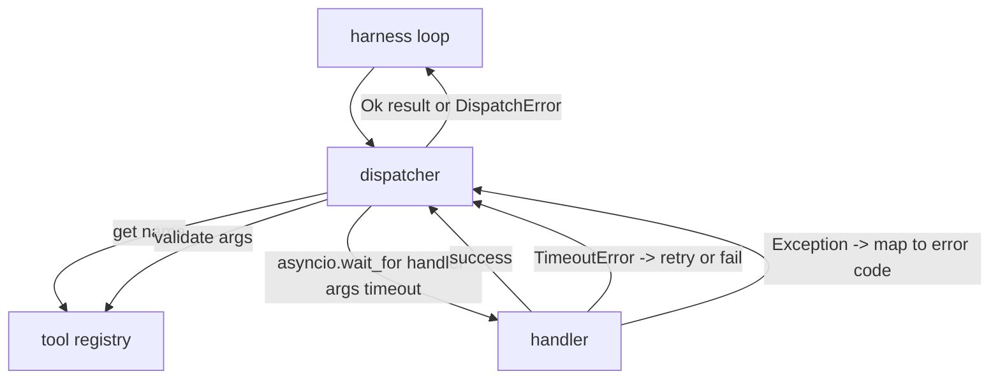
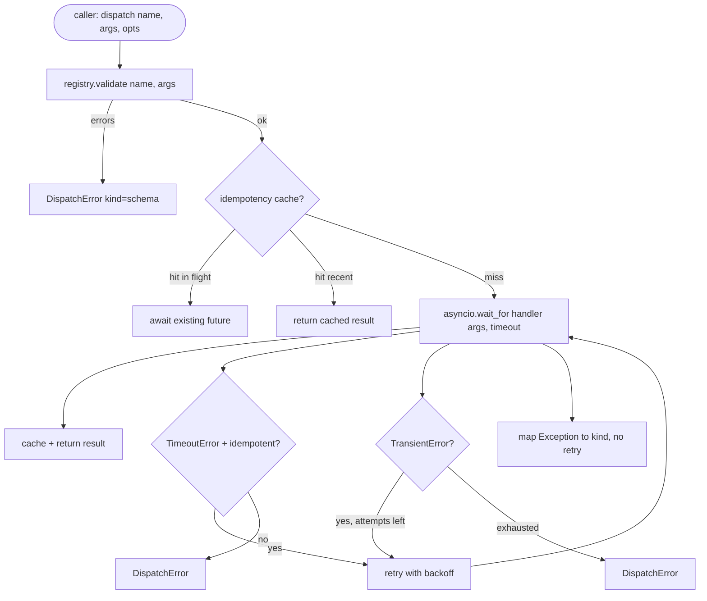

# 函式呼叫 Dispatcher (Function Call Dispatcher)

> Schema 做出的每一個承諾，都是在 dispatcher 這裡兌現。Timeout、retry、去重、錯誤對應，全都集中在同一道接縫上。

**Type:** Build
**Languages:** Python
**Prerequisites:** Phase 13 lessons 01-07, Phase 14 lesson 01
**Time:** ~90 分鐘

## 學習目標 (Learning Objectives)
- 用每次呼叫的 timeout 包住工具 handler，讓它回傳有型別的錯誤，而不是卡住迴圈。
- 套用帶有 jitter 與最大嘗試次數的指數退避 retry。
- 依 idempotency key 對 retry 去重，讓與緩慢的原始呼叫賽跑的 retry 不會執行兩次。
- 把 handler 例外與傳輸層故障對應到 harness 迴圈已經看得懂的單一錯誤信封。
- 以並行上限限制平行派送，讓四十個工具呼叫的 fan-out 不會耗盡事件迴圈。

```figure
cf-dispatch-retry
```

## Dispatcher 位於何處 (Where the dispatcher sits)

位於 harness 迴圈 (第二十課) 與工具註冊表 (第二十一課) 之間。傳輸層 (第二十二課) 餵給迴圈。迴圈把工具呼叫交給 dispatcher。Dispatcher 呼叫註冊表、執行 handler，並回傳結果或 JSON-RPC 形狀的錯誤信封。



Dispatcher 是唯一知道計時器、retry 與 idempotency 的層。迴圈不知道。註冊表不知道。Handler 也不知道。這種隔離正是重點。

## Timeout (Timeouts)

每個工具都有預設的 timeout。註冊表記錄帶有 `timeout_ms`。當 harness 傳入時，dispatcher 會用每次呼叫的覆寫值取代它。我們使用 `asyncio.wait_for`。Timeout 時，handler task 會被取消，dispatcher 回傳 `DispatchError(kind="timeout")`。

對非 idempotent 的工具而言，timeout 預設不是可 retry 的錯誤。逾時的 `db.write` 可能已經提交，也可能沒有。Retry 會讓寫入重複。Dispatcher 遵守註冊表記錄中的 `idempotent` 旗標。Idempotent 的工具會 retry。非 idempotent 的工具不會。

## 指數退避的 retry (Retries with exponential backoff)

Retry 策略最多三次嘗試。退避是指數式並帶 jitter。

```text
attempt 1  -> delay 0
attempt 2  -> delay 0.1s * (1 + random[0..0.5])
attempt 3  -> delay 0.4s * (1 + random[0..0.5])
```

只有 `timeout` 和 `transient` 錯誤會 retry。`schema` 錯誤、`not_found` 或 `internal` 錯誤不會 retry。Schema 錯誤是確定性的。Retry 不會改變結果，只會燒掉預算。

Retry 迴圈會遵守 harness 的預算。如果呼叫端的預算已經沒有剩餘的工具呼叫次數，dispatcher 會在第一次嘗試就快速失敗，並回傳 `kind="budget_exceeded"`。

## Idempotency key 去重 (Idempotency key dedupe)

原始呼叫仍在進行時觸發的 retry，是真實的正式環境 bug。第一次呼叫卡在四點九秒 (剛好低於 timeout)。Retry 在五秒時觸發。現在有兩個請求在對同一個後端賽跑。如果工具是 `payments.charge`，你就重複扣款了。

Dispatcher 接受可選的 `idempotency_key`。如果呼叫抵達時，相同的 key 正在進行中，dispatcher 會等待進行中的 future 並回傳其結果。快取在完成後會保留 key 六十秒，以吸收較晚到的 retry。

Key 由呼叫端負責。Harness 從 planner 推導出它：`f"{step_id}:{tool_name}:{hash(args)}"`。Dispatcher 不自己發明 key，因為只憑參數推導 key，會讓兩個語意不同的呼叫看起來一樣。

## 錯誤信封 (Error envelope)

失敗的派送回傳單一形狀。

```text
DispatchError
  kind        : "timeout" | "transient" | "schema" | "not_found" | "internal" | "budget_exceeded"
  message     : str
  attempts    : int
  jsonrpc_code: int   (one of -32601, -32602, -32603)
```

Harness 迴圈把 `kind` 對應到下一個狀態。`schema` 和 `not_found` 進入 `on_error` 並觸發 replan。`timeout` 和 `transient` 進入 `on_error`，是否 replan 則視嘗試次數而定。`budget_exceeded` 觸發 `on_budget_exceeded`。

## Fan-out 的並行上限 (Concurrency limit on fan-out)

`gather(*calls)` 會同時執行所有 coroutine。四十個工具呼叫，就是四十個開啟的 socket 或四十條 subprocess pipe。大多數後端不喜歡單一 client 同時四十個連線。

Dispatcher 用 semaphore 包住 `gather`。預設並行上限是八。每次呼叫在派送前取得 semaphore，完成時釋放。呼叫端看到的是 `gather` 形狀的輸出，但實際排程是有上限的。

## 單一呼叫的流程 (Flow for one call)



## 如何閱讀程式碼 (How to read the code)

`code/main.py` 定義了 `Dispatcher`、`DispatchError` 和 `TransientError`。Dispatcher 建構時接受一個註冊表。Async 的 `dispatch(name, args, ...)` 是唯一的進入點。每次嘗試的 timeout 在 `_run_with_retries` 內以 `asyncio.wait_for` 直接套用。`gather_bounded(calls)` 在並行上限下執行許多次派送。

`code/tests/test_dispatcher.py` 涵蓋 timeout 觸發、transient 時 retry、schema 錯誤時不 retry、idempotency 去重 (兩個帶相同 key 的並行呼叫收斂為一次 handler 呼叫)，以及並行限制 (semaphore 的實際運作)。

測試使用 `asyncio.sleep(0)` 與以 `Counter` 為基礎的確定性 handler，所以它們在幾毫秒內完成，不依賴牆鐘計時。

## 延伸 (Going further)

正式環境的 dispatcher 會再加上兩個擴充。第一，每次轉移都輸出結構化日誌 (迴圈的事件串流已經給了你這些，但 dispatcher 也應該輸出 `dispatch.attempt` 與 `dispatch.retry` 事件)。第二，circuit breaker：在一段時間內失敗 N 次後，工具進入冷卻期，期間的派送會立刻以 `kind="circuit_open"` 回傳，而不會嘗試 handler。兩者都能疊在這個 dispatcher 之上，而不改變契約。

第二十四課會把 dispatcher 黏到 plan-and-execute agent 上，讓你看到四個部件一起運轉。
