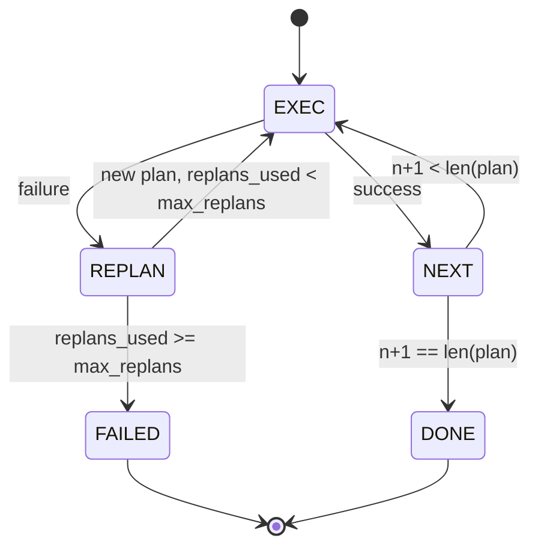

# Plan-Execute 控制流程 (Plan-Execute Control Flow)

> 撐不過失敗的計畫只是腳本。能重新規劃的腳本才是 agent。先把 replanner 做出來。

**Type:** Build
**Languages:** Python
**Prerequisites:** Phase 13 lessons 01-07, Phase 14 lesson 01
**Time:** ~90 分鐘

## 學習目標 (Learning Objectives)
- 把計畫表示成有序、有型別的步驟清單，讓 executor 能推理進度與結果。
- 依序執行步驟，並在失敗時受控地交還給 planner。
- 從目前的游標重新規劃，並把先前的錯誤放進 context，讓下一份計畫有所依據。
- 每次修訂都輸出計畫 diff，讓下游的 tracer 或 UI 能顯示計畫為何改變。
- 強制執行兩個預算：硬性的步驟上限與硬性的 replan 上限。

```figure
cg-plan-replan
```

## Plan 與 execute，不是 chain-of-thought (Plan and execute, not chain-of-thought)

Chain-of-thought 的 agent 輸出 token，讓迴圈去猜工具呼叫在哪裡結束。Plan-and-execute 的 agent 先輸出結構化的計畫，再確定性地執行每個步驟。計畫是 harness 可以檢視的資料。執行則是 harness 把那份資料送過 dispatcher。

兩個部件。產生計畫的 planner。執行計畫的 executor。有趣的工作，在於 executor 遇到失敗時發生什麼事。三個選項：

```text
1. Abort         (return failed, surface the error)
2. Skip          (mark step failed, continue with the rest)
3. Replan        (hand the error to the planner, get a new plan from the cursor)
```

Replan 是把腳本變成 agent 的那一個。

## Step 的形狀 (The Step shape)

```text
Step
  id              : int           (monotonic within a plan revision)
  tool_name       : str
  args            : dict
  expected_outcome: str           (planner's stated success condition)
  result          : Any | None
  error           : str | None
```

`expected_outcome` 是 planner 隨步驟一起輸出的短句。Executor 不強制執行它。它有兩個用途：replanner 在修訂計畫時會讀它；事件串流會輸出它，讓 tracer 能顯示「這一步本來應該做 X」。

## Planner 的形狀 (The planner shape)

```python
def planner(goal: str, history: list[Step], last_error: str | None) -> list[Step]:
    ...
```

純函式。`goal` 是使用者目標。`history` 是已經執行過的步驟 (填入結果與錯誤)。`last_error` 在第一次呼叫時是 None，之後每次呼叫都是最近一次的失敗訊息。Planner 回傳從游標開始的下一份計畫。

Planner 不知道 executor。不知道 retry。不知道 timeout。它只產生計畫，僅此而已。

## Executor (The executor)

Executor 是個小型的 state machine。每個步驟都經過 dispatcher。結果是三種之一：成功、可 replan 的失敗、致命的失敗。可 replan 的失敗交還給 planner。致命的失敗 (預算超出、replan 上限被觸及) 回傳 `FAILED` 的 session 結果。



## 修訂時的計畫 diff (Plan diffs on revision)

Planner 在失敗後回傳新計畫時，executor 會輸出一個帶有三個欄位的 `plan.diff` 事件。

```text
removed: list of step ids that were in the old plan and are not in the new
added  : list of step ids in the new plan that were not in the old
revised: list of step ids whose tool_name or args changed
```

Tracer 或 UI 可以把它呈現為被移除步驟的刪除線，以及新增步驟的醒目標示。重點不在 diff 格式，而在於修訂是看得見的事件，不是悄悄的改寫。

## 兩個預算，都是硬性的 (Two budgets, both hard)

`max_steps` 限制整個 session 的步驟執行總數，包括 replan。預設是十二。失敗的嘗試也算。一份五步驟的計畫在最後一步失敗，已經花掉五次執行。如果每次 replan 都重試那一步並加入三個新步驟，而第一次修訂的最後一步又失敗，計數就是九，第二次修訂還需要四次：十三。Executor 執行第十二次，拒絕第十三次，並回傳原因為 `step_budget` 的 FAILED。

`max_replans` 限制第一份計畫之後 planner 被呼叫的次數。預設是五。這是更重要的限制。連續五次回傳相同壞計畫的 planner，否則會一直循環到步驟預算攔住它為止。限制 replan 次數，讓失敗更快、原因更清楚。

## 這堂課中的確定性 planner (The deterministic planner in this lesson)

這堂課不呼叫模型。課程附帶一個確定性的 planner，依 `last_error` 挑選計畫。

```text
last_error is None    -> emit a four-step plan
last_error matches X  -> emit a three-step plan that routes around X
last_error matches Y  -> emit a two-step plan that gives up gracefully
otherwise             -> return [] (signals nothing to replan)
```

這足以測試 executor 在每一條轉移路徑上的行為：成功、replan 一次、replan 兩次、replan 耗盡，以及步驟預算耗盡。

## 結果的形狀 (Result shape)

```text
SessionResult
  status      : "completed" | "failed"
  reason      : str     ("goal_met" | "step_budget" | "replan_budget" | "no_plan")
  history     : list[Step]
  revisions   : list[PlanDiff]
  events      : list[Event]
```

第二十課的 harness 迴圈可以直接讀取它。第二十三課的 dispatcher 負責執行每個步驟。第二十一課的註冊表負責驗證每個步驟的參數。第二十二課的傳輸則會透過 JSON-RPC 把整個流程呈現給模型 client。

## 如何閱讀程式碼 (How to read the code)

`code/main.py` 定義了 `PlanExecuteAgent`、`Step`、`PlanDiff`、`SessionResult`，以及確定性的 planner。Executor 是單一的 `run(goal)` 方法，回傳 `SessionResult`。計畫 diff 是透過比較步驟 id 與 `(tool_name, args)` tuple 計算出來的。

`code/tests/test_agent.py` 涵蓋線性成功、中途失敗並 replan 一次、回傳 `failed:replan_budget` 的 replan 耗盡、步驟預算耗盡，以及計畫 diff 的事件格式。

## 延伸 (Going further)

把它接到真實模型之後，你會想要兩個擴充。第一，部分計畫快取：當計畫的六個步驟中前三個成功、之後失敗時，你不想重新執行前三個。Executor 已經保存歷史；planner 只需要讀取它。第二，平行分支：目前的 executor 嚴格是循序的。輸出獨立分支的 planner (用 `gather_step` 取代 `next_step`) 可以透過 dispatcher 並行執行兩個工具呼叫。

兩者都會增加真實的複雜度。兩者在線性 executor 固定下來之後，都更容易加入。這就是這堂課所做的事。
