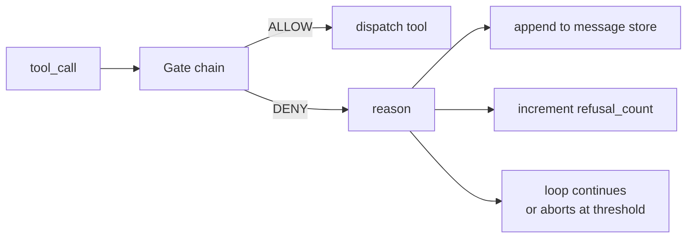
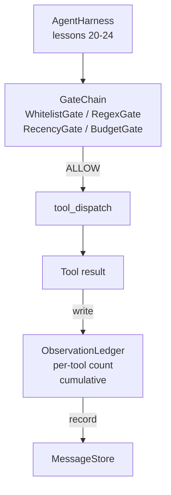

# Capstone 課程 25：驗證關卡與觀察預算 (Verification Gates and the Observation Budget)

> 沒有驗證層的 agent harness，只是穿著風衣的願望。這堂課建構確定性的關卡鏈，決定工具呼叫是否被允許觸發、agent 被允許看到多少輸出，以及何時因為 agent 讀得太多而必須停止迴圈。這條鏈是由小而有名稱的關卡，加上一本追蹤模型被展示過每一個 token 的觀察帳本所組成的函式。

**Type:** Build
**Languages:** Python (stdlib)
**Prerequisites:** Phase 19 · 20-24 (Track A1: agent loop, tool registry, message store, prompt builder, model router), Phase 14 · 33 (instructions as constraints), Phase 14 · 36 (scope contracts), Phase 14 · 38 (verification gates)
**Time:** ~90 分鐘

## 學習目標 (Learning Objectives)

- 建立帶有確定性 `evaluate(call)` 方法的 `VerificationGate` protocol。
- 將預算、時效、白名單與 regex 關卡組合成帶有短路語意的鏈。
- 透過以工具與回合為 key 的 `ObservationLedger` 追蹤每一次觀察。
- 當累計觀察預算會被超出時，拒絕該次工具呼叫。
- 輸出結構化的 `GateDecision` 記錄，供下游可觀測性系統匯入。

## 問題 (The Problem)

當 agent harness 讓模型自由呼叫工具時，實際使用的第一個小時內就會出現三類 bug。

第一類是無上限的觀察。對 200K 行 repo 做 grep，會把五十萬個 token 的輸出倒進下一回合。模型每 KB 只看到一個符合項，其餘的 context 都被浪費了。Token 帳單很大，而 agent 在這項任務上變得更差，而不是更好。

第二類是過時的時效。長時間執行的任務累積了五十次工具呼叫。模型把第三回合的第一次 read_file 當成即時狀態重新讀取。第四十七回合做的編輯永遠不會出現，因為 prompt builder 先序列化了最早的觀察。

第三類是權限蔓延。研究任務一開始呼叫 `web_search`，後來卻不知怎麼地執行了 `shell`，因為模型發明了一個工具名稱，而 harness 預設是寬鬆的。等到有人讀 trace 時，/tmp 裡已經躺著一個垃圾檔案，而且有一個 curl 打到了私有 API。

驗證關卡是 harness 中說「不」的元件。它不是模型。它不是評審。它是 `(call, history, ledger)` 的確定性函式，回傳 ALLOW 或附帶原因的 DENY。原因會被記錄。模型會被告知。迴圈繼續或中止。

## 核心概念 (The Concept)



關卡是任何具有 `evaluate(call, ctx) -> GateDecision` 方法的東西。鏈是有序的清單。評估在第一個 deny 時短路。順序很重要：便宜的結構性關卡先於昂貴的 token 計數關卡執行。

這堂課附帶四個關卡：

- `WhitelistGate`。允許的工具名稱是明確的集合。集合之外一律拒絕。這是最便宜的關卡，最先執行。
- `RegexGate`。工具參數與 regex 比對。適用於拒絕內含 `rm -rf` 的 shell 呼叫，或對內部 IP 的 HTTP 呼叫。對呼叫 payload 是純函式。
- `RecencyGate`。模型只看得到最近 N 回合的觀察。較舊的觀察會被遮蔽。如果工具呼叫的結果會延伸一個已經過期的觀察視窗，這個關卡會拒絕它。
- `BudgetGate`。模型在整個 session 中累計讀取的 token 有上限。當帳本顯示已達上限，之後每個工具呼叫都會被拒絕。

觀察帳本負責記帳。每次成功的工具呼叫寫入一列：工具名稱、回合、輸出的 token 數、累計值。帳本回答兩個問題：模型總共看過多少，以及它看過多少工具 X 的內容。預算關卡讀取前者。每個工具的預算關卡 (你會在練習中寫它) 則讀取後者。

```figure
cg-gate-chain
```

## 架構 (Architecture)



Harness 詢問這條鏈。鏈要嘛點頭，要嘛拒絕。如果點頭，工具就執行、帳本記一筆，結果被附加到訊息儲存。如果拒絕，模型會以 system message 的形式收到拒絕，由迴圈決定重試或中止。

## 你要建構的東西 (What you will build)

實作是單一的 `main.py` 加上測試。

1. `Observation` 和 `ToolCall` dataclass 定義線上形狀。
2. `ObservationLedger` 記錄 `(turn, tool, tokens)` 列，並回答 `cumulative()` 與 `per_tool(name)`。
3. `GateDecision` 攜帶 `(allow, reason, gate_name)`。
4. `VerificationGate` 是 protocol。每個關卡實作 `evaluate(call, ctx)`。
5. `GateChain` 包住有序清單。它依序呼叫每個關卡，回傳第一個 deny，或在每個關卡都通過時回傳 allow。
6. Demo 執行一個很小的合成 agent 迴圈。三回合。第三回合觸發預算關卡，迴圈回報一次乾淨的拒絕，且拒絕次數不為零。

Token 計數器刻意是個很笨的 `len(text) // 4` 啟發式。這堂課的重點是關卡的管線，不是 tokenizer。正式環境請換上真正的 tokenizer。

## 為什麼鏈的順序很重要 (Why the chain order matters)

Deny 比 allow 便宜。`WhitelistGate` 以 $O(1)$ 的雜湊查找執行。`RegexGate` 以 $O(\text{pattern} \cdot \text{argv})$ 執行。`RecencyGate` 讀取訊息儲存的一小段。`BudgetGate` 讀取整本帳本。你依成本遞增排序，讓被拒絕的呼叫在做昂貴的工作之前就短路。

你也依影響範圍排序。白名單是最強的主張：這個工具不在契約內。Regex 關卡其次：這個參數不在契約內。時效在之後：harness 仍然在意，但呼叫在結構上是合法的。預算放最後，因為依定義，它只在其他一切都通過時才會觸發。

## 這如何與 Track A 的其餘部分組合 (How this composes with the rest of Track A)

前面的課程給了你迴圈、工具註冊表、訊息儲存、prompt builder 與模型 router。這堂課在模型和工具之間加入一層。第 26 課提供 sandbox，在關卡鏈說 ALLOW 之後，dispatcher 會把工具呼叫交給它。第 27 課提供評測 harness，把拒絕次數記為品質訊號。第 28 課把關卡決定接到 OpenTelemetry span。第 29 課把全部縫成一個可運作的 coding agent。

## 執行它 (Running it)

```bash
cd phases/19-capstone-projects/25-verification-gates-observation-budget
python3 code/main.py
python3 -m pytest code/tests/ -v
```

Demo 會逐回合印出 trace，包含每一個關卡決定，並以零結束。測試涵蓋帳本、每個個別關卡、鏈的短路，以及合成迴圈的端到端行為。
