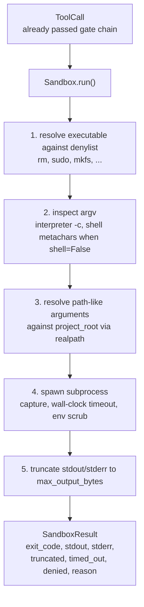
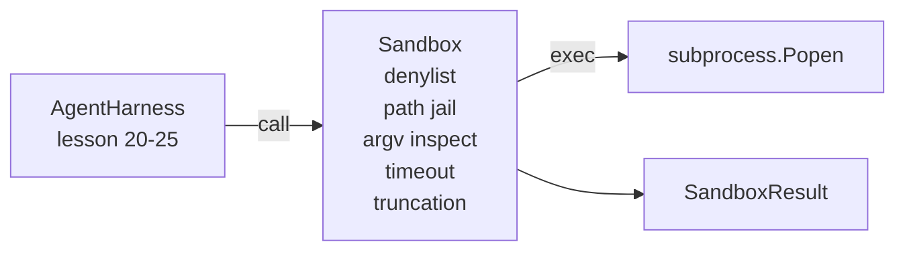

# Capstone 課程 26：具備 Denylist 與路徑監牢的 Sandbox Runner (Sandbox Runner with Denylist and Path Jail)

> 驗證關卡決定工具呼叫是否該執行。Sandbox 決定它執行時會發生什麼事。這堂課提供一個 subprocess runner：它拒絕危險的可執行檔、拒絕危險的 argv 形狀、把每個檔案路徑限制在專案根目錄內、截斷過大的輸出，並在牆鐘 timeout 時殺掉失控的行程。它是位於模型與作業系統之間的兩層防線中的第二層。

**Type:** Build
**Languages:** Python (stdlib)
**Prerequisites:** Phase 19 · 25 (verification gates and observation budget), Phase 14 · 33 (instructions as constraints), Phase 14 · 38 (verification gates)
**Time:** ~90 分鐘

## 學習目標 (Learning Objectives)

- 建立包住 `subprocess.run` 的 `Sandbox` 類別，具備 timeout、擷取與截斷功能。
- 依名稱對照 denylist 拒絕指令，並依結構以 argv 檢查器拒絕指令。
- 拒絕任何解析後落在已宣告專案根目錄之外的路徑參數。
- 在 shell 模式關閉時，拒絕 shell 特殊字元。
- 回傳結構化的 `SandboxResult`，供下游可觀測性與評測 harness 匯入。

## 問題 (The Problem)

能呼叫 shell 的 coding agent，可以在單一回合內植入後門、外洩金鑰、搞壞開發者的筆電，並累積一筆雲端帳單。成本最低的防禦是不給它 shell。成本第二低的是對一份精確的模式清單說「不」的 sandbox。

Agent trace 中反覆出現三類失敗。

第一類是危險的可執行檔。為了修路徑問題而承受壓力的模型，會嘗試 `sudo`、`chmod -R 777`、`rm -rf`、`mkfs`、`dd`。這些都不該出現在 agent 的執行中。Denylist 以名稱與別名攔下它們。

第二類是 argv 技巧。被告知不能用 shell 的模型，會透過直譯器夾帶攻擊：`python3 -c "import os; os.system('rm -rf /')"`、`bash -c '...'`、`node -e '...'`、`perl -e '...'`。Sandbox 需要知道，任何帶有類 `-c` 旗標的直譯器執行，不過是多繞幾步的 shell 呼叫。

第三類是路徑逃逸。模型被告知要讀 `./src/main.py`，卻讀了 `../../etc/passwd`。Sandbox 透過 `os.path.realpath` 解析每個路徑參數並斷言其前綴，把它們全部限制在監牢裡。

Sandbox 不是作業系統意義上的安全邊界。有決心、能執行程式碼的攻擊者仍然可以突破。Sandbox 是開發階段的護欄：它讓常見的失敗模式變得響亮，並阻止 agent 純粹因為笨拙而造成傷害。

## 核心概念 (The Concept)



Sandbox 有四個拒絕面向：名稱、argv、路徑、結構。每個面向都是呼叫的純函式，此時還沒有 subprocess。只有在每個面向都通過之後，subprocess 才會產生。

`SandboxResult` 的 exit code 採用慣例：0 表示成功，非零表示失敗，另外有三個 sentinel 值：denied (-100)、timed_out (-101)，以及 truncated (exit code 是真實的，另設旗標)。下游課程讀取這個結構化結果，而不是解析 stderr。

```figure
cg-path-jail
```

## 架構 (Architecture)



Denylist 是可執行檔 basename 的 frozenset。別名 (`/bin/rm`、`/usr/bin/rm`) 都解析成相同的 basename。Argv 檢查器認得直譯器的形狀：任何 argv[0] 是直譯器、且後面任何參數以 `-c` 或 `-e` 開頭的 argv 都會被拒絕。當呼叫沒有明確要求 shell 時，shell 特殊字元 (`;`、`|`、`&`、`>`、`<`、反引號、`$()`) 會導致拒絕。

路徑監牢是最微妙的部分。Sandbox 在建構時接受 `project_root`。任何看起來像路徑的參數 (含有 `/` 或符合既有檔案) 都會透過 `os.path.realpath` 正規化，然後與專案根目錄的 realpath 比對。如果解析後的目標不在根目錄之下，就拒絕。Symlink 逃逸嘗試 (專案根目錄中指向外部的 symlink) 透過檢查 realpath 而不是字面路徑來阻擋。

## 你要建構的東西 (What you will build)

實作是 `main.py` 加上一個 tests 目錄。

1. `SandboxResult` dataclass：exit_code、stdout、stderr、truncated、timed_out、denied、reason、duration_ms。
2. `SandboxConfig` dataclass：project_root、max_output_bytes、timeout_seconds、denylist、interpreter_block。
3. `Sandbox` 類別：`run(argv, *, shell=False, cwd=None)` 回傳 `SandboxResult`。
4. 內部拒絕輔助函式：`_check_executable_denylist`、`_check_argv_interpreter`、`_check_shell_metachars`、`_check_path_jail`。
5. 輸出截斷，帶有明確的 `truncated` 旗標，並在擷取的串流中加上標記行。
6. 底部的 demo：一連串合法與對抗式的呼叫。每一個都連同結果一起顯示。

Sandbox 預設使用 `shell=False` 的 `subprocess.run`，並設 `capture_output=True`。牆鐘 timeout 使用 `timeout` 引數；`TimeoutExpired` 發生時，sandbox 會殺掉行程群組並合成一個 SandboxResult。

## 為什麼這不是真正的 sandbox (Why this is not a real sandbox)

這堂課的 sandbox 不使用 namespace、cgroup、seccomp、gVisor、Firecracker 或任何核心層級的隔離。Subprocess 能做的一切，sandbox 也能做。保護是結構性的：agent 被拒絕最常見的危險呼叫，而響亮的拒絕會進入可觀測性，而不是悄悄執行。

對於正式環境的 agent，你要往上疊加：在無特權的 Docker container 中執行、在 microVM 中執行、丟棄 capability、以唯讀掛載專案根目錄並以可讀寫掛載暫存目錄、對記憶體與 CPU 設定 ulimit、把環境清理成已知安全的白名單。第 29 課做了其中一些。作業系統層級的隔離不在這堂課的範圍內。

## 執行它 (Running it)

```bash
cd phases/19-capstone-projects/26-sandbox-runner-denylist
python3 code/main.py
python3 -m pytest code/tests/ -v
```

Demo 建立一個暫存目錄，放入一個乾淨的檔案，然後執行一連串呼叫。合法的呼叫會成功。被拒絕的呼叫會回傳 `denied=True` 並附上原因的 SandboxResult。Timeout 回傳 `timed_out=True`。截斷會設定 `truncated=True`。Demo 印出結果的 JSON 表格並以零結束。

## 這如何與 Track A 的其餘部分組合 (How this composes with the rest of Track A)

第 25 課產生了關卡鏈。第 26 課是關卡 ALLOW 之後執行的 executor。第 27 課的評測 harness 會將 sandbox 結果與每個任務預期的 exit code 比對。第 28 課在每次 `Sandbox.run` 呼叫周圍輸出 `gen_ai.tool.execution` span。第 29 課的端到端 demo 讓真實的 coding agent 通過這兩層。
