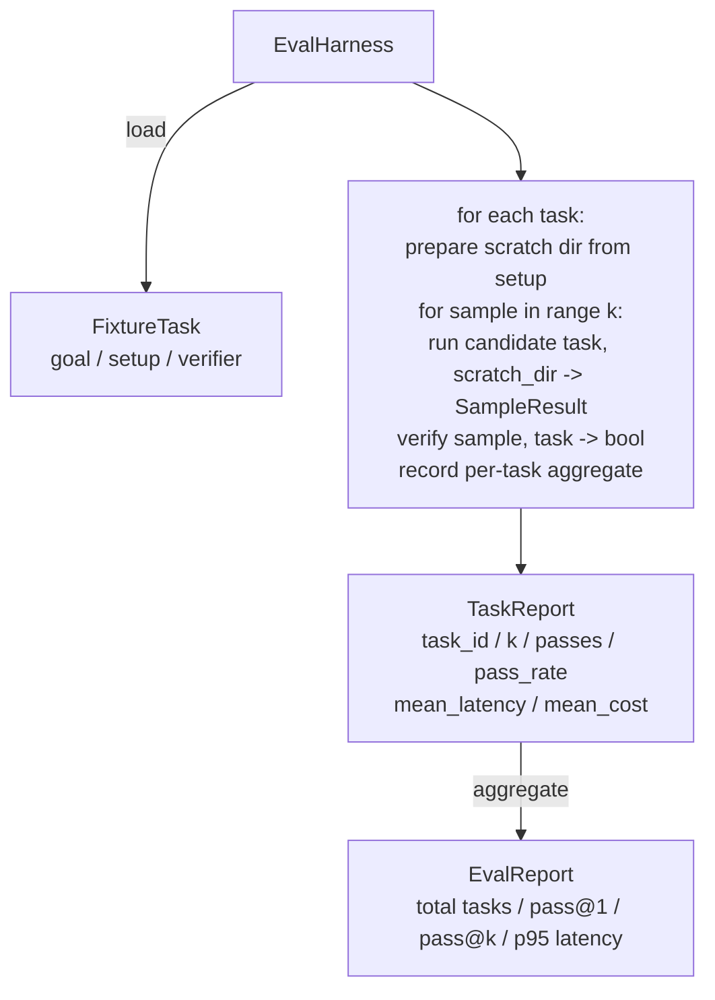

# Capstone 課程 27：具備 Fixture 任務的評測 Harness (Eval Harness with Fixture Tasks)

> Coding agent 的好壞，取決於你用來衡量它的任務套件。這堂課建構一個評測 harness：讀取一個 fixture 任務的資料夾、把每個任務送給候選 agent 執行、透過確定性的驗證器評為通過或失敗，並把結果彙整成 pass@1、pass@k、平均延遲與平均成本。Harness 是讓你分辨退步與重構的事實來源。

**Type:** Build
**Languages:** Python (stdlib)
**Prerequisites:** Phase 19 · 25 (verification gates), Phase 19 · 26 (sandbox runner), Phase 14 · 30 (eval-driven agent development), Phase 14 · 19 (SWE-bench and GAIA benchmarks)
**Time:** ~90 分鐘

## 學習目標 (Learning Objectives)

- 把 fixture 任務定義為 goal、setup 與 verifier 的三元組。
- 對每個任務的多次取樣執行評分，並計算 pass@1 與 pass@k。
- 把延遲與成本彙整成平均值與第 95 百分位指標。
- 把確定性的驗證器 (檔案 diff、exit code、regex 比對) 接成可重用的函式。
- 輸出結構化的 JSON 報告，供退步追蹤腳本匯入。

## 問題 (The Problem)

沒有評測 harness 的 agent benchmark，有三種失敗模式。

第一種是未經驗證的通過。Agent 說它修好了 bug，人類瞄了一眼 diff，套件被標為綠燈，三週後退步測試又浮出同一個 bug。Agent 的推理聽起來合理，其實什麼也沒修好。

第二種是未被偵測的退步。對 prompt 範本的一項改動，讓 agent 在吵的任務上好了 4%，在安靜的任務上卻差了 14%。沒有 goldset 與每個任務的分數，退步就這樣混進 main，直到客戶抱怨才浮現。

第三種是每個任務的漂移。評測在週一用 100 個任務跑，週五只跑了其中 95 個，因為有人改名了五個 fixture。通過率看起來像提升了 5%。其實不是。

Harness 就是把這些失敗變成事實的程式。它每次都以可重現的順序執行每個 fixture，並對照在確定性檢查上回傳 true 或 false 的驗證器。

## 核心概念 (The Concept)

```mermaid
flowchart LR
  F1[fixtures/task_001/<br/>task.json + expected/] --> Harness
  F2[fixtures/task_002/<br/>...] --> Harness
  Harness[Harness<br/>for each task:<br/>setup / run agent k samples /<br/>verify each sample /<br/>record latency, cost]
  Harness --> Report[EvalReport<br/>pass@1 / pass@k<br/>mean ms / p95 ms<br/>mean cost]
```

`FixtureTask` 是一個小的 JSON 檔，加上可選的 `expected/` 目錄。JSON 宣告 `id`、`goal` (餵給 agent 的 prompt)、`setup` 區塊 (要放進暫存目錄的檔案)，以及 `verifier` 區塊。Verifier 區塊指名 harness 驗證器註冊表中的一個函式，並提供它的參數。

三種驗證器形狀涵蓋了大多數有用的任務。

第一種是 `file_equals`。Agent 執行後，把指定檔案與預期內容比較。這能抓出「用這種確切方式修好這個 bug」的任務。

第二種是 `regex_match`。指定檔案的內容與 regex 比對。這能抓出「函式必須存在並回傳 X」這種有許多可接受解法的任務。

第三種是 `shell_exit_zero`。Harness 執行 shell 指令 (透過第 26 課的 sandbox)，只有指令以零結束時任務才通過。這能抓出「測試必須通過」的任務。

Harness 會把每個任務執行 `k` 次。Pass@k 是 `1 - (1 - p)^k`，其中 p 是經驗通過率；harness 也會回報原始計數，讓你能發現變異。這是 plug-in 估計：它把量測到的比率 p 當作真實比率使用。第 72 課使用不偏估計式 `1 - C(n - c, k) / C(n, k)`，其中 `n` 個樣本中有 `c` 個通過。Plug-in 估計偏低。在 `n = k` 個樣本時 (如同這個 harness)，不偏估計式在任何樣本通過時為 1，沒有任何通過時為 0，所以它只顯示是否有任何樣本通過。要發佈 pass@k 數字，請抽取 `n > k` 個樣本，並使用第 72 課的估計式。延遲是每個樣本的牆鐘時間。成本是 agent 自行回報的任何東西 (token 數、USD，或兩者)；harness 在各樣本間加總，並呈現每個任務與整體的數字。

```figure
pass-at-k
```

## 架構 (Architecture)



候選者是一個可呼叫物件：`Callable[[FixtureTask, str], SampleResult]`。Harness 透過 `tempfile.mkdtemp()` 建立暫存目錄，並將其路徑以純字串傳入。Harness 不在乎候選者如何運作。候選者可以是確定性的 patch 套用器 (適合 harness 自我測試)、真實的 LLM agent，或 fuzzer。契約就是 SampleResult。

## 你要建構的東西 (What you will build)

`main.py` 提供：

1. `FixtureTask` dataclass。
2. `SampleResult` dataclass：success_self_reported、latency_ms、cost_units、edits。
3. 帶有 `to_dict()` 的 `TaskReport`、`EvalReport` dataclass。
4. 把驗證器名稱對應到函式的 `VerifierRegistry`。內建驗證器：file_equals、regex_match、shell_exit_zero。
5. `EvalHarness` 類別。對候選者執行一個任務目錄。回傳 EvalReport。
6. 打包在 `tasks/` 中的五個 fixture 任務：
   - `fizzbuzz` 中的 off-by-one
   - `factorial` 中缺少的 return
   - 錯誤訊息中的拼字錯誤
   - 空的函式主體
   - 連結串列走訪中的 off-by-one
7. 確定性的參考候選者 (`apply_known_fixes`)，harness 用它來示範乾淨的 pass@1 為 1.0。
8. Demo 印出 EvalReport JSON 並以零結束。

Fixture 任務以 JSON 檔案打包在 `tasks/` 中，另外在 `tasks/<id>/buggy/` 與 `tasks/<id>/expected/` 放配對的原始檔。Harness 把 buggy 複製到暫存目錄、交給候選者，並對照 expected 驗證。

## 為什麼是 pass@k 而不只是 pass@1 (Why pass@k and not just pass@1)

真實的 LLM agent 是隨機的。Pass@1 為 0.6 看起來像失敗。Pass@5 為 0.95 則說明 agent 大多數時候能得到正確答案，只是在早期樣本中選錯了。修正方式是取樣與排序，不一定是更多訓練。Pass@k 讓這件事看得見。

Pass@k 與 pass@1 並列回報，是因為 pass@k 掩蓋了真實的失敗：如果模型二十次嘗試才有一次答對，你並沒有一個有用的 agent。Harness 兩者都顯示。

## 這如何與 Track A 的其餘部分組合 (How this composes with the rest of Track A)

第 25 課產生了關卡鏈。第 26 課產生了 sandbox。Harness 在任何 `shell_exit_zero` 驗證器中使用 sandbox。第 28 課把每次 harness 執行包進 OTel trace。第 29 課對其中一個打包的 fixture 執行端到端 demo，並斷言參考候選者的 pass@1 = 1.0。

## 執行它 (Running it)

```bash
cd phases/19-capstone-projects/27-eval-harness-fixture-tasks
python3 code/main.py
python3 -m pytest code/tests/ -v
```

Demo 以 JSON 印出 EvalReport，包含 pass@1、pass@5、平均延遲，以及每個任務的拆解。Exit code 為零。測試涵蓋驗證器函式、pass@k 的數學、fixture 載入，以及 harness 對打包的參考候選者的端到端行為。
