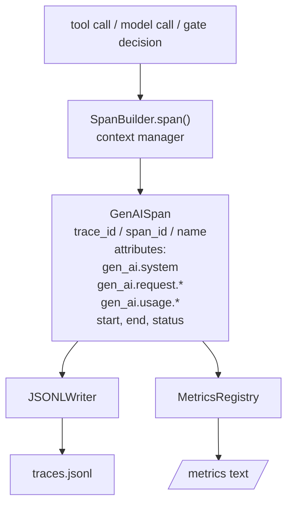
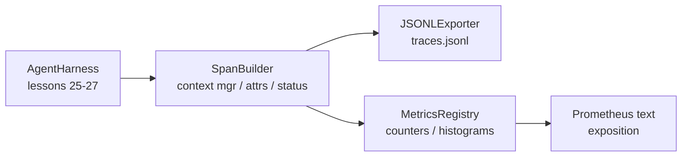

# Capstone 課程 28：以 OTel GenAI Span 與 Prometheus Metrics 實現可觀測性 (Observability with OTel GenAI Spans and Prometheus Metrics)

> 沒有可觀測性的 agent harness，是會燒錢的黑盒子。這堂課手工打造 span builder，輸出符合 OpenTelemetry GenAI semantic conventions 的記錄，一行一個 span 寫入 JSON-Lines 檔，並以 Prometheus 文字格式公開 counter 與 histogram。整個東西都是 stdlib Python，可以離線執行。

**Type:** Build
**Languages:** Python (stdlib)
**Prerequisites:** Phase 19 · 25 (verification gates), Phase 19 · 26 (sandbox), Phase 19 · 27 (eval harness), Phase 13 · 20 (OpenTelemetry GenAI), Phase 14 · 23 (OTel GenAI conventions)
**Time:** ~90 分鐘

## 學習目標 (Learning Objectives)

- 建立符合 OpenTelemetry GenAI semantic conventions 形狀的 span data class。
- 實作 JSONL exporter，一行寫入一個自足的 span。
- 建立帶 label 的 counter 與 histogram，並以 Prometheus 文字格式公開。
- 把任何可呼叫物件包進 span context manager，記錄持續時間、狀態與例外。
- 驗證輸出的 span 能透過 `json.loads` 來回轉換，且符合規格的形狀。

## 問題 (The Problem)

正式環境中的 coding agent，每回合產生三類產物：一次模型呼叫、一次工具執行，以及一次驗證關卡決定。沒有結構化的遙測，這些都沒用。

第一種失敗模式是遺失的 trace。週二出了問題，但唯一的記錄是一份 500 行的聊天日誌。沒有任何記錄顯示哪個工具執行過、花了多久、有多少 token 進入 prompt，或關卡是否拒絕過什麼。Agent 作者只能用猜的。

第二種失敗模式是無法解析的 trace。Harness 寫出了 span，卻用了自己臨時湊的欄位名稱。Grafana、Honeycomb、Jaeger 或本機 CLI 都讀不了。團隊堆疊中現有的工具全被浪費了，因為 span 不是標準格式。

第三種失敗模式是未彙總的指標。你可以在 trace 中看到一次緩慢的工具呼叫，卻無法回答「過去一小時 read_file 呼叫的 p95 延遲是多少？」，因為只有 trace，沒有指標。

OpenTelemetry GenAI semantic conventions 正是為此而存在。它們定義了一小組標準屬性，讓各個 LLM 框架的 span 輸出者共用。如果你的 harness 寫出這些屬性，任何相容 OTel 的後端都能讀取。

## 核心概念 (The Concept)



Harness 中的每個操作都產生一個 span。Span 有 trace id (整個 agent 呼叫)、span id (這個操作)、名稱 (例如 `gen_ai.chat`、`gen_ai.tool.execution`)、遵循 GenAI 慣例的屬性、開始與結束時間，以及狀態。

GenAI 慣例標準化了這些屬性 key：`gen_ai.system` (哪個提供者，例如 `anthropic`、`openai`)、`gen_ai.request.model` (模型 id)、`gen_ai.request.max_tokens`、`gen_ai.usage.input_tokens`、`gen_ai.usage.output_tokens`、`gen_ai.response.model`、`gen_ai.response.id`、`gen_ai.operation.name`，外加工具專用的 key `gen_ai.tool.name` 與 `gen_ai.tool.call.id`。

Exporter 寫出 JSONL。每行一個 JSON 物件。這是下游工具可以串流、grep 與匯入的最簡單格式。真實的 OTel exporter 會說 OTLP gRPC；這堂課的 JSONL exporter 是離線的對應版本，在每個工作站上都以零結束。

指標與 trace 並存。Counter 在每次工具呼叫時遞增：`tools_called_total{tool="read_file"}`。Histogram 記錄觀察到的延遲：`tool_latency_ms{tool="read_file"}`。兩者都序列化為 Prometheus 文字公開格式，這是以拉取為主的指標的事實標準。

```figure
trace-spans
```

## 架構 (Architecture)



Span builder 是一個小類別，帶有回傳 context manager 的 `span(name, attrs)` 方法。Context manager 在進入時記錄開始時間，在離開時記錄結束時間，若有例外則附上，並把定稿的 span 推給 exporter。

指標註冊表是兩個 dict。Counter 是 `{(name, frozen_labels): int}`。Histogram 把原始樣本保存在 list 中，並在公開時序列化成 Prometheus histogram bucket。

## 你要建構的東西 (What you will build)

`main.py` 提供：

1. `GenAISpan` dataclass：trace_id、span_id、parent_span_id、name、attributes、start_unix_nano、end_unix_nano、status、status_message、events。
2. 帶有 `span(name, attrs, parent=None)` context manager 的 `SpanBuilder` 類別。
3. 帶有附加一行的 `export(span)` 的 `JSONLExporter` 類別。
4. `Counter` 和 `Histogram` 類別，加上 `MetricsRegistry`。
5. 產生文字格式輸出的 `prometheus_exposition(registry)`。
6. 輸出 span 並更新指標的 `wrap_tool_call(name)` 裝飾器。
7. Demo：合成完整的 agent 呼叫 (工具 span 外面包著 gen_ai.chat span)、寫出 traces.jsonl、印出 Prometheus 公開輸出，並以零結束。

Trace id 是 16 位元組的值 (32 個十六進位字元)，span id 是 8 位元組的值 (16 個十六進位字元)，都截取自隨機的 `uuid4` hex。這符合 OTel 使用的 W3C Trace Context 大小。Exporter 絕不拋出例外；IO 錯誤會被呈現，但 harness 繼續執行。

Histogram 對以毫秒為單位的延遲使用固定的 bucket 集合：5、10、25、50、100、250、500、1000、2500、5000、10000、+Inf。這是 OTel SDK 預設邊界的精簡版，後者還包含 0、75、750 和 7500。樣本以 list 儲存；公開時依需求計算每個 bucket 的計數。

## 為什麼手工打造，而不用 opentelemetry-sdk (Why hand-rolled instead of opentelemetry-sdk)

OTel Python SDK 是真正的相依套件。它也有數千行程式碼、OTLP exporter 的背景匯出執行緒，以及會吃掉課程預算的執行期成本。手工打造的版本教的是線上格式。在正式環境中，你把相同的屬性接進真正的 SDK，就能免費得到 OTLP exporter、批次處理與資源偵測。

GenAI 慣例在規格中仍標示為 Development，且曾經改過屬性名稱：`gen_ai.usage.prompt_tokens` 變成了 `gen_ai.usage.input_tokens`。請固定你輸出的 semantic-conventions 版本，並在升級 SDK 時檢查它。

## 這如何與 Track A 的其餘部分組合 (How this composes with the rest of Track A)

第 25 課產生了關卡鏈。第 26 課產生了 sandbox。第 27 課產生了評測 harness。第 28 課讓這三者都可被觀測。第 29 課把端到端 demo 的每個步驟都包在 span 裡，並在結尾印出 Prometheus 文字。

## 執行它 (Running it)

```bash
cd phases/19-capstone-projects/28-observability-otel-traces
python3 code/main.py
python3 -m pytest code/tests/ -v
```

Demo 會在課程的工作目錄中輸出 `traces.jsonl` (最後會清理掉)，然後印出三個 span 的樣本，再印出 counter 與 histogram 的 Prometheus 公開輸出。測試驗證 span 能來回序列化、標準的 GenAI 屬性都存在、counter 正確遞增，以及 histogram 公開輸出包含預期的 bucket 計數。
