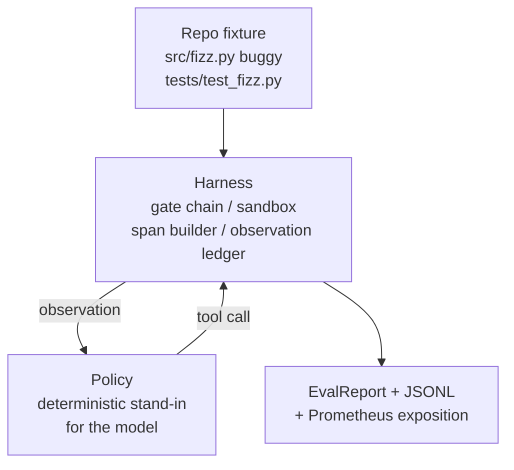
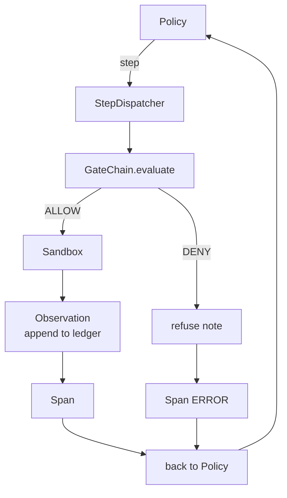

# Capstone 課程 29：在 Harness 上運行的端到端 Coding Agent (End-to-End Coding Agent on the Harness)

> Track A 的回報。這堂課把關卡鏈、sandbox、評測 harness 和 OTel span 縫成一個可運作的 coding agent，修復多檔案 Python 專案中一個真實 (小型、fixture 規模) 的 bug。這個 agent 是確定性的策略，不是 LLM；這樣替換讓課程可重現，也顯示出從頭到尾有趣的部分都是 harness。契約完全相同：真實的模型會接在策略這條接縫上。

**Type:** Build
**Languages:** Python (stdlib)
**Prerequisites:** Phase 19 · 25 (verification gates), Phase 19 · 26 (sandbox), Phase 19 · 27 (eval harness), Phase 19 · 28 (observability), Phase 14 · 38 (verification gates), Phase 14 · 41 (workbench for real repos), Phase 14 · 42 (agent workbench capstone)
**Time:** ~90 分鐘

## 學習目標 (Learning Objectives)

- 把關卡鏈、sandbox、評測 harness 和 span builder 組合成單一 agent 迴圈。
- 實作使用 read_file、run_tests 和 write_file 來修復 fixture bug 的確定性策略。
- 在端到端執行中強制執行全域步驟預算，加上觀察 token 預算。
- 為整次執行輸出完整的 OTel GenAI trace 與 Prometheus 指標。
- 驗證 agent 在少於 12 步內解決 fixture，且對合法工具零次觸發關卡。

## 問題 (The Problem)

大多數 agent demo 都是孤立運作的：單獨的 sandbox、單獨的評測 harness、單獨的 span 輸出器。它們看起來都沒問題。把它們組合起來，接縫就顯現了。

關卡鏈說 ALLOW，但 sandbox 因為鏈沒預料到的原因拒絕了。評測 harness 記錄為通過，但 OTel span 卻顯示關卡拒絕了 agent 聲稱用過的工具。Prometheus counter 該加一次卻加了兩次。觀察預算超出了，但 agent 還繼續跑，因為預算是在鏈中追蹤的，而 sandbox 不知道。

這堂課是整個 track 的整合測試。Agent 必須依序做六件事：讀專案、執行測試、從測試失敗找出 bug、寫出修正、重跑測試，然後停止。每個操作都經過關卡鏈。每次工具執行都經過 sandbox。每個步驟都包在 span 裡。評測 harness 在最後為整件事評分。

## 核心概念 (The Concept)



Agent 的策略是 state machine。五個狀態。

`SURVEY`：agent 讀取專案清單。下一個狀態是 RUN_TESTS。

`RUN_TESTS`：agent 執行測試指令。如果測試通過，state machine 以成功停止。否則下一個狀態是 INSPECT。

`INSPECT`：agent 讀取失敗的原始檔。下一個狀態是 FIX。

`FIX`：agent 寫出修正後的檔案。下一個狀態是 VERIFY。

`VERIFY`：agent 再次執行測試指令。如果測試通過，以成功停止。否則以失敗停止。

每個狀態對應一次工具呼叫。每次工具呼叫都經過關卡鏈。如果工具呼叫被拒絕，agent 會在 trace 中回報拒絕並停止。

Fixture 的 bug 是 `fizz.py` 中的 off-by-one。確定性策略透過 regex 從測試失敗訊息偵測 bug，並輸出修正後的檔案。把策略換成 LLM 並不會改變 harness 的契約。

```figure
cg-harness-weave
```

## 架構 (Architecture)



這堂課是自足的。前面課程的每個原語都在 `main.py` 中以最小規模重新實作 (gate、sandbox、ledger、span)，讓課程不必匯入同層模組就能執行。名稱與第 25-28 課完全一致，所以概念對應沒有歧義。

## 你要建構的東西 (What you will build)

`main.py` 提供：

1. 最小的 harness 原語，名稱與第 25-28 課相同：`GateChain`、`Sandbox`、`ObservationLedger`、`SpanBuilder`、`MetricsRegistry`。
2. `CodingAgentPolicy` 類別：五個狀態的 state machine。
3. `Repo` 輔助類別：以打包的有 bug fixture 準備暫存目錄。
4. `AgentRun` 類別：驅動策略、透過 harness 派送，並回傳 `AgentRunReport`。
5. 打包的 fixture (`fixture_repo/`)，包含 src/fizz.py、tests/test_fizz.py，以及供評測 harness 使用的 expected/ 樹。
6. Demo：端到端執行策略、印出逐步 trace、斷言通過、印出指標。

打包的 fixture 與第 27 課的任務結構形狀相同：一個有 bug 的檔案與一個測試檔。測試失敗訊息包含足夠的資訊，讓確定性策略找出修正。真實的 LLM 會做同樣的工作，較慢但涵蓋面更廣，但它不會改變 harness 的期望。

## 為什麼策略不是 LLM (Why the policy is not an LLM)

真實的 LLM 需要 API key、網路呼叫，以及無法驗證的隨機性。課程在意的是 harness 這部分。替換成確定性策略，讓課程能在任何開發者筆電上以零外部相依套件執行，也讓測試套件能斷言確切的步驟數。

課程的策略是 LLM agent 行為的嚴格子集。策略讀取 repo、看到失敗的測試、找出那一行，並輸出修正。LLM 以相同的 harness 契約走過相同的迴圈；記帳方式完全相同。

## Demo 斷言的內容 (What the demo asserts)

端到端 demo 在結束時斷言五件事，測試套件則以程式方式重新斷言。

策略在少於 12 步內解決 fixture。

觀察預算從未被超出。

對合法工具沒有觸發任何關卡拒絕。(Agent 從未發明被拒絕的工具名稱。)

每個步驟在 traces.jsonl 中都有對應的 span。

Prometheus 公開輸出包含 `tools_called_total{tool="read_file"}` 項目與 `tool_latency_ms` histogram。

## 這如何與 Track A 的其餘部分組合 (How this composes with the rest of Track A)

這堂課是整合。第 25 課寫了關卡鏈。第 26 課寫了 sandbox。第 27 課寫了評測 harness。第 28 課寫了可觀測性。第 29 課證明它們能作為一個系統運作。真實的 agent harness 從這裡延伸：把確定性策略換成模型，把打包的 fixture 換成真實 repo 的任務，把 JSONL exporter 換成 OTLP。

## 執行它 (Running it)

```bash
cd phases/19-capstone-projects/29-end-to-end-coding-task-demo
python3 code/main.py
python3 -m pytest code/tests/ -v
```

Demo 印出逐步 trace、最終的評測報告，以及 Prometheus 公開輸出。Exit code 為零。測試涵蓋策略的狀態轉移、對合成工具呼叫的關卡拒絕、對打包 fixture 的端到端執行，以及步驟預算的不變條件。
