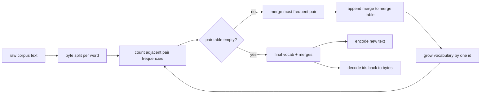
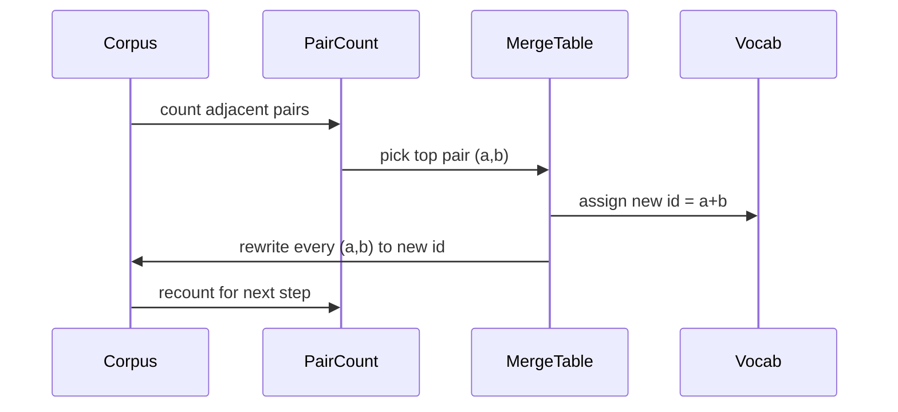

# 從零打造 BPE Tokenizer (BPE Tokenizer From Scratch)

> 位元組進，id 出，id 再變回相同的位元組。打造每個現代文字模型仍然從它出發的 tokenizer。

**Type:** Build
**Languages:** Python
**Prerequisites:** Phase 04 lessons, Phase 07 transformer lessons
**Time:** ~90 分鐘

## 學習目標 (Learning Objectives)
- 從原始文字語料訓練 Byte-Pair Encoding 詞彙表，方法是反覆合併最常出現的相鄰符號對。
- 實作確定性的合併表，並把它套用到新文字，產生 subword id 的串流。
- 把任意 UTF-8 輸入來回轉換為 id 並還原，且不遺失資訊。
- 保留並保護特殊 token (`<|endoftext|>`、`<|pad|>`)，讓它們在訓練與解碼中保持完整。
- 推理為什麼位元組層級的字母表，是通用 tokenizer 的正確下限。

```figure
cap-bpe-merge
```

## 框架 (The frame)

語言模型從不看見文字。它看見的是整數。從字串到整數清單再回來的對應，就是 tokenizer。這一層做錯，訓練中的每條 loss 曲線都在衡量錯誤的東西。

通用文字模型中主流的 subword tokenizer 家族是 Byte-Pair Encoding。想法很小。從已知的字母表出發。找出訓練語料中最常出現的相鄰符號對。把它合併成新符號。重複，直到詞彙表達到目標大小。對新文字編碼時，以相同順序重用同一份合併清單。

我們要建構位元組層級的變體。字母表是 256 個原始位元組，而不是 Unicode code point。這個選擇讓 tokenizer 能處理任何 UTF-8 輸入，而不必退回到未知 token。

## 管線 (The pipeline)



訓練端與推論端共用合併表。這份共用就是契約。如果你在推論時改變合併順序，解碼出來的就是不同的 id 串流。

## 位元組字母表 (The byte alphabet)

前 256 個 id 保留給原始位元組 0x00 到 0xFF。這保證在任何合併發生之前，每個輸入字串都能用詞彙表表示。位元組區塊之後，我們為特殊 token 保留一小段範圍。訓練迴圈從不把這些 id 提議為合併目標，因為我們讓它們完全不在預先 token 化的串流中。

Pretokenizer 在訓練看到語料之前，先依空白和標點邊界切分。沒有這個切分，BPE 合併步驟會很樂意學到跨越單字邊界的合併，詞彙表就會被整個常見片語塞滿。有了切分，合併就留在單字之內，結果更能泛化。

## 訓練迴圈 (The training loop)

每個訓練步驟，迴圈做三件事。它走訪語料中的每個單字，計算每個目前符號的相鄰符號對出現幾次，並以該單字本身出現的次數加權。它挑出計數最高的符號對。它把該符號對的每次出現改寫成單一個新符號，其 id 是詞彙表中下一個空位。然後它記錄這次合併。



每一步的成本，與語料表示為符號序列清單的大小成線性。對於一百萬個單字和一萬個 id 的目標詞彙表，迴圈在幾秒內就能跑完，因為符號序列會隨著合併落地而縮短。

## 對新文字編碼 (Encoding fresh text)

推論不會呼叫合併計數器。它以學到的相同順序套用合併表。對於新單字，編碼器從位元組切分開始。它掃描目前序列，找出排名最低 (最早適用) 的合併。它執行該合併。再掃描一次。當表中沒有任何合併適用於目前序列時，迴圈結束。

依排名排序，是讓編碼具確定性、並與訓練對相同輸入的行為一致的特性。最先學到的合併位在表的頂端，也最先被套用。如果兩個合併可以套用在同一個位置，排名較低的勝出。

## 特殊 token (Special tokens)

特殊 token 是位元組串流永遠無法產生的 id。我們手動保留它們。這堂課有兩個就夠了。

- `<|endoftext|>` 在預訓練時分隔文件。它告訴模型「新文件從這裡開始，不要讓前一份的 context 洩漏進來。」
- `<|pad|>` 補足較短的序列，讓一個 batch 可以是矩形 tensor。Loss mask 在訓練時會把它藏起來。

編碼器接受一個旗標，用來允許輸入中的特殊 token。旗標關閉時，字串 `<|endoftext|>` 和 `<|pad|>` 會被當作拼出它們的位元組來 token 化。旗標開啟時，字面字串會被對應到它們保留的 id，且不受任何合併影響。

## 來回轉換的保證 (Round-trip guarantee)

編碼再解碼，必須完全回傳輸入的位元組。解碼器依序串接每個 id 的位元組展開。因為每個 id 要嘛是原始位元組，要嘛是兩個先前已知 id 的串接，遞迴展開總是會終止在原始位元組。解碼接著回傳這些位元組所拼出的 UTF-8 字串。

這堂課的測試套件在未見過的句子、含有 Unicode emoji 的句子，以及含有字面 `<|endoftext|>` token 的句子上檢查這個特性。

## 這堂課沒有做的事 (What this lesson does not do)

它沒有建構最大型正式 tokenizer 風格的 regex 驅動 pretokenizer。這裡的 pretokenizer 是個小型的空白與標點切分。這足以在小型訓練語料上產生合理的合併，且與課程鏈其餘部分的契約維持不變。下一課把 tokenizer 當作黑盒，並在它之上建構滑動視窗資料集。

它沒有平行化符號對計數器。在幾千個單字的語料上，Python 迴圈遠不到一秒就能跑完。對於更大的語料，明顯的做法是平行地逐單字計算符號對，然後再 reduce。

## 如何閱讀程式碼 (How to read the code)

`main.py` 定義四個物件。`BPETokenizer` 持有詞彙表、合併表和特殊 token 表。`train` 是訓練迴圈。`encode` 是推論路徑。`decode` 是位元組串接。底部的 demo 在內建語料上訓練一個小型 tokenizer、編碼一個 held-out 句子、把 id 解碼回來，並印出兩者。`code/tests/test_bpe.py` 中的測試固定了來回轉換的特性、特殊 token 的保留，以及合併順序。

執行 demo。然後把 demo 中的目標詞彙表大小從 300 改成 600，觀察 held-out 句子的編碼長度如何下降。那條曲線就是 BPE 壓縮曲線。
