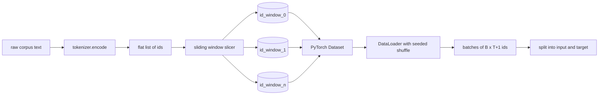
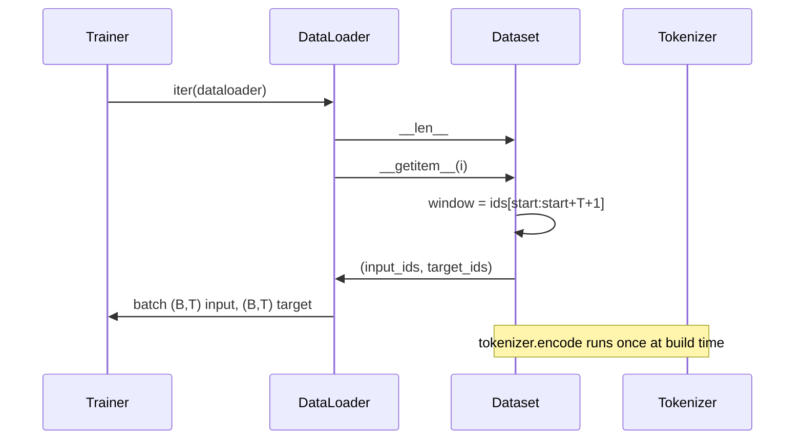

# 帶滑動視窗的 Token 化資料集 (Tokenized Dataset with Sliding Window)

> 預訓練執行是從 token id 到梯度的函式。這堂課打造把 id 送進去的輸送帶。

**Type:** Build
**Languages:** Python
**Prerequisites:** Phase 04 lessons, Phase 07 transformer lessons, Lesson 30 of this phase
**Time:** ~90 分鐘

## 學習目標 (Learning Objectives)
- 呼叫一次 tokenizer，把原始語料轉換成 token id 的串流。
- 以可設定的重疊 stride，把 id 串流切成固定長度的視窗。
- 建立回傳 next-token prediction 所需輸入與目標 tensor 的 PyTorch Dataset。
- 把 dataset 包進 DataLoader，使用每個 epoch 以 seed 決定的確定性 shuffle。
- 推理 stride、冗餘與有效資料集大小之間的取捨。

```figure
cap-sliding-window
```

## 框架 (The frame)

預訓練執行每次讀取一個 batch 的 token id 並更新模型。每個 batch 的形狀由訓練契約固定。對 causal language model 而言，batch 包含 `(B, T)` 的輸入 id 與 `(B, T)` 的目標 id，其中目標是輸入左移一位。資料管線的工作，是從可能有數 GB 原始文字的語料，以確定且可重現的方式，按需產生那份契約。

這堂課建構那條管線。前一課的 tokenizer 把文字變成一長串扁平的 id 清單。滑動視窗把那份清單切成訓練範例。自訂 Dataset 把範例公開為 tensor。DataLoader 把它們組成 batch，並以已知的 seed 做 shuffle。

## 形狀契約 (The shape contract)

Causal LM 消耗形狀為 `(B, T)` 的 id，其中 `B` 是 batch 大小，`T` 是 context 長度。位置 `t` 的目標是位置 `t+1` 的輸入。這代表每個訓練範例涵蓋 `T+1` 個原始 id。視窗 stride 控制連續範例之間的重疊量。



切片器從不與語料的邊界重疊。如果最後一個視窗的 id 不足以填滿 `T+1` 個位置，切片器會丟棄它。用 `<|pad|>` 補足尾端也是有效的選擇，但會讓 loss mask 變複雜。這堂課我們選擇丟棄。

## 為什麼要用滑動視窗 (Why a sliding window)

預訓練語料是一長串 id。如果模型只看見不重疊的視窗，每個訓練範例都會教它相同的 `T` 邊界。調整 stride 會移動這些邊界，讓模型看到更多樣的 predict-next-token 任務。

Stride 為 `T` 時產生不重疊的視窗。Stride 為 `T // 2` 時產生五成的重疊，並讓有效資料集加倍。Stride 為 `1` 時產生最大重疊，並讓資料集增加 `T` 倍。代價是每個 epoch 要更多運算。好處是邊界更多樣。大多數預訓練執行使用等於 context 長度的 stride，因為語料已經遠大於模型一個 epoch 能完成的量，邊界多樣性的論點因此較弱。

## Dataset 類別 (The Dataset class)

PyTorch Dataset 有兩個必要方法。`__len__` 回傳範例數量。`__getitem__` 以一對 tensor 回傳一個範例。我們的 Dataset 儲存編碼後的 id 串流與 stride。對它做索引時，會即時計算視窗的起點，所以無論 stride 產生多少範例，記憶體成本都是 id 串流的一份拷貝。



位移一位的動作發生在 `__getitem__` 內部。Dataset 回傳 `(input, target)`，其中 `input = window[:-1]`，`target = window[1:]`。兩者都是 PyTorch long tensor。訓練迴圈把它們視為真實基準。

## 確定性的 shuffle (Deterministic shuffle)

`shuffle=True` 的 DataLoader 從 PyTorch 隨機產生器讀取。透過傳入每個 epoch 以 seed 初始化的明確 `torch.Generator`，每次重新啟動執行時，我們都會得到相同的 shuffle。當你想比較只差一個超參數的兩次執行時，這個特性很重要。沒有 seed 的話，兩次執行以不同順序看到資料，loss 曲線會因為與該變更無關的原因而分歧。

這堂課的 seed 契約很簡單。`epoch_seed = base_seed + epoch_index`。基底 seed 在建構時傳入。Epoch 索引由 trainer 在每個 epoch 開頭遞增。以相同基底 seed 重新執行，在每個 epoch 都會看到相同的順序。

## Batch sampler (Batch sampler)

PyTorch 的預設 sampler 以均勻隨機方式挑選索引，且停用放回抽樣。這正是預訓練所需。對小型資料集做 finetuning，契約也相同。DataLoader 透過呼叫 `__getitem__` `B` 次並堆疊結果來組成 batch。因為每個範例依建構都是相同長度，不需要 padding 邏輯。

為了簡單，這堂課保持 `num_workers=0`。在正式執行中，worker 會平行化 `__getitem__` 呼叫。對我們的管線來說，這大多沒有作用，因為工作只是對記憶體內 tensor 的切片，但相同的 Dataset API 能乾淨地支援 worker。

## 計算範例數 (Counting examples)

對長度為 `N` 的 id 串流、context 長度 `T` 與 stride `S`，範例數量為 `max(0, 1 + (N - (T + 1)) // S)`。這堂課把這個計算公開為 Dataset 的靜態方法，讓 trainer 不必迭代就能計算每個 epoch 的總步數。

## 這堂課沒有做的事 (What this lesson does not do)

它不從磁碟串流。語料完整地在記憶體中編碼，並以單一 tensor 保存。對於幾百萬個 id 的語料，這遠低於一百 MB，是這堂課的正確形狀。磁碟串流是另一個獨立的問題，可以透過替換儲存層接上來，同時維持 Dataset 契約。

它不處理多份文件。語料被當作一條連續的 id 串流。下一份文件的邊界，是在由多份文件建構語料時插入 `<|endoftext|>` id 來編碼的。模型學會在邊界附近做預測。

## 如何閱讀程式碼 (How to read the code)

`main.py` 定義兩個類別和一個輔助函式。`SlidingWindowDataset` 是 PyTorch Dataset。`make_dataloader` 回傳設定好、帶 seed 產生器的 DataLoader。`_encode_corpus_to_ids` 是一次性的 tokenizer 呼叫。底部的 demo 在行程內建立小型 tokenizer、編碼內建語料、建構 dataset 與 dataloader、印出一個 batch，並斷言形狀契約。`code/tests/test_dataset.py` 中的測試固定了視窗數量公式、位移一位的特性、確定性 shuffle，以及 stride 的取捨。

執行 demo。然後把 context 長度從 16 改成 32，觀察每個 epoch 的範例數如何下降。那個數字就是你每個 epoch 的步數預算。
